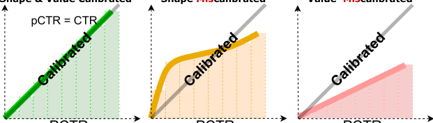
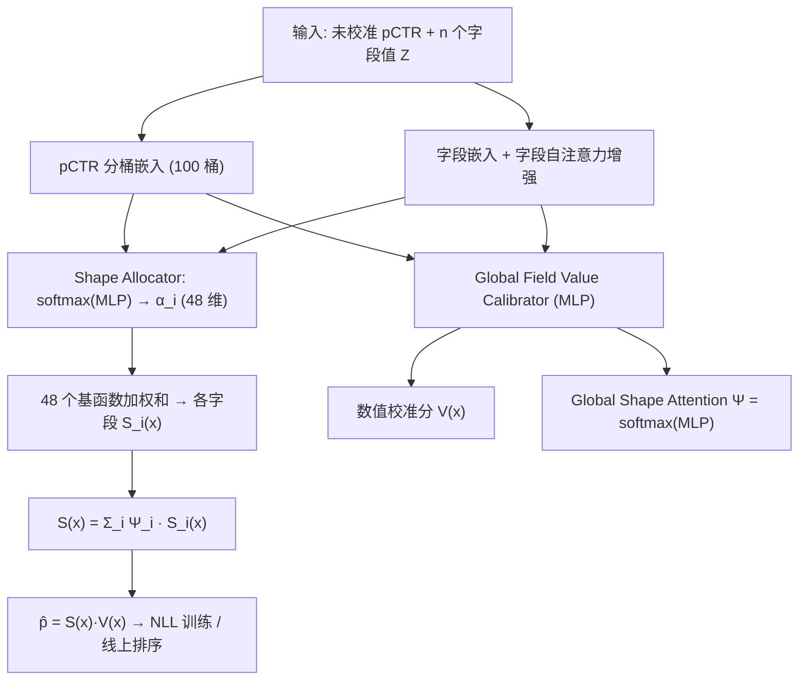
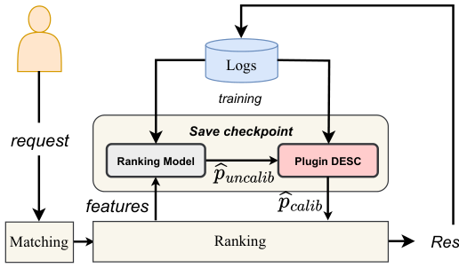

# Deep Ensemble Shape Calibration: Multi-Field Post-hoc Calibration in Online Advertising (深度集成形状校准：在线广告中的多字段后置校准)

- **会议/期刊**: KDD 2024
- **作者与机构**: Shuai Yang, Hao Yang, Zhuang Zou, Linhe Xu, Shuo Yuan, Yifan Zeng（Shopee Discovery Ads）
- **推荐链路定位**: 精排后置校准（在线推理阶段的 pCTR/pCVR 插件）
- **研究方向**: CTR/CVR 预估与特征交叉 / 去偏公平与工业架构
- **论文原文**: [https://arxiv.org/abs/2401.09507v2](https://arxiv.org/abs/2401.09507v2)
- **开源代码**: [https://github.com/HaoYang0123/DESC](https://github.com/HaoYang0123/DESC)

## TL;DR (1分钟核心速览)

电商广告要求 pCTR/pCVR 在**每个字段（类目、年龄、itemID）上都校准**，但现有方法或只做单字段、或因分箱造成"样本隔离"，在稀疏字段值上训练不动。DESC 把多字段校准拆成**形状校准 $S(x)$× 数值校准$V(x)$**：用 48 个单调基函数的注意力加权和免分箱逼近任意误差曲线，再用全局形状注意力调和字段冲突。在 Criteo/AliCCP/Shopee 三套数据上 MF-RCE 全面最优（工业数据 −12.5%），线上 A/B 相对 SIR 取得 CVR +2.5%、GMV +4.0%，推理仅增 2ms。

## Background & Motivation (背景与核心矛盾)

- **主流范式**: 后置校准在独立验证集上训练 $f_{calib}$，线上用它修正$f_{uncalib}(x)$ 的原始打分；分参数法（Platt/Temperature/Beta）、非参数法（HB/IR）与混合法（SIR/ETS 非字段感知，FAC/Ada/MBCT 字段感知）三条路线。
- **前人局限**: ①FAC 只建模字段值的**整体高估/低估**，Ada 只能单字段同时做形状+数值，MBCT 依赖树分裂，均无法在多字段上同时满足两类校准；②分箱类方法使一个 bin 的参数只被本 bin 及相邻 bin 样本更新，稀疏字段值（itemID 500 万取值）几乎学不到东西。
- **核心洞察 (Key Insight)**: 校准误差可正交分解为 **value miscalibration（某字段值上均值偏移）** 与 **shape miscalibration（pCTR 各区间内比值曲线弯曲）**；而任意复杂形状都可由少量单调、端点固定的简单基函数线性组合逼近（图 1、图 5）。
- **本文切入点**: 放弃分箱，改用"预定义基函数 + 字段感知注意力分配 + 多字段全局融合"，让**全部样本参与每个基函数的训练**。

<figure class="paper-figure" markdown="span">
  <figcaption>图1：展示形状误校准与数值误校准的示例</figcaption>
</figure>

## Method (核心方法设计)

### 1. 整体框架 (Overall Architecture)

输入为未校准分 $\hat{p}_{uncalib}$与$n$个字段值$Z$。**Shape Calibrator** 先把 pCTR 分 100 桶得到桶嵌入、把各字段值嵌入并经字段间自注意力增强，再由 MLP+softmax 为每个字段分配 48 个基函数的权重$\alpha_i$，加权求和得该字段形状分$S_i(x)$；**Value Calibrator** 用全字段拼接 MLP 输出整体数值分$V(x)$，并复用其隐层生成全局形状注意力$\Psi$融合各字段形状分。最终$\hat{p}_{calib}=S(x)\cdot V(x)$，以 NLL 端到端训练，线上作为排序模型插件部署。

### 2. 关键设计拆解 (Key Designs)

1. **基函数形状校准器 (Basis Calibration Functions，免分箱)**：分箱把样本切成互不通信的孤岛 $\to$预定义三类满足$B(0^+)=0,\ B(1^-)=1$且单调连续的基函数：幂函数$B^{power}_i(t;h)=t^{h}$、对数函数$B^{log}_i(t;v)=\log(1+vt)/\log(1+v)$、缩放函数$B^{scaling}_i(t;a)=\sigma(\sigma^{-1}(t)\cdot a)$，参数用等距浮点数初始化并可训练$\to$单字段形状分为$S_i(x)=\sum_{j=1}^{m}\alpha_{ji}B_j(t)$，$m=48$（三类各 16）$\to$ 直觉：每个基函数都被**全量样本**监督，稀疏字段值也能借共享基函数"搭便车"，同时用组合表达力换掉分箱的分段线性约束。

2. **形状分配器与稀疏字段嵌入增强 (Shape Allocation + Embedding Augment)**：不同字段值误差形状差异极大（图 3），必须按上下文选基函数 $\to$把 pCTR 桶嵌入与字段嵌入送 MLP+softmax 得$\alpha_i$；对稀疏字段再引入字段间自注意力$\mathrm{X}(e_i)=\sum_{j\neq i}\mathrm{softmax}(e_i e_j^{\top}/\sqrt{d})\,e_j$，并以$\alpha_i=\mathrm{softmax}(\mathrm{MLP}(b_{\hat{p}},e_i,\mathrm{X}(e_i)))$分配$\to$ 直觉：误差分布相似的字段（如类目与价格带）语义近邻，可互相借统计强度，缓解 ID 类字段样本稀缺。

3. **多字段形状集成、训练目标与推理**: 各字段校准方向可能冲突（类目上高估 30%、年龄上低估 20%）$\to$用 Value Calibrator 隐层生成$\Psi=\mathrm{softmax}(\mathrm{MLP}_3(hidden))$，令$S(x)=\sum_{i=1}^{n}\Psi_i S_i(x)$，$\Psi$由全字段信息决定而非平均池化$\to$总损失为校准后 NLL：$\mathcal{L}=-\frac{1}{|\mathcal{D}|}\sum\big[y\log\hat{p}_{calib}+(1-y)\log(1-\hat{p}_{calib})\big]$；**无负采样**（全量曝光日志），校准器在独立验证集训练、测试集评估，线上以插件形式接入排序模型，单请求额外开销约 2ms。

## Experimental Setup & Evaluation Protocol (实验设置与评估协议)

- **数据集与预处理**:

| 数据集 | 样本量 | 字段数 $n$ | 划分 (Train/Dev/Test) | 任务/说明 |
| :--- | :---: | :---: | :---: | :--- |
| Criteo | 46M | 26 | 28M / 9M / 9M | CTR，公开 Display Ad Challenge |
| AliCCP | 80M | 23 | 2:1:1 比例划分 | CTR，阿里点击-转化日志 |
| Shopee 工业 | 100M | 10 | 60M / 20M / 20M | CVR，含 itemID(500万)、categoryID(5000) |

- **数据划分与防穿越**: 均为**按比例（或按时间先后）切分**的三段式，未采用 Leave-One-Out；校准器严格只在 $D_{dev}$上拟合、$D_{test}$上评估，原始打分由 DeepFM 在$D_{train}$ 训练后冻结输出。
- **排名评测协议**: 本文任务为**概率校准**，不涉及全库 Full-Ranking 或负采样排序；指标为 F-RCE、F-ECE@3 及跨字段平均的 MF-RCE / MF-ECE@3，辅以 AUC 与 Log-loss 监控排序不退化。F-ECE 先按**未校准分**排序分桶（$M=3$），再对每个字段值子集做置信度-准确率加权偏差。
- **对比基线与超参**: HB、IR、PS、SIR、ETS、FAC、Ada、MBCT 共 8 个基线；神经校准器统一 Adam、lr=1e-3、batch=16,384，FAC/Ada 嵌入 256 维、DESC 128 维，MBCT 按其原文超参；未报告显著性检验。

## Key Experimental Results (实验关键数据)

### 1. 主实验对比 (Main Results)

| 方法 | Criteo F-RCE↓ | Criteo F-ECE↓ | AliCCP MF-RCE↓ | AliCCP MF-ECE↓ | 工业 MF-RCE↓ | 工业 MF-ECE↓ |
| :--- | :---: | :---: | :---: | :---: | :---: | :---: |
| No Calib. | 0.0426 | 0.0119 | 0.1492 | 0.0143 | 0.0793 | 0.0370 |
| PS | 0.0301 | 0.0105 | 0.1420 | 0.0129 | 0.0765 | 0.0248 |
| ETS | 0.0293 | 0.0095 | 0.1470 | 0.0129 | 0.0761 | 0.0248 |
| FAC | 0.0265 | 0.0087 | 0.1321 | 0.0120 | 0.0412 | 0.0183 |
| Ada | 0.0273 | 0.0089 | 0.1338 | 0.0122 | 0.0415 | 0.0180 |
| MBCT | 0.0248 | 0.0095 | 0.1357 | 0.0125 | 0.0430 | 0.0192 |
| **DESC** | **0.0203** | **0.0080** | **0.1264** | **0.0115** | **0.0361** | **0.0132** |
| Improv. (vs 最优基线) | −18.1% | −15.8% | −4.3% | −4.2% | −12.5% | −26.7% |

### 2. 消融实验 (Ablation Study)

AliCCP 数据集（AUC/F1 无关，仅校准与排序）：

| 配置 | AUC↑ | Log-loss↓ | MF-RCE↓ | MF-ECE@3↓ |
| :--- | :---: | :---: | :---: | :---: |
| w/o Shape Calibrator | 0.6602 | 0.1581 | 0.1434 | 0.0120 |
| w/o Value Calibrator | 0.6761 | 0.1567 | 0.1398 | 0.0119 |
| w/o Multi-Field Shape Ensemble | 0.6755 | 0.1568 | 0.1324 | 0.0116 |
| w/o pCTR Bucket Feature | 0.6764 | 0.1567 | 0.1391 | 0.0120 |
| w/o Embedding Augment | 0.6764 | 0.1567 | 0.1398 | 0.0119 |
| **DESC 完整** | **0.6774** | **0.1566** | **0.1264** | **0.0115** |

### 3. 关键实验发现 (Key Findings)

1. **形状校准是主增益来源，而非整体缩放**：去掉 Shape Calibrator 使 MF-RCE 从 0.1264 恶化到 0.1434（+13.4%），AUC 从 0.6774 掉到 0.6602；而去掉 Value Calibrator 仅到 0.1398。说明广告场景的校准误差主要是"曲线弯"，单纯学一个全局缩放系数（PS/ETS 一类）无法解决。
2. **稀疏字段值处收益被显著放大**：工业数据 itemID 单字段 F-RCE 从 FAC 的 0.0402 降到 0.0307（−23.6%），全字段 MF-ECE 从 0.0183 降到 0.0132（−27.9%）；全局下采样实验中 DESC 曲线始终最低，且小样本字段值上 $\mathrm{EER}=ECE_{DESC}/ECE_{calib}<1$，直接验证了"免分箱提升数据利用率"的动机。
3. **多字段融合不可省，且能处理复杂形状**：把 $\Psi$退化为均值池化，MF-RCE 即从 0.1264 升到 0.1324；在高"误校准复杂度"$D_{Z,v}$ 区间，DESC 相对 MBCT/FAC/Ada 的误差比全部小于 1。线上 7 天 A/B（vs SIR）CVR +2.5%、GMV +4.0%，代价仅 2ms。

<figure class="paper-figure" markdown="span">
  <figcaption>图6：我们工业广告系统中用于 CXR（CTR/CVR）任务并采用 DESC 方法的实时校准系统</figcaption>
</figure>

## Highlights & Limitations (亮点、对比与审稿批判)

- **与代表作对比 (vs. Prior Work)**: FAC 用辅助网络学字段值偏置但不管形状；Ada 用等渗回归做形状却只支持单字段且仍分箱；MBCT 用树分裂处理多字段但对稀疏 ID 无能为力。DESC 的差异在于**把"分箱"整体替换为"基函数组合"**，从而同时获得全局样本共享与多字段联合分配。
- **可迁移亮点**: ①"端点固定 + 单调 + 可微"的基函数族可直接迁移到 CVR 延迟反馈校准、多任务概率输出融合；②复用 Value 分支隐层生成字段注意力 $\Psi$，是一种零额外参数的跨模块注意力共享范式。
- **审稿级局限批判**: ①每字段一套 48 维 softmax 与 $O(n^2d)$字段自注意力，字段数从 26 扩到上百时显存与延迟线性/平方增长，论文只报了 2ms 单请求而未给出字段数敏感性；②离线划分仅按比例/时间先后，未见"训练-校准-测试"三段时间严格隔离的说明，存在标签泄漏与分布漂移风险；③缺失显著性检验与$m$、桶数$M$ 的敏感性分析，工业数据不开源亦削弱可复现性。

## Rating (四维评分)

- **方法创新性 (Novelty)**: ⭐⭐⭐⭐ （把多字段校准解耦为 value×shape 并用端点固定基函数替代分箱，组合式校准的构造简洁且有明确物理直觉，但缺乏校准误差界的理论证明）
- **评估协议与实验扎实度 (Protocol & Experiments)**: ⭐⭐⭐ （两公开集+一工业集+线上 A/B 较完整，但仅比例划分、无显著性检验、单字段实验只挑一个字段作代表）
- **写作与数学规范度 (Clarity & Rigor)**: ⭐⭐⭐⭐ （基函数定义、分配与融合公式链条清晰，F-RCE/F-ECE 指标推导完整；但架构图与符号下标略拥挤，部分实现细节需靠代码补足）
- **工业落地与复现价值 (Industrial & Practical Value)**: ⭐⭐⭐⭐⭐ （代码开源、以插件形式接入排序模型、单请求仅 +2ms，线上 +2.5% CVR/+4.0% GMV 的收益闭环极具落地说服力）

