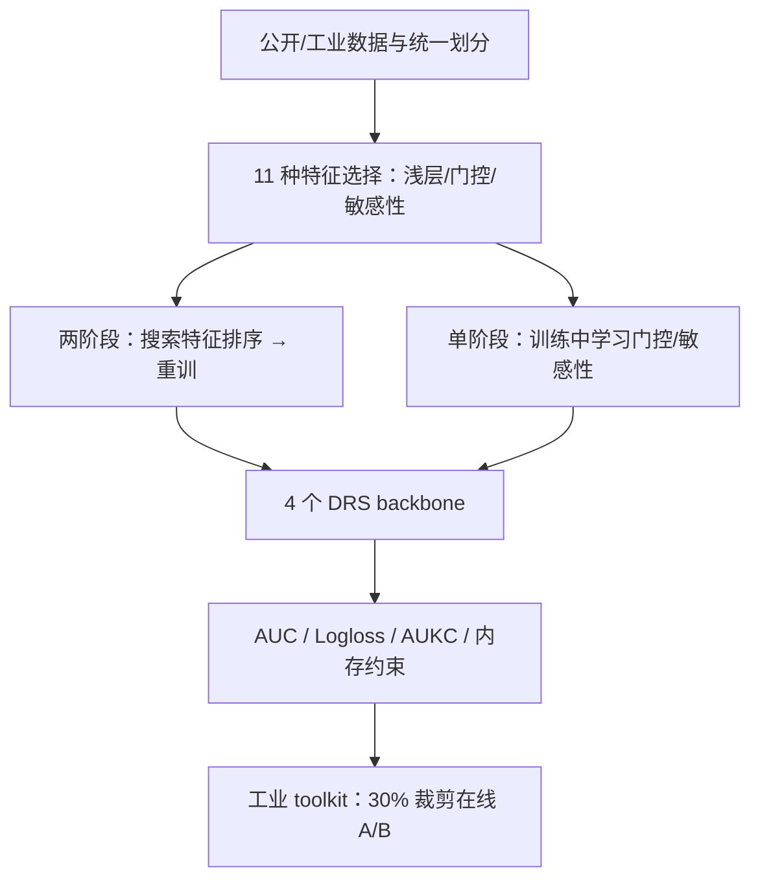
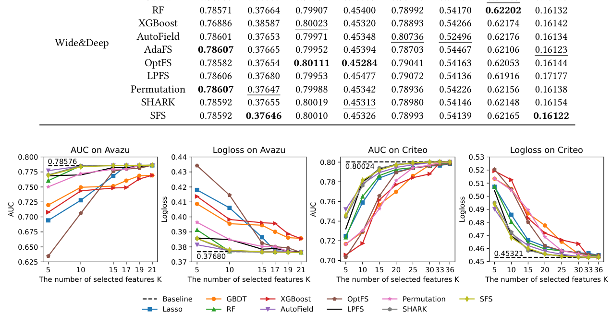

# ERASE: Benchmarking Feature Selection Methods for Deep Recommender Systems（ERASE：面向深度推荐系统的特征选择基准评测）

- **会议/期刊**: KDD 2024
- **作者与机构**: Pengyue Jia, Yejing Wang, Zhaocheng Du, Xiangyu Zhao, Yichao Wang, Bo Chen, Wanyu Wang, Huifeng Guo, Ruiming Tang；香港城市大学、华为诺亚方舟实验室
- **推荐链路定位**: 精排（CTR 预估的特征工程）
- **研究方向**: CTR/CVR 预估与特征交叉 / 工业架构与评测基准
- **论文原文**: [论文原文链接](https://arxiv.org/abs/2403.12660v3)
- **开源代码**: [开源代码仓库链接](https://github.com/Applied-Machine-Learning-Lab/ERASE)

## TL;DR (1分钟核心速览)

DRS 特征字段动辄数百，特征选择方法却因 field/value 粒度、单/两阶段、最优 $k$不同而难以公平比较，且缺少大规模与工业验证。ERASE 统一评测 11 种浅层/门控/敏感性方法×4 个 backbone×4 个公开数据集，提出 AUKC 衡量$k$ 曲线稳定性，并做工业离线与在线 A/B。结果显示公开 AUC 提升常小于 0.5%，AutoField 稳定性最佳，Criteo 仅 8.18% 嵌入内存达 99% 效果；在线裁 30% 特征降 20% 延迟且效果不降。

## Background & Motivation (背景与核心矛盾)

- **主流范式**: DRS 以 Wide&Deep、DeepFM、DCN、FibiNet 等为 backbone，将数百至上千特征字段嵌入后做高阶交叉；特征选择分浅层统计、门控学习、敏感性分析三类。
- **前人局限**: 各方法在 field-level vs value-level、single-stage vs two-stage、$k$选择上设置不一，实验不可比；现有 benchmark 多面向表格分类与小数据，未覆盖 DRS 的大规模稀疏特征与内存约束；只比最优$k$的峰值性能，忽略不同$k$ 下的鲁棒性与部署成本。
- **核心洞察 (Key Insight)**: 特征选择收益强依赖数据分布与 $k$；两阶段通常比单阶段稳定；门控方法擅长小$k$ 下挖掘信息特征，敏感性方法在全量附近剔除冗余更强。
- **本文切入点**: 统一实验协议 + 新指标 AUKC + 工业离线/在线验证，回答“选哪个方法、在什么 $k$、能否落地”。

## Method (核心方法设计)

### 1. 整体框架 (Overall Architecture)

ERASE 不改 backbone，而把特征选择放进统一评测流水线：先对 4 个公开数据集和 1 个工业 CVR 数据集统一预处理与划分；再对 11 种方法按浅层/门控/敏感性三类运行，两阶段方法先搜索特征排序再重训，单阶段方法直接训练（可改两阶段则取最优）；随后在 Wide&Deep、DeepFM、DCN、FibiNet 四个 backbone 上以 AUC/Logloss 评估，并沿 $k$ 网格计算 AUKC；最后用 1% AUC 容忍与 25/50/75% 内存预算做部署视角分析，并将 toolkit 接入线上做 30% 特征裁剪 A/B。

### 2. 关键设计拆解 (Key Designs)

1. **统一公平协议（消除设置差异）**：前人各用不同 backbone、划分与调参预算，结论不可迁移。ERASE 固定 embedding=8、Adam、lr=0.001、batch=4096，三次重复取均值；两阶段统一为“搜索-重训”，单阶段可改则取最优。形式化上，搜索阶段解 $S^*=\arg\max_{S\subseteq F,|S|=k}\mathrm{AUC}_{\mathrm{val}}(S)$，再用$S^*$ 重训。直觉是把性能差异归因到选择算法本身，而非训练技巧。
2. **AUKC 稳定性指标（从峰值到曲线）**：只比最优 $k$既不可比又计算昂贵。AUKC 对$k$-AUC 曲线积分：$\mathrm{AUKC}=\frac{1}{|K|}\sum_{k=1}^{|K|}(\mathrm{AUC}_k+\mathrm{AUC}_{k-1}-1)$，其中$\mathrm{AUC}_0=0.5$为随机基线；实际网格不均时分段近似$\mathrm{AUKC}=\frac{1}{|K|}\sum_{n=1}^{|N|}(\mathrm{AUC}_{n,l}+\mathrm{AUC}_{n,r}-1)\Delta l_n$。它奖励“整个$k$ 区间都稳”的方法，而非单点峰值。
3. **双约束效率评估与工业 toolkit（对应部署）**：前人只报峰值，忽略内存/延迟。ERASE 设两条约束：性能约束——在 1% AUC 容忍下，记录达到阈值所需的最小内存与字段数；内存约束——在 $M(k)\le \rho M_{\text{full}}$（$\rho\in\{25\%,50\%,75\%\}$）下取最优 AUC。直觉是直接量化“省多少 embedding、掉多少效果”。

训练目标为 CTR 二分类 BCE：$\mathcal{L}=-\frac{1}{N}\sum_i[y_i\log\hat{y}_i+(1-y_i)\log(1-\hat{y}_i)]$。CTR 场景不做召回式负采样，曝光未点击即负样本；推理为全测试样本前向，两阶段多一次搜索+重训开销，单阶段一次训练；内存收益主要来自 embedding table 裁剪。

## Experimental Setup & Evaluation Protocol (实验设置与评估协议)

- **数据集与预处理**: 未使用 `5-core`；ML-1M 以 rating>3 为正样本。统计如下：

| 数据集 | #Users | #Items | #Interactions | 稀疏度/密度 | 特征/场景说明 |
| :--- | :---: | :---: | :---: | :---: | :--- |
| Avazu | N/A | N/A | 40,428,967 | N/A | 23 字段，CTR 广告 |
| Criteo | N/A | N/A | 45,850,617 | N/A | 39 字段，CTR 广告 |
| ML-1M | 6,040 | 3,706 | 1,000,209 | 4.47% | 9 字段，电影评分 |
| AliCCP | 238,635 | 467,298 | 85,316,519 | 0.077% | 23 字段，电商点击/转化 |

- **数据划分与防穿越**: Avazu/Criteo/ML-1M 按 7:2:1 比例划分；AliCCP 按 50:25:25 划分。无全局时间戳切分，属于随机比例划分，需注意 CTR 分布漂移下的乐观偏差。
- **排名评测协议**: CTR 样本级评估，非 Top-K `Full-Ranking`；测试集使用全体曝光样本，负样本为真实未点击，不做负采样，因此也不是 `Sampled Ranking`。AUC 衡量正负样本排序概率，Logloss 衡量校准。
- **对比基线与超参**: 11 种方法覆盖浅层（Lasso/GBDT/RF/XGBoost）、门控（AutoField/AdaFS/OptFS/LPFS）、敏感性（Permutation/SHARK/SFS）；4 个 backbone；embedding=8、Adam、lr=0.001、batch=4096，三次重复取均值；论文未报告显著性检验。

## Key Experimental Results (实验关键数据)

### 1. 主实验对比 (Main Results)

表 2 为 DeepFM backbone 的 AUC（完整 4 backbone 见附录，趋势一致）。LPFS 在 Avazu/Criteo/AliCCP 最优，AutoField 在 ML-1M 最优。

| 方法 (DeepFM) | Avazu | Criteo | ML-1M | AliCCP |
| :--- | :---: | :---: | :---: | :---: |
| no_selection | 0.78576 | 0.80024 | 0.79027 | 0.61813 |
| Lasso | 0.78587 | 0.79832 | 0.80683 | 0.61887 |
| GBDT | 0.76930 | 0.80011 | 0.78942 | 0.61864 |
| AutoField | 0.78611 | 0.80022 | **0.80722** | 0.61894 |
| AdaFS | 0.78278 | 0.79950 | 0.78590 | 0.61726 |
| OptFS | 0.78624 | 0.79934 | 0.79027 | 0.61551 |
| LPFS | **0.78840** | **0.80080** | 0.78885 | **0.61941** |
| SHARK | 0.78611 | 0.80035 | 0.78888 | 0.61840 |
| SFS | 0.78626 | 0.80020 | 0.78982 | 0.61835 |

相对 `no_selection`，LPFS 在 Avazu/Criteo/AliCCP 分别提升 +0.34%/+0.07%/+0.21%，AutoField 在 ML-1M 提升 +2.15%。但 LPFS 在 AliCCP 的 Logloss 为 0.17864，远差于 no_selection 的 0.16176，说明其 AUC 略优但概率校准异常；Criteo 的 +0.07% 也提示公开 CTR 数据上特征选择收益接近饱和。

### 2. 消融实验 (Ablation Study)

本文无模块消融，以“稳定性 + 效率约束”替代。表 3 为 DeepFM 的 AUKC：AutoField 在 Avazu 最高，SFS 在 Criteo 最高；XGBoost/GBDT 明显偏低。

| 方法 | Avazu AUKC | Criteo AUKC |
| :--- | :---: | :---: |
| AutoField | **0.50526** | 0.53862 |
| SHARK | 0.50267 | 0.53886 |
| SFS | 0.50146 | **0.53998** |
| LPFS | 0.49337 | 0.53634 |
| Permutation | 0.48526 | 0.50311 |
| Lasso | 0.43896 | 0.52193 |
| GBDT | 0.44430 | 0.49894 |
| XGBoost | 0.43264 | 0.49388 |

表 4 为 DCN、Criteo 下内存约束结果（括号为字段数 $k$；全量 no_selection AUC=0.80045）：

| 方法 | 25% 内存 | 50% 内存 | 75% 内存 |
| :--- | :---: | :---: | :---: |
| AutoField | **0.79997 (30)** | **0.80037 (32)** | **0.80037 (32)** |
| LPFS | 0.79892 (25) | 0.80015 (30) | 0.80031 (32) |
| SHARK | 0.79748 (20) | 0.79977 (25) | 0.79977 (25) |
| SFS | 0.79577 (18) | 0.80027 (28) | 0.80027 (28) |
| RF | 0.72374 (6) | 0.75961 (8) | 0.76520 (10) |

图 3 展示 DeepFM 下 AUC/Logloss 随 $k$的曲线：$k=5/10$时 AutoField、SHARK、SFS 领先；$k$ 接近全量时 Permutation 更强，因其从全量中识别冗余；XGBoost/GBDT 在 Avazu 上因特征值集中而明显过拟合。

<figure class="paper-figure" markdown="span">
  <figcaption>图3：以 DeepFM 为主干网络的特征选择方法实验结果，采用 AUC 和 Logloss 评估。</figcaption>
</figure>

### 3. 关键实验发现 (Key Findings)

1. **数据分布决定方法选择**：Avazu 特征值集中在少数字段，GBDT 的 AUC 0.76930 反比 no_selection 0.78576 低 2.1%；Criteo 分布较均匀，LPFS 0.80080 仅 +0.07%；ML-1M 小特征集上 AutoField 0.80722 提升 2.15% 最显著。
2. **峰值与稳定性错位**：LPFS 公开 AUC 三项最佳，但 AliCCP Logloss 0.17864 明显差、工业 AUKC 0.817445；AutoField 工业 AUKC 0.819053 最高，而峰值 AUC 0.933915 不及 SHARK 的 0.933985，说明只看最优 $k$ 会误判。
3. **内存与延迟收益真实**：Criteo 25% 内存下 AutoField 0.79997 接近全量 0.80045；1% AUC 容忍下 LPFS 仅保留 0.001% 嵌入内存与 15 字段，AutoField 为 8.18%/20，SHARK 7.31%/15，SFS 8.16%/15；工业在线裁 30% 特征后推理延迟降约 20%，vv 与平均播放时长不变。

## Highlights & Limitations (亮点、对比与审稿批判)

- **与代表作对比 (vs. Prior Work)**: DeepLasso 面向表格学习、仅浅层方法与小数据；AutoField/AdaFS/LPFS/SHARK/SFS 各自实验设置与 backbone 不同、只报最优 $k$。ERASE 的本质区别是“统一协议 + 4 backbone + 公开/工业/在线 + AUKC”，把方法比较从单点峰值推进到$k$ 曲线与部署约束。
- **可迁移亮点**: AUKC 可直接迁移到任何对 $k$ 敏感的剪枝/稀疏化/特征筛选评测；“1% AUC 容忍 + 内存预算”的双约束评估可复用到召回索引压缩与 embedding 裁剪。
- **审稿级局限批判**: 其一，仅覆盖 CTR 二分类与 4 个 backbone，未涉及多任务、序列推荐与生成式推荐，结论外推需谨慎；其二，未报告显著性检验，Criteo +0.07% 等微小提升的统计可靠性不足，且 AUKC 依赖 $k$ 网格与分段端点，工业数据私有也限制复现。

## Rating (四维评分)

- **方法创新性 (Novelty)**: ⭐⭐⭐（首个 DRS 特征选择基准并提出 AUKC，但算法本身非新，核心贡献在评测体系。）
- **评估协议与实验扎实度 (Protocol & Experiments)**: ⭐⭐⭐⭐（4 公开+工业+在线 A/B、4 backbone、11 方法、三次重复；但无显著性检验且工业数据不公开。）
- **写作与数学规范度 (Clarity & Rigor)**: ⭐⭐⭐⭐（分类与协议清晰、AUKC 推导完整；正文与附录存在 $\mathrm{AUC}_{k-1}$与$\mathrm{AUC}_{k+1}$ 的笔误不一致。）
- **工业落地与复现价值 (Industrial & Practical Value)**: ⭐⭐⭐⭐⭐（开源 toolkit，内存约束与在线 20% 延迟下降直接可用，对精排特征工程价值高。）

