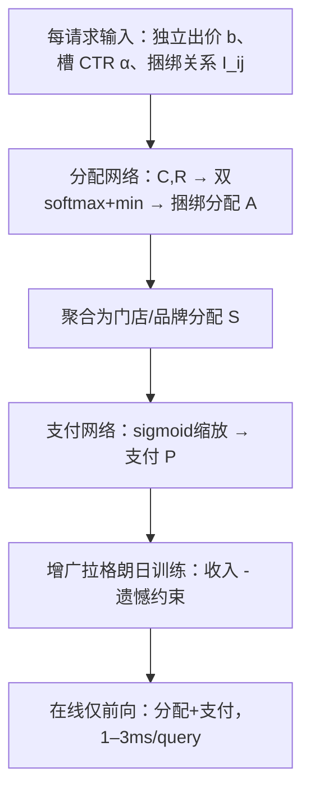

# Joint Auction in the Online Advertising Market（在线广告市场中的联合拍卖）

- **会议/期刊**: KDD 2024（arXiv 2024）
- **作者与机构**: Zhen Zhang、Weian Li、Yahui Lei 等；中国人民大学高瓴人工智能学院、山东大学、美团。
- **推荐链路定位**: 广告精排/广告位分配与定价（拍卖机制设计）
- **研究方向**: CTR/CVR预估与特征交叉 / 广告拍卖机制交叉
- **论文原文**: [https://arxiv.org/abs/2408.09885v1](https://arxiv.org/abs/2408.09885v1)
- **开源代码**: 暂未开源

## TL;DR (1分钟核心速览)

传统电商广告只让门店竞价，品牌供应商有曝光需求却无法参与；而“门店+品牌”捆绑竞价会带来捆绑出价相关、支付拆分、每槽至多一捆绑等新约束，RegretNet/VCG/GSP 难以直接适用。本文提出 Joint Auction 场景与 JRegNet 自动机制设计网络：以捆绑关系图为每请求输入，用双 softmax 构造双随机分配矩阵，再用 sigmoid 缩放支付硬保证 IR，并以经验遗憾约束逼近似 DSIC。合成设置 B/C/D 上收入较 IRegNet 提升 19.6%/19.8%/15.9%，真实美团日志较 GSP 提升 6.3%–10.9%，在线前向仅 1–3ms/query。

## Background & Motivation (背景与核心矛盾)

- **主流范式**: 电商广告通常以门店为竞拍者，用 GSP/VCG/Myerson 或 RegretNet 等自动机制设计决定槽位与支付。
- **前人局限**: 品牌供应商被排除在竞价之外，平台损失潜在收入；联合拍卖中槽位分配给“门店-品牌”捆绑，捆绑价值相关且支付须拆分，经典机制难以定义均衡或直接失效。
- **核心洞察**: 门店与品牌的销售捆绑关系可建模为随搜索请求变化的二部图；若把机制设计转为“收入最大化+经验遗憾约束”，网络可从门店/品牌独立出价直接生成捆绑分配。
- **本文切入点**: 提出 Joint Auction 新广告模式，并设计 JRegNet 解决捆绑约束、相关出价与支付拆分。

## Method (核心方法设计)

### 1. 整体框架 (Overall Architecture)

每个搜索请求输入门店/品牌独立出价 $b_{i\cdot},b_{\cdot j}$、槽位 CTR$\alpha_k$与捆绑关系矩阵$\mathbb{I}_{ij}$，先构造期望出价$e_{i\cdot k}=\alpha_k b_{i\cdot}$、$e_{\cdot jk}=\alpha_k b_{\cdot j}$。分配网络经隐藏层输出$C,R$，用双 softmax + min 得到捆绑分配双随机矩阵$A$，再聚合为门店/品牌分配概率$S$；支付网络由$S$与期望出价、经 sigmoid 缩放因子输出支付$P$。训练时用增广拉格朗日把经验遗憾约束并入损失，内层梯度上升找最优误报；在线仅前向得到分配与支付，约 1–3ms/query。

### 2. 关键设计拆解 (Key Designs)

1. **联合关系图与双随机捆绑分配**：痛点是非所有门店-品牌可成捆绑，且每槽/每捆绑互斥。JRegNet 将 $\mathbb{I}_{ij}$作为每请求输入，对$Q$个可行捆绑构造$a_{qk}=\min\{\frac{e^{c_{qk}}}{\sum_{t=1}^{Q}e^{c_{tk}}},\frac{e^{r_{qk}}}{\sum_{t=1}^{K+1}e^{r_{qt}}}\}$，其中$K+1$ 为 dummy 槽表示不分配；该结构硬保证“每槽≤1捆绑、每捆绑≤1槽”，比后处理约束更稳。
2. **捆绑分配聚合与支付拆分**：痛点是一个捆绑含两个竞拍者，支付不能直接照搬单边拍卖。对门店 $i$与品牌$j$，$s_{i\cdot k}=\sum_{q\in Q_{i\cdot}}a_{qk}$，$s_{\cdot jk}=\sum_{q\in Q_{\cdot j}}a_{qk}$；支付$p_{i\cdot}=\tilde p_{i\cdot}\sum_{k}s_{i\cdot k}e_{i\cdot k}$，$\tilde p_{i\cdot}\in[0,1]$ 由 sigmoid 得到。因真实出价下效用非负，IR 被结构硬保证；直接输入独立出价也避免对相关捆绑出价建模。
3. **训练目标、遗憾约束与推理**：总损失 $\mathcal{L}=-\frac{1}{L}\sum_{\ell}(\sum_i p_{i\cdot}+\sum_j p_{\cdot j})+\sum_i\lambda_{i\cdot}\widehat{rgt}_{i\cdot}+\sum_j\lambda_{\cdot j}\widehat{rgt}_{\cdot j}+\frac{\rho}{2}\sum_i\widehat{rgt}_{i\cdot}^2+\frac{\rho}{2}\sum_j\widehat{rgt}_{\cdot j}^2$；误报由梯度上升求得，训练无传统负采样。在线免搜索，仅一次前向。

## Experimental Setup & Evaluation Protocol (实验设置与评估协议)

- **数据集与预处理**: 合成数据按设置 A–D 生成，捆绑关系每请求随机；真实数据来自美团广告拍卖日志，裁剪/补零到每样本 10 门店、10 品牌、5 槽：

| 数据/设置 | 规模 | 槽位 | 训练/测试 | 过滤与说明 |
| :--- | :---: | :---: | :---: | :--- |
| Synthetic A–D | 3–4 门店、4–5 品牌 | 1/3/5 | 640k / 12.8k | 出价 $U[0,1]$；关系图逐请求生成 |
| 价值分布实验 | 3 门店、5 品牌 | 3 | 同上 | Uniform/Normal/Lognormal |
| Meituan 真实日志 | 10 门店、10 品牌 | 5 | 6912 测试 | trim/pad 至 10×10，零价值填充；按 3 时间段训练、3 时间点测试 |

- **数据划分与防穿越**: 合成训练/测试独立生成；真实按不同时间段训练、不同时间点测试，避免未来日志穿越。
- **排名评测协议**: 非 Full-Ranking/采样排序，而是拍卖仿真评测：固定测试集统计平均经验遗憾 $\widehat{rgt}$、收入 rev、社会福利 sw；DSIC 以$\widehat{rgt}<0.001$或相对效用遗憾$ru$衡量；GSP 用枚举$\beta v$ 找误报。
- **对比基线与超参**: RegretNet、IRegNet、VCG、GSP；minibatch=128，合成 5000 minibatches/200k iterations，真实约 30k iterations、2–4h 离线训练；显著性 paired t-test $p<0.05$。

## Key Experimental Results (实验关键数据)

### 1. 主实验对比 (Main Results)

| 方法 | B rev | B sw | B rgt | C rev | C sw | C rgt | D rev | D sw | D rgt |
| :--- | :---: | :---: | :---: | :---: | :---: | :---: | :---: | :---: | :---: |
| RegretNet | 0.298 | 0.399 | <0.001 | 0.302 | 0.403 | <0.001 | 0.370 | 0.488 | <0.001 |
| IRegNet | 0.536 | 0.651 | <0.001 | 0.551 | 0.680 | <0.001 | 0.583 | 0.690 | <0.001 |
| VCG | 0.445 | **1.154** | — | 0.400 | **1.256** | — | 0.602 | **1.232** | — |
| JRegNet | **0.641†** | 0.955 | <0.001 | **0.660†** | 1.007 | <0.001 | **0.676†** | 1.005 | <0.001 |
| 相对最优基线 rev 提升 | +19.6% | — | — | +19.8% | — | — | +15.9% | — | — |

### 2. 消融与敏感性实验 (Ablation & Sensitivity)

原文未提供标准“w/o 模块”消融；以下汇总价值分布敏感性（机制设计文献常用替代），同设置下比较收入：

| 设置 | Uniform rev | Normal rev | Lognormal rev | 相对 IRegNet 提升 |
| :--- | :---: | :---: | :---: | :---: |
| IRegNet | 0.536 | 0.496 | 0.501 | — |
| JRegNet | **0.641** | **0.674** | **0.612** | +19.6% / +35.9% / +22.2% |

### 3. 关键实验发现 (Key Findings)

- **联合建模是收入主因**：B/C/D 上 JRegNet 收入 0.641/0.660/0.676，较 IRegNet 的 0.536/0.551/0.583 提升 19.6%/19.8%/15.9%，同时遗憾保持 <0.001，说明关系图、捆绑分配与支付拆分并非装饰。
- **分布鲁棒但收入-福利有权衡**：Uniform/Normal/Lognormal 下 JRegNet 收入 0.641/0.674/0.612，较 IRegNet 提升 19.6%/35.9%/22.2%；VCG 社会福利最高（如 B 的 1.154），但收入仅 0.445，JRegNet 以福利损失换收入。
- **真实场景有效且可上线**：美团 E1–E3 中 JRegNet 收入 43.329/49.005/48.867，较 GSP 的 40.764/44.206/44.765 提升 6.3%/10.9%/9.2%，$ru$ 约 0.402–0.868；GSP 收入按真实出价上界计算，实际均衡收入更低，JRegNet 在线推理仅 1–3ms/query。

## Highlights & Limitations (亮点、对比与审稿批判)

- **与代表作对比**: RegretNet 只建模门店单边竞价，无法处理门店-品牌捆绑；IRegNet 让门店/品牌独立占槽，忽略捆绑互斥与支付拆分；VCG 虽 DSIC/IR 且社会福利最大，但收入低且需捆绑估值；GSP 简单但非 DSIC，联合场景均衡难定义。JRegNet 把关系图、双随机分配、支付拆分统一进自动机制设计。
- **可迁移亮点**: 双 softmax+min 构造双随机矩阵可迁移到互斥资源分配/列表重排；sigmoid 缩放支付可硬保证 IR；把每请求变化的组合关系图作为输入，适合动态捆绑/多主体广告。
- **审稿级局限批判**: 真实数据仅 6912 测试样本且固定 10×10×5，GSP 收入是 truthful-bid 上界；DSIC/IR 为经验近满足，缺乏解析保证；训练 2–4h/30k iter，且对 $\lambda,\rho$、CTR 预测与出价分布较敏感，原文未充分做超参稳健性分析。

## Rating (四维评分)

- **方法创新性 (Novelty)**: ⭐⭐⭐⭐ （联合拍卖场景与捆绑感知 JRegNet 新颖，双随机分配+支付拆分有机制设计增量。）
- **评估协议与实验扎实度 (Protocol & Experiments)**: ⭐⭐⭐ （合成设置较全、真实美团日志有说服力，但真实规模小、无标准模块消融、GSP 用收入上界。）
- **写作与数学规范度 (Clarity & Rigor)**: ⭐⭐⭐⭐ （机制、约束与训练公式清楚，DSIC/IR 定义完整；符号较多，附录依赖较强。）
- **工业落地与复现价值 (Industrial & Practical Value)**: ⭐⭐⭐⭐ （美团真实日志与 1–3ms 推理支撑落地，离线训练可接受；未开源，超参与训练成本仍需工程调优。）

