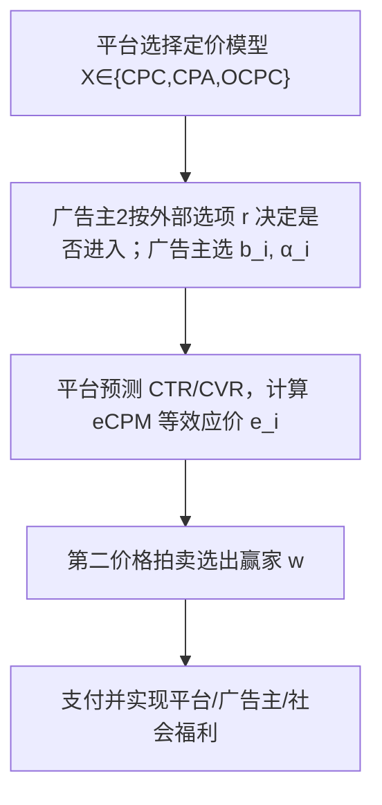
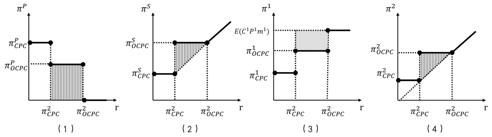

# Optimized Cost Per Click in Online Advertising: A Theoretical Analysis (在线广告优化点击计费：理论分析)

- **会议/期刊**: KDD 2024 (SIGKDD 2024 Research Track)
- **作者与机构**: Kaichen Zhang, Zixuan Yuan, Hui Xiong；香港科技大学（广州）人工智能/金融科技学域、香港科技大学计算机科学与工程系
- **推荐链路定位**: 精排后的广告拍卖与计费机制（非召回/粗排/精排模型）
- **研究方向**: CTR/CVR 预估与特征交叉（广告计费机制交叉）/ 工业级广告定价与可信机制
- **论文原文**: [论文原文链接](https://arxiv.org/abs/2405.14279v1)
- **开源代码**: 暂未开源

## TL;DR (1分钟核心速览)

本文针对“OCPC/OCPM 已被工业界广泛采用，但何时优于 CPC/CPA 缺乏理论解释”的痛点，构建一个平台与两类广告主的扩展式博弈，纳入**站外转化报告操纵**与**广告主外部选项**两个关键因素。核心结论：站外场景下 CPA 因广告主低报转化而平台收益趋于 0，OCPC 仍可保持正收益；OCPC 还能以更高广告主收益吸引外部选项广告主进入，但若广告主黏性强，CPC 的平台收益可能更高。本文为纯理论解析，无真实数据集与百分比提升指标。

## Background & Motivation (背景与核心矛盾)

- **主流范式**: 广告计费从 CPM、CPC、CPA 演进到 OCPC/OCPM：广告主为转化竞价，但分别按点击或展示付费；平台用 CTR/CVR 预测计算 eCPM 排序。
- **前人局限**: 现有文献尚未从经济模型上识别 OCPC 相对 CPC/CPA 的优势条件；且多数定价模型假设广告主必然参与拍卖，忽略其外部选项，也未建模站外转化由广告主上报导致的 CVR 预测偏差。
- **核心洞察 (Key Insight)**: CPA 下广告主可降低转化上报概率 $\alpha_i$来减少支付，导致无均衡；OCPC 下$\alpha_i$只与出价$b_i$以乘积$\alpha_i b_i$ 进入胜负条件，真话报价仍是占优策略。
- **本文切入点**: 用两广告主、一平台、第二价格拍卖的扩展式博弈，逆向归纳比较 CPC/CPA/OCPC 在站内/站外场景的均衡收益。

## Method (核心方法设计)

### 1. 整体框架 (Overall Architecture)

博弈时序为：平台先选择定价模型 $X\in\{\text{CPC},\text{CPA},\text{OCPC}\}$；广告主 2 根据外部选项$r$决定是否进入拍卖，广告主 1 无外部选项、始终进入；进入者选择出价$b_i$，站外场景下还选择转化报告策略$\alpha_i$；平台基于 CTR/CVR 预测$\bar c_i,\bar p_i$计算等效应价$e_i$ 并举行第二价格拍卖；赢家支付，各方实现收益。模型以逆向归纳求解子博弈精炼均衡，并比较平台收益、广告主收益与社会福利。

### 2. 关键设计拆解 (Key Designs)

1. **OCPC 的“竞价目标≠计费事件”乘积耦合**：CPA 下广告主按转化付费，降低 $\alpha_i$可少付且平台难以即时察觉；OCPC 按点击付费，效用中$\bar P_i=\alpha_iP_i$只通过$\bar C_i\bar P_i b_i$影响胜负，故$\alpha_i$与$b_i$仅以乘积出现。站外 OCPC 的占优策略为$\alpha_i b_i=m_i$，真话策略$\alpha_i=1,b_i=m_i$ 是其中一员，因而避免 CPA 的“低报竞赛”。  
2. **外部选项 $r$与平台定价选择**：固定参与下，CPC 的平台收益$\mathbb{E}[\min(C_1\mu_{p_1}m_1,C_2\mu_{p_2}m_2)]$可高于 OCPC 的$\mathbb{E}[\min(C_1P_1m_1,C_2P_2m_2)]$；但 OCPC 给广告主的收益更高。当$\pi_2^{CPC}<r<\pi_2^{OCPC}$时，广告主 2 只进入 OCPC 拍卖，平台收益由 0 变为正。平台最优模型为$X^*=\arg\max_X \pi_P^X$s.t.$\pi_2^X>r$。  
3. **求解与“推理”开销**：本文非参数化推荐模型，无训练损失、负采样与在线向量检索；均衡由解析命题和逆向归纳得到。核心比较式为 $\pi_P^{OCPC}=\mathbb{E}[\min(C_1P_1m_1,C_2P_2m_2)]$、$\pi_P^{CPC}=\mathbb{E}[\min(C_1\mu_{p_1}m_1,C_2\mu_{p_2}m_2)]$，计算开销为命题级，不涉及线上推理延迟。

<figure class="paper-figure" markdown="span">
  <figcaption>图2：外部选项𝑟变化时的均衡收益</figcaption>
</figure>

*图 2：外部选项 $r$ 变化时各方均衡收益；竖线阴影为 OCPC 带来的平台收益增量。*

## Experimental Setup & Evaluation Protocol (实验设置与评估协议)

- **数据集与预处理**: 不适用。本文为理论经济模型，无真实数据集、无 `5-core` 过滤；以两广告主、一平台抽象市场。
- **数据划分与防穿越 (Splitting Strategy)**: 不适用；无训练/验证/测试划分。评估对象为解析均衡与数值均衡图（图 2）。
- **排名评测协议 (Ranking Protocol)**: 不适用；无 Full-Ranking / Sampled Ranking。拍卖采用第二价格密封机制，按等效应价 $e_i$ 选赢家。
- **对比基线与超参设置**: 对比 CPC、CPA、OCPC；OCPM/CPM 在附录 A.1 类比讨论。无 Embedding 维度、无显著性检验；以命题证明和收益序关系为评价协议。

| 设置项 | 取值 |
| :--- | :--- |
| 市场结构 | 1 平台 + 2 广告主；广告主 1 无外部选项，广告主 2 有外部选项 $r$ |
| 转化场景 | 站内 in-site：CVR 可准确追踪；站外 out-site：广告主以 $\alpha_i\in[0,1]$ 低报转化 |
| 拍卖机制 | 第二价格密封拍卖，按 $e_i=\bar c_i\bar p_i b_i$（CPA/OCPC）或$\bar c_i b_i$（CPC）排序 |
| 均衡概念 | 子博弈精炼均衡；逆向归纳 |
| 主要评价 | 平台收益、广告主收益、社会福利、广告主 2 进入阈值 $r$ |

## Key Experimental Results (实验关键数据)

### 1. 主实验对比 (Main Results)

本文无百分比提升与真实基准，以下为理论比较结果；加粗表示对应比较中的收益优势，无单一全局最优。

| 定价模型 | 场景 | 广告主主导策略 | 平台收益 | 社会福利 | 结论 |
| :--- | :--- | :--- | :--- | :--- | :--- |
| CPC | 站内/站外无差异 | $b_i=\mu_{p_i}m_i$| **$\mathbb{E}[\min(C_1\mu_{p_1}m_1,C_2\mu_{p_2}m_2)]$** |$\mathbb{E}[\max(C_1\mu_{p_1}m_1,C_2\mu_{p_2}m_2)]$ | 固定参与下平台收益最高，但广告主收益低 |
| CPA | in-site | $b_i=m_i$|$\mathbb{E}[\min(C_1P_1m_1,C_2P_2m_2)]$|$\mathbb{E}[\max(C_1P_1m_1,C_2P_2m_2)]$ | 与 OCPC 同效 |
| CPA | out-site | 无均衡，$\alpha_i\downarrow 0$| 0 |$\frac12(\mathbb{E}[C_1P_1m_1]+\mathbb{E}[C_2P_2m_2])$ | 转化报告操纵致命 |
| OCPC | in-site | $b_i=m_i$|$\mathbb{E}[\min(C_1P_1m_1,C_2P_2m_2)]$|$\mathbb{E}[\max(C_1P_1m_1,C_2P_2m_2)]$ | 与 CPA 同效 |
| OCPC | out-site | $\alpha_i b_i=m_i$；真话占优 | **$\mathbb{E}[\min(C_1P_1m_1,C_2P_2m_2)]>0$** |$\mathbb{E}[\max(C_1P_1m_1,C_2P_2m_2)]$ | 相对 CPA 的 0 收益具鲁棒性 |

### 2. 消融实验 (Ablation Study)

| 移除/放松因素 | 关键变化 | 平台收益变化 | 解释 |
| :--- | :--- | :--- | :--- |
| 移除站外转化操纵 $\alpha_i$ | CPA 恢复均衡，OCPC 与 CPA 同效 | CPA 由 0 升至正；OCPC 不变 | OCPC 优势主要来自站外操纵鲁棒性 |
| 移除外部选项 $r$（广告主 2 必进入） | OCPC 的参与扩展优势消失 | 固定参与下 CPC 高于 OCPC | OCPC 的收益优势依赖吸引边缘广告主 |
| 移除平台 CVR 预测（CPC 式均值估计） | 平台用 $\mu_{p_i}$替代$P_i$ | 平台可能更高，但社会福利下降 | 预测精度提升社会福利与广告主收益 |
| 仅站内场景 | CPA=OCPC | 两者完全相同 | OCPC 在站内不优于 CPA |

### 3. 关键实验发现 (Key Findings)

1. **站外 CPA 平台收益从正降至 0**：in-site CPA 平台收益为 $\mathbb{E}[\min(C_1P_1m_1,C_2P_2m_2)]$，out-site 因$\alpha_i\downarrow0$ 降为 **0**；OCPC 仍保持同式正收益，故 OCPC 可替代 CPA。  
2. **OCPC 与 CPC 的收益排序随 $r$翻转**：固定参与下 CPC 平台收益更高，但当$r\in(\pi_2^{CPC},\pi_2^{OCPC})$ 时广告主 2 只进入 OCPC，平台收益从 0 升至正，OCPC 更优。  
3. **OCPC 非帕累托改进**：广告主 2 进入加剧竞争，广告主 1 的收益下降（图 2 点线区域）；平台需在“平台收益”与“广告主收益以吸引进入”之间权衡。

## Highlights & Limitations (亮点、对比与审稿批判)

- **与代表作对比 (vs. Prior Work)**: 相较于 Hu et al. 等 CPA/CPC 激励分析，本文首次将 OCPC 作为定价模型进行经济分析；相较于 OCPC 算法系统研究，本文补充了“何时应选 OCPC”的理论条件。  
- **可迁移亮点**: “竞价目标≠计费事件”的乘积耦合可用于延迟反馈、可操纵归因等场景；平台考核应同时约束平台收益与广告主收益，以维持参与。  
- **审稿级局限批判**: 两广告主、两类型与第二价格拍卖设定较简化，未建模预算动态、重复博弈与 CVR 学习时滞；缺少真实数据/在线 A/B，且 OCPC 占优策略非唯一，均衡选择与鲁棒性仍可加强。

## Rating (四维评分)

- **方法创新性 (Novelty)**: ⭐⭐⭐⭐ （首个 OCPC 经济模型，乘积耦合与外部选项洞察清晰）
- **评估协议与实验扎实度 (Protocol & Experiments)**: ⭐⭐⭐ （命题证明完整，但纯理论、无真实数据与在线验证）
- **写作与数学规范度 (Clarity & Rigor)**: ⭐⭐⭐⭐ （时序、命题与收益比较清楚，部分假设较强）
- **工业落地与复现价值 (Industrial & Practical Value)**: ⭐⭐⭐⭐ （直接指导广告平台定价选择与补贴策略，复现门槛为理论推导）

