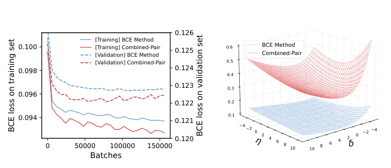
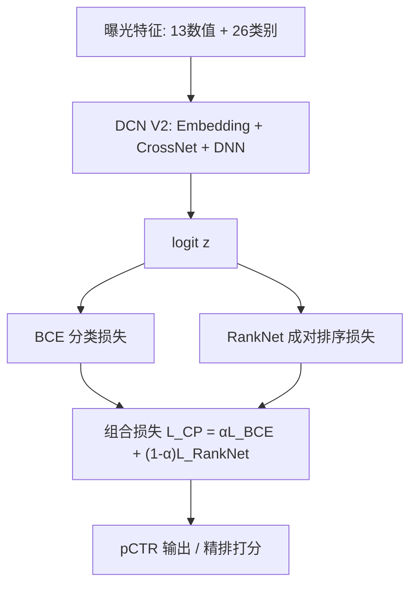

# Understanding the Ranking Loss for Recommendation with Sparse User Feedback（稀疏用户反馈推荐中的排序损失理解）

- **会议/期刊**: KDD 2024 (SIGKDD)
- **作者与机构**: Zhutian Lin、Junwei Pan、Shangyu Zhang、Ximei Wang、Xi Xiao、Shudong Huang、Lei Xiao、Jie Jiang；清华大学深圳国际研究生院、腾讯
- **推荐链路定位**: 精排（CTR 预估训练目标与排序）
- **研究方向**: CTR/CVR 预估与特征交叉
- **论文原文**: [论文原文链接](https://arxiv.org/abs/2403.14144v2)
- **开源代码**: [开源代码仓库链接](https://github.com/SkylerLinn/Understanding-the-Ranking-Loss)

## TL;DR (1分钟核心速览)

针对 CTR 正反馈稀疏时 BCE 负样本梯度随 pCTR 趋近 0 而消失的痛点，本文从梯度视角解释辅助排序损失：RankNet 成对项使负样本获得更大梯度，并给出理论证明与 Criteo_x1 全样本 AUC/BCE 评测。$\beta_{pos}=0.1$ 时 AUC 0.81398 vs 0.81321（+0.095%），BCE 0.12131 vs 0.12152；腾讯线上 GMV 最高 +1.26%。

## Background & Motivation (背景与核心矛盾)

- **主流范式**: CTR 预估以 BCE 点式分类损失为主，工业界常将 BCE 与成对/列表排序损失按 $\alpha$ 加权组合，如 Combined-Pair、Combined-List、RCR/JRC。
- **前人局限**: 既有解释多把收益归因于“排序能力提升/AUC 提升”，却未解释为何辅助排序损失还能降低分类 BCE；且真实广告 CTR 常低于 2%，负样本梯度消失问题被忽视。
- **核心洞察 (Key Insight)**: BCE 对负样本 logit 的梯度等于预测点击率 $\hat{p}_j$，无偏模型下接近全局 CTR，稀疏正反馈使该梯度极小；RankNet 的成对比较会额外注入更大负样本梯度。
- **本文切入点**: 以“负样本梯度消失—排序损失梯度补偿”为统一视角，理论推导 + 人工稀疏化实验 + 线上 A/B 验证。

<figure class="paper-figure" markdown="span">
  <figcaption>图 1：(a) 训练集和验证集上 BCE 损失随训练轮次的动态变化；(b) BCE 方法（蓝色）与 Combined-Pair（红色）的损失景观。</figcaption>
</figure>
图 1：BCE 与 Combined-Pair 的训练/验证损失动态及损失景观；Combined-Pair 损失更低且景观更陡。

## Method (核心方法设计)

### 1. 整体框架 (Overall Architecture)

模型输入为 Criteo 式曝光特征（13 数值 + 26 类别），经 DCN V2 的 Embedding、CrossNet 与 DNN 得到 logit $z$。训练端并行计算 BCE 与批内正负样本对的 RankNet，按$\mathcal{L}_{CP}=\alpha\mathcal{L}_{BCE}+(1-\alpha)\mathcal{L}_{RankNet}$联合优化；推理端仍只输出$\hat{p}=\sigma(z)$，不增加线上打分与排序开销。排序项只改训练梯度，不改服务链路。

### 2. 关键设计拆解 (Key Designs)

1. **负样本梯度消失诊断（Gradient Vanishing Diagnosis）**：BCE 对负样本 logit 的梯度为 $\nabla_{z_j^-}\mathcal{L}_{BCE}=\sigma(z_j^-)=\hat{p}_j$。无偏模型的$\hat{p}_j$接近全局 CTR；当 CTR 很小（如 <2%）时该梯度极小，负样本几乎不更新，而正样本梯度$-(1-\hat{p}_i)$ 仍大，形成正负样本优化失衡。

2. **RankNet 梯度补偿（Ranking Loss Gradient Compensation）**：成对排序项把每个负样本与批内正样本比较，$\nabla_{z_j^-}\mathcal{L}_{RankNet}=\frac{1}{N^+}\sum_{i=1}^{N^+}\sigma(z_j^- - z_i^+)$。稀疏正反馈下正样本 logit$z_i^+<0$，故$\sigma(z_j^- - z_i^+)>\sigma(z_j^-)$，Combined-Pair 的负样本梯度严格大于纯 BCE，即$\nabla_{z_j^-}\mathcal{L}_{CP}>\nabla_{z_j^-}\mathcal{L}_{BCE}$；这解释了排序损失为何反而提升分类 BCE 与 AUC。

3. **训练目标、扩展与推理效率**：总损失 $\mathcal{L}_{CP}=\alpha\mathcal{L}_{BCE}+(1-\alpha)\mathcal{L}_{RankNet}$；无需额外负采样，批内全配对，代价$O(N^+N^-)$仅发生在训练期。作者还提出 Combined-Contrastive：$\mathcal{L}_{CC}=\alpha\mathcal{L}_{BCE}+(1-\alpha)\mathcal{L}_{Contr}$，取$\alpha=0.9,\tau=0.4$，用同标签对比项继续放大负样本梯度。线上取$\alpha=0.9$，推理时延/QPS 与 BCE 基线一致。

## Experimental Setup & Evaluation Protocol (实验设置与评估协议)

- **数据集与预处理**: 使用 Criteo_x1，原始 CTR 25.6%（负样本下采样后偏高）；通过正样本权重 $\beta_{pos}$降权模拟真实低 CTR 场景，如$\beta_{pos}=0.1$ 对应约 3.3% CTR。

| 数据集 | #Users | #Items | #Interactions | 稀疏度/密度 | 特征/场景说明 |
| :--- | :---: | :---: | :---: | :---: | :--- |
| Criteo_x1 | 匿名 ID | 匿名广告 ID | ≈1.0M | 原始正例率 25.6%（下采样） | 13 数值 + 26 类别；$\beta_{pos}$ 人工稀疏化 |

- **数据划分与防穿越 (Splitting Strategy)**: 按 7:2:1 比例划分训练/验证/测试，非 Leave-One-Out，也非全局时间戳切分。
- **排名评测协议 (Ranking Protocol)**: 测试集全样本 AUC（全库排序，非采样负候选排序）衡量排序能力，BCE loss 衡量分类/概率校准。
- **对比基线与超参设置**: 对比 BCE、Combined-Pair、JRC、Combined-List、RCR、Combined-Contrastive，并讨论 Focal Loss 与负采样。Backbone 为 DCN V2 + FuxiCTR/BARS；论文未显式给出 embedding 维度 $d$，沿用默认配置；离线分析常用$\alpha=0.5$，线上取$\alpha=0.9$。线上新广告用 t-test 验证，离线未报告 p 值。

## Key Experimental Results (实验关键数据)

### 1. 主实验对比 (Main Results)

$\beta_{pos}=0.1$ 的 Criteo_x1 测试集结果：

| 方法 | 类型 | AUC↑ | BCE loss↓ | AUC 相对 BCE | BCE 相对 BCE |
| :--- | :--- | :---: | :---: | :---: | :---: |
| BCE | Pointwise | 0.81321 | 0.12152 | — | — |
| Combined-Pair | BCE + Pairwise | **0.81398** | **0.12131** | +0.095% | -0.168% |
| JRC | BCE + Listwise-like | 0.81355 | 0.12146 | +0.042% | -0.049% |
| Combined-List | BCE + Listwise | 0.81351 | 0.12152 | +0.037% | 0.000% |
| RCR | BCE + ListCE | 0.81349 | 0.12141 | +0.034% | -0.091% |
| Combined-Contrastive | BCE + Contrastive | 0.81340 | 0.12147 | +0.023% | -0.041% |

### 2. 消融实验 (Ablation Study)

| 配置 | AUC↑ | BCE loss↓ | 说明 |
| :--- | :---: | :---: | :--- |
| BCE only（w/o 排序项） | 0.81321 | 0.12152 | 基线 |
| + Pairwise RankNet | **0.81398** | **0.12131** | 全模型，最佳 |
| + Listwise ListNet | 0.81351 | 0.12152 | 仅排序升，分类未降 |
| + ListCE（RCR） | 0.81349 | 0.12141 | 分类略升 |
| + Contrastive | 0.81340 | 0.12147 | 辅助监督可替代排序项 |

### 3. 关键实验发现 (Key Findings)

- **稀疏度放大收益**：$\beta_{pos}$ 从 0.6 降到 0.1，Combined-Pair 相对 BCE 的 AUC 提升由 0.020% 升至 0.095%，BCE loss 降幅由 0.045% 升至 0.168%；与“负样本梯度正比于 pCTR”的诊断一致。
- **排序项权重存在甜点**：$\beta_{pos}=0.1$时$\alpha$由 1.0 降到 0.7，AUC 约 0.8132→0.8139、负 BCE 约 0.1215→0.1213；继续降低$\alpha$后两项指标回落，线上最终取$\alpha=0.9$。
- **工业收益与校准改善**：微信视频号/朋友圈 GMV +1.08%/+0.70%，新广告 GMV +1.26%，视频号 CTR +0.91%；分桶偏差显示 Combined-Pair 在低 pCTR 桶低估更小，且推理时延不变。

## Highlights & Limitations (亮点、对比与审稿批判)

- **与代表作对比 (vs. Prior Work)**: 相较 Combined-Pair 原论文将收益归因于排序能力，本文进一步证明其改善分类优化；相较 Focal Loss 的样本重加权，本文指出排序项通过成对比较注入更大负样本梯度；相较负采样，人工提高正例率会损失信息且实验反而下降。
- **可迁移亮点**: 可直接监控“负样本 logit 梯度范数 / pCTR”诊断稀疏反馈训练；辅助排序项只增加训练开销，适合精排模型低成本上线；$\beta_{pos}$ 降权正样本可用于离线模拟低 CTR 场景。
- **审稿级局限批判**: 公开实验仅 Criteo_x1，且稀疏性由正样本降权人工构造，未必等价真实曝光分布；RankNet 批内全配对为 $O(N^+N^-)$，大 batch 或长列表下训练成本会上升，$\alpha$ 的最优区间也缺理论刻画。

## Rating (四维评分)

- **方法创新性 (Novelty)**: ⭐⭐⭐⭐ （从负样本梯度消失重新解释辅助排序损失，理论推导与 Combined-Contrastive 扩展有新意，但非全新模型结构。）
- **评估协议与实验扎实度 (Protocol & Experiments)**: ⭐⭐⭐ （含全样本 AUC/BCE、稀疏度与 $\alpha$ 扫描及腾讯线上 A/B，但公开数据集单一，离线缺显著性检验。）
- **写作与数学规范度 (Clarity & Rigor)**: ⭐⭐⭐⭐ （梯度推导清晰，稳定性/兼容性讨论完整；部分实现超参如 embedding 维度未展开。）
- **工业落地与复现价值 (Industrial & Practical Value)**: ⭐⭐⭐⭐⭐ （开源代码，训练期增益、推理零额外时延，腾讯多场景 GMV 与新广告收益有说服力。）

