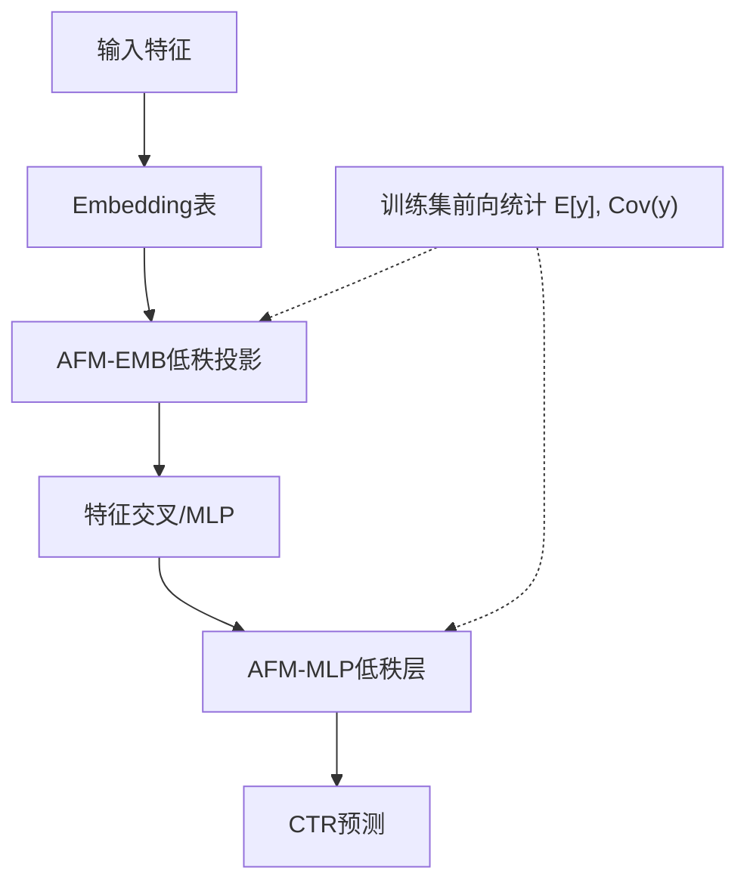

# Unified Low-rank Compression Framework for Click-through Rate Prediction (面向CTR预估的统一低秩压缩框架)

- **会议/期刊**: KDD 2024 (ADS Track)
- **作者与机构**: Hao Yu, Minghao Fu, Jiandong Ding, Yusheng Zhou, Jianxin Wu；南京大学 LAMDA 等
- **推荐链路定位**: 精排（CTR模型压缩与推理加速）
- **研究方向**: CTR预估与特征交叉 / 工业级模型压缩
- **论文原文**: [论文原文链接](https://arxiv.org/abs/2405.18146v2)
- **开源代码**: [开源代码仓库链接](https://github.com/yuhao318/Atomic_Feature_Mimicking)

## TL;DR (1分钟核心速览)

针对DLRM嵌入表与MLP的参数/计算瓶颈，提出AFM统一低秩压缩：不逼近权重而逼近层输出特征协方差主成分，可同时压Embedding与MLP。Criteo/Avazu/XYZ点式AUC评测下，3–5×压缩反升AUC 0.003–0.010，CPU吞吐最高+166%。

## Background & Motivation (背景与核心矛盾)

- **主流范式**: CTR模型由Embedding表、特征交叉与MLP组成；压缩常用张量分解、剪枝、量化/哈希。
- **前人局限**: TTD可高压缩但仅适用Embedding，推理需重乘张量、额外开销大且AUC下降；SVD直接逼近权重 $W$，忽略输入分布与输出特征冗余。
- **核心洞察 (Key Insight)**: MLP输出特征高度线性相关。Criteo上DeepFM的400维输出中，第2/3层仅需1–2个奇异方向即可保留90%奇异值能量，压缩空间大。
- **本文切入点**: 以“输出特征模仿”替代“权重逼近”，统一压缩MLP与Embedding，并通过1 epoch微调恢复甚至提升AUC。

## Method (核心方法设计)

### 1. 整体框架 (Overall Architecture)

先训练原CTR模型；用全训练集前向流式累计各层 $\mathbb{E}[y]$、$\mathbb{E}[yy^\top]$，PCA得到$U_k$；将线性层替换为两个低秩层并微调1 epoch；再按字段对Embedding表做PCA降维，必要时把投影矩阵融进MLP首层。推理走低秩投影或融合后矩阵，无需张量重乘。

### 2. 关键设计拆解 (Key Designs)

1. **AFM-MLP：逼近输出而非权重**：原层 $y=Wx+b$。传统目标$\min\|W-W_r\|_2$；AFM改为保留输出主成分。由$\operatorname{Cov}(y)=USU^\top$取前$k$列$U_k$，有$y\approx U_k(U_k^\top Wx)+U_kU_k^\top b+(\mathbf{I}-U_kU_k^\top)\mathbb{E}[y]$，即$U_k^\top W$与$U_k$ 两个线性层；中间加ReLU后微调。直觉是丢弃冗余方向并起正则化作用。

2. **AFM-EMB：按字段压缩查表**：将查表视作one-hot全连接 $e_i=D_i x_{v_i}$。对每字段统计$\operatorname{Cov}(e_i)=U_iS_iU_i^\top$，保留$U_k^i$，把$D_i\in\mathbb{R}^{t\times s_i}$压成$(U_k^i)^\top D_i\in\mathbb{R}^{k\times s_i}$，恢复层权重$U_k^i$、偏置$(\mathbf{I}-U_k^i(U_k^i)^\top)\mathbb{E}[e_i]$。存储从$O(t\prod_i s_i)$降至$O(k(\prod_i s_i+dt))$；投影可融进MLP首层，NFM/FiBiNet因结构不融。

3. **训练目标、负采样与推理效率**：沿用原模型BCE，无额外负采样；先MLP后Embedding，各微调1 epoch。推理仅多轻量投影层或已融合矩阵，CPU吞吐提升1.35–2.66×；不改变CTR主损失。

## Experimental Setup & Evaluation Protocol (实验设置与评估协议)

- **数据集与预处理**:

| 数据集 | #训练样本 | #测试样本 | #类别特征 | #连续特征 | 场景说明 |
| :--- | ---: | ---: | ---: | ---: | :--- |
| Criteo | 41,256,556 | 4,584,062 | 26 | 13 | 广告点击日志 |
| Avazu | 32,343,174 | 8,085,794 | 22 | 0 | 按时间排列的广告点击 |
| XYZ AppGallery | 10,842,707 | 20,538 | 80 | 0 | 工业应用商店点击 |

- **数据划分与防穿越**: Criteo随机90%/10%；Avazu随机80%/20%；XYZ前12天训练、第13天测试，属全局时间切分。
- **排名评测协议**: CTR点式全测试集评估，非sampled ranking；报告AUC、Logloss、参数量与CPU吞吐，无负采样排序。
- **对比基线与超参**: DCN、DeepFM、NFM、AutoInt、FiBiNet、DCNv2、GDCN七类主干，并对比SVD、TTD；Embedding维度16（Criteo/XYZ）/50（Avazu），MLP 400/2000，3层；压缩MLP至64/320，Embedding至2/8/4。未报告显著性检验。

## Key Experimental Results (实验关键数据)

### 1. 主实验对比 (Main Results)

表1 Criteo/Avazu上原始模型与AFM全压缩模型（AFM MLP + AFM EMB）：

| 模型 | Criteo原始 | Criteo+AFM EMB | ΔAUC | Param(M) | Criteo吞吐↑ | Avazu原始 | Avazu+AFM EMB | ΔAUC | Avazu吞吐↑ |
| :--- | ---: | ---: | ---: | ---: | ---: | ---: | ---: | ---: | ---: |
| DCN | 0.7932 | 0.8023 | +0.0091 | 101.42 | +39.7% | 0.7890 | 0.7941 | +0.0051 | +131.3% |
| DeepFM | 0.7964 | 0.8021 | +0.0057 | 101.42 | +59.2% | 0.7917 | 0.7948 | +0.0031 | +166.1% |
| NFM | 0.7929 | 0.8025 | +0.0096 | 101.26 | +37.4% | 0.7864 | 0.7911 | +0.0047 | +119.7% |
| AutoInt | 0.7939 | 0.8019 | +0.0080 | 101.42 | +7.49% | 0.7904 | 0.7952 | +0.0048 | +68.8% |
| FiBiNet | 0.8002 | **0.8051** | +0.0049 | 105.58 | +14.12% | 0.7965 | **0.7968** | +0.0003 | +16.5% |
| DCNv2 | 0.7947 | 0.8029 | +0.0082 | 101.79 | +37.15% | 0.7913 | 0.7950 | +0.0037 | +115.85% |
| GDCN | 0.7949 | 0.8022 | +0.0073 | 102.15 | +10.83% | 0.7913 | 0.7953 | +0.0040 | +80.12% |

### 2. 消融实验 (Ablation Study)

表2 DeepFM上不同压缩初始化与组件（FT=微调1 epoch）：

| 变体 | Criteo AUC | Avazu AUC | XYZ AUC | 说明 |
| :--- | ---: | ---: | ---: | :--- |
| Baseline | 0.7964 | 0.7917 | 0.8290 | 未压缩 |
| +AFM MLP (FT) | 0.8016 | **0.7964** | 0.8306 | 仅压MLP |
| +AFM EMB (FT) | **0.8021** | 0.7948 | **0.8362** | 全压缩3–5× |
| +SVD MLP (FT) | 0.8011 | 0.7960 | 0.8245 | 同结构换SVD |
| +SVD EMB (FT) | 0.8009 | 0.7933 | 0.8339 | 同结构换SVD |
| +TTD EMB (FT) | 0.7837 | 0.7644 | 0.8340 | 3.76M，吞吐-98.9% |
| w/o ReLU (FT) | 0.8011 | 0.7961 | 0.8278 | 去掉额外激活 |

### 3. 关键实验发现 (Key Findings)

- **全压缩稳定增益**: DeepFM在Criteo从0.7964升至0.8021、Avazu从0.7917升至0.7948、XYZ从0.8290升至0.8362；参数量约574M→101M，吞吐分别+59.2%/+166.1%/+25.1%，说明“压得更小反而更准”在该设置下成立。
- **框架价值大于单一AFM**: SVD在相同结构下微调后也超过原模型（Criteo 0.8009–0.8011 vs 0.7964），而AFM更优（0.8016–0.8021）；TTD虽压到3.76M，Criteo仅0.7837且吞吐-98.9%，高压缩比被解压开销抵消。
- **MLP维度不敏感、Embedding维度敏感**: Criteo MLP取32/64/96/128时AUC约0.8016–0.8019；Embedding从16降至4时Criteo达0.8020，Avazu降至4仅0.7915，说明Embedding维度是主要瓶颈。线上7天A/B：AUC +0.079‰、平均吞吐+15%、TPP99 +23%、广告主价值AV +2.34%。

## Highlights & Limitations (亮点、对比与审稿批判)

- **与代表作对比 (vs. Prior Work)**: TT-Rec/TTD仅压Embedding且推理需重乘张量；SVD逼近权重、忽略输入分布；PEP/UMEC走剪枝路线。本文以输出特征PCA统一压Embedding与MLP，插件式改动小。
- **可迁移亮点**: 流式统计 $\mathbb{E}[yy^\top]$ 避免存全量输出；将Embedding投影融进MLP首层；PCA低秩初始化+1 epoch微调可作通用压缩后校准。
- **审稿级局限批判**: 加速主要来自CPU内存访问瓶颈，作者承认GPU上收益有限；需全训练集前向统计协方差，离线成本与Embedding维度选择敏感度未充分展开；实验缺少显著性检验，FiBiNet/AutoInt受注意力/SENet影响吞吐增益较小。

## Rating (四维评分)

- **方法创新性 (Novelty)**: ⭐⭐⭐⭐ （输出特征模仿替代权重逼近，统一Embedding与MLP压缩，思路清晰但PCA/AFM非全新）
- **评估协议与实验扎实度 (Protocol & Experiments)**: ⭐⭐⭐⭐ （三数据集、七主干、SVD/TTD对比及线上A/B较完整；缺显著性检验与排序协议讨论）
- **写作与数学规范度 (Clarity & Rigor)**: ⭐⭐⭐⭐ （公式、复杂度与融合条件交代清楚；部分表格排版重复列影响可读性）
- **工业落地与复现价值 (Industrial & Practical Value)**: ⭐⭐⭐⭐⭐ （开源、插件式、3–5×压缩、CPU提速与线上AV +2.34%，落地价值强）

