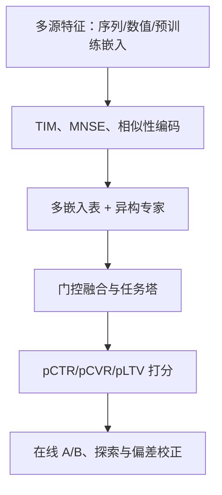
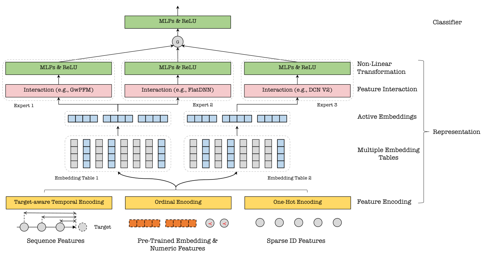
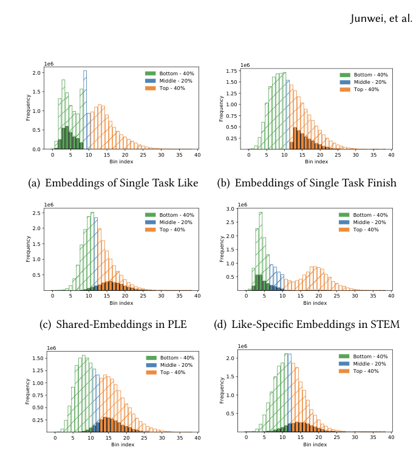

# Ads Recommendation in a Collapsed and Entangled World（坍缩与纠缠世界中的广告推荐）

- **会议/期刊**: KDD 2024 (SIGKDD)
- **作者与机构**: Junwei Pan、Wei Xue、Ximei Wang 等，腾讯广告
- **推荐链路定位**: 精排/多任务（pCTR、pCVR、pLTV）
- **研究方向**: 去偏公平、可信隐私与工业架构 / CTR/CVR 预估与特征交叉
- **论文原文**: [https://arxiv.org/abs/2403.00793v2](https://arxiv.org/abs/2403.00793v2)
- **开源代码**: [https://github.com/junwei-pan/RecScope](https://github.com/junwei-pan/RecScope)（主要开放分析工具）

## TL;DR (1分钟核心速览)

腾讯广告系统面对特征先验丢失、嵌入维度坍缩与跨任务兴趣纠缠三大痛点，提出 TIM/MNSE/相似性编码、多嵌入+GwPFM、STEM/AME 解缠及 ranking loss、REW、GP 探索等工业方案；以线上 A/B 的 GMV/AUC 与 TikTok 公开集诊断为主，Moments 多嵌入带来 **3.9% GMV**，AME 带来 **4.2–7.1% GMV**。

## Background & Motivation (背景与核心矛盾)

- **主流范式**: 工业广告精排普遍采用 Embedding & Explicit Interaction；多任务用 MMoE/PLE 共享嵌入，特征交互用 FM/FFM/DCN-V2 等。
- **前人局限**: ① 序列、数值、预训练嵌入被简单 ID 化后，时间/序关系/相似度先验丢失；② 增大嵌入维度 $K$ 常无收益甚至变差，低基数域交互会让高维嵌入坍缩到低维子空间；③ 共享嵌入使矛盾兴趣被强行混合，产生负迁移。
- **核心洞察 (Key Insight)**: SVD 可见大量奇异值趋零；TikTok Like/Finish 诊断中，PLE 共享嵌入对矛盾用户-物品对的距离分布更接近 Finish，而非 Like，说明兴趣确实被纠缠。
- **本文切入点**: 以“表征”为中心，分别做保先验编码、多嵌入/投影抗坍缩、任务特定/非对称嵌入解缠，并补训练策略与诊断工具。

## Method (核心方法设计)

### 1. 整体框架 (Overall Architecture)

模型遵循特征编码 → 多嵌入查表 → 异构专家（GwPFM/IPNN/DCN-V2/FlatDNN 等）→ 门控融合 → 分类塔的闭环。单任务用多嵌入异构 MoE；多任务将 STEM/AME/STEM-AL 嵌入解缠模块接入共享/任务专家，推理时按塔输出 pCTR/pCVR。训练侧叠加 BCE、ranking 辅助损失、REW 重复曝光加权、动态在线学习与 GP+Thompson Sampling 探索。

<figure class="paper-figure" markdown="span">
  <figcaption>图1：用于单任务学习的 Heterogeneous Mixture-of-Experts with Multi-Embedding 架构，包含四个关键模块：特征编码、多嵌入查找、专家（特征交互与MLPs）和分类塔。</figcaption>
</figure>

### 2. 关键设计拆解 (Key Designs)

1. **保先验编码（TIM + MNSE）**：序列行为用目标感知时序编码与注意力，显式建模行为-目标语义/时间四元交互：$\tilde{\mathbf e}_i=\mathbf e_i\oplus\mathbf p_f(X_i)$，$\mathbf u_{TIM}=\sum_i\alpha(\tilde{\mathbf e}_i,\tilde{\mathbf v}_t)(\tilde{\mathbf e}_i\odot\tilde{\mathbf v}_t)$。数值及预训练相似度用多进制码本$f_{MNS}(v)$ 保留序关系，避免随机 ID 丢失距离先验。

2. **多嵌入抗维度坍缩与 GwPFM**：单嵌入在低基数域交互后张成低维子空间；改为 $T$张嵌入表与异构专家，$h=\frac{1}{T}\sum_t g^{(t)}h^{(t)}$，专家内需含 ReLU，否则等价单嵌入。GwPFM 用字段分组降低 FFM 的$O(M^2)$开销：$\Phi=\sum_{i<j}x_ix_j\langle\mathbf e_{i,P(j)},\mathbf e_{j,P(i)}\rangle r_{G(i),G(j)}$；投影交互$f_{Proj}=(\mathbf e_i\mathbf M_{F(i)\to F(j)})\odot\mathbf e_j$ 进一步抗坍缩。

3. **兴趣解缠与训练/探索**：STEM 给任务特定+共享嵌入；AME 用 16/32/64 三种维度表加门控路由，小任务走小表；STEM-AL 主任务独占主表、辅助任务只更新共享表，推理删辅助塔。训练用 BCE+ranking 缓解稀疏负样本梯度消失，REW 对重复负样本加权并校正正样本偏差，GP+TS 以 $\hat f\sim\mathcal N(\mu(x^\star),\Sigma(x^\star))$ 做探索。

<figure class="paper-figure" markdown="span">
  <figcaption>图3：基于单嵌入的MTL模型中任务间兴趣纠缠与STEM中解缠的示意图。图中展示了矛盾用户-物品对集合𝑆（实色）以及全体用户-物品对集合（斜线）在单任务Like嵌入(a)和Finish嵌入(b)、PLE共享嵌入(c)，以及STEM中Like(d)、Finish特定嵌入(e)和共享嵌入(f)下的距离分布。</figcaption>
</figure>

## Experimental Setup & Evaluation Protocol (实验设置与评估协议)

- **数据集与预处理**: 原文为工业系统总结，无统一 5-core 离线主表；生产环境日请求百亿级，CTR 正样本约 0.1%–2%。TikTok 公开集仅用于兴趣纠缠诊断。

| 数据集/场景 | #Users | #Items | #Interactions | 稀疏度/说明 | 特征/场景 |
| :--- | :---: | :---: | :---: | :---: | :--- |
| Tencent Ads 生产 | 十亿级 | 百万级广告 | 日百亿级请求 | 极端稀疏 | 微信、视频号、公众号、新闻等 |
| TikTok 公开诊断 | 未披露 | 未披露 | 未披露 | 二任务 Like/Finish | 兴趣纠缠可视化 |
| Moments/Channels/Applet | 未披露 | 未披露 | 未披露 | 在线 A/B | pCTR/pCVR/pLTV |

- **数据划分与防穿越**: 生产模型采用秒级流式在线学习；A/B 按线上流量切分；未采用统一 Leave-One-Out 或比例切分。
- **排名评测协议**: 非全库/采样离线排序，主要报告在线 GMV、AUC、CTR 与重复曝光率；TikTok 仅做距离分布分析，不报告 NDCG。
- **对比基线与超参**: 单嵌入、PLE $K=64$/$128$、BCE、点估计等；主嵌入维$K=64$/$128$/$192$。未报告显著性$p$ 值，以线上增量为主。

## Key Experimental Results (实验关键数据)

### 1. 主实验对比 (Main Results)

原文无统一离线主表；下表汇总模块级在线 A/B 对照（相对基线 Δ）。

| 场景/任务 | 对比基线 → 本文方案 | 指标 | 报告增益 |
| :--- | :--- | :---: | :---: |
| Moments pCTR | 单嵌入 → 异构 MoE+多嵌入 | GMV | **+3.9%** |
| Moments pCTR | 无 TIM → TIM | GMV | **+1.93%** |
| Moments pCVR | 原 Ad ID → Visual Semantic ID+MNSE | GMV | **+1.13%**（新广告 +1.74%） |
| Moments/Channel/Applet pCTR | 无 GNN → GNN 相似性编码 | GMV | **+1.21/+0.59/+1.47%** |
| 三场景 CVR | PLE $K=64$ → AME 16/32/64 | AUC / GMV | **+0.32/+0.24/+0.48%**；GMV **+4.2/+3.9/+7.1%** |
| Applet pCTR | 单任务 → STEM-AL（Moments 辅助） | CTR | **+1.16%**；双辅助 **+2.93%** |
| Moments/Channel pCTR | BCE → BCE+ranking | GMV | **+0.57/+1.08%**；pLTV **+5.99%** |
| Moments pCTR | 点估计 → GP+TS | GMV | **+1.92%** |

### 2. 消融实验 (Ablation Study)

| 组件/替换 | 场景 | 报告影响 |
| :--- | :--- | :---: |
| 多嵌入 vs 单嵌入 | Moments pCTR | GMV **+3.9%** |
| TIM vs 无 TIM | Moments pCTR | GMV **+1.93%** |
| Visual Semantic ID vs 原 ID | Moments pCVR | GMV **+1.13%**，新广告 **+1.74%** |
| PLE $K=128$vs$K=64$ | 多场景 | 性能反而变差，扩容失效 |
| AME vs PLE $K=64$ | 三场景 | AUC **+0.32/+0.24/+0.48%** |
| BCE+ranking vs BCE | Moments/Channel | GMV **+0.57/+1.08%** |
| REW vs 无 REW | 公众号/新闻/视频 | 重复曝光 **-14.7/-7.8/-9.7%** |
| GP+TS vs 点估计 | Moments | GMV **+1.92%** |

### 3. 关键实验发现 (Key Findings)

- **单纯扩维无效，结构扩容才有效**：$K$从 64 增至 192 无显著收益，PLE$K=128$甚至差于$K=64$；多嵌入在 Moments 带来 **3.9% GMV**，直接印证维度坍缩是容量浪费主因。
- **解缠对小任务更关键**：AME 在三场景平均 AUC 提升 **0.24–0.48%**，小任务 Pay 反而提升 **0.35/0.27/0.78%**，说明非对称容量路由缓解了共享嵌入的负迁移。
- **训练侧去偏与探索同样可量化**：ranking loss 将 pLTV GMV 提升 **5.99%**；动态在线学习把新广告偏差从 **>10%** 压到 **<1%**；REW 显著降低重复曝光。

## Highlights & Limitations (亮点、对比与审稿批判)

- **与代表作对比 (vs. Prior Work)**: 相比 DHEN 的单共享嵌入表，本文用多嵌入表+异构专家；相比 PLE/MMoE 的共享嵌入，STEM/AME 显式解缠；相比 FFM 的 $M-1$ 嵌入，GwPFM 用字段分组控制复杂度。
- **可迁移亮点**: 多嵌入表+投影交互可迁移到大规模 CTR 模型；MNSE/相似性编码适合把 GNN/LLM 预训练相似度注入 ID 推荐。
- **审稿级局限批判**: 缺少统一离线基准与显著性检验，大量结论依赖平台 A/B，复现门槛高；多嵌入表与多专家增加训练/推理开销，且多数模块引用团队前作，本文更像系统集成与经验总结。

## Rating (四维评分)

- **方法创新性 (Novelty)**: ⭐⭐⭐⭐（把维度坍缩与兴趣纠缠统一为表征问题，多嵌入/非对称解缠有工程新意，但多数模块为已有工作集成）
- **评估协议与实验扎实度 (Protocol & Experiments)**: ⭐⭐⭐（线上 A/B 规模大、场景多，但缺统一离线基准、方差与显著性检验）
- **写作与数学规范度 (Clarity & Rigor)**: ⭐⭐⭐⭐（公式简洁、符号统一，但部分推导依赖外部文献）
- **工业落地与复现价值 (Industrial & Practical Value)**: ⭐⭐⭐⭐⭐（百亿请求级验证，分析工具开源，对工业推荐系统有直接参考价值）

