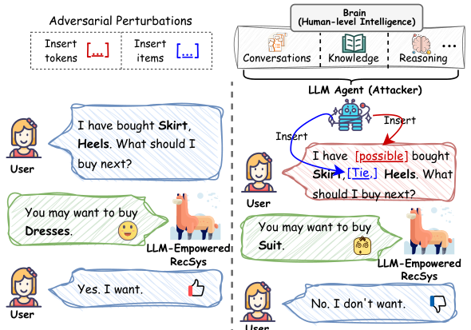
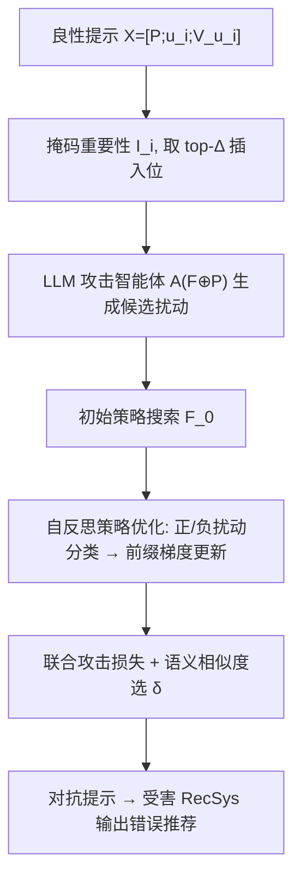
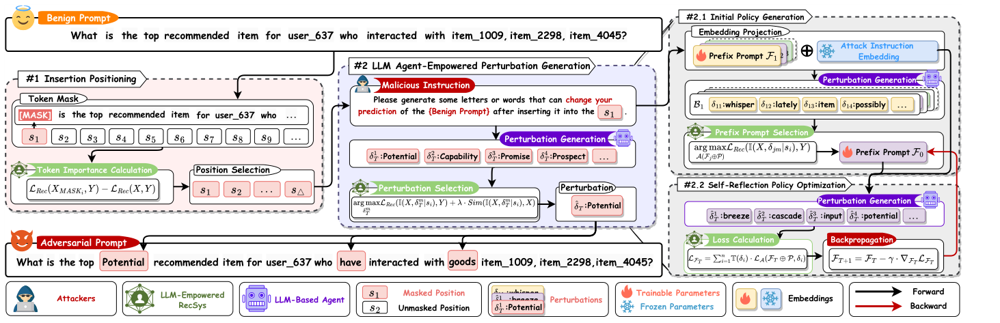

# CheatAgent: Attacking LLM-Empowered Recommender Systems via LLM Agent (以 LLM 智能体攻击 LLM 赋能推荐系统)

- **会议/期刊**: KDD 2024 (Barcelona)
- **作者与机构**: Liang-bo Ning, Shijie Wang, Wenqi Fan (通讯), Qing Li, Xin Xu, Hao Chen (香港理工大学)；Feiran Huang (暨南大学)
- **推荐链路定位**: 端到端生成式（LLM 推荐系统的推理输入侧安全性）
- **研究方向**: 去偏公平、可信隐私与工业架构 / LLM 推荐 (LLM4Rec)
- **论文原文**: [https://arxiv.org/abs/2504.13192v2](https://arxiv.org/abs/2504.13192v2)
- **开源代码**: 暂未开源

## TL;DR (1分钟核心速览)

LLM 赋能推荐系统 (P5 / TALLRec) 把用户画像整体序列化为自然语言提示，天然暴露在"提示投毒"风险之下，而传统基于 RL 的黑盒攻击智能体缺乏文本理解与规划能力、难以奏效。本文提出 CheatAgent：先用 token 掩码定位"最小改动、最大影响"的插入位置，再以 LLM 为攻击智能体生成插入式扰动，并用前缀提示自反思优化策略。在 ML1M/LastFM/Taobao 三个数据集上，仅插入 $\Delta=3$ 个 token，即可让 P5 的 H@5 相对下降 30.6%–71.0%，ASR-H@5 显著超越 GA、BAE、C-w/o PT 等 7 个基线。

## Background & Motivation (背景与核心矛盾)

- **主流范式**: LLM4Rec（P5、TALLRec）将推荐转为"提示 + 生成"，把用户历史写成文本序列，并以负对数似然 $\mathcal{L}_{Rec}$ 微调；安全性研究则多沿用 PoisonRec/KGAttack 式 RL 智能体做假用户画像注入。
- **前人局限**: ① 纯 RL 智能体从头训练、缺乏开放世界知识，难以处理推荐提示中的文本语义与物品标题，在黑盒 LLM 推荐上收敛差；② 已有攻击针对"离散 ID 序列 + 白盒梯度"，无法在只能观测输入/输出的软标签黑盒设定下工作。
- **核心洞察 (Key Insight)**: 提示词中各 token 对最终推荐的贡献极不均衡——少数"决策关键 token"的邻域足以撬动整条生成；同时 LLM 本身具备人类式推理能力，可反身充当攻击者。
- **本文切入点**: 把攻击重构为"在有序序列中插词/插物品"的受限优化 $\hat{\delta}=\arg\max_{\delta:\lVert\hat{X}-X\rVert_0\le\Delta}\mathcal{L}_{Rec}(\hat{X},Y)$，用定位降搜索空间、用 LLM 智能体降语义鸿沟。

<figure class="paper-figure" markdown="span">
  <figcaption>图1：LLM 时代推荐系统对抗攻击示意图。攻击者利用 LLM 智能体在用户提示中插入一些词元（如单词）或物品，以操纵由 LLM 赋能的推荐系统做出错误决策。</figcaption>
</figure>

## Method (核心方法设计)

### 1. 整体框架 (Overall Architecture)

给定良性提示 $X=[P;u_i;V_{u_i}]$，框架先做**插入定位**：逐 token 掩码、以攻击损失增量衡量重要性，取 top-$\Delta$位置集合$S$；随后进入 **LLM 智能体扰动生成**：用可训练前缀$F$与攻击指令$P$拼接驱动攻击模型$\mathcal{A}$（T5）产出候选扰动，先经$k\times n$采样搜索初始化策略$F_0$，再依据受害系统反馈把候选分为正/负扰动、仅对前缀 embedding 反向传播（受害模型与智能体参数均冻结）做自反思调优；最终在攻击强度与语义相似度之间折中选择$\hat{\delta}$ 并插入。全流程只依赖对受害系统的查询与输出概率，属无目标软标签黑盒攻击。

<figure class="paper-figure" markdown="span">
  <figcaption>图2：所提 CheatAgent 的整体框架。插入定位首先定位影响最大的词元。然后，提出由 LLM 智能体赋能的扰动生成，利用 LLM 作为攻击者智能体生成对抗扰动。其包含两个过程：1）初始策略生成（Initial Policy Generation）搜索较优的攻击策略初始化；2）自我反思策略优化（Self-Reflection Policy Optimization）微调前缀提示，以更新基于 LLM 的智能体的攻击策略。</figcaption>
</figure>

### 2. 关键设计拆解 (Key Designs)

1. **插入定位 (Insertion Positioning)**：痛点是把 $\Delta$个 token 插遍全序列的组合爆炸。做法是掩码第$i$个 token 后测损失变化$I_i=\mathcal{L}_{Rec}(X^{MASK}_i,Y)-\mathcal{L}_{Rec}(X,Y)$，按$S=[s_1,\dots,s_\Delta]$取 top-$\Delta$。直觉：$I_i$ 越大说明该位置承载越多决策证据，相邻插入既能少改输入又能最大化传播。作者还观察到对用户画像成对掩码、并把扰动插到"最大影响物品对的中间"效果更好，侧面验证物品顺序本身编码偏好。
2. **初始策略生成 (Initial Policy Generation)**：随机初始化单一前缀易陷局部最优。做法是采样 $k$个前缀，各自与指令拼接生成$n$个候选$B_j=\mathcal{A}(F_j\oplus P)$，以受害损失选优：$F_0=\arg\max_{j,m}\mathcal{L}_{Rec}(I(X,\delta_{jm}|s_i),Y)$。这一步把"提示词搜索"变成廉价的并行采样，显著缩短后续调优步数。
3. **自反思策略优化 (Self-Reflection Optimization)**：痛点在于攻击智能体与已在下游推荐数据上微调的受害模型存在领域知识鸿沟。做法是用指示函数 $\mathcal{T}(\delta_i)=1$（若损伤$\ge\mathcal{L}^{max}_{Rec}$）否则$-1$，构造带符号损失$\mathcal{L}_{F_0}=\sum_{i}\mathcal{T}(\delta_i)\mathcal{L}_A(F_0\oplus P,\delta_i)$，只在 embedding 空间更新前缀$F\leftarrow F-\gamma\nabla_F\mathcal{L}_F$（$\gamma=0.1$，$T\in\{1,5\}$轮）。正样本被强化、负样本被抑制，等价于对"攻击策略"做免人工标注的偏好对齐。最终扰动由$\hat{\delta}_T=\arg\max_{\delta}\mathcal{L}_{Rec}(I(X,\delta|s_i),Y)+\lambda\cdot Sim(\cdot,X)$选出，$Sim$用 bge-large-en 余弦、$\lambda=0.01$ 保证隐蔽性。

**训练目标、查询开销与推理**：无需训练受害模型，攻击成本主要为查询数，量级约 $k\cdot n+|S|\cdot n\cdot T$；单用户默认$\Delta=3$、$k\in\{6,10\}$、$n\in\{10,12\}$，P5 上$k=n=10$。攻击侧 LLM 冻结，只有前缀向量可训练，避免全参数微调的高昂开销，单次插入扰动即可离线复用。

## Experimental Setup & Evaluation Protocol (实验设置与评估协议)

- **数据集与预处理**（统计量见原文附录 B.1）：

| 数据集 | #Users | #Items | #Interactions | 稀疏度/密度 | 特征/场景说明 |
| :--- | :---: | :---: | :---: | :---: | :--- |
| ML1M | 附录 B.1 | 附录 B.1 | ~1M 评分 | 极稀疏 | 电影评分 + 用户属性；TALLRec 需评分切分喜好/厌恶 |
| LastFM | 附录 B.1 | 附录 B.1 | 音乐收听记录 | 极稀疏 | 音乐艺人交互，长尾显著 |
| Taobao | 附录 B.1 | 附录 B.1 | 电商交易行为 | 稀疏 | 淘宝商品点击/购买 |

- **数据划分与防穿越 (Splitting Strategy)**: 沿用 P5 / TALLRec 官方数据构造（用户历史→下一物品的序列式构造），受害模型在其官方微调设置下复现；攻击侧不接触训练集，仅黑盒查询。
- **排名评测协议 (Ranking Protocol)**: 非全库 Full-Ranking。P5 为生成式 top-$r$输出，用$H@r$、$N@r$（$r\in\{5,10\}$）评估；TALLRec 为 "Yes/No" 二分类，用 AUC。攻击效果统一为相对下降率$ASR=1-\hat{M}/M$（$\hat{M}$为受攻击后指标），$ASR$ 越大攻击越强；**注意该协议衡量的是相对损伤，非绝对排序质量**。
- **对比基线与超参**: 基线含人工构造 MD、RL(PPO)、GA（种群 50、迭代 10）、BAE（BERT 生成 50 候选）、LLMBA、随机基线 RP/RT、随机位置+RPGP、无策略调优 C-w/o PT。攻击侧 $\mathcal{A}$为 T5，所有方法统一$\Delta=3$。

## Key Experimental Results (实验关键数据)

### 1. 主实验对比 (Main Results)

受害模型 P5（顺序索引），$H@5$越低、$ASR$ 越高越好：

| 方法 | ML1M $H@5\downarrow$| ML1M$ASR\text{-}H@5\uparrow$| ML1M$ASR\text{-}N@10\uparrow$| LastFM$ASR\text{-}H@5\uparrow$| Taobao$ASR\text{-}H@5\uparrow$| Taobao$ASR\text{-}N@10\uparrow$ |
| :--- | :---: | :---: | :---: | :---: | :---: | :---: |
| Benign | 0.2116 | / | / | / | / | / |
| MD | 0.1982 | 0.0634 | 0.0776 | 0.1591 | 0.0392 | 0.0180 |
| RT | 0.1949 | 0.0790 | 0.0839 | -0.0227 | 0.0173 | 0.0145 |
| RL (PPO) | 0.1917 | 0.0939 | 0.0926 | 0.2727 | 0.0311 | 0.0234 |
| GA | 0.0829 | 0.6080 | 0.5849 | 0.3864 | 0.0888 | 0.0886 |
| BAE | 0.1606 | 0.2410 | 0.2432 | 0.5909 | 0.1003 | 0.1050 |
| LLMBA | 0.1889 | 0.1072 | 0.0876 | 0.0000 | 0.0473 | 0.0448 |
| RPGP | 0.1733 | 0.1808 | 0.1715 | 0.2727 | 0.1142 | 0.1159 |
| C-w/o PT | 0.0844 | 0.6009 | 0.5935 | 0.6591 | 0.2837 | 0.3161 |
| **CheatAgent** | **0.0614** | **0.7097** | **0.6805** | **0.7045** | **0.3068** | **0.3319** |
| Improv. (vs 最强基线) | -25.9% | +16.7% (vs GA) | +14.7% | +6.9% (vs C-w/o PT) | +8.1% | +5.0% |

受害模型 TALLRec（图 3）：良性 AUC 约 0.71，CheatAgent 将其压至约 0.41（全基线最低），$ASR\text{-}A$ 约 0.39 为最高，说明攻击策略可跨推荐器架构迁移。

### 2. 消融实验 (Ablation Study)

| 变体 | ML1M $ASR\text{-}H@5$| LastFM$ASR\text{-}H@5$| Taobao$ASR\text{-}H@5$ | 说明 |
| :--- | :---: | :---: | :---: | :--- |
| CheatAgent | **0.7097** | **0.7045** | **0.3068** | 完整模型 |
| CheatAgent-RP | 0.3685 | 0.5227 | 0.1142 | 扰动插入随机位置 |
| CheatAgent-I | 0.6174 | 0.6364 | 0.2791 | 前缀随机初始化（无策略搜索） |
| CheatAgent-T | 0.6565 | 0.6818 | 0.3068 | 不做自反思策略调优 |

### 3. 关键实验发现 (Key Findings)

1. **定位是最大收益来源**：将同一 LLM 智能体生成的扰动改插到随机位置（CheatAgent-RP），ML1M 上 $ASR\text{-}H@5$从 0.7097 崩到 0.3685（$-34.1$ 个点），Taobao 从 0.3068 掉到 0.1142，说明"插哪里"比"插什么"更先决；随机插入（RP/RT）本身也能带来 2%–12% 的损伤，证明 LLM 推荐器对输入噪声高度敏感。
2. **策略调优是二次增益而非必需项**：C-w/o PT 已达 0.6009/0.6591/0.2837，说明零样本 LLM 智能体即具攻击力（受害模型下游微调后仍保留 LLM 的提示脆弱性）；自反思优化再提升 6.9%–18.1%，其中初始化搜索（CheatAgent-I 对比）贡献略小于迭代调优（CheatAgent-T 对比）。
3. **扰动可 stealth**：受 $\Delta=3$约束，所有方法余弦相似度均$>0.98$；RP（改画像）最隐蔽，CheatAgent 次之，明显优于 MD/GA，即高攻击成功率并未以语义破坏为代价。超参上$k$在 6–14 间几乎不敏感（曲线平坦），$n$单调增益但耗时上升，故取$n=10$ 折中。

## Highlights & Limitations (亮点、对比与审稿批判)

- **与代表作对比 (vs. Prior Work)**: 相较 PoisonRec/KGAttack 类 RL 假用户注入，本文攻击面从"物品 ID 序列"迁移到"自然语言提示"，无需构造完整假画像，只需 3 个 token；相较 BAE（BERT 掩码填空）与 LLMBA（一次性 LLM 生成），CheatAgent 增加"插入位置定位 + 闭环反馈调优"两个环节，在 ML1M 上 $ASR\text{-}H@5$ 分别为其 2.9× 与 6.6×。
- **可迁移亮点**: ① 掩码重要性排序可作为通用的"提示敏感位检测"工具，直接迁移到 LLM 重排/对话推荐的鲁棒性自检与提示加固；② 前缀 embedding 空间内的正负样本自反思更新，是一种无需人工标注的攻击/防御策略对齐范式，可反向用于训练鲁棒提示。
- **审稿级局限批判**: ① 攻击智能体用 T5 而非更强 LLM，且受害模型仅 P5/TALLRec 两类，对闭源商用 API（GPT-4 级）与 RAG 式推荐的可迁移性未验证；② 仅做无目标攻击（打散整体性能），缺少定向推广（targeted promotion）场景，而后者才是黑产真实动机；③ 每用户需 $O(kn)$ 次黑盒查询与多轮反传，查询成本与频控下的可行性未量化；④ 数据集统计与划分细节下放附录，主表未报告方差与显著性检验。

## Rating (四维评分)

- **方法创新性 (Novelty)**: ⭐⭐⭐⭐ （首次系统刻画 LLM 推荐器的提示级脆弱性，"定位 + LLM 智能体 + 前缀自反思"三段式组合新颖，但单点技术均为已有组件的巧妙拼装）
- **评估协议与实验扎实度 (Protocol & Experiments)**: ⭐⭐⭐⭐ （三数据集 × 两 victim × 7 基线 + 三变体消融 + 超参/隐蔽性分析较为完整，扣分在无显著性检验、缺定向攻击与统计细节）
- **写作与数学规范度 (Clarity & Rigor)**: ⭐⭐⭐⭐ （攻击目标、正负扰动指示函数与带符号损失推导清晰，符号统一；部分实现细节如成对掩码启发式仅给经验解释）
- **工业落地与复现价值 (Industrial & Practical Value)**: ⭐⭐⭐⭐ （揭示线上 LLM 推荐必须做输入侧防御的直接警示，方法仅需黑盒查询、成本可控；但代码未开源、查询预算与频控约束下的工程化仍待补）

