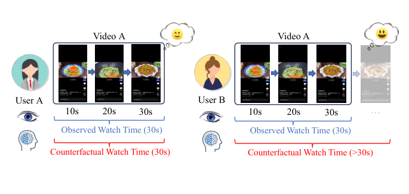
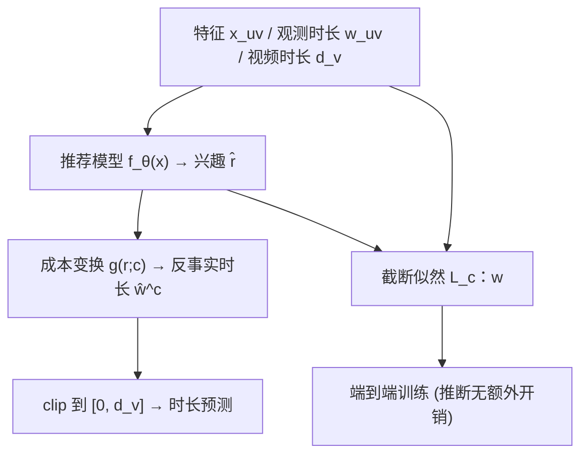

# Counteracting Duration Bias in Video Recommendation via Counterfactual Watch Time (基于反事实观看时长的视频推荐时长偏差矫正)

- **会议/期刊**: KDD 2024 (Barcelona)
- **作者与机构**: Haiyuan Zhao, Jun Xu, Ji-Rong Wen (中国人民大学) ；Guohao Cai, Jieming Zhu, Zhenhua Dong (华为诺亚方舟实验室)
- **推荐链路定位**: 精排（观看时长回归 + 兴趣相关性排序）
- **研究方向**: 去偏公平、可信隐私与工业架构 / 多任务学习与列表级重排
- **论文原文**: [论文原文链接](https://arxiv.org/abs/2406.07932v2)
- **开源代码**: [开源代码仓库链接](https://github.com/hyz20/CWM.git)

## TL;DR (1分钟核心速览)

现有做法（PCR/WTG/D2Q/D2Co）把"完整播放"一律当作最高兴趣，按视频时长分组归一化观看时长来纠偏。本文指出这只是**截断假象**：真正反映兴趣的是"若视频足够长用户还会看多久"的反事实观看时长 (CWT)，完整播放记录只是 CWT 被 $d_v$右截断。作者用经济学边际效用均衡推出 CWT 与兴趣的显式变换函数$w^c=1/(-c\log r)-1$，并用生存分析的**截断似然**在观测时长上优化。三个真实数据集上 MAE 相对次优基线再降 1.8%–2.4%、AUC 追平 Oracle 上限的 ~99.6%，线上 A/B 平均观看时长 +2.9%。

## Background & Motivation (背景与核心矛盾)

- **主流范式**: 以观看时长 $w_{u,v}$作为兴趣代理，通过 PCR、WTG、D2Q、D2Co 等"标签矫正"方法按视频时长$d_v$ 分组归一化，再逆变换回时长预测，可同时兼顾排序与时长回归。
- **前人局限**: ①所有矫正方法把所有"完整播放"记录视作同等高兴趣，与真实数据严重不符（图 1：短视频的完整播放反而正反馈比例更低）；②短视频更易被完整播放，截断更频繁，偏差被进一步放大；论文更以定理 1 证明：**仅凭观测时长的任何变换函数都无法还原兴趣**。
- **核心洞察 (Key Insight)**: 用户观看是一段"边际收益递减、边际成本恒定"的经济决策过程，边际收益=边际成本时累计效用最大，用户主动停止，这一时刻即 CWT（图 2：A、B 观测时长同为 30s，但 B 的 CWT 远大于 30s）。重复播放比例随视频变长而下降、固定时长下观看时长呈双峰分布，均可用 CWT 截断统一解释。

<figure class="paper-figure" markdown="span">
  <figcaption>图2：反事实观看时长与观测观看时长的比较。用户A和用户B的观测观看时长相同，但反事实观看时长不同。</figcaption>
</figure>

- **本文切入点**: 不再修正"观测标签"，而是**显式建模被截断的潜变量 CWT**，将时长的截断机制写入似然函数。

## Method (核心方法设计)

### 1. 整体框架 (Overall Architecture)

训练阶段把每条日志 $\{x_{u,v},w_{u,v},d_v\}$送入推荐模型$f_\theta$得兴趣$ \hat{r}_{u,v}$；再由成本变换函数逆映射$g^{-1}(\cdot;c)$把观测时长（完整播放时用$d_v$）转成兴趣监督$r'_{u,v}$，二者联合$d_v$构成截断似然$\mathcal{L}_c$反向传播。推理阶段则先$\hat r=\Phi(f_{\theta^*}(x))$，再经前向变换$g$与$d_v$ 截断得到实际时长预测，公式开销仅为一次 exp/log，无需额外网络。

### 2. 关键设计拆解 (Key Designs)

1. **成本变换函数：把 CWT 折回兴趣**：定义累计奖励 $F_{\text{reward}}=\omega(r)\log(w^c+1)$、累计成本$F_{\text{cost}}=c\,w^c$，令二者导数相等即得均衡点$w^c=\omega(r)/c-1$；选取满足"$r\to0$时$\omega\to0$、$r\to1$时$\omega\to+\infty$"的$\omega(r)=1/(-\log r)$，得
$w^c_{u,v}=g(r_{u,v};c)=\dfrac{1}{-c\log r_{u,v}}-1,\quad r_{u,v}=g^{-1}(w^c_{u,v};c)=\exp\!\big(\tfrac{1}{-c(w^c_{u,v}+1)}\big)$。
直觉：$c$ 是用户注意力"秒成本"，兴趣越高可支撑的观看越长，且呈对数饱和。

2. **反事实（截断）似然：只在完整播放样本上"放大器"**：把 CWT 视为右截断潜变量，完整播放时只知道 $w^c\ge d_v$，于是
$\log \mathcal{L}_c=\sum_{w_{u,v}<d_v}-\dfrac{\big(g'(w_{u,v};c)-f_\theta(x_{u,v})\big)^2}{2\sigma^2}+\sum_{w_{u,v}=d_v}\log\Phi\!\Big(\dfrac{f_\theta(x_{u,v})-g'(d_v;c)}{\sigma}\Big)$，
其中 $g'(\cdot)=\Phi^{-1}(g^{-1}(\cdot))$ 保证兴趣服从高斯。前半是普通 MSE，后半是生存分析式的 CDF 项，只"单向"抬高被截断样本的兴趣下界，避免把完整播放误标为满分。

3. **训练目标、负采样与推理效率**：无负采样（全曝光回归/似然），两点式损失逐条独立计算；超参仅 $\{c,\sigma\}$两个，推理时$g$ 为常数级 exp/log + 截断，几乎无额外延迟，可直接挂在 FM/DCN/AutoInt 等任意骨干之后。

## Experimental Setup & Evaluation Protocol (实验设置与评估协议)

- **数据集与预处理**（真实日志，无人工负采样）：

| 数据集 | #Users | #Items | #Interactions | 完整播放率(偏差强度) | 说明 |
| :--- | :---: | :---: | :---: | :---: | :--- |
| KuaiRand | 26,988 | 6,598 | 1,266,560 | 17.5% | 快手公开微视频 |
| WeChat | 20,000 | 96,418 | 7,310,108 | 45.5% | 视频号，偏差最重 |
| Product | 2,000,000 | 1,011,007 | 36,366,437 | 32.8% | 工业短视频产品 |

- **数据划分与防穿越**: 沿用各数据集官方日志划分（正文未明示比例，实现细节见附录 B）；训练/测试按用户日志切分，工业集 A/B 为同一周增量数据。
- **排名评测协议**: 无采样负例的**日志内全量样本评估**（点式回归/似然打分，非负采样排序）；排序任务使用式 (8) 构造的兴趣标签——$d_v\le w_{0.7}$时看满即正、$d_v>w_{0.7}$时超$w_{0.7}$即正（$w_{0.7}$ 为观测时长 70% 分位），并提供 Oracle（直接用该标签监督）作为上界。
- **对比基线与超参设置**: 标签矫正类 PCR / WTG / D2Q / D2Co，时长加权类 WLR / NDT，朴素基线 VR，特征类 DCR / CVRDD / VLDRec；骨干为 FM / DCN / AutoInt 三族（内积、外积、Attention），$p<0.05$单尾$t$ 检验。

## Key Experimental Results (实验关键数据)

### 1. 主实验对比 (Main Results)

时长预测（FM 骨干，MAE↓ / XAUC↑，CWM 提升相对次优基线）：

| Method | KuaiRand MAE | KuaiRand XAUC | WeChat MAE | WeChat XAUC | Product MAE | Product XAUC |
| :--- | :---: | :---: | :---: | :---: | :---: | :---: |
| VR | 22.100 | 0.683 | 9.404 | 0.696 | 9.411 | 0.808 |
| PCR | 20.974 | 0.697 | 8.920 | 0.692 | 7.395 | 0.801 |
| WLR | 24.279 | 0.668 | 9.653 | 0.667 | 8.913 | 0.816 |
| D2Q | 18.271 | 0.646 | 8.778 | 0.682 | 7.383 | 0.817 |
| WTG | 23.044 | 0.666 | 9.637 | 0.653 | 7.420 | 0.816 |
| D2Co | 22.262 | 0.662 | 10.200 | 0.627 | 7.511 | 0.812 |
| **CWM** | **17.738** | **0.714** | **8.001** | **0.713** | **6.785** | **0.833** |
| Improv. | 2.9% | 2.4% | 8.9% | 0.4% | 8.1% | 2.0% |

相关性排序（FM 骨干，AUC / nDCG@3）：

| Method | KuaiRand | WeChat | Product |
| :--- | :---: | :---: | :---: |
| Oracle (上界) | 0.738 / 0.489 | 0.711 / 0.588 | 0.669 / 0.589 |
| VR | 0.661 / 0.442 | 0.639 / 0.520 | 0.605 / 0.556 |
| D2Q | 0.679 / 0.464 | 0.602 / 0.528 | 0.624 / 0.523 |
| D2Co | 0.688 / 0.464 | 0.573 / 0.527 | 0.629 / 0.531 |
| NDT | 0.668 / 0.461 | 0.629 / 0.510 | 0.640 / 0.553 |
| **CWM** | **0.735 / 0.486** | **0.703 / 0.581** | **0.660 / 0.582** |

补充对比（表 4）：在 DCN/AutoInt 骨干上 CWM 仍全面优于特征类 DCR、CVRDD、VLDRec（如 Product-AUC 0.663 vs 0.649/0.630/0.647）。

### 2. 消融实验 (Ablation Study)

| 变体 | KuaiRand(截断 17.5%) | WeChat(截断 45.5%) | 结论 |
| :--- | :---: | :---: | :--- |
| CWM (完整) | 最优 (XAUC 0.714 / nDCG 0.486) | 最优 (0.713 / 0.581) | — |
| CWM-C（去成本变换，直接用原始时长） | 显著下降 | 与完整版接近 | 轻截断时变换函数是关键 |
| CWM-L（截断似然→MSE） | 与完整版接近 | 显著下降 | 重截断时似然建模是关键 |

### 3. 关键实验发现 (Key Findings)

- **偏差越重，收益越大且基线越易失效**：WeChat 完整播放率 45.5% 时，WTG(9.637)、D2Co(10.200) 的 MAE 反而不如朴素 VR(9.404)；CWM 却在该集拿到最大相对增益（MAE −14.9% vs VR），印证"完整播放≠同质高兴趣"。
- **排序能力已贴近自建标签的理论上界**：KuaiRand 上 CWM 的 AUC 0.735 达到 Oracle 0.738 的 99.6%，而最强基线 D2Co 仅 0.688（差 4.7 个点），说明收益来自真正的截断建模而非重新标定。
- **按视频时长分桶（图 8）显示基线在长视频上系统性低估**：各基线在 <30s 桶相对 VR 有正增益，但在 >150s 桶增益转负；CWM 在所有时长桶均保持正增益，说明其核心作用是给长视频"补回"被截断的兴趣，而非在短视频上刷分。

## Highlights & Limitations (亮点、对比与审稿批判)

- **与代表作对比 (vs. Prior Work)**: 与 D2Q/WTG/PCR 等标签矫正方法的本质区别是——它们假设"存在单调变换把观测时长映射为兴趣"（定理 1 已否证），CWM 则把观测时长视为潜变量的**截断观测**，用生存似然只约束下界；与 DCR/CVRDD 等特征类去偏方法相比，CWM 还能同时给出无偏兴趣分与时长预测，逆向变换闭环完整。
- **可迁移亮点**: ①"边际收益递减 + 边际成本恒定"推导出的 $1/(-c\log r)-1$可直接移植到阅读时长、直播停留、广告 dwell time 等任何有硬上限的消费类信号；②截断似然（$w<d$用 MSE、$w=d$用$\log\Phi$）是处理"天花板截断"的通用轻量插件。
- **审稿级局限批判**: ①成本参数 $c$是**全局标量超参**，隐含"所有用户注意力成本相同"，与用户异质性、时段疲劳相冲突，$c$敏感度分析也未在正文给出；②排序任务的兴趣真值由式 (8) 用观测时长的 70% 分位自造，存在**标签自洽性风险**——与时长强相关的模型天然占优，缺乏独立的人工或显式反馈验证；③线上仅 +0.3% CTR，说明观看时长导向可能牺牲即时点击，长期留存与"标题党/超长视频"诱导的时长膨胀未被讨论；④高斯假设与$\sigma$ 固定也限制了分布形态复杂场景的适配。

## Rating (四维评分)

- **方法创新性 (Novelty)**: ⭐⭐⭐⭐⭐ （把时长偏差重新定义为 CWT 截断，并用经济学边际均衡推导出显式可逆变换 + 定理 1 否证前人范式，概念重写彻底）
- **评估协议与实验扎实度 (Protocol & Experiments)**: ⭐⭐⭐⭐ （三数据集 × 三骨干 × 两任务 + 时长分桶 + 一周线上 A/B 与显著性检验，覆盖完整；但兴趣标签为自造、缺超参敏感度）
- **写作与数学规范度 (Clarity & Rigor)**: ⭐⭐⭐⭐ （从假设到 $g$/$g^{-1}$、截断似然的推导链条清晰，符号统一；$\sigma$、$c$ 的取法与附录依赖略依赖原文附录）
- **工业落地与复现价值 (Industrial & Practical Value)**: ⭐⭐⭐⭐⭐ （代码开源、可插拔到任意 CTR 骨干、推理仅一次 log/exp 且无额外候选扩展，线上已验证 +2.9% MWT）

