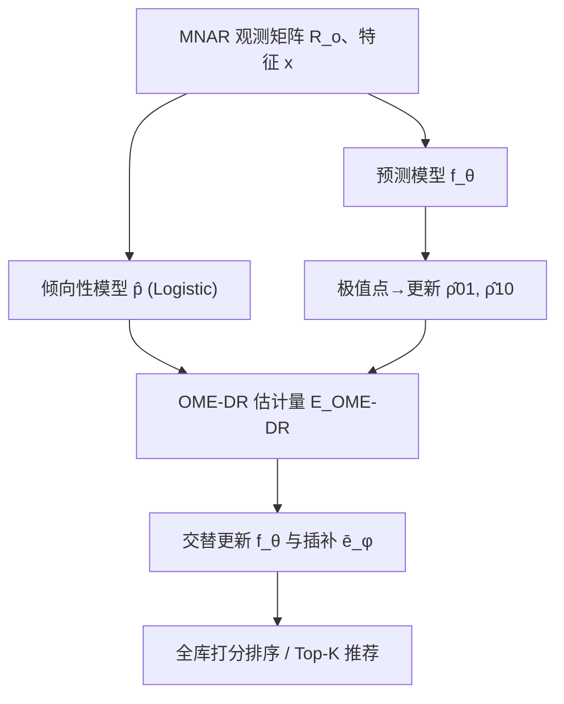
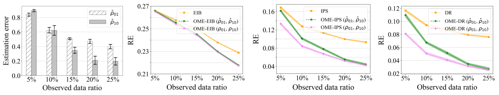

# Debiased Recommendation with Noisy Feedback (带噪反馈下的去偏推荐)

- **会议/期刊**: KDD 2024 (Research Track)
- **作者与机构**: Haoxuan Li, Chunyuan Zheng, Wenjie Wang, Hao Wang, Fuli Feng, Xiao-Hua Zhou（北京大学、新加坡国立大学、浙江大学、中国科学技术大学）
- **推荐链路定位**: 精排（评分预测与风险最小化）
- **研究方向**: 去偏公平与工业架构 / 协同过滤
- **论文原文**: [https://arxiv.org/abs/2406.17182v1](https://arxiv.org/abs/2406.17182v1)
- **开源代码**: [https://github.com/haoxuanli-pku/KDD24-OME-DR](https://github.com/haoxuanli-pku/KDD24-OME-DR)

## TL;DR (1分钟核心速览)

真实推荐数据同时存在两类系统性偏差：评分缺失非随机（MNAR）且观测评分与用户真实偏好不一致（OME，如从众、攻击、随意填答）。现有 EIB/IPS/DR 只校正 MNAR，等价于假设观测评分即真实偏好；而基于替代损失的噪声标签方法又要求标签完全可观测，无法直接用于缺失场景。本文定义“真实预测不准确度”作为评价准则，将替代损失嵌入 EIB/IPS/DR 得到 OME-EIB、OME-IPS、OME-DR 三个估计量，并基于弱可分性假设从数据中辨识假阴性率 $\rho_{01}$与假阳性率$\rho_{10}$，配合交替去噪训练。在 Coat/Music/KuaiRec 三个真实数据集上 OME-DR 的 AUC 相比最优基线提升约 1.5–2.8%，KuaiRec Recall@50 提升约 2.97%。

## Background & Motivation (背景与核心矛盾)

- **主流范式**: 面对 MNAR，EIB 插补缺失评分误差、IPS 用倾向性给观测评分逆概率加权、DR 结合两者，在插补模型或倾向模型之一正确时无偏。
- **前人局限**: ① 上述方法根本不建模“观测评分 $\neq$真实偏好”的测量误差，当$\rho_{01},\rho_{10}$ 较大时风险估计系统性偏离；② 噪声标签领域的替代损失去噪要求全量标签可观测，与推荐场景中大量缺失条目天然冲突。
- **核心洞察 (Key Insight)**: 若弱可分性成立（全体用户-物品对中存在“完全正/完全负”样本），则观测正反馈概率与真实正反馈概率满足单调线性关系 $P(r=1|x)=(1-\rho_{01}-\rho_{10})P(r^*=1|x)+\rho_{10}$，从而可在不改动候选物品集的前提下，用预测分的最大/最小极值点辨识两个误差参数。
- **本文切入点**: 用一个统一替代损失把 OME 去噪“翻译”成真实损失的无偏替代，再套入 EIB/IPS/DR 框架；误差参数用交替训练在线更新，避免额外全观测标注。

## Method (核心方法设计)

### 1. 整体框架 (Overall Architecture)

框架分三阶段闭环：先用 Logistic 回归在 MNAR 观测数据上训练倾向性 $\hat{p}_{u,i}=\sigma(w^\top x_{u,i}+\beta_u+\gamma_i)$；再以 OME-DR 估计量为目标交替更新预测模型$f_\theta$与插补模型$\bar{e}_\phi$；每轮用当前预测模型的最大/最小打分对更新$\hat{\rho}_{01},\hat{\rho}_{10}$。核心思想是把“评分噪声”视为观测标签与真实标签之间的概率翻转，通过替代损失和双稳健插补把翻转效应抵消。

### 2. 关键设计拆解 (Key Designs)

1. **OME 替代损失（去噪核心）**：为在观测噪声标签下无偏估计真实损失 $\ell(f,r^*)$，令$\tilde{\ell}$满足$\mathbb{E}_{r|r^*}[\tilde{\ell}(f,r)]=\ell(f,r^*)$。解得
   $\tilde{\ell}(f,1)=\frac{(1-\rho_{10})\ell(f,1)-\rho_{01}\ell(f,0)}{1-\rho_{01}-\rho_{10}}$，$\tilde{\ell}(f,0)=\frac{(1-\rho_{01})\ell(f,0)-\rho_{10}\ell(f,1)}{1-\rho_{01}-\rho_{10}}$。
   它把假阴性率、假阳性率作为线性系数反向修正损失，物理上抵消标签翻转带来的期望偏移；但该式需 $r$ 已知，故仅在观测条目上使用。

2. **OME-DR 估计量（并行校正 MNAR 与 OME）**：将替代损失嵌入 DR 形式：
   $\mathcal{E}_{\text{OME-DR}}=\frac{1}{|\mathcal{D}|}\sum_{(u,i)}\left(1-\frac{o_{u,i}}{\hat{p}_{u,i}}\right)\bar{e}_{u,i}+\frac{1}{|\mathcal{D}|}\sum_{(u,i)}\frac{o_{u,i}}{\hat{p}_{u,i}}\tilde{\ell}(f_\theta(x_{u,i}),r_{u,i})$。
   第一项用插补误差补齐缺失，第二项用倾向性对观测条目逆概率加权并去噪。当 $\bar{e}=\tilde{e}$或$\hat{p}=p$时无偏（Corollary 3.2 双稳健）。OME-EIB 去掉第二项倾向加权，OME-IPS 令$\bar e=0$。

3. **误差参数辨识与交替训练**：基于弱可分性 $\inf P(r^*=1|x)=0$、$\sup=1$，观测概率最大/最小点满足
   $\rho_{01}=1-P(r_{u_>,i_>}=1|x_{u_>,i_>})$，$\rho_{10}=P(r_{u_<,i_<}=1|x_{u_<,i_<})$。
   训练损失为预测风险 $\min_\theta \mathcal{E}_{\text{OME-DR}}$与插补损失$\mathcal{L}_{\bar e}=\frac{1}{|\mathcal{D}|}\sum o_{u,i}(\tilde{e}_{u,i}-\bar{e}_{u,i})^2/\hat{p}_{u,i}$交替优化；$\hat{\rho}$ 由当前预测分极值点更新。无需负采样，全库打分，推理开销等价于一次 MF 前向。

<figure class="paper-figure" markdown="span">
  <figcaption>图1：随观测数据比例变化的 ˆ𝜌01 和 ˆ𝜌10 及 RE 的估计误差。</figcaption>
</figure>

## Experimental Setup & Evaluation Protocol (实验设置与评估协议)

- **数据集与预处理**: Coat（290 用户/300 物品，6,960 条 MNAR + 4,640 条 MAR）、Music（15,400/1,000，311,704 条 MNAR）、KuaiRec（1,411/3,327，4,676,570 条全曝光记录）。Coat/Music 将评分 $\ge 3$二值化为 1，KuaiRec 将观看比例$\ge 1$ 二值化为 1；另用 ML-100K 构造半合成数据，按 MF 补全矩阵后分 5 档正反馈概率注入不同 OME 翻转。

| 数据集 | #Users | #Items | #Interactions | 稀疏度/密度 | 特征/场景说明 |
| :--- | :---: | :---: | :---: | :---: | :--- |
| Coat | 290 | 300 | 11,600 | 13.3% | 含 MNAR + MAR 双集合 |
| Music | 15,400 | 1,000 | 365,704 | 2.37% | MNAR + MAR |
| KuaiRec | 1,411 | 3,327 | 4,676,570 | 99.7% | 全曝光工业短视频 |
| ML-100K | 943 | 1,682 | ~100k | 6.3% | 半合成，控制 $\rho_{01},\rho_{10}$ |

- **数据划分与防穿越**: Coat/Music 采用官方提供的 MAR 测试集（训练仅见 MNAR），KuaiRec 用全曝光矩阵按用户划分；半合成按观测比例扫描。
- **排名评测协议**: 真实数据报告全候选的 AUC、NDCG@5/50、Recall@5/50；半合成用绝对相对误差 $\text{RE}=|P^*-E_{\text{est}}|/P^*$ 评估风险估计精度，越小越好。
- **对比基线与超参设置**: 去偏基线含 EIB、IPS、SNIPS、DR、DR-JL、MRDR-JL、SDR、TDR、DR-V2、IPS-V2 等；去噪基线含 OME、T-MF、R-MF、LCD-MF；MF 为底座。嵌入维度 Coat 搜索 {4,8,16,32}，Music/KuaiRec 搜索 {8,16,32,64}；学习率 {0.001,…,0.05}，批大小 Coat {64,128,256}、其余 {2048,4096,8192}；显著性用 paired t-test，$p<0.05$。

## Key Experimental Results (实验关键数据)

### 1. 主实验对比 (Main Results)

**半合成 ML-100K（$\rho_{01}=0.2,\rho_{10}=0.1$，指标 RE↓）**：

| 方法 | ROTATE | SKEW | CRS | ONE | THREE | FIVE |
| :--- | :---: | :---: | :---: | :---: | :---: | :---: |
| Naive | 0.125 | 0.179 | 0.175 | 0.241 | 0.264 | 0.299 |
| DR | 0.106 | 0.087 | 0.104 | 0.190 | 0.209 | 0.216 |
| SDR | 0.097 | 0.089 | 0.102 | 0.172 | 0.191 | 0.194 |
| TDR | 0.092 | 0.080 | 0.103 | 0.171 | 0.189 | 0.195 |
| OME-IPS (估 $\hat\rho$) | 0.060 | 0.096 | 0.075 | 0.111 | 0.125 | 0.144 |
| OME-DR (估 $\hat\rho$) | **0.056** | **0.067** | **0.045** | **0.090** | **0.102** | **0.106** |
| OME-DR (真 $\rho$) | 0.009 | 0.039 | 0.022 | 0.013 | 0.016 | 0.012 |

**真实数据集（AUC / Recall@K，$K$=5/5/50）**：

| 方法 | Coat AUC | Coat Rec@5 | Music AUC | Music Rec@5 | KuaiRec AUC | KuaiRec Rec@50 |
| :--- | :---: | :---: | :---: | :---: | :---: | :---: |
| MF | 0.619 | 0.364 | 0.632 | 0.361 | 0.621 | 0.702 |
| DR | 0.633 | 0.360 | 0.654 | 0.372 | 0.643 | 0.721 |
| TDR | 0.638 | 0.370 | 0.657 | 0.371 | 0.650 | 0.723 |
| SDR | 0.635 | 0.368 | 0.660 | 0.376 | 0.661 | 0.739 |
| T-MF (去噪) | 0.633 | 0.372 | 0.650 | 0.376 | 0.657 | 0.739 |
| R-MF | 0.641 | 0.376 | 0.657 | 0.371 | 0.645 | 0.720 |
| OME-EIB | 0.627 | **0.387** | 0.664 | 0.384 | 0.667 | 0.742 |
| OME-IPS | 0.636 | 0.373 | 0.664 | **0.385** | **0.671** | **0.763** |
| OME-DR | **0.651** | 0.385 | **0.671** | 0.389 | 0.662 | 0.743 |
| **Improv.%** | **+1.56%** | **+2.93%** | **+1.67%** | **+1.83%** | **+1.51%** | **+3.24%** |

### 2. 消融实验 (Ablation Study)

| 配置 | ROTATE RE↓ | Coat AUC | Music AUC | KuaiRec AUC | 说明 |
| :--- | :---: | :---: | :---: | :---: | :--- |
| w/o 倾向加权 (OME-EIB) | 0.357 | 0.627 | 0.664 | 0.667 | 仅插补 + 去噪 |
| w/o 插补 (OME-IPS) | 0.060 | 0.636 | 0.664 | **0.671** | 仅 IPS + 去噪 |
| w/o OME (DR) | 0.106 | 0.633 | 0.654 | 0.643 | 原始 DR，忽略噪声 |
| OME-DR (估 $\hat\rho$) | **0.056** | **0.651** | **0.671** | 0.662 | 完整模型 |
| OME-DR (真 $\rho$, 上界) | 0.009 | – | – | – | 参数理想情况 |

### 3. 关键实验发现 (Key Findings)

- **必须“双管齐下”**: 半合成 ROTATE 上，仅去噪的 OME-EIB RE 高达 0.357，几乎与普通 EIB (0.366) 持平；而 OME-DR 降至 0.056，证明 MNAR 与 OME 是乘性叠加偏差，缺一不可。
- **误差参数可辨识且鲁棒**: 图 1 显示随观测比例上升，$\hat\rho_{01}/\hat\rho_{10}$估计误差与 RE 单调下降；估计$\hat\rho$的 RE (0.056) 虽高于真$\rho$ 上界 (0.009)，但相较原始 DR (0.106) 仍降低约 47%。
- **真实数据全面增益**: Coat 上 OME-DR AUC 0.651 已显著超越所有 DR 变体（$\rho<0.05$）；KuaiRec 因全曝光且噪声更强，IPS 型 OME-IPS 的 Recall@50 达 0.763，较 SDR 0.739 提升 3.24%，说明倾向性加权在稠密数据下更有效。

## Highlights & Limitations (亮点、对比与审稿批判)

- **与代表作对比 (vs. Prior Work)**: 相较 DR/TDR/SDR 只在 MNAR 维度做双稳健校正，本文把 OME 的标签翻转矩阵嵌入同一估计量，并给出显式偏差项 $\omega_{11},\omega_{01},\omega_{10},\omega_{00}$；相较 T-MF/R-MF 等启发式去噪，本文有可证明的无偏性与 Rademacher 泛化界（Theorem 3.4）。
- **可迁移亮点**: ① 用预测分极值点在线辨识类条件噪声率，几乎零额外标注成本，可迁移到点击/转化噪声校正；② 替代损失与 DR 的“正交组合”思路可推广到延迟反馈、位置偏差等复合偏差。
- **审稿级局限批判**: ① 弱可分性假设在长尾或冷启动物品占主导时可能不成立，极值点本身可能被噪声污染；② 需要预训练一个 $P(r=1|x)$模型并提供初始$\hat\rho$，若初始误差大，交替训练可能陷入局部解；③ 实验以 MF 为底座，未验证在深度序列模型或图模型上的可扩展性。

## Rating (四维评分)

- **方法创新性 (Novelty)**: ⭐⭐⭐⭐ （首次将 OME 与 MNAR 作为交叠威胁统一建模，替代损失嵌入 DR 的推导干净，双稳健与泛化界完整）
- **评估协议与实验扎实度 (Protocol & Experiments)**: ⭐⭐⭐⭐ （3 真实 + 1 半合成，RE/AUC/NDCG/Recall 多指标，含真 $\rho$ 上界对照与显著性检验，但真实数据只有 MF 底座）
- **写作与数学规范度 (Clarity & Rigor)**: ⭐⭐⭐⭐ （偏差项分解清晰，弱可分性讨论充分；部分符号在正文与附录间略有跳跃）
- **工业落地与复现价值 (Industrial & Practical Value)**: ⭐⭐⭐⭐ （代码开源，全库打分无额外负采样，误差参数在线更新，适合精排风险校正；但依赖倾向模型质量与交替调参）

