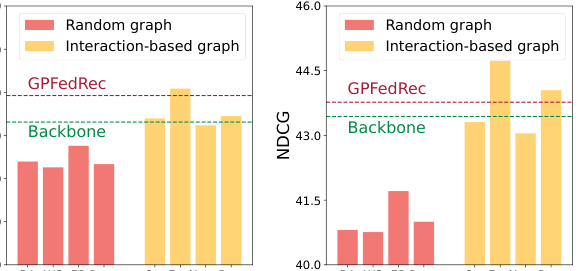
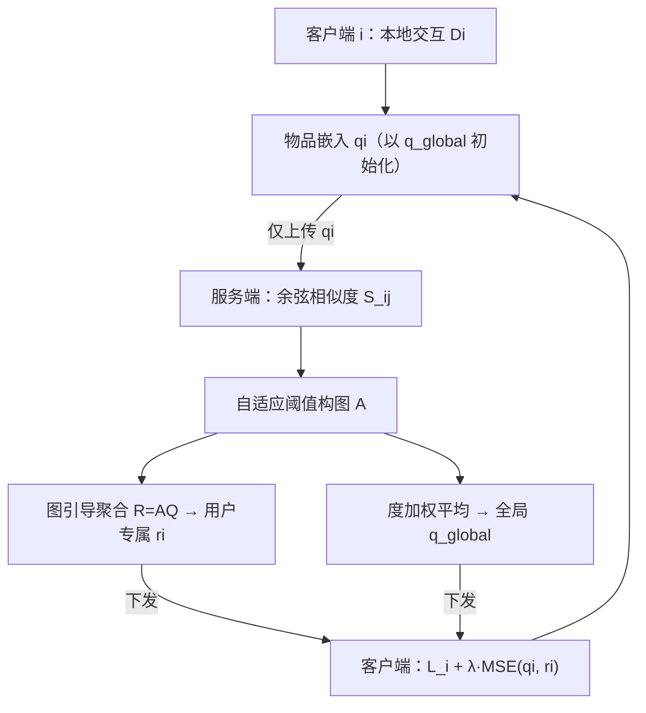
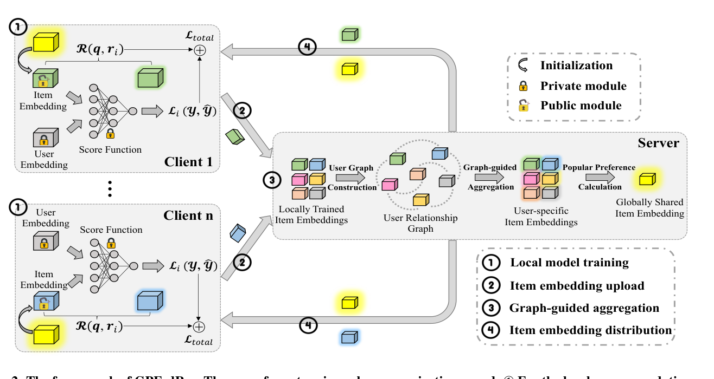

# GPFedRec: Graph-guided Personalization for Federated Recommendation (图引导个性化的联邦推荐)

- **会议/期刊**: KDD 2024 (Regular Paper)
- **作者与机构**: Chunxu Zhang, Bo Yang (吉林大学)；Guodong Long, Peng Yan (UTS)；Tianyi Zhou (UMD)；Zijian Zhang (吉大/香港城市大学)
- **推荐链路定位**: 召回（联邦协同过滤表征学习）+ 端侧训练/云侧聚合的服务架构
- **研究方向**: 去偏公平、可信隐私与工业架构 / 图神经网络推荐
- **论文原文**: [https://arxiv.org/abs/2305.07866v2](https://arxiv.org/abs/2305.07866v2)
- **开源代码**: [https://github.com/Zhangcx19/GPFedRec](https://github.com/Zhangcx19/GPFedRec)

## TL;DR (1分钟核心速览)

联邦推荐把每个用户当成孤立客户端共享同一套物品嵌入，既丢掉了用户间的兴趣相关性，又因隐私约束无法拿到全局交互图来补。GPFedRec 的做法是：让客户端上传**本地微调后的物品嵌入**（而非交互记录），服务端以此计算余弦相似度、按自适应阈值构图，再用 1 层 GCN 聚合出**用户专属物品嵌入 $r_i$** 与度加权的**全局共享嵌入$q_{global}$**，双通道下发并以 MSE 正则约束本地训练。在 5 个基准、Leave-One-Out + HR/NDCG@10 协议下取得 9/10 项指标最优，相对最强基线 HR@10 最高 +3.38%，且可作为插件无缝提升 FedMF/FedRecon/PFedRec（最高 +9.96% HR）。

## Background & Motivation (背景与核心矛盾)

- **主流范式**: FedRec 以客户端本地训练 + 服务端同步共享参数实现隐私保护，代表性工作 FCF/FedMF/FedNCF 共享完整模型，PFedRec 去除用户嵌入、改由本地个性化打分函数刻画偏好。
- **前人局限**: ① 所有客户端共享**统一的物品嵌入**，无法反映不同用户群对同一物品的差异化视角，个性化被"平均"抹平；② FedPerGNN 等试图引入图结构，但需借助第三方服务器匹配高阶邻居，通信与计算开销大，且负采样样本会误导邻居发现，隐私暴露面反而扩大。
- **核心洞察 (Key Insight)**: 作者先用 PFedRec 在 MovieLens-100K 上做预实验（图 1）——随机图（BA/WS/ER/Regular）**反而掉点**，而交互图（Cosine/Jaccard/Pearson）稳定涨点，说明增益来自"图是否真有信息量"而非"是否有图"。既然物品嵌入本身承载了用户对物品的偏好视角，那么**相似用户必然给出相似的物品嵌入**，这层信息天然可共享。
- **本文切入点**: 用可公开共享的物品嵌入替代私有交互记录来构造用户关系图，把"图增强"与"数据不出端"两个目标同时满足。

<figure class="paper-figure" markdown="span">
  <figcaption>图 1：不同的用户关系图增强联邦推荐模型在 MovieLens-100K 数据集上的性能比较。Backbone 表示当前最先进的联邦推荐模型。</figcaption>
</figure>

## Method (核心方法设计)

### 1. 整体框架 (Overall Architecture)

每个通信轮次四步闭环：① 客户端以服务端下发的 $q_{global}$初始化本地物品嵌入$q_i$，用户嵌入$p_i$与打分函数$o_i$保持本地私有，用 BCE 交互损失 + 与$r_i$的 MSE 正则联合优化；② 客户端仅上传$q_i$；③ 服务端计算$S_{ij}$并按自适应阈值建图$A$，一路做图卷积聚合得到每人专属的$r_i$，另一路做度加权平均得到$q_{global}$；④ 两者一并下发进入下一轮。图结构与嵌入随训练自适应演化，全程不触碰任何$Y_{um}$。

<figure class="paper-figure" markdown="span">
  <figcaption>图 2：GPFedRec 的框架。每个通信轮次包含四个步骤：①对于在每个客户端上训练的本地推荐模型，它使用全局共享的物品嵌入初始化物品嵌入。然后，它将用户特定的物品嵌入作为正则项 R(𝑞,𝑟𝑖)，与推荐任务损失 L𝑖(Y, ˆY) 一起作为优化目标 L𝑡𝑜𝑡𝑎𝑙。②客户端将本地更新的物品嵌入 𝑞 上传到服务器。③服务器首先基于接收到的物品嵌入构建用户关系图。然后，它进行图引导的</figcaption>
</figure>

### 2. 关键设计拆解 (Key Designs)

1. **无交互隐私的用户图构建（Adaptive-threshold User Graph）**：固定邻居数 $k$ 会引入冗余或邻居不足，且各用户活跃度差异极大。作者改为按相似度均值动态定阈：
$S_{ij}=\frac{q_i\cdot q_j}{\lVert q_i\rVert\lVert q_j\rVert},\qquad A_{ij}=\mathbb{I}\left[S_{ij}>\gamma\,\bar{S}\right]$其中$\bar{S}$为相似度矩阵均值、$\gamma$为缩放因子（实验最优 0.5）。物理直觉：活跃度高的用户与多数人相似度高，自然获得更多邻居，稀疏用户自动被保护，图密度随训练自适应收敛，无需人工指定$k$。

2. **图引导聚合 + 流行偏好双通道（Graph-guided Aggregation）**：FedAvg 的平均聚合抹杀个性化。本文令 $R=A^{l}Q$（$l=1$，取原始邻接矩阵），第$i$行为用户专属嵌入$r_i$；同时以度矩阵$D$加权得到$q_{global}=DQ$，使邻居多的用户（流行偏好持有者）在全局嵌入中占更高权重。训练目标为
$\mathcal{L}_{total}=\mathcal{L}_{i}(\theta_i;Y,\hat{Y})+\lambda\,\mathcal{R}(q_i,r_i),\quad \mathcal{R}=\text{MSE}$
两个通道分别供给"群体共性"与"邻域个性"——消融显示单靠 Reg 不初始化（71.05）与单靠 Init 不加 Reg（68.68）均劣于二者结合（72.85），证明共性与个性必须同时注入。

3. **训练目标、负采样与推理效率**：$\mathcal{L}_i$为隐式反馈 BCE，负样本按比例从未交互集中均匀采样；上传前可选拉普拉斯机制$q_i \leftarrow q_i+\text{Laplacian}(0,\delta)$ 实现本地差分隐私。工程上客户端只保留交互物品 + 采样子集，服务端先做候选过滤再让端侧小集合排序；`Light_GPFedRec` 通过降低图更新频率（偏好短时稳定）换取效率，精度几乎无损。

## Experimental Setup & Evaluation Protocol (实验设置与评估协议)

- **数据集与预处理**（Lastfm-2K 过滤交互 <5 的用户，其余沿用原始划分）：

| 数据集 | #Users | #Items | #Interactions | 稀疏度 | 场景说明 |
| :--- | :---: | :---: | :---: | :---: | :--- |
| MovieLens-100K | 943 | 1,682 | 100,000 | 93.70% | 电影评分（每用户 ≥20 条） |
| MovieLens-1M | 6,040 | 3,706 | 1,000,209 | 95.53% | 电影评分，最大用户规模 |
| Lastfm-2K | 1,600 | 12,454 | 185,650 | 99.07% | 音乐（艺人收听） |
| HetRec2011 | 2,113 | 10,109 | 855,598 | 95.99% | MovieLens-10M 扩展 |
| Douban | 2,509 | 39,576 | 893,575 | 99.10% | 用户-电影，最稀疏 |

- **数据划分与防穿越**: `Leave-One-Out`（每用户最后一条交互作测试、倒数第二条验证），纯隐式反馈、无辅助特征。
- **排名评测协议**: 报告 HR@10 与 NDCG@10（单位 1e-2）；训练阶段对未交互物品做负采样，评测沿用 LOO 惯例（非全库百万级 Full-Ranking，属该子领域通行的小候选集协议，需注意与真实全库排序的偏差）。
- **对比基线与超参**: 集中式 MF/NCF/SGL + 联邦 FedMF/FedNCF/FedRecon/MetaMF/PFedRec/FedLightGCN/FedPerGNN；最优正则系数 $\lambda=0.5$、阈值因子$\gamma=0.5$、嵌入维度 64（16 欠拟合、128 过拟合）；改进均通过双侧 t 检验$p<0.05$（标 `*`）。

## Key Experimental Results (实验关键数据)

### 1. 主实验对比 (Main Results)

| Method | ML-100K HR/NDCG | ML-1M HR/NDCG | Lastfm-2K HR/NDCG | HetRec2011 HR/NDCG | Douban HR/NDCG |
| :--- | :---: | :---: | :---: | :---: | :---: |
| MF (CenRec) | 64.48 / 38.61 | 68.69 / 41.45 | 83.13 / 71.78 | 66.07 / 41.21 | 87.17 / 61.75 |
| NCF (CenRec) | 64.21 / 37.13 | 64.02 / 38.16 | 82.57 / 68.26 | 64.74 / 39.55 | 87.49 / 62.51 |
| SGL (CenRec) | 64.90 / 40.02 | 62.60 / 34.13 | 82.37 / 68.59 | 65.12 / 40.18 | – |
| FedMF | 66.17 / 38.73 | 67.91 / 40.81 | 81.63 / 68.18 | 64.69 / 40.29 | 87.17 / 61.00 |
| FedRecon | 65.22 / 38.49 | 62.78 / 36.82 | 82.06 / 67.37 | 61.57 / 34.20 | 87.52 / 60.38 |
| MetaMF | 66.21 / 41.02 | 44.98 / 26.31 | 81.04 / 64.13 | 54.52 / 32.36 | 82.58 / 55.44 |
| PFedRec (最强基线) | 71.37 / 42.59 | **73.03** / 44.49 | 82.38 / 73.19 | 67.20 / 42.70 | 87.40 / 61.90 |
| FedLightGCN | 24.53 / 12.78 | 37.53 / 15.01 | 43.75 / 15.17 | 22.65 / 7.96 | 35.66 / 12.33 |
| **GPFedRec (Ours)** | **72.85\*** / 43.77\* | 72.17 / 43.61 | 83.44\* / 74.11\* | 69.41\* / **43.34**\* | 88.04\* / 63.87\* |
| **Light_GPFedRec (Ours)** | 72.00\* / **43.92**\* | 72.95 / **45.48**\* | **83.44**\* / **74.33**\* | **69.47**\* / 43.21\* | **88.04**\* / **64.00**\* |
| Improv.% (vs 最强基线) | ↑2.07% / ↑3.12% | – / ↑2.23% | ↑1.29% / ↑1.56% | ↑3.38% / ↑1.50% | ↑0.59% / ↑2.38% |

（FedPerGNN 在 HetRec2011/Douban 上内存溢出无法运行；GPFedRec 相对**集中式**最优基线在 ML-100K 上 HR/NDCG 提升达 13.46%/17.88%。）

### 2. 消融实验 (Ablation Study)

| 变体 (backbone = FedNCF) | ML-100K HR/NDCG | ML-1M HR/NDCG |
| :--- | :---: | :---: |
| FedNCF | 60.66 / 33.93 | 60.38 / 34.13 |
| + 个性化打分函数 (PSF) | 66.38 / 38.85 | 67.14 / 40.22 |
| + PSF + 全局嵌入初始化 (Init) | 68.68 / 41.12 | 68.26 / 41.10 |
| + PSF + 用户专属嵌入正则 (Reg) | 71.05 / 42.56 | 67.79 / 42.98 |
| GPFedRec (PSF + Init + Reg) | **72.85 / 43.77** | **72.17 / 43.61** |
| FedMF + GraphAgg | 71.79 / 44.20 (↑8.49%/↑14.12%) | 72.15 / 43.69 (↑6.24%/↑7.06%) |
| FedRecon + GraphAgg | 70.78 / 41.10 (↑8.52%/↑6.78%) | 69.03 / 40.15 (↑9.96%/↑9.04%) |
| PFedRec + GraphAgg | 72.38 / 43.75 (↑1.42%/↑2.72%) | 73.50 / 44.53 (↑0.64%/↑0.09%) |

### 3. 关键实验发现 (Key Findings)

1. **增益主因是"个性化打分函数 + 图引导嵌入"的互补，而非任一单点**：PSF 单独带来最大单步跃升（60.66→66.38，+9.4% HR），但 Init 与 Reg 单独使用均停留在 68.68/71.05，只有二者同时注入才到 72.85——说明"邻域个性"必须与"全局流行"协同，任何一侧缺失都会退化为有偏约束。
2. **"统一物品嵌入"才是 FedRec 的真正瓶颈，而非具体 backbone**：把 GraphAgg 作为零参数插件挂到 FedRecon 上，ML-1M 上 HR 由 62.78 升至 69.03（+9.96%）、NDCG +9.04%；连已做个性化的 PFedRec 也能再涨 1.42%（ML-100K），验证该机制与模型结构正交。
3. **隐私预算可承受，图的信息量是硬门槛**：$\delta=0.3$ 的拉普拉斯噪声下 HR/NDCG 仅从 72.85/43.77 降至 70.41/41.78，仍高于最强基线 PFedRec（71.37/42.59）；反之随机图全面掉点、交互图（Euclid@80% 密度）最优，而本文用嵌入构图可逼近交互图水平——即"图的真实相关性"决定收益上限，而非图的密度。

## Highlights & Limitations (亮点、对比与审稿批判)

- **与代表作对比**: 相比 PFedRec（只做本地个性化打分、用户间零通信），本文多了一条"服务端邻域信息回流"通道；相比 FedPerGNN（需第三方服务器对齐交互、开销大且负样本污染邻居匹配），本文仅共享物品嵌入、零额外参数；相比集中式 LightGCN/SGL（依赖全局交互图，本质违规），本文在等价隐私约束下取得更优精度。
- **可迁移亮点**: ① "用模型参数而非原始数据做相似度"这一隐私友好构图范式，可直接移植到跨域/多场景联邦对齐、端云协同的冷启动用户分群；② 自适应均值阈值构图免调 $k$，在密度差异极大的数据集（93.7% vs 99.1% 稀疏度）上均稳定。
- **审稿级局限批判**: ① **可扩展性被严重低估**——每轮需计算 $N\times N$相似度矩阵（$O(N^2d)$）并在服务端跑全批 GCN，实验最大仅 6,040 用户，千万级工业场景不可行，作者仅以"降低更新频率 + 邻居采样"作定性讨论而无实测；② **隐私论证偏弱**——上传物品嵌入仍可能被反演出交互偏好，本文只加 LDP 噪声而无形式化$(\epsilon,\delta)$-DP 保证、也无成员推断/重构攻击实验；③ 邻接矩阵未做度归一化（原文明确取原始$A$），高度数用户的$r_i$数值尺度会随邻居数膨胀，且$q_{global}=DQ$的表述与"度加权平均"直觉存在符号歧义，复现时需自行判定是否隐含$D^{-1}A$；④ ML-1M 上 HR@10 未超 PFedRec（72.17 vs 73.03），作者未解释该规模下的失效原因。

## Rating (四维评分)

- **方法创新性 (Novelty)**: ⭐⭐⭐⭐ （"参数即可共享的图信号"洞察简洁有力，用嵌入替代交互构图的思路具有范式意义，但 GCN 聚合本身无理论新意）
- **评估协议与实验扎实度 (Protocol & Experiments)**: ⭐⭐⭐⭐ （5 数据集 + 显著性检验 + 消融 + 兼容性 + 隐私 + 超参五组分析齐备，扣分在于仅 LOO 小候选集协议、无全库排序与大规规模压力测试）
- **写作与数学规范度 (Clarity & Rigor)**: ⭐⭐⭐ （框架与算法流程清晰，但公式编号错乱、$DQ$ 与度归一化表述含糊、消融表命名与正文描述不一致，隐私分析缺乏形式化推导）
- **工业落地与复现价值 (Industrial & Practical Value)**: ⭐⭐⭐⭐ （代码开源、插件式零新增参数、通信仅传物品嵌入、Light 变体兼顾效率，但 $O(N^2)$ 构图与端侧存储问题在大规模场景仍需工程改造）

