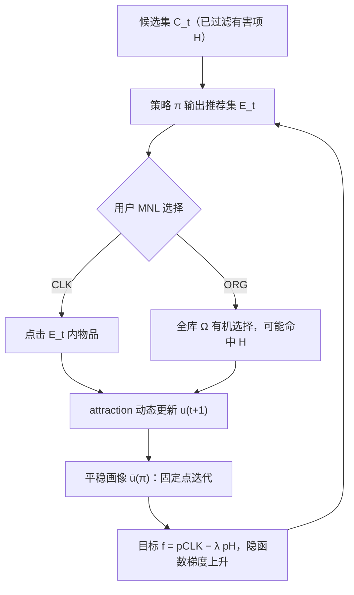

# Harm Mitigation in Recommender Systems under User Preference Dynamics (用户偏好动态下的推荐系统危害缓解)

- **会议/期刊**: KDD 2024
- **作者与机构**: Jerry Chee、Sarah Dean（Cornell University），Shankar Kalyanaraman、Sindhu Kiranmai Ernala、Udi Weinsberg（Meta），Stratis Ioannidis（Northeastern University）
- **推荐链路定位**: 召回/排序策略层（top-$k$ 推荐策略的稳态优化，非模型结构改进）
- **研究方向**: 去偏公平与可信推荐 / 用户偏好动态与长期影响
- **论文原文**: [论文原文链接](https://arxiv.org/abs/2406.09882v1)
- **开源代码**: [开源代码仓库链接](https://github.com/jerry-chee/HarmMitigation)

## TL;DR (1分钟核心速览)

本文指出一个被忽视的因果链：推荐系统**从不展示有害内容**，却可以通过“吸引用户点击”改变其兴趣漂移方向，进而影响其**站外有机选择**有害内容的概率。作者用 MNL 选择模型 + attraction 偏好动态刻画该闭环，证明静态偏好下 top-$k$对任意危害惩罚系数$\lambda$仍最优（即危害项形同虚设），且交替优化可任意次优；转而用**隐函数定理**对平稳点求梯度直接优化$p_{\text{CLK}}-\lambda p_H$。在 MovieLens+IMDB 半合成实验（5 个类型、100 用户）上，梯度策略在$p_{\text{CLK}}$与$p_H$ 上**同时**优于 Alt/U0/Unif，目标值相对 Unif 最高提升 77%。

## Background & Motivation (背景与核心矛盾)

- **主流范式**: 工业界以 top-$k$ 最大化 CTR；多目标推荐则把危害/健康风险作为惩罚项直接塞进打分目标（或 RL 奖励），但用户偏好被视为静态。
- **前人局限 1**: 忽略推荐—偏好的放大反馈回路（amplification），无法解释“平台内全是安全内容，用户却越推越极端”的现象；静态假设下危害项在数学上会被 CTR 项吞掉。
- **前人局限 2**: 即便引入偏好动态（如 Lu et al. 的 attraction 模型），其反馈为矩阵分解的实值评分、平稳点有闭式解、策略优化退化为半定松弛的二次规划；一旦换成离散选择（MNL），平稳点无闭式、目标非凸，常用交替优化失去保证。
- **核心洞察 (Key Insight)**: 危害是**间接且路径依赖**的——推荐集 $E_t$只影响$p_{\text{CLK}}$，而$p_H=(1-p_{\text{CLK}})\cdot s_H/s_\Omega$，即“把用户留在平台内”本身就是一种危害缓解手段；但用户画像会因消费内容而漂移，今天的点击会改变明天的$s_H$。
- **本文切入点**: 在**平稳点**上定义目标，用 Banach 不动点定理保证平稳画像存在唯一且可迭代求得，再用隐函数定理把“平稳点对策略的依赖”微分掉，从而做真正的端到端策略梯度。

## Method (核心方法设计)

### 1. 整体框架 (Overall Architecture)

每一时刻，推荐器从已过滤有害项的候选集 $C_t\subseteq\Omega\setminus H$中依策略$\pi$抽取推荐集$E_t$；用户依 MNL 模型二选一：**CLK**（点击$E_t$中某物品）或 **ORG**（拒绝推荐，从含有害项的全体$\Omega$中有机选择）。被消费物品$v(t)$通过 attraction 动态把用户画像$u(t)$拉向自身，形成$u(t+1)$。优化的不是单步收益，而是该马尔可夫式过程的**平稳画像**$\bar u(\pi)$上的$f(\pi)=p_{\text{CLK}}(\pi,\bar u)-\lambda p_H(\pi,\bar u)$。求解分三层：固定点迭代算$\bar u$→ 隐函数定理算$\nabla_\pi\bar u$→ 链式法则得$\nabla_\pi f$→ 投影梯度/SLSQP 更新$\pi$。

<figure class="paper-figure" markdown="span">
  ![图 1：我们的完整模型，在推荐系统交互下纳入用户动态。推荐系统向用户呈现推荐集 𝐸𝑡，用户选择与推荐内容交互（CLK），或从整个目录（包括有害内容）中自然选择一项（ORG）。随后用户画像在吸引力模型 \[24, 41, 48, 51\] 下更新，更接近用户所选的物品 𝑣(𝑡)。](../../../../assets/papers/2406.09882v1/figure_1.png)<figcaption>图 1：我们的完整模型，在推荐系统交互下纳入用户动态。推荐系统向用户呈现推荐集 𝐸𝑡，用户选择与推荐内容交互（CLK），或从整个目录（包括有害内容）中自然选择一项（ORG）。随后用户画像在吸引力模型 [24, 41, 48, 51] 下更新，更接近用户所选的物品 𝑣(𝑡)。</figcaption>
</figure>
*图 1：推荐集—用户选择—偏好漂移的闭环；推荐器永不展示有害项，危害仅经 ORG 通道发生。*

### 2. 关键设计拆解 (Key Designs)

1. **CLK/ORG 双通道 MNL 选择模型（把“不推荐”也建模成一种干预）**：痛点是把危害当作物品属性，忽略了“用户可绕开推荐”。本文令 $s_v=e^{v^\top u}$、$g(s_E)=s_E/(s_E+c)$，则$p_{\text{CLK}\mid E}=g(s_E)$、$p_{v\mid E,\text{ORG}}=s_v/s_\Omega$，于是$p_H=(1-g(s_E))\cdot s_H/s_\Omega$。直觉：$c$是“拒绝推荐的吸引力”，$c$ 越大推荐越难被接受，缓解危害越只能靠**精准选品**而非“多推”。

2. **静态最优性反例（Thm 1）：危害惩罚在静态偏好下完全失效**：若 $g$单调非降，则对任意$\lambda\ge 0$，top-$k$仍是$\max_\pi p_{\text{CLK}}-\lambda p_H$的最优解（独立采样下再加$g$凹即可，用子模/多重线性松弛证明）。因为$p_H$关于$p_{\text{CLK}}$ 单调递减，最大化点击即最小化危害。这解释了为何“在目标里加危害项”若无动态建模则毫无作用——也给出本文的合法性：**必须**建模动态。

3. **平稳点存在唯一性与隐函数梯度（Thm 2 + 可解性）**：attraction 动态为 $u(t+1)=\mathbb{E}[\beta u_0+\alpha_{v(t)}v(t)+(1-\alpha_{v(t)}-\beta)u(t)]$，令漂移为零得固定点方程

$$\bar u=F(\pi,\bar u)=\frac{\beta u_0+\alpha_H\sum_{v\in H}v\,p_v+\alpha_{NH}\sum_{v\notin H}v\,p_v}{\beta+\alpha_H p_H+\alpha_{NH}p_{NH}}.$$

当 $\|v\|$满足收缩条件（与$\|u_0\|,\alpha_{NH},\beta,n,d,\alpha_H$有关）时$F$关于$u$是$\pi$-一致压缩，故$\bar u$存在唯一且$\bar u_{\ell+1}=F(\pi,\bar u_\ell)$指数收敛；该条件可通过对$v,u_0$同步缩放无损满足。由于$\bar u(\pi)$无闭式，用隐函数定理对$F(\pi,\bar u)-\bar u=0$ 求导：

$$\nabla_\pi\bar u(\pi)=-\left(\nabla_u F(\pi,\bar u)-I_{d\times d}\right)^{-1}\nabla_\pi F(\pi,\bar u),$$

再链式展开 $\nabla_\pi f=\nabla_\pi U+[\nabla_\pi\bar u]^\top\nabla_u U$（$U=p_{\text{CLK}}-\lambda p_H$）。核心价值：把“仿真到收敛”这一不可微过程变成可反向传播的**可微不动点**。

4. **训练目标、负采样与推理开销**：无负采样（非对比学习范式）；目标即式 (9) 的非凸 $f$，约束集$\mathcal{P}$是单纯形并集，投影$O(m\log m)$（Michelot 算法）。有界基数设定参数量$m=\sum_C\binom{|C|}{k}$，仅$k$固定时可行；独立采样设定$m'=\sum_C|C|$，对任意$k$多项式。每步梯度需一次固定点收敛（指数收敛）+ 一次$d\times d$ 线性求解，整体多项式复杂度；实验用 SLSQP 而非朴素 PGA。

## Experimental Setup & Evaluation Protocol (实验设置与评估协议)

- **数据集与预处理**: MovieLens-25M 提供用户/物品画像，经 IMDB parental guide 对齐；某片在 5 类（Sex & Nudity、Violence & Gore、Profanity、Alcohol/Drugs/Smoking、Frightening Scenes）中任一为 “Severe” 即标为有害。

| 数据集（类型子集） | #Users | #Items | #Interactions | 密度 | 说明 |
| :--- | :---: | :---: | :---: | :---: | :--- |
| Action / Adventure / Comedy / Fantasy / Sci-Fi | 各 100 | 各 100（评分数最多） | 子集内全部评分（原文未逐条报告） | 未报告 | $d=12$的 MF 画像作$u_0$与$v$；$c\in[1,20]$ 按类型校准 |

- **数据划分与防穿越 (Splitting Strategy)**: 本文**不做**训练/测试集切分，而是**半合成策略仿真**：MF 在全量评分上学出 $u_0,v$，作为仿真初值与物品向量；随后对每个策略独立跑$u(t)$动力学至$10^{-3}$ 容差，比较平稳点指标。因此不存在传统意义上的穿越风险，但也失去了真实泛化评估。
- **排名评测协议 (Ranking Protocol)**: **非** Full-Ranking 亦非 Sampled Ranking，不报告 HR/NDCG/Recall。评价指标为策略级期望量：$f$、$p_{\text{CLK}}$、$p_H$，以及收敛残差$\|\lim_t u(t)-\bar u\|$；100 用户取均值±标准差，并额外给出**逐用户**目标差 PDF 以证明非均值掩盖。
- **对比基线与超参设置**: 4 个策略——`Grad`（本文，SLSQP+隐函数梯度）、`Alt`（交替优化，式 14）、`U0`（静态画像 $u_0$下的 top-$k$，即 Thm 1）、`Unif`（均匀随机推荐）。默认$\alpha_H=0.25$、$\alpha_{NH}=0.5$、$\beta=0.15$、$\lambda=100$、有界基数$k=1$；参数敏感性另测$\lambda,\beta,c,\alpha_H/\alpha_{NH},k$。

## Key Experimental Results (实验关键数据)

### 1. 主实验对比 (Main Results)

| 类型 | Grad $f$↑ | Alt$f$| U0$f$| Unif$f$| Grad$p_{\text{CLK}}$↑ | Grad$p_H$↓ | Improv.% (以$\lvert f\rvert$ 计) |
| :--- | :---: | :---: | :---: | :---: | :---: | :---: | :---: |
| Action | **-4.694** | -6.268 | -6.279 | -15.681 | **0.810** | **0.055** | +70.1% |
| Adventure | **-3.445** | -3.793 | -4.160 | -9.243 | **0.676** | **0.041** | +62.7% |
| Comedy | **-3.816** | -4.725 | -5.556 | -11.318 | **0.717** | **0.045** | +66.3% |
| Fantasy | **-2.754** | -2.760 | -3.425 | -7.957 | 0.649 | **0.034** | +65.4% |
| Sci-Fi | **-2.925** | -4.772 | -4.618 | -12.485 | **0.812** | **0.037** | **+76.6%** |

（完整对照：Alt 的 $p_{\text{CLK}}/p_H$在 Action 为 0.774/0.070，U0 为 0.778/0.071，Unif 为 0.487/0.162；Grad 在**所有**类型上同时取得更高$p_{\text{CLK}}$与更低$p_H$。）

### 2. 消融实验 (Ablation Study)

本文无传统模块消融，其“消融”即策略变体，恰好对应两条定理：

| 变体 | 5 类型平均 $f$↑ | 平均$p_{\text{CLK}}$↑ | 平均$p_H$ ↓ | 移除的要素 |
| :--- | :---: | :---: | :---: | :--- |
| Grad（完整） | **-3.527** | **0.733** | **0.042** | — |
| Alt（交替优化） | -4.464 | 0.706 | 0.052 | 平稳点与策略的**联合**梯度（退化为 Thm 1 的 top-$k$） |
| U0（静态 top-$k$） | -4.808 | 0.684 | 0.055 | 偏好动态建模（Thm 1 场景） |
| Unif（均匀） | -11.337 | 0.341 | 0.117 | 个性化与全部优化 |

收敛性（表 3）：所有策略、所有类型的 $\|\lim_t u(t)-\bar u\|$均在$4.7\times10^{-5}\sim7.3\times10^{-4}$，与$10^{-3}$ 阈值同量级，验证 Thm 2 的指数收敛在实测中成立。

### 3. 关键实验发现 (Key Findings)

1. **不存在“效用—安全”权衡**：Grad 在 Action 上比 Alt 高 3.6 个点 $p_{\text{CLK}}$（0.810 vs 0.774）同时低 1.5 个点$p_H$（0.055 vs 0.070）。原因在于稳态下被推荐的物品既“更可点”又与平均有害向量的内积更小（图 3 中 Grad 的支持集明显右偏），二者在画像空间中本就解耦，并非此消彼长。
2. **交替优化的失效被实测复现**：U0 与 Alt 的 $f$差距很小（平均 -4.808 vs -4.464），远小于二者与 Grad 的差距——说明 Alt 的第一步被 Thm 1 锁死为 top-$k$、轨迹与$\lambda$ 无关，多迭代几乎不产生信息增量；而 Grad 相对 Unif 的 62.7%–76.6% 提升主要来自“动态+联合梯度”而非“多算几步”。
3. **收益随“危害可分离性”单调变化**：$\lambda$从 100 增大时 Grad 的优势扩大（危害越重要，动态建模越值钱）；$\beta$增大则优势缩小（固有画像权重高、策略可塑性低）；$c$增大优势扩大（推荐越易被拒，越需选品精准）；$\alpha_H/\alpha_{NH}$增大优势缩小（用户对有害内容越敏感，缓解空间越小）；$k$增大在固定$c$时全体变好、在固定$k/c$ 时全体变差但 Grad 始终领先。Fantasy 上 Grad≈Alt（-2.754 vs -2.760）说明该类型下危害方向与点击方向近乎重合，动态建模的边际价值趋零。

## Highlights & Limitations (亮点、对比与审稿批判)

- **与代表作对比 (vs. Prior Work)**: 相较 Lu et al. (KDD'14) 的 attraction+MF 实值反馈（平稳点闭式、SDR 解二次规划），本文将反馈换成**离散 MNL 选择**，平稳点变为无闭式固定点、目标非凸，技术难度实质性上升；相较 Kalimeris et al. (KDD'21) 等对 amplification 的实证批判，本文给出**可执行的策略优化算法**而非仅诊断；相较 Singh et al. (FAccTRec'20) 的 safe-RL，本文不依赖在线试错，用可微不动点离线求解稳态。
- **可迁移亮点**: ①“可微不动点”范式可直接迁移到任何“推荐→用户状态演化→再推荐”的稳态优化（如多样性衰减、创作者生态、留存 LTV）；②独立采样策略参数化把 $\Theta(2^k)$降到$\sum_C|C|$，是大动作空间策略搜索的实用技巧；③把“拒绝推荐”显式建模为 ORG 通道，使$p_H$ 成为可解释的乘积形式，便于业务归因。
- **审稿级局限批判**: ①评估规模极小且半合成——每类型仅 100 用户×100 物品、$d=12$、$k=1$，MF 画像直接当真值，缺少真实在线 A/B 或反事实日志验证，77% 的提升幅度不宜外推；②目标非凸且需已知候选分布$\mathcal{C}$、$c$、$\alpha_H/\alpha_{NH}$与完美有害项标注，SLSQP 每步需解线性系统并跑固定点收敛，线上时延与参数标定成本未评估；③危害被简化为二元标签，“Severe 即有害”既忽略强度与语境，也把 ORG 选择建模为与推荐无关的静态分布$s_\Omega$，实际中站外内容供给本身受平台外因素驱动。

## Rating (四维评分)

- **方法创新性 (Novelty)**: ⭐⭐⭐⭐ （把偏好动态下的危害缓解从“加惩罚项”推进到“平稳点可微优化”，Thm 1/Thm 3 两个负面结论尤具警示价值，但 attraction+MNL 组件本身均为已有工具的组合）
- **评估协议与实验扎实度 (Protocol & Experiments)**: ⭐⭐⭐ （逐用户 PDF 与收敛残差检验较严谨，但无真实划分、无全库排序评测、规模仅 100×100、5 类型子集且 $k=1$，统计显著性与线上有效性缺失）
- **写作与数学规范度 (Clarity & Rigor)**: ⭐⭐⭐⭐ （Thm 1–3 与引理证明完整，收缩条件与复杂度分析清晰，隐函数梯度推导规范；符号表完备，但附录中 $p_H$与$p_{\text{NH}}$ 的记号偶有混用）
- **工业落地与复现价值 (Industrial & Practical Value)**: ⭐⭐⭐ （代码已开源、思路对平台治理与“安全推荐”极具启发，但依赖完美有害标注与已知动力学参数，且需在候选集分布上求解非凸问题，距线上部署尚有距离）

