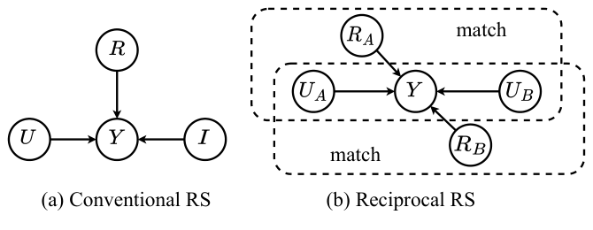
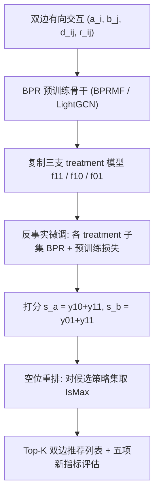
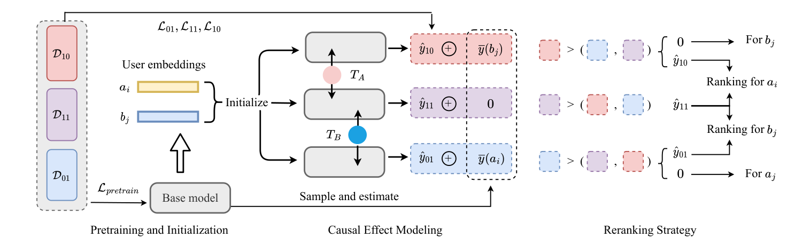

# Revisiting Reciprocal Recommender Systems: Metrics, Formulation, and Method (重访互惠推荐系统：指标、形式化与方法)

- **会议/期刊**: KDD 2024
- **作者与机构**: Chen Yang, Sunhao Dai, Yupeng Hou, Wayne Xin Zhao, Jun Xu, Yang Song, Hengshu Zhu（中国人民大学高瓴人工智能学院、BOSS 直聘南贝叶实验室、UCSD）
- **推荐链路定位**: 重排（双边列表级重排）
- **研究方向**: 去偏公平、可信隐私与工业架构 / 多任务学习与列表级重排
- **论文原文**: [arXiv:2408.09748](https://arxiv.org/abs/2408.09748v1)
- **开源代码**: [RUCAIBox/CRRS](https://github.com/RUCAIBox/CRRS)

## TL;DR (1分钟核心速览)

互惠推荐（RRS，招聘/约会）长期复用单边 Recall/NDCG 各自评估，无法识别"同一对被双边重复推荐"的冗余，也无法刻画两侧用户规模失衡。本文提出 CRecall/CPrecision（覆盖去冗余）、SRecall/SPrecision（双边稳定）与 RNDCG（按两侧人数加权）五项指标，并将推荐形式化为双边 treatment 的潜在结果估计（$T\in\{11,10,01,00\}$），配合"空位重排"最大化匹配期望。招聘/约会两数据集全库排序（$K=50$）下，CRRS 的 CRecall 较最优基线提升 2.5%/11.2%，匹配对数提升至 10,490/1,743。

## Background & Motivation (背景与核心矛盾)

- **主流范式**: RRS 视作"两个独立排序任务"，对 A 侧、B 侧分别用 BPRMF/LightGCN 类骨干训练与评估，指标仍沿用 Recall/Precision/NDCG。
- **前人局限①**: 单边评估**重复计分**——若一对用户被互相推荐并成功匹配，两侧各记一次 TP，实际只产生 1 个匹配对，覆盖率被高估。
- **前人局限②**: 忽视**双边失衡与拥挤**（如 1000 候选人 vs 100 岗位），简单算术平均 Recall 会被大侧主导；且冗余推荐多集中榜首，直接优化两侧差异无效（图 5）。
- **核心洞察 (Key Insight)**: 推荐本身是作用于匹配结果的"处理 (treatment)"，且 A/B 两侧推荐是**耦合的混合处理**；只有对 $\{11,10,01\}$ 三种干预分别估计潜在结果，才能解耦"到底是谁的推荐促成了匹配"（图 1）。
- **本文切入点**: 先重建指标 → 再用潜在结果框架建模双边干预 → 最后用空位重排把"未被推荐的一侧槽位"的替代收益纳入打分。

<figure class="paper-figure" markdown="span">
  <figcaption>图1：(a) 常规RS中将推荐作为处理的因果图；(b) RRS中将互惠推荐作为双边处理的因果图。U：用户，I：物品，R：推荐，RA和RB：分别为每一侧做出的推荐，Y：排序分数（例如，匹配概率）。为简洁起见，忽略所有混杂因素。</figcaption>
</figure>

## Method (核心方法设计)

### 1. 整体框架 (Overall Architecture)

输入为双边有向交互四元组 $\langle a_i,b_j,d_{ij},r_{ij}\rangle$，$d_{ij}$标记交互方向、$r_{ij}$标记是否最终匹配。先用真实匹配标签以 BPR 预训练一个骨干（BPRMF 或 LightGCN），并将其嵌入复制为三支独立参数的模型$f_{11},f_{10},f_{01}$，分别在$D_{11},D_{10},D_{01}$三个"treatment 子数据集"上反事实微调；推理时三支输出聚合为两侧排序分，再经空位重排（IsMax 策略选择）产出 Top-$K$ 双边列表。方法对骨干**模型无关**，可直接套用任意协同过滤模型。

<figure class="paper-figure" markdown="span">
  <figcaption>图3：所提出框架CRRS的示意图。我们用红色、紫色和蓝色表示三种处理分配。每种分配表示一个不同的数据集以及在处理条件下得到的结果。</figcaption>
</figure>

### 2. 关键设计拆解 (Key Designs)

1. **覆盖/稳定性/均衡三类指标（把冗余推荐纳入分母与分子）**：痛点是把双边重复命中计两次。核心做法是在 TP 上做**容斥去重** $TP_A+TP_B-TP_{A\cap B}$：$\mathrm{CRecall}=\frac{TP_A+TP_B-TP_{A\cap B}}{M}$、$\mathrm{SRecall}=\frac{TP_{A\cap B}}{M}$、$\mathrm{RNDCG@}K=\frac{n\cdot\mathrm{NDCG}_A+m\cdot\mathrm{NDCG}_B}{n+m}$。直觉：CRecall 计"系统真正撮合了多少对"，SRecall 计"双向互推的比例"，RNDCG 用两侧人数做加权以抵消拥挤效应；三者在传统 Recall 完全相同的三种情形下可区分出 1 vs 0.5 的覆盖率差异。

2. **双边 treatment 潜在结果建模（解耦两侧推荐各自的因果贡献）**：$T_A=1$表示把$b_j$推给$a_i$，$T_B=1$反之，$T=(T_A,T_B)\in\{11,10,01,00\}$。为避开"同一对被观测到多种干预"的反事实困境，采用"相似用户相似处理效应"的协同假设，用三支骨干分别估计$\hat{y}_{10}=f_{10}(a_i,b_j)$、$\hat{y}_{11}=f_{11}(a_i,b_j)$、$\hat{y}_{01}=f_{01}(a_i,b_j)$，并聚合为$s_{a_i}=\hat{y}_{10}+\hat{y}_{11}$、$s_{b_j}=\hat{y}_{01}+\hat{y}_{11}$。直觉：单向推荐与双向互推的收益可加，模型无需再猜测匹配归因于哪一侧。

3. **空位重排与训练目标**：若 $T_A=0$，$a_i$腾出的槽位可推荐他人$b_v$，其收益$\bar{y}(a_i)$由对侧采样用户近似估计。候选策略集$\mathcal{S}=\{\hat{y}_{11},\ \hat{y}_{01}+\bar{y}(a_i),\ \hat{y}_{10}+\bar{y}(b_j),\ \bar{y}(a_i)+\bar{y}(b_j)\}$，用示性函数只保留最优策略项：$s_{a_i}=\mathbb{I}_{\max}(\hat{y}_{11})\hat{y}_{11}+\mathbb{I}_{\max}(\hat{y}_{10}+\bar{y}(b_j))\hat{y}_{10}$（B 侧对称）。训练两阶段：$\mathcal{L}=\mathcal{L}_{pretrain}+\sum_{t\in\{11,10,01\}}\mathcal{L}_t$，其中$\mathcal{L}_t=-\frac{1}{|\mathcal{D}_t|}\sum\log\sigma\big(\hat{y}_t(a_i,b_j)-\hat{y}_t(a_i,b_j')\big)$。负采样为**每侧随机 1 个（Uniform）**，$D_{11}$ 同时采样双向负例；复杂度与骨干同阶、无需负样本缓存，但需 3 份模型参数（约 3× 推理开销）。

## Experimental Setup & Evaluation Protocol (实验设置与评估协议)

- **数据集与预处理**: 两数据集均保留 `5-core` 交互，随机按 `8:1:1` 划分。

| 数据集 | #Users A | #Users B | #Interactions | #Match | 稀疏度 | 场景说明 |
| :--- | :---: | :---: | :---: | :---: | :---: | :--- |
| Recruitment | 32,161 | 25,665 | 790,725 | 224,636 | 99.90% | 招聘平台两周真实日志，候选人-招聘者双向选择 |
| Dating | 6,391 | 6,516 | 605,288 | 51,474 | 98.55% | Libimseti 异性评分，双向评分 ≥8 记为匹配 |

- **数据划分与防穿越 (Splitting Strategy)**: `比例划分`（8:1:1），未采用全局时间戳切分——论文未处理时序穿越，属潜在泄漏风险点。
- **排名评测协议 (Ranking Protocol)**: 无偏 `Full-Ranking`（对侧全部候选用户参与排序），$K=50$；同时报告单边 Recall/Precision/NDCG 与五项新指标及 True Positive Pairs 计数。
- **对比基线与超参设置**: 骨干类 BPRMF / LightGCN；互惠类 D-BPRMF、LFRR、D-LightGCN、DPGNN；嵌入维度 $d=128$，Adam（学习率搜索$\{10^{-3},10^{-4},10^{-5}\}$），早停 patience=30，配对$t$-test 显著性$p<0.05$。

## Key Experimental Results (实验关键数据)

### 1. 主实验对比 (Main Results)

| 数据集 | 模型 | CRecall@50 | CPrecision@50 | SRecall@50 | RNDCG@50 | TP Pairs |
| :--- | :--- | :---: | :---: | :---: | :---: | :---: |
| Recruitment | BPRMF | 0.3388 | 0.0052 | 0.0617 | 0.0989 | 7,610 |
| | D-BPRMF | 0.2336 | 0.0036 | 0.0152 | 0.0620 | 5,247 |
| | LFRR | 0.3530 | 0.0054 | 0.0967 | 0.1054 | 7,929 |
| | LightGCN | 0.3609 | 0.0056 | 0.0638 | 0.0832 | 8,106 |
| | DPGNN | 0.4555 | 0.0070 | **0.1535** | **0.1447** | 10,231 |
| | CRRS (LightGCN) | **0.4670** | **0.0073** | 0.1248 | 0.1142 | **10,490** |
| Dating | BPRMF | 0.2795 | 0.0062 | 0.0830 | 0.0660 | 1,439 |
| | LFRR | 0.3045 | 0.0067 | 0.0968 | 0.0706 | 1,567 |
| | DPGNN | 0.3007 | 0.0067 | 0.0997 | 0.0738 | 1,548 |
| | CRRS (LightGCN) | **0.3387** | **0.0075** | **0.1221** | **0.0849** | **1,743** |
| | `Improv.` vs best baseline | +11.2% | +11.9% | +22.5% | +15.0% | +11.2% |

Recruitment 上 CRRS 相对 DPGNN 的 CRecall 提升 +2.5%（$0.4670$vs$0.4555$），但 RNDCG 反降 21.1%，体现覆盖-稳定性的本质权衡；Dating 上则全面领先（全指标$p<0.05$）。

### 2. 消融实验 (Ablation Study)

| 数据集 | 变体 | CRecall@50 | CPrecision@50 | SRecall@50 | RNDCG@50 |
| :--- | :--- | :---: | :---: | :---: | :---: |
| Recruitment | CRRS (BPRMF) | **0.3968** | **0.0061** | 0.0242 | 0.1050 |
| | w/o finetune | 0.3694 | 0.0057 | 0.0397 | **0.1070** |
| | w/o pre-train | 0.3400 | 0.0052 | 0.0527 | 0.0689 |
| | w/o rerank | 0.3091 | 0.0048 | **0.0757** | 0.0882 |
| | BPRMF (原骨干) | 0.3388 | 0.0052 | 0.0617 | 0.0989 |
| Dating | CRRS (BPRMF) | **0.3086** | **0.0068** | 0.0993 | **0.0751** |
| | w/o finetune | 0.2927 | 0.0065 | 0.0696 | 0.0692 |
| | w/o pre-train | 0.2986 | 0.0066 | 0.0826 | 0.0669 |
| | w/o rerank | 0.3011 | 0.0067 | **0.1123** | 0.0748 |
| | BPRMF (原骨干) | 0.2795 | 0.0062 | 0.0830 | 0.0660 |

### 3. 关键实验发现 (Key Findings)

1. **重排是覆盖率增益的主引擎，但代价是稳定性**：Recruitment 上去掉重排使 CRecall 从 $0.3968$跌至$0.3091$（$-22.1\%$），甚至低于原始 BPRMF（$0.3388$）；同时 SRecall 由$0.0242$升至$0.0757$（$+213\%$）。说明"提高撮合总量"与"双向互推"在稀疏场景下是显式冲突，需按业务取舍。
2. **反事实微调主要买来稳定性，预训练主要买来覆盖率**：Dating 上去掉 finetune 使 SRecall 从 $0.0993$掉到$0.0696$（$-29.9\%$），而 CRecall 仅$-5.2\%$；去掉预训练则 CRecall 降至$0.2986$且 RNDCG 仅$0.0669$。即预训练提供跨侧相关性底座，方向性微调精修双边稳定。
3. **指标本身即是"新结论"**：在同一 BPRMF 上人工把冗余推荐改为非冗余（BPRMF-Uni）或反向操作（BPRMF-Rep），三者 Recall/Precision/NDCG **完全相同**，但 CRecall 与匹配对数差异显著（图 4）；且冗余命中集中在 Top-50 前列（图 5），故"直接压低两侧列表差异"的对称正则难以奏效，必须显式重排。

## Highlights & Limitations (亮点、对比与审稿批判)

- **与代表作对比 (vs. Prior Work)**: 相较 LFRR（双 MF 聚合）与 DPGNN（双视角图表示），本文不在单侧相关性上堆叠结构，而是**先改评估口径再改优化目标**；相较 D-BPRMF/D-LightGCN 这类"切断两侧共享训练信号"的独立双模型，CRRS 通过预训练共享嵌入 + 分方向微调保留了协同信息（D-BPRMF 全面最差即为例证）。
- **可迁移亮点**: ①容斥式 TP 去重可直接用于任何"多路曝光合并"的场景（如双列流、双边市场、多场景联合去重）；②"空位槽位收益 $\bar{y}$"的采样近似是一种轻量级 listwise 重排打分项，可移植到粗排-精排级联的二阶段打分修正。
- **审稿级局限批判**: ①需三份骨干参数（$f_{11}/f_{10}/f_{01}$）且重排要对每个候选采样对侧用户估计$\bar{y}$，工业上线推理成本约 3–5×，文中未给延迟数据；②划分采用随机 8:1:1 而非时间切分，招聘/约会存在强时序演化，可能高估泛化；③"冗余推荐一律为负"的立场在 Tinder 类双向 like 产品成立，但在 LinkedIn 类单侧可达场景未必，指标通用性受业务假设约束。

## Rating (四维评分)

- **方法创新性 (Novelty)**: ⭐⭐⭐⭐ （首次把 RRS 评估缺陷与双边因果 treatment 形式化闭环打通，指标容斥与空位重排均有清晰因果解释，但组件本身技术门槛不高）
- **评估协议与实验扎实度 (Protocol & Experiments)**: ⭐⭐⭐⭐ （两域真实数据集 + 全库排序 + 配对 $t$ 检验 + 完整消融与人工指标对照实验，唯随机划分未做时间切分）
- **写作与数学规范度 (Clarity & Rigor)**: ⭐⭐⭐⭐ （指标定义、IsMax 策略与算法伪代码符号自洽，复杂度和假设交代略简，反事实假设仅定性引用）
- **工业落地与复现价值 (Industrial & Practical Value)**: ⭐⭐⭐⭐ （代码与数据开源、骨干无关易插拔，覆盖-稳定权衡可直接对齐双边市场业务指标，但 3× 模型与采样式 $\bar{y}$ 估计增加线上开销）

