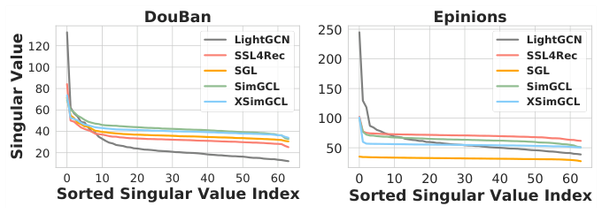
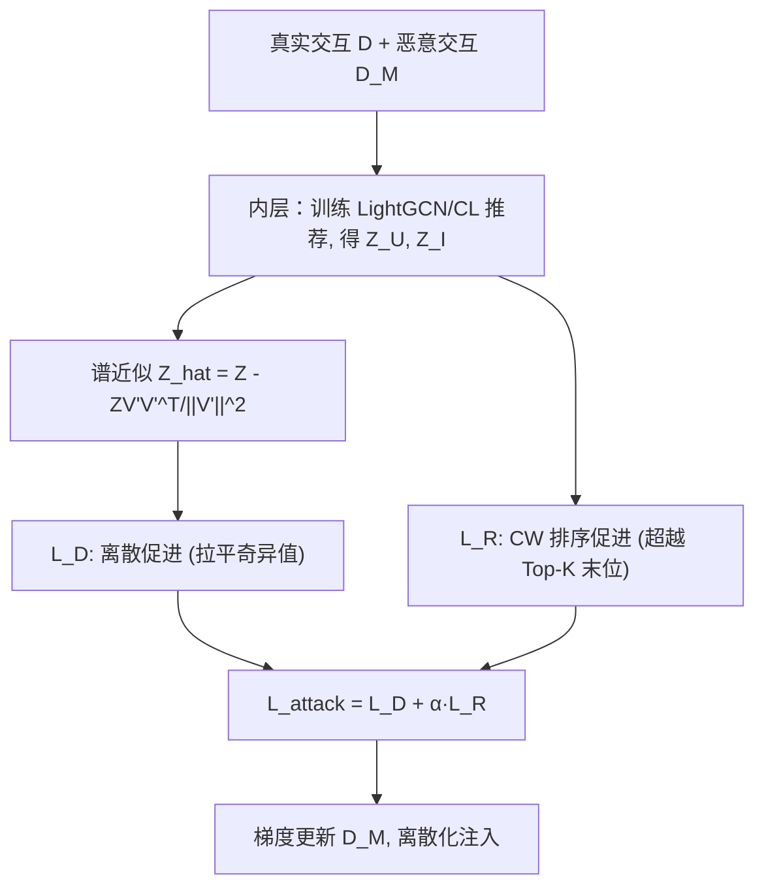
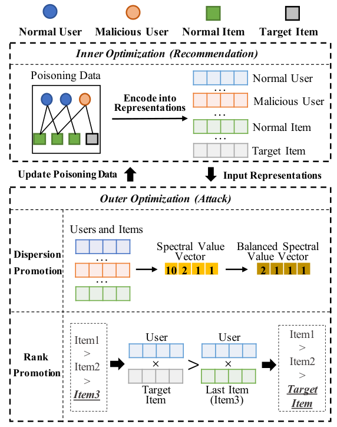

# Unveiling Vulnerabilities of Contrastive Recommender Systems to Poisoning Attacks (对比学习推荐系统对投毒攻击的脆弱性揭示)

- **会议/期刊**: KDD 2024 (Aug 25–29, Barcelona)
- **作者与机构**: Zongwei Wang, Min Gao (重庆大学); Junliang Yu, Hongzhi Yin, Shazia Sadiq (昆士兰大学); Bin Cui (北京大学)
- **推荐链路定位**: 训练阶段数据投毒（作用于召回表征学习，评估于 Top-K 推荐列表）
- **研究方向**: 去偏公平、可信隐私与工业架构 / 自监督对比学习与交互去噪
- **论文原文**: [https://arxiv.org/abs/2311.18244v2](https://arxiv.org/abs/2311.18244v2)
- **开源代码**: [https://github.com/CoderWZW/ARLib](https://github.com/CoderWZW/ARLib)

## TL;DR (1分钟核心速览)

CL 推荐（SGL/SimGCL/XSimGCL 等）虽能缓解流行度偏置，本文却发现其对**定向推广单个物品**的投毒攻击比 LightGCN 更脆弱。作者从梯度与谱分析指出：InfoNCE 的负项等价于节点间排斥，使表征全局离散；而最小化 CL 损失等价于压平表征奇异值谱。据此提出 CLeaR：以「谱离散促进 + CW 排序促进」双目标的双层优化生成恶意交互。在 DouBan/Epinions/ML-1M/Yelp 四数据集上，1% 恶意用户即可使 Epinions 上 XSimGCL 的 Hit-Ratio@50 从 0.0161 升至 0.0470（+192%），远超 A_hum、GSPAttack 等 8 个 SOTA 攻击。

## Background & Motivation (背景与核心矛盾)

- **主流范式**: 以 LightGCN 为编码器，联合优化 BPR 主任务与 InfoNCE 辅助任务 $\mathcal{L}=\mathcal{L}_{rec}+\omega\mathcal{L}_{cl}$，通过图/表征增广构造正负视图提升精度与噪声鲁棒性。
- **前人局限**: 现有鲁棒性研究只看**整体精度**（Recall），忽略**单品级攻击面**；图 1 显示随机攻击下 CL 模型 Recall@50 稳定甚至上升，但 Hit-Ratio@50 随攻击规模单调攀升，且始终高于 LightGCN——即"整体健壮、单品脆弱"的悖论。第二，现有攻击（Random/Bandwagon/AUSH/PoisonRec）均为模型无关的启发式或黑盒 RL，未针对 CL 的损失几何设计。
- **核心洞察 (Key Insight)**: 表征可视化（图 2）显示无 CL 时用户与流行物品**局部聚簇**、冷门物品被推远；加 CL 后呈**全局离散**。原因在 InfoNCE 的负项 $\log\sum_n \exp(\bar{z}_p^\top\bar{z}_n/\tau)$天然产生节点互斥力。目标物品通常正是冷门物品，于是 CL 反而成了攻击"助推器"。进一步地，Proposition 1 给出上界$\mathcal{L}_{cl} < N\max_j \sigma'_j\sigma''_j - \sum_i \sigma'_i\sigma''_i + N\log N$，最小化 CL 即"压低最大奇异值 + 抬升总和"，使奇异值谱趋于平坦（图 3 实证：CL 曲线明显更平滑）。
- **本文切入点**: 攻击者若能**主动把谱压得更平**，就能加速 CL 的离散化优化，让目标物品天然靠近更多用户；再叠加显式排序目标，即构成对 CL 推荐最坏情形的投毒。

<figure class="paper-figure" markdown="span">
  <figcaption>图3：两个数据集上的奇异值分布。</figcaption>
</figure>

## Method (核心方法设计)

### 1. 整体框架 (Overall Architecture)

CLeaR 建模为双层优化：内层在真实交互 $\mathcal{D}$与固定恶意交互$\mathcal{D}_M$上训练受害模型得到最优表征$Z_U^*, Z_I^*$；外层调整$\mathcal{D}_M$（恶意用户-物品连边），在预算约束（1% 用户、每人交互数 ≤ 全局人均）下最大化攻击损失。外层损失由**离散促进**$\mathcal{L}_D$（把表征谱推向平坦）与**排序促进**$\mathcal{L}_R$（把目标物品推入 Top-K）加权组成，二者交替、端到端求梯度后离散化为连边。白盒为主设定，黑盒可用同构代理模型迁移。

### 2. 关键设计拆解 (Key Designs)

1. **离散促进目标（Dispersion Promotion）**：直觉上应直接把奇异值对齐到平坦分布 $\mathcal{L}_D=sim(\boldsymbol{\sigma}, cx^{-\beta})$，但 SVD 耗时且反传不稳定。作者改用 rank-1 谱近似：$\hat{Z}=Z-\frac{ZV'V'^\top}{\|V'\|_2^2},\ V'=Z^\top ZV$（$V$每轮随机初始化）。该算子对大奇异值乘小系数、对小奇异值乘大系数，直接把谱"压平"，无需 SVD。最终$\mathcal{L}_D=-\|ZV'V'^\top\|/\|V'\|_2^2$，即原表征与近似表征的$L_1$ 距离。物理直觉：让用户表征更均匀铺满空间，冷门目标物品获得更大"接触面"。
2. **排序促进目标（Rank Promotion）**：离散只提供"起跑线公平"，不保证超越对手。采用可微 CW 损失，令目标物品分数超过该用户推荐列表中最末位物品：$\mathcal{L}_R=\sum_{u}\sum_{t\in\mathcal{I}_T}g(z_u^\top z_t-\min_{i\in\mathcal{I}^u_{rec}\setminus\mathcal{I}_T}z_u^\top z_i)$，其中$g(x)=x$if$x\ge0$else$e^x-1$（负区指数平滑，避免梯度消失）。
3. **训练目标与开销**：$\mathcal{L}_{attack}=\mathcal{L}_D+\alpha\mathcal{L}_R$，恶意连边按梯度符号取 Top-|预算| 离散化。无需负采样改造，直接在受害模型的反传图上求解；DouBan 单次攻击耗时 345–885 s，显著低于 DLAttack（4537–7654 s）与 AUSH（约 1350 s），但仍比免训练的 RandomAttack（7.7 s）高 2 个数量级。

<figure class="paper-figure" markdown="span">
  <figcaption>图4：CLeaR概述。</figcaption>
</figure>

## Experimental Setup & Evaluation Protocol (实验设置与评估协议)

- **数据集与预处理**: 四个公开数据集，统计细节置于原文附录 A.4.1；本文正文以攻击者视角仅使用训练集作为已知信息。

| 数据集 | 规模 | 领域/类型 | 恶意用户预算 | 交互上限 |
| :--- | :---: | :--- | :---: | :--- |
| DouBan | 中小型 | 书影音社交评论 | 1% 真实用户 | ≤ 人均交互数 |
| Epinions | 中小型 | 信任社交电商 | 1% | ≤ 人均交互数 |
| ML-1M | 百万级 | 电影评分 | 1% | ≤ 人均交互数 |
| Yelp | 大型 | 本地商户点评 | 1% | ≤ 人均交互数 |

- **数据划分与防穿越 (Splitting Strategy)**: **比例划分 7:1:2**（train/valid/test），投毒数据仅注入训练过程，测试集保持纯净，避免评估穿越。
- **排名评测协议 (Ranking Protocol)**: 属**攻击有效性评测**而非传统排序精度评测——对每个用户生成 Top-50 推荐列表，统计 **Hit-Ratio@50**（目标物品出现频次）与 **NDCG@50**（出现位置），每实验重复 **10 次取均值**。未报告显著性检验。
- **对比基线与超参设置**: 受害模型为 LightGCN 及 SSL4Rec/SGL/SimGCL/XSimGCL 四种 CL 变体（另在 GMF/NGCF 上验证通用性）；攻击基线 8 个：RandomAttack、BandwagonAttack、AUSH、DLAttack、PoisonRec、FedRecAttack、A_hum、GSPAttack（后两者由联邦模型投毒改造为集中式数据投毒）。权重 $\alpha\in\{0,0.01,0.1,0.5,1,5,10\}$，最优多在$\alpha=0.5$ 附近。

## Key Experimental Results (实验关键数据)

### 1. 主实验对比 (Main Results)

Hit-Ratio@50（Yelp 数值需 ×10⁻³），括号内为相对最强基线的提升：

| 数据集 | 受害模型 | Random | AUSH | DLAttack | PoisonRec | A_hum | GSPAttack | **CLeaR** | Improv. |
| :--- | :--- | :---: | :---: | :---: | :---: | :---: | :---: | :---: | :---: |
| DouBan | SGL | 0.0038 | 0.0018 | 0.0017 | 0.0044 | 0.0069 | 0.0047 | **0.0101** | +46.4% |
| DouBan | SimGCL | 0.0058 | 0.0067 | 0.0055 | 0.0109 | 0.0089 | 0.0108 | **0.0159** | +45.9% |
| Epinions | SSL4Rec | 0.0082 | 0.0095 | 0.0325 | 0.0278 | 0.0512 | 0.0465 | **0.0556** | +8.6% |
| Epinions | SGL | 0.0151 | 0.0075 | 0.0186 | 0.0164 | 0.0289 | 0.0222 | **0.0415** | +43.6% |
| Epinions | XSimGCL | 0.0161 | 0.0089 | 0.0159 | 0.0244 | 0.0368 | 0.0458 | **0.0470** | +2.6% |
| ML-1M | SimGCL | 0.0040 | 0.0039 | 0.0048 | 0.0048 | 0.0033 | 0.0055 | **0.0084** | +52.7% |
| Yelp | SSL4Rec | 0.1563 | 0.2061 | 0.1118 | 0.1886 | 0.1938 | 0.1311 | **0.2563** | +24.3% |
| Yelp | SGL | 0.0937 | 0.1561 | 0.0954 | 0.1005 | 0.1000 | 0.1135 | **0.2001** | +28.2% |

NDCG@50 上 CLeaR 同样最优，如 Epinions-XSimGCL 由 GSPAttack 的 0.1262 提至 **0.1490**，Epinions-SGL 由 0.0753 提至 **0.1223**。

### 2. 消融实验 (Ablation Study)

Hit-Ratio@50，$CLeaR_D$仅离散促进、$CLeaR_R$ 仅排序促进：

| 数据集 | 受害模型 | NoneAttack | $CLeaR_D$|$CLeaR_R$|$CLeaR_{D+R}$ |
| :--- | :--- | :---: | :---: | :---: | :---: |
| DouBan | SSL4Rec | 0.0000 | 0.0057 | 0.0136 | **0.0181** |
| DouBan | SimGCL | 0.0002 | 0.0051 | 0.0076 | **0.0099** |
| Epinions | SGL | 0.0001 | 0.0168 | 0.0219 | **0.0415** |
| Epinions | XSimGCL | 0.0000 | 0.0245 | 0.0301 | **0.0470** |

### 3. 关键实验发现 (Key Findings)

1. **CL 是"放大器"而非"防护盾"**：同一攻击强度下，四种 CL 模型的 Hit-Ratio 普遍高于 LightGCN（如 Epinions 上 XSimGCL 0.0470 vs LightGCN 0.0095，约 5 倍），而 $CLeaR_D$ 单目标已能把 SSL4Rec/DouBan 从 0 拉到 0.0057，直接证明"谱离散"是可被外部操纵的独立攻击面。
2. **双目标协同而非简单叠加**：Epinions-XSimGCL 上 $CLeaR_D$0.0245、$CLeaR_R$ 0.0301，组合后 0.0470，高于两者之和的一半以上——离散"铺开用户"与排序"顶掉末位"存在乘性互补；且随攻击规模 1%→5% 曲线仍未饱和，说明上界未探明。
3. **跨模型结构可迁移且代价可控**：在 GMF/NGCF 上仍最优（Epinions-NGCF：A_hum 0.0073 → CLeaR **0.0100**）；黑盒下以 NGCF 作代理攻击 SGL 得 0.0084，优于 PoisonRec 的 0.0044，接近白盒 0.0101；单次攻击耗时仅为 DLAttack 的 1/5–1/20，具备工程可行性。

## Highlights & Limitations (亮点、对比与审稿批判)

- **与代表作对比 (vs. Prior Work)**: 与 SGL/SimGCL/XSimGCL 等 **防御方**工作相反，本文把 InfoNCE 的均匀性从"去偏优点"重述为"攻击面"；与 A_hum/FedRecAttack 等双层优化攻击相比，其差异在于**优化目标不再是单一排序损失，而是显式操纵表征奇异值谱**，因此对 CL 模型增益最大；与 GSPAttack 这类利用图传播的攻击相比，本文不依赖传播层结构，故在非图编码器（GMF）上同样有效。
- **可迁移亮点**: (1) 用 rank-1 近似 $Z-\frac{ZV'V'^\top}{\|V'\|_2^2}$ 替代 SVD 做"可微谱塑形"，可直接迁移到谱正则化、去流行度偏置、乃至谱域防御（如反向**锐化**谱）。(2) 把"攻击预算 + 人均交互上限"作为硬约束投影到离散连边，是可复用的投毒实现范式。
- **审稿级局限批判**: 其一，主设定为**白盒**，黑盒仅以同构代理在单数据集验证，"独立训练导致参数漂移"使黑盒性能显著下降，现实威胁被高估；其二，防御侧完全缺席——未提出或评估任何缓解手段（如谱锐化正则、恶意用户检测），且 Yelp-SimGCL 出现 Hit-Ratio 上升而 NDCG 反降（0.0122→0.0119）的矛盾，说明"排名质量"与"曝光频次"两指标的权衡未被讨论。此外正文未报告显著性检验与方差，10 次均值的置信区间缺失。

## Rating (四维评分)

- **方法创新性 (Novelty)**: ⭐⭐⭐⭐⭐ （首次以 SVD 谱上界严格解释 InfoNCE 的离散效应，并将"压平谱"落成可微攻击算子，视角新颖且有理论支撑）
- **评估协议与实验扎实度 (Protocol & Experiments)**: ⭐⭐⭐⭐ （四数据集 × 五受害模型 × 八攻击基线 + 消融/黑盒/编码器/复杂度齐备，但缺显著性检验，且仅用攻击指标未报告对正常推荐精度的副作用）
- **写作与数学规范度 (Clarity & Rigor)**: ⭐⭐⭐⭐ （Proposition 1 与谱近似推导链条清晰，符号统一；但部分定义（如 $sim(\cdot)$的选择理由、$V$ 随机初始化的收敛性）论证略简）
- **工业落地与复现价值 (Industrial & Practical Value)**: ⭐⭐⭐⭐ （代码开源 ARLib，攻击耗时远低于同类学习型攻击，可直接作为 CL 推荐上线前的红队测试基准；白盒依赖仍限制真实黑产场景）

