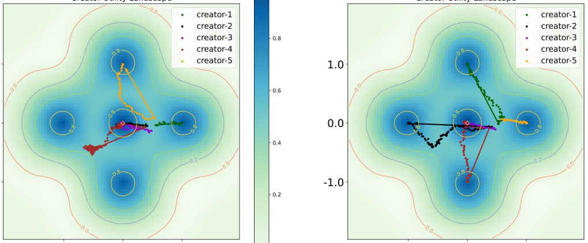
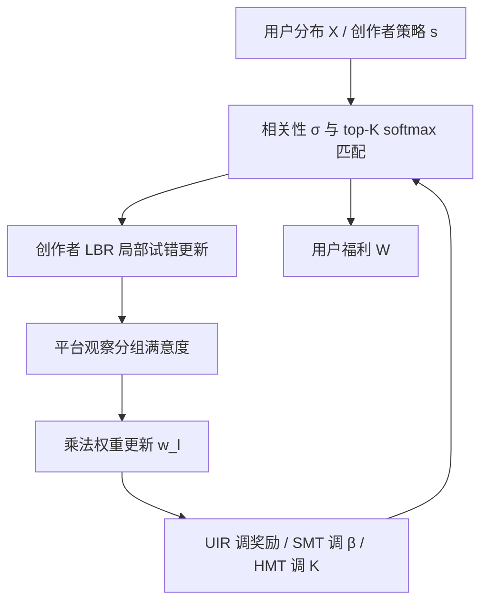

# User Welfare Optimization in Recommender Systems with Competing Content Creators (竞争创作者场景下的推荐系统用户福利优化)

- **会议/期刊**: KDD 2024
- **作者与机构**: Fan Yao, Mingzhe Wu, Hongning Wang 等；University of Virginia、Meta、University of Chicago、Yale、Google
- **推荐链路定位**: 召回/供给生态干预（冷启动召回阈值 + 后置奖励）
- **研究方向**: 去偏公平、可信隐私与工业架构（平台生态干预）
- **论文原文**: [arXiv:2404.18319v1](https://arxiv.org/abs/2404.18319v1)
- **开源代码**: 暂未开源

## TL;DR (1分钟核心速览)

论文针对推荐平台中“创作者只追逐头部/中心用户、导致长尾用户福利次优”的问题，把创作者竞争建模为 C3ext 博弈，并提出平台侧动态用户重要性重加权：按用户满意度用乘法权重更新 $w(x)$，再通过 UIR 调奖励、SMT 调软匹配温度、HMT 调硬匹配候选数。离线仿真与 MovieLens 均优于无干预基线，三周线上对称 A/B 中 HMT 使 LTR 提升 **1.13%**、冷启动曝光 +0.76%、2 小时内新鲜内容曝光 +3.7%。

## Background & Motivation (背景与核心矛盾)

- **主流范式**: 推荐平台长期以相关性匹配和用户即时偏好预测为中心，用户福利被定义为交互总量与质量；但内容供给由追逐收益的创作者决定。
- **前人局限**: C3 等博弈工作多假设创作者可 no-regret 学习、拥有效用 oracle，或可达到 PNE；现实创作者只有黑盒、局部、路径依赖的试错更新，且 $K<n$ 时 PNE 存在性/可达性都不稳。
- **核心洞察 (Key Insight)**: 关键矛盾是平台与创作者间的信息不对称。中心用户因嵌入空间“安全、可吸量”而被多个创作者过度争夺，长尾用户无人服务，竞争收敛到次优 LNE。
- **本文切入点**: 平台不直接命令创作，而是利用用户满意度信息重塑创作者效用景观：对高满意用户降权、对低满意用户升权，引导边际收益流向被忽视人群。

图 1 展示了该机制：无干预时创作者被中心用户“吸住”；将中心用户权重减半后，部分创作者转向边缘用户。

<figure class="paper-figure" markdown="span">
  <figcaption>图 1：创作者策略演化的可视化。左：无干预；右：平台将中心用户的权重降低一半。创作者策略以不同颜色标记，箭头从初始策略出发，指向最后迭代策略。</figcaption>
</figure>

## Method (核心方法设计)

### 1. 整体框架 (Overall Architecture)

模型把平台、用户分布 $\mathcal{X}$、创作者策略$\mathbf{s}_i$组成 C3ext 博弈。平台用相关性$\sigma(\mathbf{s}_i,\mathbf{x})$做 top-$K$softmax 匹配，创作者按局部更优响应 LBR 更新策略；平台按 epoch 观察分组满意度$\bar{\pi}_l$，用乘法权重更新用户组权重$w_l$，并选择 UIR/SMT/HMT 改变奖励或匹配函数，从而影响下一轮创作与匹配，最终优化累计用户福利$W=\mathbb{E}_{\mathbf{x}}[\sigma(\mathbf{s}_{\mathbf{x}},\mathbf{x})]$。

### 2. 关键设计拆解 (Key Designs)

1. **三种干预通道：只改效用，不改创作模型**：创作者效用为 $u_i(\mathbf{s})=\mathbb{E}_{\mathbf{x}}[w(\mathbf{x})R(\mathbf{s}_i,\mathbf{x})P_i(\mathbf{s},\mathbf{x})]$。UIR 直接把$w(x)$乘到后置奖励$R$；SMT 令$\beta(x)=f(w(x))$改变匹配温度；HMT 令$K(x)=g(w(x))$ 改变候选截断数。直觉是：提高长尾用户权重，使创作者转向该群体的边际收益超过继续挤在中心用户处。

2. **自适应反权重更新：满意度越高越降权**：在正交用户、点积相关性、创作者足够多的 stylized 设定下，定理 2 给出改进方向 $w'_j=w_j e^{-\eta\bar{\pi}(x_j)}$。据此实际采用$w^{(e+1)}_l\propto w^{(e)}_l\exp(-\alpha\bar{\pi}_l)$，再归一化并裁剪到$[w_{\min},w_{\max}]$。其物理直觉是负反馈：已高满意用户边际收益低，应把“注意力预算”让给低满意群体；用分组权重而非逐用户权重可降维、抗噪。

3. **训练目标、负采样与推理效率**：本文不训练新的推荐大模型，$\sigma$由离线相关性模型估计；核心优化是双层问题$\max_{w}W(\mathbf{s}^*(w))$，约束$\mathbf{s}^*(w)$为 LNE，因不可微采用启发式乘法权重。无负采样与 BPR/InfoNCE 损失。UIR/SMT 每个 epoch 只更新$L$维权重；HMT 仅改冷启动召回候选数$K(x)$，线上接入成本最低。

## Experimental Setup & Evaluation Protocol (实验设置与评估协议)

- **数据集与预处理**:

| 数据集 | #Users | #Items | #Interactions | 稀疏度/密度 | 特征/场景说明 |
| :--- | :---: | :---: | :---: | :---: | :--- |
| Synthetic | 2,000 | 10 个用户簇 / 200 creators | 3,000 步 × 200 次 LBR 更新 | — | $d=5$单位球；簇大小$10\times(100,50,20,10,10,5,2,1,1,1)$ |
| MovieLens-1m | 1,578（活跃用户 >200 ratings） | 3,706 部电影；每 creator 行动集 1,000 部 | 约 1M ratings | 约 4.5%（筛选前） | 1–5 分评分，32 维 MF 嵌入，5 折 RMSE=0.739 |
| 线上短视频 | 未披露 | 未披露 | 3 周对称 A/B | — | 3% creators × 3% users 封闭反馈，HMT 用于冷启动召回 |

- **数据划分与防穿越 (Splitting Strategy)**: 离线不是传统 LOO/比例划分，而是策略演化仿真；MovieLens 仅用 5 折验证嵌入质量，随后全量重训。线上采用对称 A/B：实验组/对照组各自随机配 3% 创作者与 3% 用户，组内用户只看组内创作者内容，持续 3 周，避免跨组泄漏。
- **排名评测协议 (Ranking Protocol)**: 非 Full-Ranking/Sampled Ranking 基准；离线评价用户福利曲线与分组效用，线上评价 LTR、冷启动曝光、<2h 新鲜内容曝光、人均 topic 数、Creator DAU。论文未使用传统召回排序负采样。
- **对比基线与超参设置**: 论文未报告 MovieLens 上 5–8 个推荐 SOTA 基线，核心比较为无干预 Base、UIR、SMT、HMT，故不虚构外部基线。默认 $\beta=0.1,K=20$，创作者学习率$\eta=0.2$，$M=5,T=3000$；聚类数合成 20、MovieLens 15；$\alpha$前半程 0.5、后半程 0.1；裁剪$[0.2,5.0]$。线上称提升统计显著，但未给具体$p$ 值/检验名。

## Key Experimental Results (实验关键数据)

### 1. 主实验对比 (Main Results)

离线部分原文主要给曲线而非最终标量，下表按论文结论归纳；线上为三周 A/B 精确相对增益。

| 机制/设置 | 操纵通道 | Synthetic 福利 | MovieLens 福利 | 方差/公平性 |
| :--- | :--- | :--- | :--- | :--- |
| Base（无干预） | — | 早期平台期且不回升 | 同样易困于次优 LNE | 组越大效用越高 |
| UIR | 奖励 $w(x)R$ | 稳定提升，边际较小 | 提升 | 方差小，较公平 |
| SMT | 温度 $\beta(x)$ | 中等提升 | 提升 | 方差大，可能加剧偏斜 |
| **HMT** | 截断 $K(x)$ | **提升最大、方差最低** | **提升最大** | **全组 Pareto 改善** |

| 线上指标（HMT vs 对照） | 相对提升 |
| :--- | :---: |
| LTR（用户效用） | **+1.13%** |
| 冷启动内容总曝光 | +0.76% |
| 2 小时内新鲜内容曝光 | +3.7% |
| 人均消费 topic 数 | +0.71% |
| 头部创作者 DAU（>1000 followers） | +0.17%（第 3 周 +0.48%） |
| 其余创作者 DAU | +0.06% |
| 分组 LTR：1–5 / 6–20 / 21–74 / 75+ | +0.43% / **+1.40%** / +0.75% / **+1.36%** |

### 2. 消融实验 (Ablation Study)

原文无标准“w/o 模块”消融，本质是三种干预通道与无干预的机制级对比：

| 变体 | 移除/替换 | 合成数据结论 | MovieLens 结论 | 线上可行性 |
| :--- | :--- | :--- | :--- | :--- |
| Base | 移除平台干预 | 福利停滞 | 福利停滞 | 生产基线 |
| UIR | 仅保留奖励重加权 | 稳定但增益较小 | 有增益 | 需支付/奖励权限 |
| SMT | 仅改匹配温度 | 增益中等、方差大 | 有增益 | 改动排序探索强度 |
| HMT | 仅改 top-$K$ 截断 | 增益最大、最稳 | 增益最大 | 冷启动召回最易接入 |

### 3. 关键实验发现 (Key Findings)

1. **重加权确实把创作者推向长尾**：线上最小用户组 LTR +1.36%、次小组 +1.40%，显著高于最大组 1–5 的 +0.43%；总 LTR +1.13%，说明 HMT 不是单纯做大盘提效，而是重新分配了创作者注意力。
2. **HMT 在福利与新鲜度上双赢**：冷启动曝光 +0.76%、<2h 新鲜内容曝光 +3.7%、人均 topic +0.71%，且离线 HMT 方差最低、全组 Pareto 改善；SMT 虽有增益但方差大，说明直接调温度过激。
3. **创作者响应存在滞后**：头部创作者 DAU 三周分别为 -0.2%、+0.24%、+0.48%，说明前两周仍处适应期；三周实验可能低估长期收益，也解释了线上增益为何是“小而显著”。

## Highlights & Limitations (亮点、对比与审稿批判)

- **与代表作对比 (vs. Prior Work)**: 相比 Yao 等 C3 依赖 no-regret/PNE 强假设，本文放松为 LBR 局部试错并优化 LNE 下的福利；相比 Prasad 等依赖平台向创作者发 prompt，本文只调匹配概率/后置奖励，适用于平台影响力受限场景。
- **可迁移亮点**: “用户满意度反向加权 + 乘法权重”可迁移到双边市场、冷启动流量分配、创作者激励；HMT 只改候选截断数，是最易 A/B 的工业技巧。
- **审稿级局限批判**: 离线仍基于合成 C3ext 与 MovieLens 嵌入仿真，创作者策略响应是模拟而非真实反事实；线上只测 HMT、仅 3 周、单平台，Creator DAU 增益很小且滞后。权重更新依赖 $\alpha$、裁剪区间、分组数和权重→百分位映射，超参敏感度与长期公平性未充分展开。

## Rating (四维评分)

- **方法创新性 (Novelty)**: ⭐⭐⭐⭐ （把创作者竞争博弈与用户福利重加权结合，定理给出反权重方向，机制清晰但非全新优化器）
- **评估协议与实验扎实度 (Protocol & Experiments)**: ⭐⭐⭐⭐ （离线仿真+MovieLens+三周线上 A/B 较完整，但缺传统 SOTA 基线与标准消融，显著性细节不足）
- **写作与数学规范度 (Clarity & Rigor)**: ⭐⭐⭐⭐ （C3ext、LNE、UIR/SMT/HMT 定义清楚，定理证明完整；部分假设较 stylized）
- **工业落地与复现价值 (Industrial & Practical Value)**: ⭐⭐⭐⭐⭐ （HMT 可直接嵌入冷启动召回，线上验证显著，工程改动小；可惜未开源）

