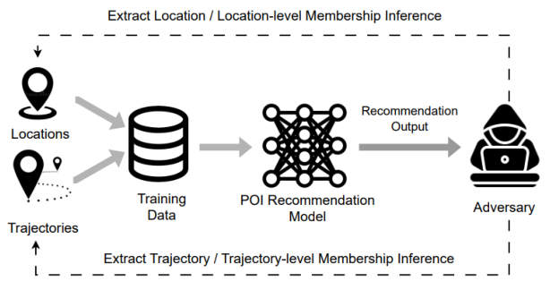
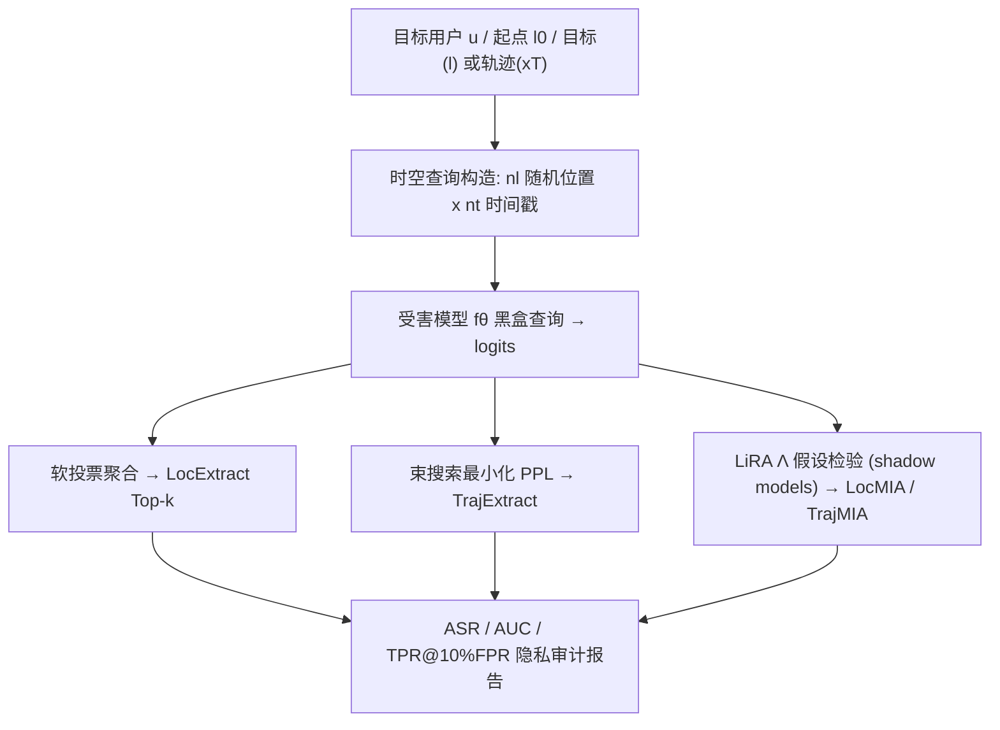
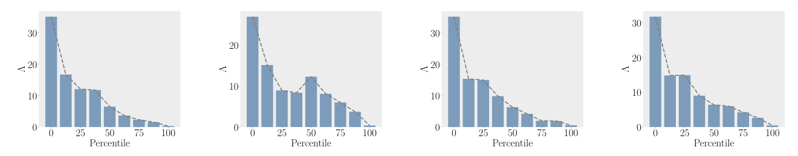

# Where Have You Been? A Study of Privacy Risk for Point-of-Interest Recommendation (你曾去过哪里？POI 推荐的隐私风险研究)

- **会议/期刊**: KDD 2024（The 30th ACM SIGKDD）
- **作者与机构**: Kunlin Cai, Jinghuai Zhang, William Shand, Yuan Tian (UCLA)；Zhiqing Hong, Desheng Zhang (Rutgers)；Guang Wang (FSU)；Jianfeng Chi (Meta)
- **推荐链路定位**: 召回（Next-POI 全库打分预测，输出 $|\mathcal{L}|$ 维 logits）
- **研究方向**: 去偏公平、可信隐私与工业架构 / 时空轨迹与 POI 本地生活推荐
- **论文原文**: [https://arxiv.org/abs/2310.18606v2](https://arxiv.org/abs/2310.18606v2)
- **开源代码**: [https://github.com/KunlinChoi/POIPrivacy](https://github.com/KunlinChoi/POIPrivacy)

## TL;DR (1分钟核心速览)

本文针对"POI 推荐模型把用户签到轨迹记到骨子里"这一被忽视的隐私面：已有隐私研究只保护传输与发布阶段，从未量化**训练好的模型本身**会泄露什么。作者提出首个面向 POI 推荐的四元攻击套件——位置抽取 LocExtract、轨迹抽取 TrajExtract、位置级成员推断 LocMIA、轨迹级成员推断 TrajMIA，把时空上下文注入 LiRA 与束搜索。在 4sq / Gowalla 两数据集、GETNext / LSTPM / RNN 三个全库排序受害模型上，仅黑盒查询 logits 即可把最高频位置以 **33.0%–80.9% 的 Top-$k$ASR** 抽出（随机猜仅 0.04%），成员推断 AUC 显著高于 0.5 对角线；而 DP-SGD 在$(5,0.001)$-DP 下把 Top-10 精度从 71% 砸到 4.97%。

## Background & Motivation (背景与核心矛盾)

- **主流范式**: POI 推荐已从马尔可夫链/矩阵分解全面转向 RNN、LSTM 与自注意力（LSTPM、GETNext），用时空签到序列预测下一站，并以内置查询 API 的形式嵌入 Yelp、Google Maps 等 LBS。
- **前人局限**: ① 移动数据隐私工作集中在传输/聚合发布阶段的重识别（社交侧信道、网络包、轨迹聚合），默认模型是"安全的黑盒压缩"；② 图像/文本域的 MIA 与抽取攻击依赖"单条样本语义自足"，而单个位置点语义贫乏、缺少轨迹时序上下文，直接迁移全线失效。
- **核心洞察 (Key Insight)**: 模型会对**高频位置**和**短轨迹**产生"过拟合式记忆"——用 100 个随机位置查询 10 个用户，32.5% 的查询直接吐出了该用户最高频位置，而这些位置仅占其数据的 18.7%；且记忆的触发强烈依赖查询时间戳（正午 0.5 处 ASR 达峰）。
- **本文切入点**: 不发明新推荐模型，而是把"时空上下文构造"作为攻击原语，构造位置/轨迹 × 抽取/推断的四象限审计套件。

<figure class="paper-figure" markdown="span">
  <figcaption>图1：我们的攻击套件揭示了POI推荐模型中的隐私问题。特别地，我们证明攻击者可提取或推断训练数据集中位置或轨迹的成员信息。</figcaption>
</figure>

## Method (核心方法设计)

### 1. 整体框架 (Overall Architecture)

攻击者被设定为仅持有受害模型查询接口（返回 $|\mathcal{L}|$维 logits）的第三方或恶意内部人，并（对 MIA 而言）持有 shadow 数据集。四个攻击共享同一原语：**操纵查询中的空间（随机位置）与时间（等间隔时间戳）分量，迫使模型在输出分布上暴露训练记忆**。抽取类攻击对聚合后的 logits 排序取 Top-$k$；推断类攻击把受害模型查询结果喂入适配了时空增广的 LiRA 假设检验；TrajExtract 额外用束搜索在指数搜索空间中最小化对数困惑度。整个套件既是攻击也是隐私审计工具（GDPR 意义上训练数据被删除后模型仍可回溯）。

### 2. 关键设计拆解 (Key Designs)

1. **LocExtract 软投票与 TrajExtract 困惑度束搜索**：单个随机查询噪声太大 $\to$用$Q$组随机时空输入查询并对 logits 取均值，再取 Top-$k$：$\hat{l}_{top\text{-}k}=\mathrm{TopK}\!\left(\frac{1}{Q}\sum_{q=1}^{Q} f_\theta(u,x^{(q)})\right)$；轨迹抽取则反向利用束搜索"输出趋同训练序列"的已知缺陷，以对数困惑度为目标：$\mathrm{PPL}_{f_\theta}(u,x^{0:n-1}_T)=-\sum_{i=0}^{n-1}\log \Pr_{f_\theta}(u,x^{0:i-1}_T)$，把$O(|\mathcal{L}|^{n-1})$的穷举压缩到$O(|\mathcal{L}|\cdot n\cdot \beta)$。直觉：模型见过真实序列时每一步条件概率都被抬高，整条路径困惑度最低。
2. **LocMIA 的时空查询增广（把 LiRA 搬到位置粒度）**：目标只是 $(u,l)$，缺少序列上下文，无法直接算 loss$\to$生成$n_l$个随机位置与$n_t$个固定间隔时间戳，先按同一时间戳对$n_l$次查询的成员置信度取均值，再跨时间戳取 max：$\Lambda(u,l)=\max_{t\in\{t_1..t_{n_t}\}}\frac{1}{n_l}\sum_{j=1}^{n_l}\Lambda\!\left(u,l_j,t\right)$。物理直觉：若用户真的访问过$l$，模型会"连带记忆"其邻域 POI 与该时段的时间先验，邻域探针即可把信号放大。
3. **TrajMIA 的中间步聚合与训练/推理开销**：仅用末步输出浪费信息 $\to$对长度为$n$的序列取全部$n-1$个中间输出成员分数平均；阴影侧沿用 LiRA 四步（多 shadow models 拟合 in/out 损失分布 +$\Lambda$似然比检验）。全流程**免负采样**（全库 softmax 已隐式包含），在线开销集中在查询次数$Q$、$n_l\times n_t$ 与 shadow 模型数量，作者实测少量查询即已有效。

## Experimental Setup & Evaluation Protocol (实验设置与评估协议)

- **数据集与预处理**（统计详见原文附录 A，正文仅给关键量级）：

| 数据集 | #Users | #Items(POI) | #Interactions | 稀疏度/密度 | 特征/场景说明 |
| :--- | :---: | :---: | :---: | :---: | :--- |
| FourSquare (4sq) | 附录 A | $>4{,}000$| 附录 A | 极稀疏 | 城市级签到，含时间戳；随机猜基线$1/|\mathcal{L}|=0.04\%$ |
| Gowalla | 附录 A | $>4{,}000$| 附录 A | 极稀疏 | 跨地区社交签到；轨迹随机猜$1/|\mathcal{L}|^{n-1}\approx10^{-8}\%$ |

- **数据划分与防穿越**: 沿用 GETNext / LSTPM 的按时间留出（末次签到作测试）预处理管线，无随机泄露。
- **排名评测协议**: 受害模型侧为 **Full-Ranking（对全部 $|\mathcal{L}|$个 POI 未交互候选全库排序）**，报告 Top-1 / Top-10 Accuracy；攻击侧为 Top-$k$ ASR（抽取）与 AUC、Average ACC、**TPR@10%FPR**（低假阳率最坏情形，作者视为首要指标）。
- **对比基线与超参设置**: 三类受害模型 GETNext（Transformer）、LSTPM（层次 LSTM）、RNN；攻击基线为随机猜（ASR $1/|\mathcal{L}|$、MIA 的 AUC=0.5 对角线）。

## Key Experimental Results (实验关键数据)

### 1. 主实验对比 (Main Results)

受害模型自身效用（隐私-效用对照基准）：

| 数据集 | 模型 | Top-1 ACC | Top-10 ACC |
| :--- | :--- | :---: | :---: |
| 4sq | GETNext | 0.34 | **0.71** |
| 4sq | LSTPM | 0.25 | 0.67 |
| 4sq | RNN | 0.24 | 0.68 |
| Gowalla | GETNext | **0.16** | **0.48** |
| Gowalla | LSTPM | 0.15 | 0.39 |
| Gowalla | RNN | 0.10 | 0.26 |

抽取攻击 Top-$k$ ASR（%，随机猜 0.04%）：

| 攻击 | 数据集 | GETNext (k=1/3/5) | LSTPM (k=1/3/5) | RNN (k=1/3/5) |
| :--- | :--- | :---: | :---: | :---: |
| LocExtract | 4sq | 33.0 / 57.3 / 64.9 | **53.1 / 77.9 / 80.9** | 26.3 / 42.8 / 48.6 |
| LocExtract | Gowalla | 26.9 / 41.6 / 48.1 | **42.9 / 48.2 / 54.5** | 3.2 / 6.1 / 8.9 |
| TrajExtract | 4sq | **7.7 / 15.7 / 20.1** | 2.5 / 5.9 / 8.3 | 5.9 / 11.4 / 14.8 |
| TrajExtract | Gowalla | 0.9 / 2.3 / 3.3 | **0.9 / 3.0 / 3.5** | 0.2 / 0.5 / 0.6 |

成员推断（LocMIA / TrajMIA）在全部 3 模型 × 2 数据集上 ROC 曲线均显著高于随机对角线（AUC 基线 0.5），LocMIA 强于 TrajMIA。

### 2. 消融实验 (Ablation Study)

| 变体 / 防御 | 关键结果 | 结论 |
| :--- | :--- | :--- |
| w/o 软投票聚合（单次随机查询） | LocExtract ASR 显著↓ | 多次查询均值是信号放大的关键 |
| w/o 最优查询时间戳（正午 0.5） | LocExtract / TrajExtract ASR 先升后降，0.5 达峰 | 时间戳是强攻击超参（白天签到密集） |
| 减少 shadow models 数 | MIA 的 AUC / TPR@10%FPR 单调↓ | 影子模型数量决定损失分布拟合质量 |
| 减少 $n_l$/$n_t$ | LocMIA 仍保持较高 AUC/TPR | 少量查询即可实用，攻击成本低 |
| 早停 / $l_2$ 正则 | 记忆轻度下降，不足以阻断 | 无统计保证 |
| **DP-SGD $(5,0.001)$-DP** | Top-10 ACC **71% → 4.97%** | 效用崩塌，不可用于$>4$k 类目 POI 任务 |
| Selective DP (JFT) / Geo-Ind | 可保护**指定敏感子集**，全量防护仍缺失 | 无统一防御能兼顾四类攻击且效用可控 |

### 3. 关键实验发现 (Key Findings)

1. **攻击强度不随模型效用单调增长**：RNN 在 4sq 的 Top-10 ACC 达 0.68，与 GETNext 的 0.71 几乎持平，但 LocExtract Top-1 ASR 仅 26.3%，远低于 GETNext 的 33.0% 与 LSTPM 的 53.1%——更充分挖掘时空结构的架构即使效用相近也呈现不同记忆形态，隐私-效用曲线并非单一维度。
2. **粒度和序列长度决定脆弱性**：位置级抽取 Top-5 可达 64.9%–80.9%，而轨迹级仅 8.3%–20.1%（4sq），Gowalla 上更跌至 0.9%–3.5%；且轨迹越长、起点信号越被稀释，ASR 越低，说明"多步联合记忆"是当前模型尚未形成的能力。

<figure class="paper-figure" markdown="span">
  <figcaption>图5：用户级聚合统计量与TrajMIA的关系。x轴：百分位数根据特征值将用户/位置/轨迹划分为不同组。y轴：Λ表示每组假设检验中训练轨迹/位置为成员相对于非成员的（平均）似然比，值越高表示脆弱性越大。总签到数更少、唯一POI更少以及轨迹更少或更短的用户更易受TrajMIA攻击。(4sq)</figcaption>
</figure>

3. **隐私风险高度集中在长尾离群样本**：被更少用户访问、周边签到更少的位置 $\Lambda$显著更高；签到总数少、唯一 POI 少、轨迹短的用户$\Lambda$ 显著高于头部用户——这与"扶持长尾/冷启动用户"的推荐公平性目标直接冲突，意味着低频用户在模型服务中承担了不成比例的隐私代价。

## Highlights & Limitations (亮点、对比与审稿批判)

- **与代表作对比 (vs. Prior Work)**: 相比 Carlini 等的 LiRA 与训练数据抽取（图像/文本，样本语义自足），本文的核心增量是**时空查询增广**——把"构造不出完整输入"这一移动数据特有障碍转成随机位置 × 时间戳的探针设计；相比移动数据聚合发布侧信道研究，本文首次把攻击面从"数据"移到"已训练 DNN 模型权重"上，具备 GDPR 删除后仍可回溯的现实意义。
- **可迁移亮点**: ① "查询时间戳作为攻击/审计超参"可迁移到任何接受时间输入的序列推荐（短视频、会话推荐）；② 困惑度束搜索作为黑盒模型记忆探针，可直接用于生成式推荐（semantic ID 自回归解码）的隐私审计。
- **审稿级局限批判**: ① 威胁模型要求 shadow 数据集 + 数十个 shadow 模型训练，工业级复现成本高，且仅验证 logits 可得（label-only 场景作者留作未来工作）；② 防御评估单薄——DP-SGD 效用崩塌后仅给出 JFT/Geo-Ind 的定性对比，未量化"隐私预算-效用-Top-$k$ ASR"的完整帕累托前沿，也未给出可部署的折中方案；③ 数据集统计与预处理全部堆在附录，正文难以判断划分与过滤细节的可复现性。

## Rating (四维评分)

- **方法创新性 (Novelty)**: ⭐⭐⭐⭐ （首个 POI 推荐模型级隐私审计套件；时空查询增广与"反向利用束搜索趋同缺陷"两处算子设计巧妙，但底层仍是 LiRA 的迁移）
- **评估协议与实验扎实度 (Protocol & Experiments)**: ⭐⭐⭐⭐ （3 模型 × 2 数据集 × 4 攻击 + 全库排序协议 + TPR@低 FPR 最坏情形指标齐全，缺显著性检验与数据集统计透明度）
- **写作与数学规范度 (Clarity & Rigor)**: ⭐⭐⭐⭐ （PPL 与 $\Lambda$ 形式化清晰、攻击算法伪代码完整，防御章节偏概述、附录依赖过重）
- **工业落地与复现价值 (Industrial & Practical Value)**: ⭐⭐⭐⭐ （代码已开源、攻击仅需黑盒查询且少量探针即可生效，可直接作为 LBS 上线前的隐私回归测试；但 shadow 训练开销与缺失的可用防御限制了防护侧落地）

