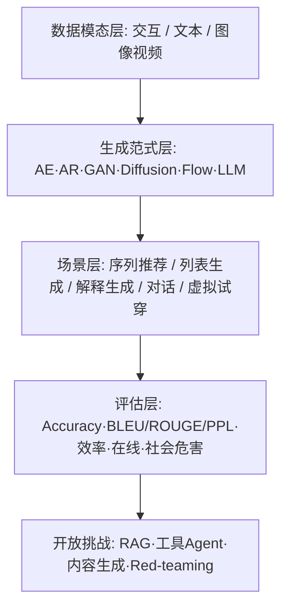
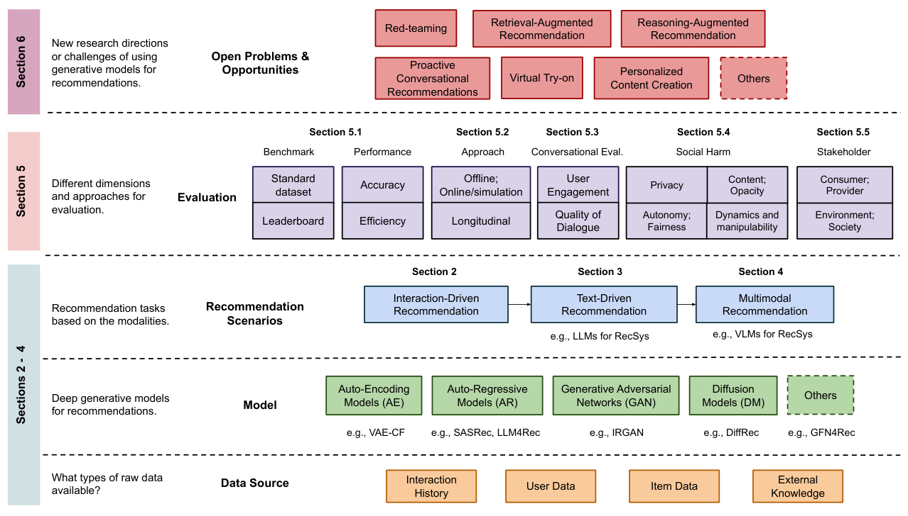

# A Review of Modern Recommender Systems Using Generative Models (Gen-RecSys)（生成模型驱动的现代推荐系统综述）

- **会议/期刊**: ACM SIGKDD 2024（伴随 KDD'24 Tutorial）
- **作者与机构**: Yashar Deldjoo (Polytechnic University of Bari)、Zhankui He / Julian McAuley (UCSD)、Anton Korikov / Scott Sanner (Toronto)、Arnau Ramisa / René Vidal (Amazon)、Maheswaran Sathiamoorthy (Bespoke Labs)、Atoosa Kasirzadeh (Edinburgh)、Silvia Milano (Exeter & LMU)
- **推荐链路定位**: 端到端生成式（覆盖召回级 dense retrieval、精排级 cross-encoder、重排级 LLM listwise、以及列表/页面级生成）
- **研究方向**: 生成式推荐与离散语义 ID / LLM4Rec / 多模态推荐
- **论文原文**: [论文原文链接](https://arxiv.org/abs/2404.00579v2)
- **开源代码**: [FAISS（文中 dense retrieval 工具链引用，非本文实现）](https://github.com/facebookresearch/faiss)

## TL;DR (1分钟核心速览)

本文针对“传统 RS 以用户-物品评分史为唯一数据源、以判别式打分器为唯一范式”的瓶颈，提出一个跨模态的 Gen-RecSys 二维分类学：**场景层按数据模态划分（交互驱动 / 文本驱动 LLM / 多模态生成）**，**模型层按生成范式划分（AE、AR、GAN、Diffusion、Normalizing Flow / GFlowNet、LLM）**。它并非提出新模型，而是把分散在 RecSys/IR/NLP/CV 的上百项工作归入同一坐标系，并首次将**评估协议（离线 accuracy + 生成式 BLEU/ROUGE/PPL + 对话评估 + 在线/纵向 + 社会危害）**与开放挑战（RAG、工具增强主动对话、个性化内容生成、red-teaming）整合为统一框架。作为综述，它不含自建实验，其“收益”体现在分类学完备性与评估维度覆盖度。

## Background & Motivation (背景与核心矛盾)

- **主流范式**: 传统 RS 是域内“narrow experts”，在单一交互矩阵上做判别式打分（MF / 序列 Transformer / GNN），数据源与输出形态都受限。
- **前人局限**: ① 现有综述多被 LLM[38,95,99,150,171]、基础模型[67]或单一 GAN[33]切割，无法覆盖 VAE-CF、DiffRec、GFN4Rec 这类无文本的纯交互生成范式；② 生成式输出（列表、解释、图像）缺乏与之匹配的评估语言，沿用 Recall@k/NDCG 会系统性低估列表级与内容级生成的价值。
- **核心洞察 (Key Insight)**: 生成模型的本质是“学习并采样复杂分布”，这恰好对应 RS 的两类新能力——**直接训练**（在交互矩阵上学 $p(\text{item}\mid \text{history})$）与**预训练复用**（LLM/VLM 的 emergent 推理、ICL、开放世界知识）。
- **本文切入点**: 以“数据模态 × 生成范式”正交切分，再叠加“评估与危害”第四维，把 Gen-RecSys 拆成可比较的组件而非模型堆叠。

## Method (核心方法设计)

### 1. 整体框架 (Overall Architecture)

综述沿 KDD'24 教程的五段式展开：Section 2 交互驱动生成（输入仅 user-item 交互，输出 item 列表/页面）；Section 3 文本驱动 LLM 推荐（encoder-only 检索、cross-encoder 融合打分、seq2seq 生成推荐/解释、RAG、LLM 特征抽取、对话推荐）；Section 4 多模态生成（对比对齐 CLIP/ALBEF → 生成式 ContrastVAE/Diffusion/MLLM）；Section 5 评估（离线精度+效率+benchmark、在线 A/B 与 longitudinal、对话评估、社会影响、多利益相关方 holistic）；Section 6 开放挑战。

<figure class="paper-figure" markdown="span">
  <figcaption>图1：推荐中生成模型关注领域概览。</figcaption>
</figure>

### 2. 关键设计拆解 (Key Designs)

1. **交互驱动五范式及其“增量算子”**：AE 族从 AutoRec/BERT4Rec 的掩码重构走向 VAE-CF 的随机隐映射，其 ELBO $\mathcal{L}_{\text{VAE}}=\mathbb{E}_{q_\phi(\boldsymbol{z}\mid\boldsymbol{x})}[\log p_\theta(\boldsymbol{x}\mid\boldsymbol{z})]-\mathrm{KL}(q_\phi\|p)$带来更强建模假设；CVAE 进一步以用户为条件生成整条推荐列表（ListCVAE/PivotCVAE），把“逐项贪心排序”替换为“列表级一次采样”。AR 族以$p(\boldsymbol{x})=\prod_{i}p(x_i\mid x_{<i})$为骨架，从 GRU4Rec 迁移到 self-attention（SASRec/BERT4Rec），同时被反向用于**模型窃取攻击**（生成伪用户行为序列）。GAN 族（IRGAN）用$\min_G\max_D\mathbb{E}_{p_{\text{true}}}[\log D]+\mathbb{E}_{G}[\log(1-D)]$让生成器**采样高信息量负样本**，直接改写负采样这一召回核心算子。Diffusion 族以$\mathcal{L}=\mathbb{E}_{t,\boldsymbol{x}_0,\boldsymbol{\epsilon}}\|\boldsymbol{\epsilon}-\boldsymbol{\epsilon}_\theta(\boldsymbol{x}_t,t)\|^2$ 学去噪，DiffRec 用加噪历史预测未来交互，Diff4Rec 则把扩散当**序列增广器**缓解稀疏与长尾。
2. **LLM 与 RS 的四种耦合位形**：按计算开销与耦合深度分层——(a) **Encoder-only dense retrieval**：物品文本离线编码建 FAISS 索引，查询为用户偏好语句/近期 liked 标题，可扩展到全库召回；(b) **Cross-encoder 融合打分**：user 与 item 文本在同一次前向中交互后接 MLP，效果好但代价高，故定位为**小候选集重排**；(c) **Seq2seq 生成**：prompt→item 标题/ID/评分/解释，P5 用一套“pretrain-prompt-predict”统一 rating、sequential rec、top-k、解释、评论摘要五任务；(d) **特征抽取器**：把 LLM 当编码器反哺推荐模型，TIGER 即先 LLM 嵌入物品文本、再量化为语义 ID、最后用 T5 自回归生成 $\text{ID}_{i}\sim p(\cdot\mid \text{ID}_{<i})$，实现**免内积检索的生成式召回**。
3. **RAG 与多模态生成的对齐公式**：RAG 将知识外置，$p(y\mid x)=\sum_{z\in\mathcal{Z}}p_\eta(z\mid x)\,p_\theta(y\mid x,z)$，使系统可在线更新、减少幻觉且无需重训全部参数，代价是检索噪声直接进入生成分布。多模态侧，纯对比对齐（CLIP 对称交叉熵、ALBEF 的 ITC+MLM+ITM+momentum distillation）只捕捉**跨模态共享信息**、丢失互补信息；ContrastVAE 则在 ELBO 上追加对比项$\mathcal{L}=\mathcal{L}_{\text{VAE}}+\lambda\mathcal{L}_{\text{CL}}$，用生成结构建模稀疏性与不确定性。
4. **训练目标与推理开销（综述层归纳）**：交互生成族训练常配 BPR/BCE 或重构损失，负采样可为 Uniform、In-batch、或 GAN 生成式难负样本；LLM 族推理开销排序为 cross-encoder > seq2seq 生成 > dense retrieval（后者可完全离线预索引）；Diffusion 族需多步反向采样，是延迟主要来源。

## Experimental Setup & Evaluation Protocol (实验设置与评估协议)

**本文为综述，无自建实验、无主实验表与消融表**；以下为其梳理的评估协议矩阵（表 1）与公开基准盘点（表 2）。

- **数据集与预处理（原文盘点）**:

| 基准 | 模态 | 典型用途 | 协议特征 |
| :--- | :---: | :--- | :--- |
| Movielens / Amazon Reviews / Yelp / Last.fm / BookCrossing | 交互(+文本) | 判别式与生成式通用 | 主流按比例或 LOO 划分；原文指出其对生成式任务“仅狭窄可用” |
| ReDial / INSPIRED | 对话文本 | 对话推荐 | 需 BLEU/PPL + 任务指标 + 人工/LLM-as-judge |
| FaiRLLM / cFairLLM | 文本 | 消费者公平性 | 探测受保护属性敏感度 |
| BigBench（含 rec 子任务） | 文本 | LLM 通用能力 | 与 RS 原生协议不兼容 |

- **数据划分与防穿越**: 综述未强制统一划分，但明确指出跨模态生成任务若沿用随机划分会与“预训练语料已见过该物品”冲突，需按时间戳或冷启划分重估。
- **排名评测协议**: 强调生成式的**协议错配**——用 Sampled Ranking 的 Recall@k 评 seq2seq 生成的标题，会因同义词/别名漏判；建议补充 BLEU/ROUGE/PPL 与人工成对比较。
- **对比基线与超参**: 归纳的对照轴为 判别式 CF/序列模型（BPR、SASRec、BERT4Rec、TIGER）v.s. 生成式各族代表；未报告统一 $d$ 或显著性检验，这是综述的固有短板。

## Key Experimental Results (实验关键数据)

### 1. 主实验对比（替代为“范式—代表工作—核心增量”横向表，表 1）

| 生成范式 | 代表工作 | 核心增量 | 主要评估指标 | 已知短板 |
| :--- | :--- | :--- | :--- | :--- |
| Denoising AE | AutoRec / BERT4Rec | 掩码重构 + 双向自注意力 | Recall@k、NDCG@k | 仅建模交互，无生成多样性 |
| VAE / CVAE | VAE-CF / ListCVAE / ContrastVAE | 随机隐变量；列表级一次采样；ELBO+对比项 | NDCG@k、列表多样性 | 后验坍缩、训练不稳 |
| AR / Self-attentive | GRU4Rec / SASRec / P5 / TIGER | 序列条件概率；统一多任务 prompt；语义 ID 生成式召回 | HR@k、NDCG@k、BLEU | 长序列成本高、ID 量化失真 |
| GAN | IRGAN / 生成式增广 | 生成器充当**难负采样器** / 数据增广 | Recall@k、AUC | 训练不稳定、模式坍缩 |
| Diffusion | DiffRec / Diff4Rec | 加噪-去噪预测未来交互；序列增广 | Recall@k、稀疏/长尾分桶 | 多步采样延迟高 |
| Flow / GFlowNet | VASER / GFN4Rec | 可逆流做会话推荐；整列表生成 | HR@k、列表级效用 | 组合空间大、收敛慢 |
| LLM（零/少样本） | ChatGPT/GPT4 类 | ICL 直接推荐 + 解释 | 人工/LLM-as-judge、BLEU | 数据充足时不及监督 CF |
| LLM（微调/软 prompt） | P5 / COLLM | 指令统一 + 协同嵌入注入 | HR@k、NDCG@k、RMSE | 参数成本、更新滞后 |
| RAG / 工具 Agent | 检索增强 rerank / RecMind | 外置知识 + 多工具调度 | Recall@k、对话质量 | 检索噪声、架构复杂 |
| 多模态生成 | ALBEF / ContrastVAE / LLaVA / TryOnDiffusion | 对齐+融合；ELBO+CL；线性 adapter→两层 MLP | zero-shot 检索、生成质量 | 三模态数据稀缺 |

### 2. 消融实验（替代为“评估维度覆盖矩阵”，表 2）

| 评估维度 | 判别式 RS 常规做法 | Gen-RecSys 必需补充 | 原文举例 |
| :--- | :--- | :--- | :--- |
| 离线精度 | Recall/NDCG/AUC/RMSE | 保留，但需防语料穿越 | BERT4Rec / TIGER |
| 生成质量 | — | BLEU / ROUGE / Perplexity | P5 解释生成、RevCore |
| 计算效率 | 训练/推理时延 | 双向计入（含多步采样） | Diffusion 反向步数 |
| 对话 | — | 任务指标 + 多样性 + 人工 | ReDial、CRSLab |
| 在线/纵向 | 短期 A/B | 长期留存 + Agent 仿真 | RecAgent 模拟评估 |
| 社会危害 | 六类传统 harm | 新增 OOD 偏见、环境成本、创作者替代、可操纵性、超个性化 | FaiRLLM、HELM 式 holistic |

### 3. 关键实验发现 (Key Findings)

- **生成式不会无偿超越判别式**：原文明确指出，在训练数据充足的场景下未微调 LLM 的推荐效果**不及监督式 CF**，其优势集中在 near cold-start 与解释生成；这意味着 Gen-RecSys 的收益是**条件性**的，取决于数据稀疏度与任务是否需要自然语言输出。
- **“对齐”与“生成”是互补而非替代**：ALBEF 以远少于 CLIP 的预训练图像量在 zero-shot/微调多模态基准上反超，说明对比对齐解决共享信息、生成结构解决稀疏与不确定性，二者叠加（ContrastVAE 的 ELBO+CL）才是正确组合；单纯堆叠模态的 late fusion 在跨模态复合请求（“黑色金属玻璃咖啡桌 + 我的客厅”）上必然失效。
- **评估协议是当前最大瓶颈**：当同一系统同时输出列表、评分与解释时，单一 Recall@k 无法区分“排序对了但解释幻觉”与“生成合理但排序偏差”，因此原文主张以 HELM 式 holistic 框架 + red-teaming 作为上线前门槛，而非仅补一个 BLEU。

## Highlights & Limitations (亮点、对比与审稿批判)

- **与代表作对比 (vs. Prior Work)**: 相较 [33]（仅 GAN）、[95,99,150,171]（仅 LLM）、[67]（仅基础模型）、[158]（偏个性化内容生成），本文是唯一同时覆盖**无文本交互生成（VAE/Diffusion/Flow）**、**LLM 四类耦合位形**与**多模态生成**的分类学；差异不在模型深度，而在坐标系广度与评估维度的正交拆分。
- **可迁移亮点**: ① “生成器即难负采样器”（IRGAN 思路）可直接嵌入双塔召回训练；② “LLM 嵌入 → 量化语义 ID → 自回归生成”（TIGER 路线）为免 ANN 索引的生成式召回提供模板；③ 评估矩阵可直接改造为内部 Gen-RecSys 上线 checklist。
- **审稿级局限批判**: ① 全文无统一实验、无定量 meta-analysis，跨范式性能不可直接比较，分类学结论偏“地图”而非“证据”；② 对推理延迟、语义 ID 量化误差、RAG 检索噪声传播等工程代价仅作定性描述，缺乏复杂度或成本分析；③ 2024 年 3 月截稿，未覆盖后续大规模工业生成式召回（如语义 ID 与 RL 对齐结合）的进展，时效性有限。

## Rating (四维评分)

- **方法创新性 (Novelty)**: ⭐⭐⭐ （贡献是“模态 × 范式”分类学与评估四维拆分，属结构性整合而非新算子，但覆盖无文本生成族这一点确有补空白价值）
- **评估协议与实验扎实度 (Protocol & Experiments)**: ⭐⭐⭐ （系统盘点 benchmark、对话评估与社会危害维度，但无自建实验、无显著性检验，跨范式结论不可量化验证）
- **写作与数学规范度 (Clarity & Rigor)**: ⭐⭐⭐⭐ （五段结构与图 1 总览清晰，各范式均给出标准式骨架如 ELBO、扩散目标、RAG 后验，但符号未统一约定）
- **工业落地与复现价值 (Industrial & Practical Value)**: ⭐⭐⭐⭐ （评估 checklist 与“dense retrieval→cross-encoder→RAG 重排”的分层成本观可直接指导架构选型；但无开源实现，落地需自行回溯各代表工作）

