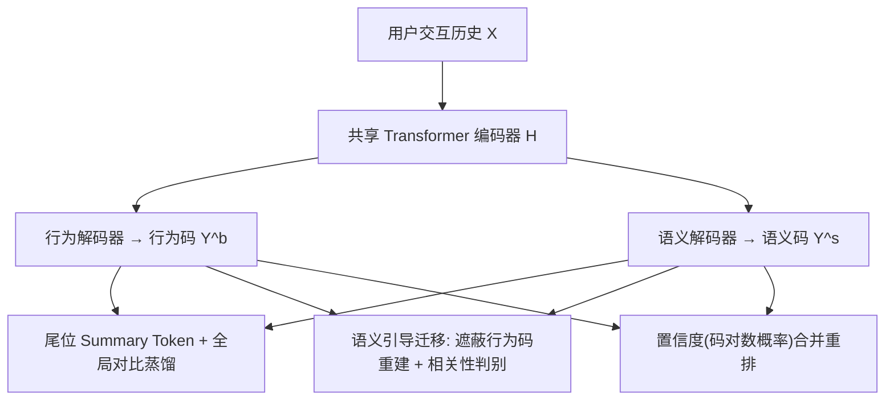
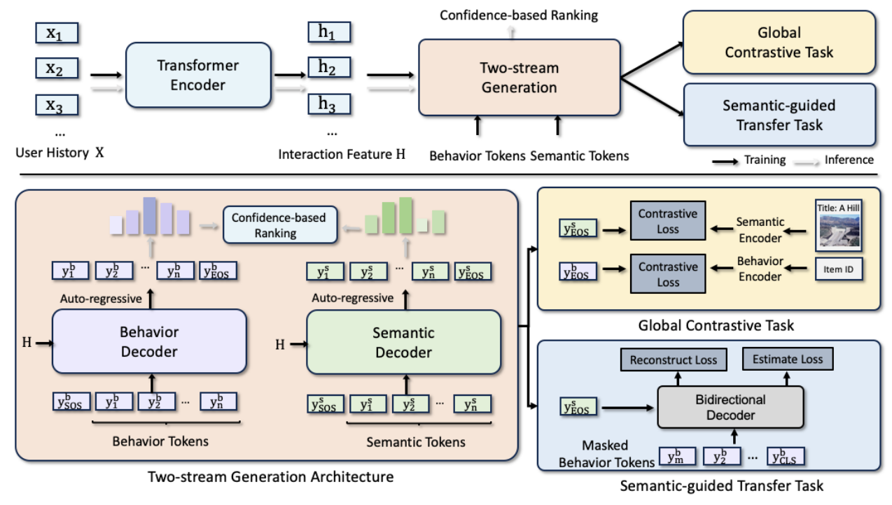

# EAGER: Two-Stream Generative Recommender with Behavior-Semantic Collaboration (行为-语义协同的双流生成式推荐器)

- **会议/期刊**: KDD 2024 (August 25–29, Barcelona)
- **作者与机构**: Ye Wang, Jiahao Xun, Minjie Hong, Tao Jin, Wang Lin, Haoyuan Li, Linjun Li, Yan Xia, Zhou Zhao (浙江大学)；Jieming Zhu, Zhenhua Dong (华为诺亚方舟实验室)
- **推荐链路定位**: 召回（端到端生成式索引替代 ANN 检索）
- **研究方向**: 生成式推荐与离散语义 ID / 序列与会话推荐
- **论文原文**: [https://arxiv.org/abs/2406.14017v2](https://arxiv.org/abs/2406.14017v2)
- **开源代码**: [https://reczoo.github.io/EAGER](https://reczoo.github.io/EAGER)

## TL;DR (1分钟核心速览)

现有生成式推荐只用**单一信息源**构造物品 ID：RecForest/TDM 走行为 ID 聚类，TIGER 走文本语义 ID，二者互补性被完全浪费——行为信号刻画用户个性化偏好，语义信号提供无偏、可跨域泛化的先验。EAGER 提出"双码 + 双流解码"框架：对同一物品分别用 DIN 行为向量与 Sentence-T5 语义向量做分级 K-Means 得到两套码本，共享一个历史编码器、配两个独立自回归解码器并行预测，再用全局对比任务（尾位 Summary Token 蒸馏预训练嵌入）与语义引导迁移任务（遮蔽行为码重建 + 相关性判别）补足判别力与跨流交互，推理时按每流的码序列对数概率置信度合并重排。在 4 个 5-core 数据集、Leave-One-Out 全库排序协议下，Beauty Recall@5 相对 TIGER 提升 31.49%、NDCG@5 提升 32.26%。

## Background & Motivation (背景与核心矛盾)

- **主流范式**: 生成式检索把候选检索写成码序列的自回归生成 $p(Y|X)=\prod_{i=1}^{l}p(y_i|X,y_1,\dots,y_{i-1})$，用 beam search 替代 Faiss/SCANN 的向量近邻索引，从而把"表征学习 + 索引构建"两段解耦流程合并为端到端优化。
- **前人局限之一**: 码本来源单一。RecForest 用预训练 DIN 行为嵌入构造树结构，TIGER 用 Sentence-T5 文本嵌入构造语义 ID——前者在长尾/稀疏物品上过拟合交互噪声，后者在类目同质的电商数据里语义区分度不足（同类物品文本高度相似）。
- **前人局限之二**: 特征级融合不可行。行为特征与语义特征处于差异极大的特征空间，过往双塔式编码器端侧拼接融合（[25,34]）收益常为负；同时单解码器若连续生成两套 ID，监督信号混杂导致互相干扰、且串行解码慢。
- **核心洞察 (Key Insight)**: 互补性应体现在**解码端的多监督信号**而非编码端的特征拼接——让两条流各自保持纯净的监督、只在全局 token 层面做隐式交互。
- **本文切入点**: 双码双流生成 + 全局对比蒸馏 + 语义→行为的隐式迁移，最后用置信度（码序列对数概率）做两流结果融合排序。

## Method (核心方法设计)

### 1. 整体框架 (Overall Architecture)

输入用户交互历史 $X=\{x_1,\dots,x_{t-1}\}$，共享 Transformer 编码器得到$H=\mathrm{Encoder}(X)$（1 层）；两个独立解码器（各 4 层）在$H$的 cross-attention 条件下分别自回归生成行为码$Y^b$与语义码$Y^s$。训练阶段叠加四项损失：双流交叉熵生成、以尾位 Summary Token 为锚的全局对比蒸馏、语义引导的行为码遮蔽重建与相关性判别。推理阶段两条流各做 beam search 得$k$个候选码，按码序列平均对数概率（越低越自信）统一排序取 top-$k$，无需任何向量内积与 ANN 索引。

<figure class="paper-figure" markdown="span">
  <figcaption>图2：EAGER 概览。EAGER 由三个主要组件组成：双流生成架构（TSG）、全局对比任务（GCT）和语义引导迁移任务（STT）。</figcaption>
</figure>

### 2. 关键设计拆解 (Key Designs)

1. **双码双流生成架构 (TSG)**：用同一物品的两套嵌入分别做分级 K-Means（分支数 $k=256$，逐层均分至叶节点单物品）得到行为码与语义码（图 3 的"双码示意"）。关键在于两个独立解码器而非一个共享解码器：监督差异被彻底隔离，且两码可并行生成，效率高于单解码器串行产双 ID。生成损失为
$\mathcal{L}_{gen}=\sum_{t\in\{b,s\}}\sum_{i=1}^{l}\log p(y^t_i\,|\,x_t,y^t_{\mathrm{SOS}},y^t_1,\dots,y^t_{i-1})$。
直觉：行为码负责"谁会点"，语义码负责"物品像什么"，二者错误模式不相关，融合后鲁棒性天然提升。

2. **全局对比任务 (GCT)**：自回归解码只优化局部 token 似然，缺乏全局判别力。作者在码序列**末尾**插入可学习 $y_{\mathrm{EOS}}$，令其单向汇聚全部前序 token 信息并作为蒸馏锚点，采用 positive-only 度量对齐冻结的预训练嵌入：
$\mathcal{L}_{con}=\mathcal{F}(y^{t}_{\mathrm{EOS}},E^{t}),\ t\in\{b,s\}$，其中$\mathcal{F}$取 Smooth$\ell_1$ 或 Cosine。
使用正样本-only 而非 InfoNCE 的原因有二：一是冻结特征 + 无负样本可避免表征坍缩；二是同类目数据负样本语义高度同质，构成"伪负样本"噪声反而伤害优化。

3. **语义引导迁移任务 (STT) 与训练目标**：为避免两流彻底割裂，构造一个独立双向 Transformer 辅助模块，把语义 Summary Token 嵌入 $y^s_{\mathrm{EOS}}$送入 cross-attention，供每个行为 token 查询，并设两个目标：遮蔽 50% 行为码后用语义全局特征做对比重建$\mathcal{L}_{recon}$；再把行为码随机替换 50% token 构造负例，用 [CLS] 上的 sigmoid 分类器做相关性判别$\mathcal{L}_{recog}=-\log s^+ + \log(1-s^-)$。总损失
$\mathcal{L}_{\mathrm{EAGER}}=\mathcal{L}_{gen}+\lambda_1\mathcal{L}_{con}+\lambda_2(\mathcal{L}_{recon}+\mathcal{L}_{recog})$，$\lambda_1=\lambda_2=1$（两辅助任务收敛快，对系数不敏感）。
**复杂度/推理开销**: 免负采样、免 ANN；Beauty 上单样本 beam=100、top-5 推理 0.0325 s（TIGER 0.0281 s、RecForest 0.0499 s、DIN+Faiss 0.2349 s），参数量 87（百万级，TIGER 14、RecForest 51）。

## Experimental Setup & Evaluation Protocol (实验设置与评估协议)

- **数据集与预处理**: 四个公开数据集，全部按用户分组、按时间戳升序排序并保留 **5-core**（过滤交互数 < 5 的用户/物品）：

| 数据集 | #Users | #Items | #Interactions | 密度 | 特征/场景说明 |
| :--- | :---: | :---: | :---: | :---: | :--- |
| Beauty | 22,363 | 12,101 | 198,360 | 0.00073 | Amazon 评论 + 元数据，文本描述 |
| Sports & Outdoors | 35,598 | 18,357 | 296,175 | 0.00045 | Amazon 户外运动类 |
| Toys & Games | 19,412 | 11,924 | 167,526 | 0.00073 | Amazon 玩具类，类目同质性强 |
| Yelp | 30,431 | 20,033 | 316,354 | 0.00051 | 2019 全年商户交易记录，含封面图 |

- **数据划分与防穿越**: `Leave-One-Out`——每序列最后一项作测试、倒数第二项作验证、其余训练；训练时历史序列截断至 20。
- **排名评测协议**: 无偏 `Full-Ranking`（对全部未交互物品排序），指标 Recall@5/10/20 与 NDCG@5/10/20。
- **对比基线与超参设置**: 4 类基线——传统序列（GRU4REC/Caser/HGN）、Transformer（SASRec/BERT4Rec/S³-Rec）、树索引（TDM/RecForest）、生成式（TIGER）；隐藏维 $d=128$，编码器 1 层、解码器 4 层，聚类分支$k=256$，Adam+Warmup，学习率 0.001；全部结果相对最优基线在$p<0.05$ 下显著。

## Key Experimental Results (实验关键数据)

### 1. 主实验对比 (Main Results)

| Dataset | Method | R@5 | N@5 | R@10 | N@10 | R@20 |
| :--- | :--- | :---: | :---: | :---: | :---: | :---: |
| Beauty | SASRec | 0.0387 | 0.0249 | 0.0605 | 0.0318 | 0.0902 |
| Beauty | BERT4Rec | 0.0203 | 0.0124 | 0.0347 | 0.0170 | 0.0599 |
| Beauty | S³-Rec | 0.0387 | 0.0244 | 0.0647 | 0.0327 | 0.0994 |
| Beauty | RecForest | 0.0470 | 0.0341 | 0.0664 | 0.0400 | 0.0915 |
| Beauty | TIGER | 0.0454 | 0.0321 | 0.0648 | 0.0384 | – |
| Beauty | **EAGER** | **0.0618** | **0.0451** | **0.0836** | **0.0525** | **0.1124** |
| Toys | S³-Rec | 0.0443 | 0.0294 | 0.0700 | 0.0376 | **0.1065** |
| Toys | TIGER | 0.0521 | 0.0371 | 0.0712 | 0.0432 | – |
| Toys | **EAGER** | **0.0584** | **0.0464** | **0.0714** | **0.0505** | 0.1024 |
| Yelp | S³-Rec | 0.0201 | 0.0123 | 0.0341 | 0.0168 | 0.0573 |
| Yelp | RecForest | 0.0220 | 0.0119 | 0.0302 | 0.0163 | 0.0449 |
| Yelp | TIGER | 0.0212 | 0.0146 | 0.0367 | 0.0194 | 0.0552 |
| Yelp | **EAGER** | **0.0265** | **0.0177** | **0.0453** | **0.0242** | **0.0724** |
| **Improv.** | vs. best baseline | +31.49% (Beauty) / +12.09% (Toys) / +20.45% (Yelp) | +32.26% | +25.90% | +31.25% | +13.08% |

（Sports 亦全面领先：R@5 0.0281 vs TIGER 0.0264，提升 6.44%；NDCG@20 0.0291 vs 0.0260，+11.92%。）

### 2. 消融实验 (Ablation Study)

| Variant | Beauty R@5 | Beauty N@5 | Beauty R@20 | Toys R@5 | Toys N@5 | Toys R@20 |
| :--- | :---: | :---: | :---: | :---: | :---: | :---: |
| Base (仅单流生成) | 0.0512 | 0.0370 | 0.0943 | 0.0436 | 0.0344 | 0.0657 |
| + TSG | 0.0582 | 0.0425 | 0.1034 | 0.0526 | 0.0428 | 0.0879 |
| + TSG + GCT | 0.0604 | 0.0439 | 0.1091 | 0.0563 | 0.0454 | 0.0974 |
| + TSG + GCT + STT (full) | **0.0618** | **0.0451** | **0.1124** | **0.0584** | **0.0464** | **0.1024** |

### 3. 关键实验发现 (Key Findings)

1. **TSG 是最大增益源，GCT 次之，STT 再次**：Beauty R@5 上 TSG 贡献 $+0.0070$（约占总增益 66%），GCT 再增$+0.0022$，STT 仅$+0.0014$；Toys 上 TSG 贡献$+0.0090$ 且 R@20 从 0.0657 跃至 0.0879，说明"行为-语义双码"带来的候选覆盖度提升远大于两个辅助任务的精修作用。
2. **语义源与迁移方向的选择有明确偏向**：Yelp 上 Behav+Text（R@5 0.0265）优于 Behav+Vis（0.0259），三流融合 Behav+Text+Vis 进一步到 0.0283，验证架构对多模态的可扩展性；把 STT 方向换成"行为引导语义"后性能下降，证明语义作为先验知识源更合适。Summary Token 位置从 Head(0.0473)→Mean(0.0559)→Tail(0.0604) 单调上升，说明置于尾部既不干扰前序码生成又能通过梯度回流间接优化码表征。
3. **负样本并非总是有益**：GCT 中 InfoNCE（Beauty N@5 0.0446）反而低于正样本-only 的 Cosine（0.0458）与 Smooth $\ell_1$（0.0451），因同类目物品语义同质、构造出的都是"伪负样本"；此外 Toys 上 EAGER 的 R@20（0.1024）仍略逊 S³-Rec（0.1065，$-3.85\%$），提示双码 beam 搜索在极长尾候选上的召回覆盖仍有天花板。

## Highlights & Limitations (亮点、对比与审稿批判)

- **与代表作对比 (vs. Prior Work)**: 对比 TIGER（单一语义 ID + T5 骨干），EAGER 用轻量 Transformer（87M 参数远小于 T5）在 Yelp R@5 上从 0.0212 提升至 0.0265；对比 RecForest（单一行为 ID + 树索引），EAGER 免去树路由的低效推理（0.0325 s vs 0.0499 s）；对比 SASRec/S³-Rec（双塔+ANN），EAGER 消除了"表征优化目标与索引近似目标错位"的固有损失。
- **可迁移亮点**: ① "尾位 Summary Token + positive-only 对比蒸馏"可低成本嵌入任何自回归生成式推荐（含 RQ-VAE/TIGER 系），用于补足局部似然缺乏的全局判别力；② 用"每流码序列对数概率"作为置信度融合多条生成流，避免训练额外融合网络，可直接复用到多码本/多模态生成推荐的路由融合。
- **审稿级局限批判**: ① **双流推理成本翻倍**：两道 beam search 且 $k=256$ 分支数下码序列较长，Toys 上 R@20 未超 S³-Rec 也暗示 beam 覆盖不足，扩大 beam 又会进一步抬高延迟；② **强依赖两个预训练编码器**（DIN 需要交互序列、Sentence-T5 需要文本元数据），在纯 ID、无侧信息或冷启动物品场景下语义码构造方式与收益未被验证，且双码本各自需重跑分级 K-Means，物品库更新时维护代价高。

## Rating (四维评分)

- **方法创新性 (Novelty)**: ⭐⭐⭐⭐ （"解码端多监督而非编码端融合"的思路清晰，双码+尾位 Summary Token+语义引导迁移三件套组合合理，但单点技术均属已有范式的直接迁移，缺乏理论层面如谱分析式支撑）
- **评估协议与实验扎实度 (Protocol & Experiments)**: ⭐⭐⭐⭐ （4 数据集 + Leave-One-Out 全库排序 + $p<0.05$ 显著性检验 + 完整消融与多组分析，但仅单一数据划分，未报告多随机种子方差，且 Toys@20 的负提升未给出解释）
- **写作与数学规范度 (Clarity & Rigor)**: ⭐⭐⭐⭐ （三挑战—三模块对位清晰、公式精简，但 $\mathcal{L}_{recon}$的负样本采样集合$\Omega$ 与温度系数定义略含糊，重建/识别两损失权重未做敏感性分析）
- **工业落地与复现价值 (Industrial & Practical Value)**: ⭐⭐⭐⭐ （已开源、87M 参数训练成本可控、推理快于树索引，端到端免 ANN，具备召回替换潜力；但需同时维护行为与语义两套码本与预训练编码器，线上增量物品的码分配与一致性维护是主要工程负担）

