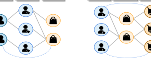
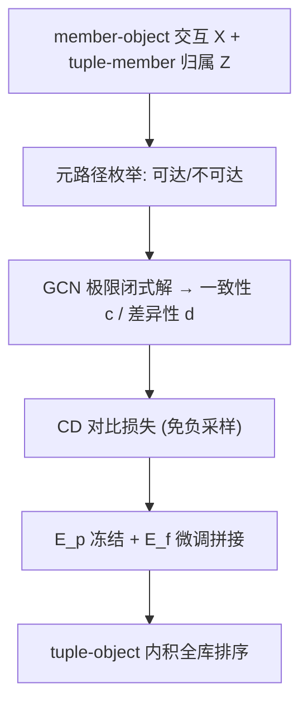
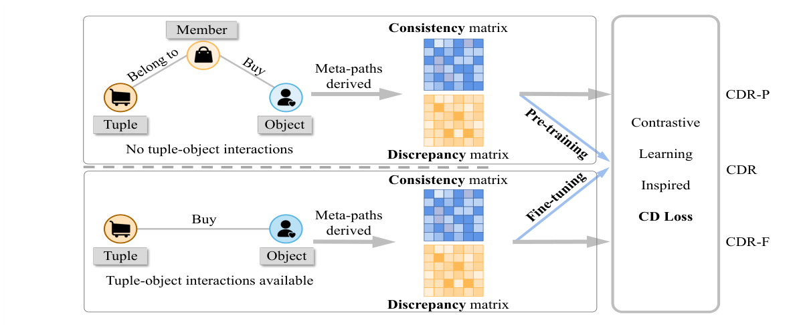

# Consistency and Discrepancy-Based Contrastive Tripartite Graph Learning for Recommendations (基于一致性与差异性的三部图对比学习推荐)

- **会议/期刊**: KDD 2024 (Barcelona)
- **作者与机构**: Linxin Guo, Min Gao, Yinghui Tao (重庆大学) / Yaochen Zhu, Chen Chen (University of Virginia) / Junliang Yu (University of Queensland)
- **推荐链路定位**: 召回（三部图上的 group / bundle 召回表征学习）
- **研究方向**: 图神经网络与知识图谱推荐 / 冷启动与长尾推荐
- **论文原文**: [https://arxiv.org/abs/2407.05126v1](https://arxiv.org/abs/2407.05126v1)
- **开源代码**: [https://github.com/foodfaust/CDR](https://github.com/foodfaust/CDR)

## TL;DR (1分钟核心速览)

三部图推荐（群组/捆绑包）中 tuple 与 object 的直接交互极度稀疏，一旦 tuple 交互为空（极端冷启动），依赖正负采样的 pairwise 排序模型全部失效。本文把 tuple–object 关系拆解为「一致性 $c$」与「差异性$d$」两个元路径系数，借助 LightGCN 无穷层极限理论在**训练前**闭式算出，再以 CD 对比损失作为正/负监督信号，**无需任何负采样与 tuple 交互**。在 Mafengwo/Youshu 的 5%-训练、20%-测试、全库排序协议下，CDR 相对最优基线平均提升 18.88%/31.92%；CDR-P 在零 tuple 交互下仍超越全部 warm-start 基线。

## Background & Motivation (背景与核心矛盾)

- **主流范式**: 群组/捆绑包推荐统一为三部图 (tuple–member–object) 上的链接预测，主流做法是 AGREE/HCR 的注意力聚合、DAM/CrossCBR 的多任务联合优化、BGCN/ConsRec 的异质图消息传播。
- **前人局限**: ①注意力/多任务/图传播三类方法最终仍要落到 tuple–object 的 pairwise BPR 排序损失上，极端冷启动（$\boldsymbol{Y}$ 为零矩阵）时无正样本可用，直接崩溃；②冷启动下 tuple 交互仅占 5%，而 member 交互极稠密，多任务联合优化被严重的数据不均衡拖累（论文实测 HCR/AGREE 甚至不如只用 tuple 交互的 LightGCN）。
- **核心洞察 (Key Insight)**: member 与 object 的交互、member 与 tuple 的归属关系是稠密的（Mafengwo 每 tuple 平均 7.19 个成员），它们隐含了 tuple–object 的高阶相似性；这种相似性可以**不经梯度优化**地从图结构系数的解析式中直接读出。
- **本文切入点**: 用"可达元路径 = 正监督、不可达元路径 = 负监督"把 tuple–object 关联量化为两个标量系数，把冷启动从"无标签"变成"结构可导出标签"。

<figure class="paper-figure" markdown="span">
  <figcaption>图 1：基于二部图与三部图的推荐对比。</figcaption>
</figure>

## Method (核心方法设计)

### 1. 整体框架 (Overall Architecture)

CDR 分两阶段。**预训练 (CDR-P)**：输入 member–object 交互 $\boldsymbol{X}$与 tuple–member 归属$\boldsymbol{Z}$，枚举 8 类元路径（$TMT, TMO, OMT, OMO$的可达与不可达形式），按 GCN 极限理论闭式算出一致性矩阵$\boldsymbol{C}_{member}$与差异性矩阵$\boldsymbol{D}_{member}$，送入 CD 对比损失训练 embedding$\boldsymbol{E}_p$。**微调 (CDR-F)**：当 tuple 交互$\boldsymbol{Y}$可用时，额外构造$TOT/OTO$与一跳$TO/OT$元路径得到$\boldsymbol{C}_{tuple},\boldsymbol{D}_{tuple}$，用$\boldsymbol{E}_p$初始化并**冻结**$\boldsymbol{E}_p$作为静态特征，最终表征$\boldsymbol{E}=\boldsymbol{E}_f\|\boldsymbol{E}_p$，再做内积排序推荐。

<figure class="paper-figure" markdown="span">
  <figcaption>图 3：CDR 模型结构。上部为使用元组-成员归属关系与成员交互的预训练，下部为使用元组交互的微调，包含变体 CDR-P 和 CDR-F。CDR-P 面向极端冷启动场景，而 CDR-F 是仅使用元组交互的变体。</figcaption>
</figure>

### 2. 关键设计拆解 (Key Designs)

1. **一致性/差异性的闭式推导（把无穷层 GCN 变成一个求和）**：直接对 $\max\sum_{m\in N(t)}e_t^\top e_m$与$\min\sum_{\tilde m\notin N(t)}e_t^\top e_{\tilde m}$做多层消息传递代价高且层数不可知。作者令$\lim_{l\to\infty}e_m^{(l+1)}=e_m^{(l)}$，把 member 表征消去：
$e_m=\sum_{t\in N(m)}\delta_{m,t}e_t+\sum_{o\in N(m)}\delta_{m,o}e_o,\ \delta_{m,v}=\frac{1}{deg_m}\sqrt{\frac{deg_m+1}{deg_v+1}}$代回目标函数后，member 嵌入消失，只剩可预计算的度数系数：$c_{v_1,v_2}=\sum_{m\in N(v_1)\cap N(v_2)}\delta_{m,v_2},\quad d_{v_1,v_2}=\sum_{\tilde m\notin N(v_1),\tilde m\in N(v_2)}\delta_{\tilde m,v_2}$直觉上，$c$统计"共同成员带来的加权连通证据"，$d$统计"连接$v_2$却刻意不连$v_1$ 的成员造成的反证"，全图预计算后训练只需查表，复杂度从多层传播降为一次稀疏矩阵乘。

2. **CD 对比损失（不许 $d-c$相减，要分开用作正负监督）**：若直接用$d_{v_1,v_2}-c_{v_1,v_2}$做监督，$(d{=}1,c{=}0.99)$与$(d{=}0.01,c{=}0)$不可区分——二部图里$d-c$恰为$\pm 1$，三部图却会丢失绝对量级。故改写成加权 InfoNCE 形式：
$\mathcal{L}=\sum_{(v_1,v_2)\in Q}-\log\frac{c_{v_1,v_2}\exp(\cos(e_{v_1},e_{v_2})/\tau)}{\sum_{\tilde v_2\in\mathcal{T}\cup\mathcal{O}}d_{v_1,\tilde v_2}\exp(\cos(e_{v_1},e_{\tilde v_2})/\tau)}$其中$c$作为**逐对正样本权重**进入分子、$d$作为**逐负样本权重**进入分母，等价于一个由结构系数软加权的成对排序目标；温度$\tau$ 用于调节对噪声的容忍度。

3. **训练目标、负采样与推理效率**：微调阶段一跳关系需改写 $\boldsymbol{C}_{TO}=[\delta_{to}\ast Y_{to}]$、$\boldsymbol{D}_{TO}=[\delta_{to}]$，使有监督信号与结构先验共存于同一损失。全流程**不使用任何随机负采样**（负信号来自不可达元路径），避免冷启动下采样偏差；微调阶段冻结$\boldsymbol{E}_p$防止预训练偏好被下游任务擦除。推理仅为内积 + 全库排序，预计算$c,d$ 为一次性开销。

## Experimental Setup & Evaluation Protocol (实验设置与评估协议)

| 数据集 | #Tuples | #Members | #Objects | T-O 交互 | M-O 交互 | 平均成员/tuple |
| :--- | :---: | :---: | :---: | :---: | :---: | :---: |
| Mafengwo (Group) | 995 | 5,275 | 1,513 | 3,595 | 39,761 | 7.19 |
| Youshu (Bundle) | 4,771 | 32,770 | 8,039 | 51,377 | 138,515 | 37.03 |
| Last-FM (Social) | 1,892 | 17,632(U) | 92,834(I) | 25,434 | — | — |

- **数据划分与防穿越**: 为模拟冷启动，**仅用 5% tuple 交互训练、20% 用于测试**（其余留作稀疏储备），member 交互与归属全量可用；极端冷启动实验则令 $\boldsymbol{Y}=\boldsymbol{0}$。
- **排名评测协议**: 采用无偏 **Full-Ranking（对全库 object/bundle 排序）**，明确弃用前人常用的"每测试样本 100 个随机负样本"采样排序，评估更严格。
- **对比基线与超参**: 18 个基线分三类——纯 tuple 交互类（BPR/LINE/NGCF/LightGCN/BUIR/SGL/SimGCL/XSimGCL/ALDI）、三部图类（DAM/CrossCBR/BGCN/AGFN/AGREE/HCR/GroupIM/ConsRec）、社交类（SBPR/DiffNet/SocialLGN）；统一 $d=64$、Adam、lr=0.001、early stopping patience=10；$\tau$ 预训练/微调在 Mafengwo 为 3.8/1、Youshu 为 1/0.3。

## Key Experimental Results (实验关键数据)

### 1. 主实验对比 (Main Results)

| 数据集 | 方法 | R@10 | R@20 | R@30 | N@10 | N@20 | N@30 |
| :--- | :--- | :---: | :---: | :---: | :---: | :---: | :---: |
| Mafengwo | LightGCN | 0.0766 | 0.1384 | 0.1943 | 0.0385 | 0.0557 | 0.0682 |
| Mafengwo | SGL | 0.1288 | 0.2121 | 0.2626 | 0.0885 | 0.1088 | 0.1212 |
| Mafengwo | ALDI | 0.1150 | 0.2460 | 0.3203 | 0.0554 | 0.0880 | 0.0999 |
| Mafengwo | CDR-F | 0.1954 | 0.2806 | 0.3238 | 0.1268 | 0.1493 | 0.1594 |
| Mafengwo | GroupIM | 0.1453 | 0.2606 | 0.3170 | 0.0796 | 0.1109 | 0.1238 |
| Mafengwo | ConsRec | 0.2312 | 0.3085 | 0.3487 | 0.1256 | 0.1449 | 0.1534 |
| Mafengwo | **CDR** | **0.2694** | **0.3833** | **0.4309** | **0.1402** | **0.1715** | **0.1825** |
| | Improv. | +16.52% | +24.25% | +23.57% | +11.62% | +18.36% | +18.97% |
| Youshu | BGCN | 0.0543 | 0.0848 | 0.1090 | 0.0358 | 0.0455 | 0.0528 |
| Youshu | AGFN | 0.0626 | 0.0981 | 0.1247 | 0.0457 | 0.0565 | 0.0652 |
| Youshu | CDR-F | 0.0648 | 0.1000 | 0.1217 | 0.0398 | 0.0501 | 0.0563 |
| Youshu | **CDR** | **0.0903** | **0.1299** | **0.1520** | **0.0627** | **0.0744** | **0.0809** |
| | Improv. | +44.25% | +32.42% | +21.89% | +37.20% | +31.68% | +24.08% |

**极端冷启动 (CDR-P 零 tuple 交互) vs. warm-start 基线**：Mafengwo 上 CDR-P R@10 0.1275 / R@20 0.1633 / N@20 0.0745，全面超过 BUIR（0.0969/0.1509/0.0740）与 LightGCN（0.0766/0.1384/0.0557）；Youshu 上 CDR-P R@10 仅 0.0280（弱于 BUIR 0.0508，论文坦承受限于该数据集 member–tuple 归属信息不足）。

### 2. 消融实验 (Ablation Study)

| 变体 (Mafengwo) | F1 | P@20 | R@20 | N@20 |
| :--- | :---: | :---: | :---: | :---: |
| CDR-P（仅预训练） | 0.0195 | 0.0104 | 0.1633 | 0.0745 |
| CDR-F（仅 tuple 交互） | 0.0336 | 0.0179 | 0.2806 | 0.1493 |
| CDR-R（两阶段数据互换） | 0.0425 | 0.0226 | 0.3531 | 0.1747 |
| w/o $c$（仅差异性） | 0.0296 | 0.0157 | 0.2411 | 0.1160 |
| w/o $d$（仅一致性） | 0.0349 | 0.0186 | 0.2790 | 0.1193 |
| w/o $c$&$d$ | 0.0298 | 0.0158 | 0.2466 | 0.1177 |
| **CDR (full)** | **0.0474** | **0.0253** | **0.3833** | **0.1715** |

**损失函数替换 (Fig. 4, Mafengwo R@20)**：$d-c$ 相减式 CDR-Origin 0.0259、MSE 版 CDR-MSE 0.0236、交叉熵版 CDR-CE 0.2377，完整 CD 损失 0.3833。

### 3. 关键实验发现 (Key Findings)

1. **相减式监督几近崩溃**：直接用 $d-c$训练时 R@20 仅 0.0259，比完整 CD 损失 0.3833 低一个数量级（14.8×），定量证实了三部图中$d,c$ 绝对量级被抵消的信息损失；把两者独立作正/负权重是性能跃升的主因。
2. **两阶段优于任一单阶段，且顺序不可颠倒**：CDR-R 交换预训练/微调数据后 R@20 从 0.3833 掉到 0.3531，Youshu 上更从 0.1299 崩至 0.0621——说明 member 域结构先验必须在微调前注入，tuple 交互作预训练会污染表征。
3. **元路径监督可迁移给其他模型**：把 CDR-P 的 $c,d$ 作为监督信号嫁接给 NGCF/LightGCN，Mafengwo 上 NGCF 的 R@20 从 0.0749 → 0.3335、NDCG@20 从 0.0252 → 0.1749；LightGCN R@20 从 0.1384 → 0.3737，接近 CDR 本体 0.3833，说明增益主要来自监督信号而非架构本身。

## Highlights & Limitations (亮点、对比与审稿批判)

- **与代表作对比 (vs. Prior Work)**: 相比 ConsRec（共识挖掘）与 AGFN（邻域聚合精修），CDR 不改聚合机制而改**监督信号来源**，因而在 5% 交互下不退化；相比 UltraGCN 只在二部图上推导极限闭式解，本文将无穷层极限推广到三元异质关系并衍生出双系数 $c,d$；相比 SGL/SimGCL 靠随机扰动造视图，本文的对比视图由元路径结构**确定性**生成，无增强随机性。
- **可迁移亮点**: ①"GCN 无穷层极限 + 度数系数预计算"这一套路可直接搬到大促场景下的稀疏商家–用户–活动三部图召回；②把"吻合证据/反证证据"分别放入对比损失分子分母的加权写法，可用于任何带结构先验的免负采样训练。
- **审稿级局限批判**: ①元路径类型需人工枚举（预训练 8 类、微调再加 4 类），元路径集合的选择缺少自动搜索，跨域迁移成本高；②$c,d$全图预计算涉及$|\mathcal{T}\cup\mathcal{O}|^2$ 量级的节点对矩阵，Youshu 上已达 12,810 阶，工业规模（百万级 bundle）显存与时延难以承受；③极端冷启动在 Youshu 上明显弱于 warm-start 的 BUIR，说明方法对 member–tuple 归属密度高度敏感，论文对此仅以"信息不足"带过，缺少分桶定量分析。

## Rating (四维评分)

- **方法创新性 (Novelty)**: ⭐⭐⭐⭐ （把 GCN 极限理论从二部图推广到三部图并导出双系数结构化监督，CD 损失的"正负独立加权"设计有清晰的信息论动机）
- **评估协议与实验扎实度 (Protocol & Experiments)**: ⭐⭐⭐⭐ （弃用 100 负采样改为 Full-Ranking，18 个基线覆盖三类范式，含极端冷启动与迁移性实验；扣分在于缺少显著性检验与稀疏度分桶）
- **写作与数学规范度 (Clarity & Rigor)**: ⭐⭐⭐⭐ （从 Eq.(1) 到 Eq.(18) 的推导链条完整、δ 系数定义清晰；但 Eq.(9)/(14) 的集合记号 $Q$ 与常数省略说明略显跳跃）
- **工业落地与复现价值 (Industrial & Practical Value)**: ⭐⭐⭐ （代码已开源、免负采样显著简化训练管线，但节点对级 $c,d$ 矩阵的平方级存储与人工元路径设计限制了大规模部署）

