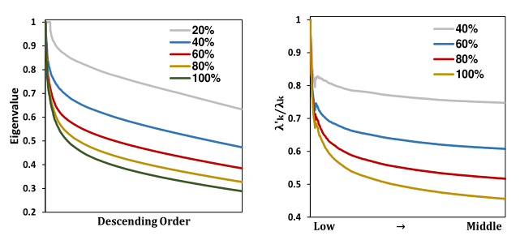
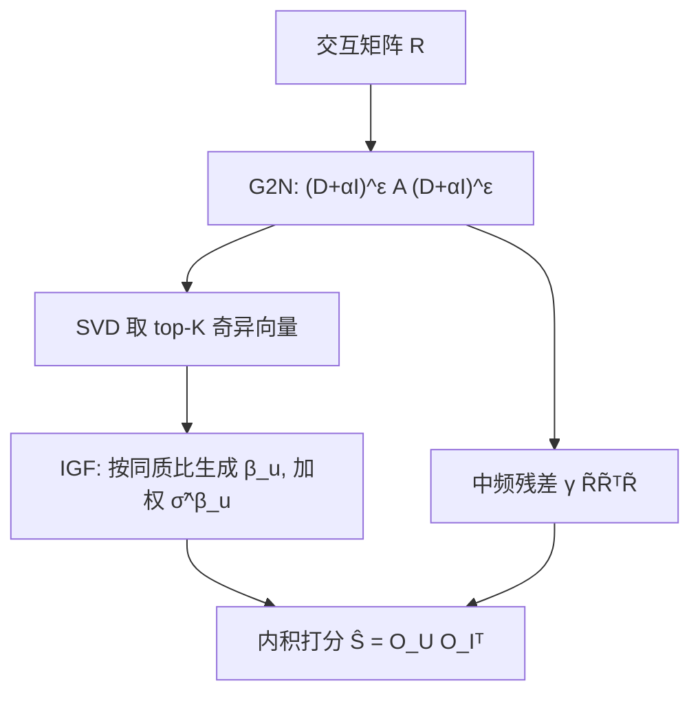

# How Powerful is Graph Filtering for Recommendation (图滤波推荐究竟有多强？)

- **会议/期刊**: KDD 2024 (ACM SIGKDD)
- **作者与机构**: Shaowen Peng (NAIST)、Xin Liu (AIST)、Kazunari Sugiyama (大阪成蹊大学)、Tsunenori Mine (九州大学)
- **推荐链路定位**: 召回 (Top-K 全库排序)
- **研究方向**: 图神经网络与知识图谱推荐 / 协同过滤
- **论文原文**: [https://arxiv.org/abs/2406.08827v1](https://arxiv.org/abs/2406.08827v1)
- **开源代码**: [https://github.com/tanatosuu/sgfcf](https://github.com/tanatosuu/sgfcf)

## TL;DR (1分钟核心速览)

现有 GCN 推荐可归结为「低通图滤波 + 有监督低秩映射」与「纯免训练图滤波」两派，但前者在稠密数据上训练冗余、后者在稀疏数据上无法去除全频段散布的噪声，且 LGCN 被证明无法生成任意嵌入。本文从谱锐度出发提出广义图归一化 G²N 与个性化图滤波 IGF，导出仅需 top-$K$ 奇异值的闭式解 SGFCF。在 4 个数据集 × 两种训练比例的 Full-Ranking 协议下，nDCG@10 相对最强基线最高提升 14.29%，训练时间较 GFCF 提速 11 倍、较 LightGCN 提速 1000 倍以上。

## Background & Motivation (背景与核心矛盾)

- **主流范式**: 一类是 LGCN 系（LightGCN/GDE/JGCF），用低通滤波后接有监督训练做低秩映射；另一类是免训练谱滤波（GFCF/PGSP/BPSM），仅靠固定多项式滤波器去噪。
- **前人局限一（缺乏泛化性）**: 噪声分布随数据密度变化。稠密数据噪声集中在中频，可被低通滤波直接滤除，此时监督训练反而冗余有害；稀疏数据噪声散布全频段并污染重要低频特征，纯图滤波失效。
- **前人局限二（缺乏表达力）**: 定理证明共享全局滤波器 $\{\theta_0,\dots,\theta_L\}$的 LGCN 在$d>1$ 时无法生成任意嵌入，即最优表征不可达。
- **核心洞察 (Key Insight)**: 谱越「锐利」（中频特征值衰减越快），越接近理想低通滤波器，重要特征与噪声越可线性分离——稠密数据恰好拥有更锐利的谱。因此只要能人为重塑谱锐度，就能免训练去噪。
- **本文切入点**: 用图归一化改造谱分布（G²N）+ 用个性化滤波补足表达力（IGF），二者结合成闭式解 SGFCF。

<figure class="paper-figure" markdown="span">
  <figcaption>图2：(a) 不同密度设置下CiteULike的谱分布。(b) 特征值比（𝜆′</figcaption>
</figure>

## Method (核心方法设计)

### 1. 整体框架 (Overall Architecture)

输入用户-物品二部图的交互矩阵 $R$，先经 G²N 重归一化为$\tilde{R}$并做 SVD 得到 top-$K$左右奇异向量；再由 IGF 依据每个节点的同质比 (homophilic ratio) 生成节点专属滤波权重$g_u(\tilde{\sigma}_k)=\tilde{\sigma}_k^{\beta_u}$对奇异向量加权；同时叠加一项覆盖全频段的中频残差$\gamma\tilde{R}\tilde{R}^\top\tilde{R}$ 补偿非低频率中残留的信息，最终内积打分得到全库排序。整个过程无需梯度训练、无需负采样。

### 2. 关键设计拆解 (Key Designs)

1. **广义图归一化 G²N（重塑谱锐度）**: 从二阶图相似度出发，节点平均相似度正比于 $d_u^2$，即给高度节点更大权重即可提升整体相似度、使能量向低频集中。据此把标准$\hat{A}_{ui}=1/\sqrt{d_u d_i}$推广为$\tilde{A}=(D+\alpha I)^{\epsilon}A(D+\alpha I)^{\epsilon}$，其中$\alpha\ge 0,\ \epsilon\in[-0.5,0]$，$\alpha=0,\epsilon=-0.5$时退化为原式。定理 4 表明$\alpha$缩放、$\epsilon$ 收缩特征值，二者均使中频特征值相对低频快速下降，逼近理想的硬截断低通，从而稀疏数据上的全频段噪声也可被分离。

2. **个性化图滤波 IGF（补足表达力）**: 交互反映的用户偏好置信度并不相同——若用户历史物品彼此相似（同质比高），则其未来行为更可信，应加重低频。定义 $\mathrm{homo}(u)=\frac{1}{|N_u|^2}\sum_{i,j\in N_u}\mathbb{I}[D_{G/u}(i,j)<\delta]$（$\delta=2$），线性映射到$[\beta_1,\beta_2]$得$\beta_u$，滤波为$g_u(\lambda_k)=\lambda_k^{\beta_u}$。对应定理 2 的逐维独立滤波形式$O=V(B\Theta)\odot V^\top E$，理论上可生成任意嵌入，突破 LGCN 的表达力上界。

3. **训练目标、负采样与推理效率**: SGFCF 为闭式解，无损失函数、无负采样、无 epoch 迭代。预测矩阵为 $\hat{S}=\big(\tilde{P}^{(K)}\odot G(\tilde{\sigma}_k)\big)\big(\tilde{Q}^{(K)}\odot G(\tilde{\sigma}_k)\big)^\top+\gamma\tilde{R}\tilde{R}^\top\tilde{R}$，复杂度仅$\mathcal{O}(K|R^+|+K^2|U|+K^2|I|)$；G²N 的谱锐化使所需$K$ 从 GFCF 的 512 降至 20–100，是二次提速来源。

## Experimental Setup & Evaluation Protocol (实验设置与评估协议)

| 数据集 | #Users | #Items | #Interactions | 密度 | 场景说明 |
| :--- | :---: | :---: | :---: | :---: | :--- |
| CiteULike | 5,551 | 16,981 | 210,537 | 0.223% | 学术书签收藏 |
| Pinterest | 37,501 | 9,836 | 1,025,709 | 0.278% | 图像内容推荐 |
| Yelp | 25,677 | 25,815 | 731,672 | 0.109% | 本地商户评论 |
| Gowalla | 29,858 | 40,981 | 1,027,370 | 0.084% | 签到 LBS |

- **数据划分与防穿越**: 采用**随机比例划分**而非时间切分——按训练比例 $x\%\in\{80\%,20\%\}$ 随机划分以人为制造稠密/稀疏两种密度，再从训练集随机取 5% 作验证集，其余为测试集。
- **排名评测协议**: 无偏 **Full-Ranking**，对全部未交互物品打分排序，截断 $k=10$，报告 Recall@10 与 nDCG@10。
- **对比基线与超参**: 有监督类 BPR、DirectAU、LightGCN、SGL-ED、XSimGCL、LightGCL、DCCF、GDE、JGCF；免训练类 EASE、GFCF、PGSP、BPSM。嵌入维度 $d=64$，正则率$\gamma=0.01$，$\alpha$步长 1、$\epsilon$步长 0.02，$\delta=2$。

## Key Experimental Results (实验关键数据)

### 1. 主实验对比 (Main Results)

nDCG@10（$x$ 为训练比例，加粗为最优）：

| Method | CiteULike 80% | CiteULike 20% | Yelp 80% | Yelp 20% | Pinterest 80% | Pinterest 20% | Gowalla 80% | Gowalla 20% |
| :--- | :---: | :---: | :---: | :---: | :---: | :---: | :---: | :---: |
| BPR | 0.1620 | 0.0674 | 0.0487 | 0.0635 | 0.0668 | 0.0976 | 0.1164 | 0.1086 |
| LightGCN | 0.1610 | 0.1273 | 0.0572 | 0.0751 | 0.0699 | 0.1297 | 0.0987 | 0.1477 |
| XSimGCL | 0.2024 | 0.1360 | 0.0691 | 0.0837 | 0.0842 | 0.1396 | 0.1288 | 0.1861 |
| JGCF | 0.1557 | 0.1438 | 0.0626 | 0.0895 | 0.0765 | 0.1363 | 0.1173 | 0.1845 |
| EASE | 0.2368 | 0.1313 | 0.0719 | 0.0360 | 0.0853 | 0.1064 | 0.1350 | 0.1405 |
| GFCF | 0.2405 | 0.0902 | 0.0644 | 0.0722 | 0.0859 | 0.0851 | 0.1387 | 0.1662 |
| PGSP | 0.2357 | 0.1121 | 0.0643 | 0.0732 | 0.0876 | 0.1264 | 0.1395 | 0.1640 |
| **SGFCF** | **0.2663** | **0.1542** | **0.0824** | **0.0963** | **0.0923** | **0.1437** | **0.1432** | **0.1973** |
| Improv.% | +8.69 | +1.58 | +14.29 | +7.60 | +5.36 | +2.42 | +0.00 | +5.85 |

### 2. 消融实验 (Ablation Study)

| 消融配置 | CiteULike 80% | CiteULike 20% | Yelp 80% | Yelp 20% | Gowalla 80% |
| :--- | :---: | :---: | :---: | :---: | :---: |
| w/o 中频残差项 ($\gamma=0$) | −4.00% | −3.66% | −2.35% | −0.21% | −3.66% |
| 共享全局滤波（去掉 IGF） | 次优（低于 IGF） | 次优 | 次优 | 次优 | 次优 |
| SGFCF, $\delta=2$/$4$/$6$ | 0.2658 / 0.2631 / 0.2629 | 0.1542 / 0.1547 / 0.1548 | 0.0825 / 0.0823 / 0.0824 | 0.0963 / 0.0960 / 0.0953 | 0.1432 / 0.1386 / 0.1386 |

### 3. 关键实验发现 (Key Findings)

1. **密度鲁棒性是核心增量**：GFCF 在 CiteULike 上从 $x=80\%$的 0.2405 塌陷到$x=20\%$ 的 0.0902（跌幅 62%），而同条件下 SGFCF 仅从 0.2663 降至 0.1542；相对 GFCF 的平均 nDCG 增益在稠密设定为 14.0%、稀疏设定扩大到 41.0%，直接印证 G²N 谱锐化对稀疏噪声散布的抑制作用。
2. **中频残差项的价值随密度反转**：加入 $\gamma$项后 Yelp 稠密提升 2.35%、稀疏仅 0.21%，CiteULike 为 4.00% vs 3.66%；对应地 Yelp 稀疏设定最优$K=20$、稠密设定$K=300$，说明稀疏数据的中频几乎全是噪声，只需极少低频谱分量即饱和。
3. **效率并非副产物而是设计红利**：Yelp 稠密设定下 SGFCF 训练仅 6.3s，GFCF 需 71.0s（≈11×），LightGCN 需 $1.13\times10^4$s（>1000×）；原因在于 G²N 使能量集中于少数低频谱分量，$K$ 从 512 降到 50–100，同时免去非凸优化的数百轮迭代。

## Highlights & Limitations (亮点、对比与审稿批判)

- **与代表作对比**: GFCF 是固定低通滤波、假定噪声只在特定频段，遇到稀疏数据直接退化；GDE/JGCF 依赖监督训练与负采样，稠密数据上训练冗余且被本文 SGFCF 全面超越（如 Yelp 80% 的 0.0824 vs GDE 0.0653）；LightGCN 则被定理 2 指出表达力上界，IGF 通过逐节点 $\beta_u$ 打破该上界。
- **可迁移亮点**: (1)「谱锐度 = 噪声可分性」的判据可迁移到任何二部图归一化设计，只需调 $\alpha,\epsilon$ 两个超参；(2) 同质比驱动的个性化滤波权重可直接移植到 LightGCN 的层聚合系数中，无需改动训练流程。
- **审稿级局限批判**: (1) 采用随机比例划分而非全局时间戳切分，隐式反馈中混入了未来交互，与真实线上召回场景存在分布差距，且完全未做冷启动/时序实验；(2) IGF 的同质比需预计算二跳图距离，$\delta$增大时复杂度上升，且$\alpha,\epsilon,\gamma,\beta_1,\beta_2,K$ 共 6 个超参需网格调优，稠密与稀疏设定下最优值差异约 4 倍（与节点度差一致），跨数据集迁移成本不低。

## Rating (四维评分)

- **方法创新性 (Novelty)**: ⭐⭐⭐⭐ （从谱锐度这一新视角统一解释「训练 vs 免训练」两派的失效边界，并给出 LGCN 表达力上界的定理刻画，理论增量扎实）
- **评估协议与实验扎实度 (Protocol & Experiments)**: ⭐⭐⭐⭐ （四数据集 × 双密度、Full-Ranking、8 个 SOTA 基线覆盖有监督与免训练两派，但划分非时间切分、缺冷启动与显著性检验）
- **写作与数学规范度 (Clarity & Rigor)**: ⭐⭐⭐⭐ （定理—推论—实验三线呼应，谱分布与特征值比可视化直观；部分推导如式 (13) 的解释略显跳跃）
- **工业落地与复现价值 (Industrial & Practical Value)**: ⭐⭐⭐⭐⭐ （纯闭式解、无训练无负采样、千倍级提速，已开源，对大规模召回索引极友好）

