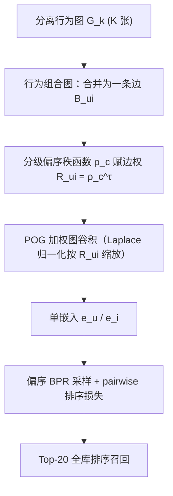

# Multi-Behavior Collaborative Filtering with Partial Order Graph Convolutional Networks (基于偏序图卷积网络的多行为协同过滤)

- **会议/期刊**: KDD 2024 (已接收，阿里首页召回模型落地)
- **作者与机构**: Yijie Zhang, Feiran Huang (暨南大学); Yuanchen Bei (浙江大学); Hao Chen, Zheng Yuan, Xiao Huang (香港理工大学); Qijie Shen (阿里巴巴); Senzhang Wang (中南大学)
- **推荐链路定位**: 召回（单嵌入 ANN 检索）
- **研究方向**: 图神经网络与知识图谱推荐 / 协同过滤
- **论文原文**: [https://arxiv.org/abs/2402.07659v2](https://arxiv.org/abs/2402.07659v2)
- **开源代码**: [https://github.com/Wings236/POGCN](https://github.com/Wings236/POGCN)

## TL;DR (1分钟核心速览)

POGCN 针对多行为 CF 的"跷跷板"共振效应：现有模型指定某行为为主任务、余者作辅助，导致主任务优而辅助任务塌陷。作者提出偏序推荐图 POG，用分级偏序秩函数把 K 张分离行为图压缩为一张带边权的加权图，并设计 POGCN 在其上做加权 LightGCN 式卷积 + 偏序 BPR 组合采样，输出单套用户/物品嵌入。在三基准 Full-Ranking 协议下 Mean Recall@20 平均提升 16.84%、Mean NDCG@20 提升 19.67%，Tenrec 上 Mean NDCG 提升 35.74%；线上 A/B（十亿用户级）UCTR +2.02%、GMV +2.84%。

## Background & Motivation (背景与核心矛盾)

- **主流范式**: 多行为推荐有两条路线——(1) 辅助增强路线 NMTR/MB-CGCN/GHCF：将购买设为主任务，点击/加购等作为辅助信号逐层增强主嵌入；(2) CTR 多任务路线 ESMM/MMoE/PLE：用复杂 MLP 门控建模任务间关系。
- **前人局限**: 其一，跷跷板问题——所有行为都有独立业务价值，主任务优化必定以牺牲辅助行为为代价（图1：GHCF 在加购/购买上优于 LightGCN，但点击 Recall 从 0.0920 掉至 0.0703）。其二，K 个行为需 K 套 CF 嵌入与 K 张图，时间、显存、存储开销成倍增长；CTR 多任务方法虽共享底层，但结构本身不产出可做 ANN 检索的单向量。
- **核心洞察 (Key Insight)**: 所有行为都发生同一用户-物品二元组上，差异只在于"该边上发生了哪些行为的组合"。若把行为组合整体当作基本单位，用分级偏序秩函数给组合打分（如 {C,F,B} > {F,B} > {C,F} > {B} > {C}），则只需一张加权图即可完整编码 K 张分离图的全部信息。
- **本文切入点**: 用分级偏序秩函数 ρ_c 将行为组合排序并转化为连续边权，构建偏序推荐图 POG，随后在 POG 上训练单一 CF 嵌入并配套偏序 BPR 采样。

## Method (核心方法设计)

### 1. 整体框架 (Overall Architecture)

POGCN 分三步闭环。**POG 构建**：给定用户按业务语义预设的行为偏序 $\leq_b$（如 click$\leq_b$favor$\leq_b$buy），对每个用户-物品对$(u,i)$收集实际发生的行为集合$B_{ui}\in\mathcal{C}$，用秩函数$\rho_c(B_{ui})$ 映射为正整数，作为 POG 边权；多行为由此压缩成一张加权图。**POG 图卷积**：在加权邻接矩阵上做对称归一化传播，按边权对邻居消息缩放，逐层取均值得最终单嵌入。**POBPR 训练**：按秩值与频率构成的分布采样行为组合，在该组合的正样本上做一次 pairwise BPR，避免 K 倍训练开销。

### 2. 关键设计拆解 (Key Designs)

**① 偏序推荐图 POG（把 K 张图压成 1 张加权图）**：若直接把边标签当作离散集合，组合之间不可微也无法排序。POG 先按最高等级行为强度计数比较，相同时递归降级，完全一致则不可比，从而把任意组合映射为分级整数（Corollary 1 证明其构成分级偏序集、可泛化到任意行为集）。边权定义为

$R_{ui} = \rho_c(B_{ui})^{\tau}$

$\tau$控制行为等级间距的拉伸，$\tau=0$ 退化为等权交互图。物理直觉：行为越"深"的组合边权越大，卷积时其消息被放大，使单嵌入自然倾向高价值行为，但低价值行为仍保留在图结构中贡献信号。

**② POGCN 偏序图卷积**：相比 MB-CGCN 按行为分别卷积、再手工权重融合，POGCN 直接在 POG 上做一次对称归一化卷积：

$e_u^{(l+1)} = \sum_{i\in N_u} \frac{R_{ui}}{\sqrt{\sum_t R_{ut}}\sqrt{\sum_t R_{ti}}}\, e_i^{(l)}$分母按行/列度数归一化，避免高边权节点主导梯度；由于$R_{ui}\ge 1$ 对所有发生交互的边恒成立，各行为在消息幅度上天然分层，K 种行为共享同一嵌入空间。

**③ 偏序 BPR 采样 (POBPR)**：传统多行为 BPR 需对 K 个行为分别构造正负样本对并加权，训练成本 K 倍且需人工调权 $\alpha_k$。POBPR 改以行为组合为单位做多项分布采样：

$p_h = \frac{\rho_c(C_h)^{\gamma}\cdot num(C_h)}{\sum_j \rho_c(C_j)^{\gamma}\cdot num(C_j)}$随后在该组合正样本上做一次 pairwise 排序损失：$\mathcal{L}_{POBPR} = \mathbb{E}_{C_h\sim P(C)}\Big[\sum_{(u,i)\in D^+_h}\sum_{j\in D^-_u}\ln\sigma(\hat{Y}_{ui}-\hat{Y}_{uj})\Big]$

$\gamma$控制秩值影响：过大则各行为趋同、丧失层次，过小则低秩组合被淹没。附录 A.2 证明该损失与传统"逐行为加权 BPR"在最大似然意义下等价，但训练复杂度由$O(K)$降至$O(1)$。

## Experimental Setup & Evaluation Protocol (实验设置与评估协议)

- **数据集与预处理**：过滤交互数 $<10$ 的用户与物品（沿用 LightGCN 设置），避免冷启动：

| 数据集 | #Users | #Items | #Interactions | 行为类别与分布 |
| :--- | :---: | :---: | :---: | :--- |
| Beibei | 21,716 | 7,977 | 3,359,784 | Click 2.41M / Cart 0.64M / Buy 0.30M |
| Taobao | 26,213 | 64,822 | 1,438,688 | Click 1.34M / Cart 52K / Favor 24K / Buy 21K |
| Tenrec | 19,035 | 15,539 | 1,382,095 | Click 1.37M / Like 11K / Share 1.5K / Follow 1.3K |

- **数据划分与防穿越**: 沿用 LightGCN 的固定交互集全库评测划分，无时间穿越问题（不涉及序列预测）。
- **排名评测协议**: 无偏 **Full-Ranking (全库未交互物品排序)**，指标 Recall@20 / NDCG@20，按行为分项评测并取均值；5 个随机种子平均。
- **偏序设定**: Beibei `click≤cart≤buy`；Taobao `click≤cart, favor≤buy`；Tenrec `click≤like≤share, follow`。
- **对比基线与超参**: 多行为 CF（MC-BPR/NMTR/GHCF/MB-GMN/MB-CGCN/IMGCF）、多任务（ESMM/MMoE/PLE，主干均替换为 LightGCN 以适配 CF 任务）、单行为 CF（MF-BPR/NCF/NGCF/LightGCN）。Embedding 维度 $d=64$，batch=1024，lr$\in\{1e\text{-}3, 5e\text{-}4, 1e\text{-}4\}$，reg$\in\{1e\text{-}4, 5e\text{-}5, 1e\text{-}5\}$，$\tau\in[0.2,1.0]$（Taobao/Tenrec 步长 0.2）与$[1.0,5.0]$（Beibei 步长 1.0），$\gamma\in[0.2,2.0]$ 步长 0.2。

## Key Experimental Results (实验关键数据)

### 1. 主实验对比 (Main Results)

**表1 三数据集 Mean Recall@20 / Mean NDCG@20（Full-Ranking, d=64）**

| 模型 | Beibei R | Beibei NDCG | Taobao R | Taobao NDCG | Tenrec R | Tenrec NDCG |
| :--- | :---: | :---: | :---: | :---: | :---: | :---: |
| MC-BPR | 0.1087 | 0.0624 | 0.0225 | 0.0103 | 0.0949 | 0.0498 |
| GHCF | 0.1350 | 0.0827 | 0.0452 | 0.0226 | 0.0947 | 0.0503 |
| MB-CGCN | 0.0956 | 0.0561 | 0.0017 | 0.0009 | 0.0697 | 0.0344 |
| IMGCF | 0.1326 | 0.0767 | 0.0272 | 0.0125 | 0.0573 | 0.0294 |
| ESMM | 0.1262 | 0.0775 | 0.0084 | 0.0038 | 0.0233 | 0.0089 |
| MMoE | 0.1157 | 0.0694 | 0.0017 | 0.0006 | 0.0199 | 0.0098 |
| PLE | 0.1191 | 0.0696 | 0.0017 | 0.0009 | 0.0196 | 0.0083 |
| LightGCN | 0.1266 | 0.0798 | 0.0151 | 0.0087 | 0.0608 | 0.0355 |
| **POGCN** | **0.1502** | **0.0957** | **0.0502** | **0.0243** | **0.1217** | **0.0683** |
| Improv.% | **+11.28%** | **+15.80%** | **+11.05%** | **+7.49%** | **+28.19%** | **+35.74%** |

分行为看：Beibei 点击 Recall 由 LightGCN 0.0920 → 0.0935、加购 0.1233 → 0.1542、购买 0.1646 → 0.2029；Taobao Favor Recall 由 GHCF 0.0595 → 0.0633；Tenrec Share Recall 0.1029 → 0.1324、Follow Recall 0.0408 → 0.0697。

### 2. 消融实验 (Ablation Study)

**表2 三变体在 Beibei / Taobao 上的性能相对排序（图3）**

| 变体 | 改动内容 | 相对完整模型 |
| :--- | :--- | :--- |
| w/o PO-all | 去掉全部偏序组件（等权交互图 + 传统 BPR 采样） | 降幅最大，所有行为全面下滑 |
| w/o POG | 卷积时去掉偏序边权，仅均匀权重 | 降幅次之 |
| w/o POBPR | 用传统多行为 BPR 采样替代 POBPR | 低于 POGCN，但优于上两者 |
| POGCN | 完整模型 | 最优 |

### 3. 关键实验发现 (Key Findings)

1. **跷跷板现象被真正消解**：Beibei 上 GHCF 以购买为主任务时点击 Recall 仅 0.0703，而 POGCN 点击 0.0935、加购 0.1542、购买 0.2029，三种行为同时超越所有基线（单行为 LightGCN 的点击 0.0920、购买 0.1646 亦被覆盖）。这直接验证"POG 加权图 + 单嵌入"可在同一空间内同时提升主辅行为，而非此消彼长。
2. **行为组合秩函数对稀疏高阶行为增益最大**：Tenrec 上 Follow、Share 分别只有 1,330、1,503 条交互，MB-CGCN 的 Follow Recall 仅 0.0405、Share NDCG 仅 0.0346，而 POGCN 达 0.0697 / 0.0636（+70.83% / +40.25%）；原因在于行为组合经 $\rho_c$ 变为边权，高阶行为不必依赖独立的辅助嵌入即能获得信号。
3. **CTR 多任务模型在召回阶段系统性失效**：即便将 ESMM/MMoE/PLE 主干全部替换为 LightGCN，Tenrec 上 Mean Recall 仍仅为 0.0233 / 0.0199 / 0.0196，远逊单行为 LightGCN 的 0.0608。说明 MLP 门控结构无法产出规范化的单 CF 向量，印证了从图结构层面统一多行为的必要性。

## Highlights & Limitations (亮点、对比与审稿批判)

- **与代表作对比 (vs. Prior Work)**: NMTR/MB-CGCN 把非目标行为当辅助信号逐级增强，GHCF 加权融合分离嵌入，三者均在主辅之间失衡；POGCN 从图结构层将 K 张图压成一张分级偏序加权图，单嵌入同时服务多行为。与 MC-BPR 相比，POBPR 将训练复杂度由 $O(K)$降至$O(1)$且免去人工权$\alpha_k$。与 ESMM/MMoE/PLE 相比，POGCN 直接面向召回阶段全库排序，而非排序阶段 CTR 预估。
- **可迁移亮点**: 分级偏序秩函数可直接改写用于任意层次化行为信号（曝光<点击<收藏<购买，阅读<点赞<评论<转发）的边权编码；POBPR 的"组合级采样 + 单次 pairwise"范式可迁移至多域/多场景联合训练中，抑制域间跷跷板。
- **审稿级局限批判**: (1) 行为偏序 $\leq_b$必须人工按业务预设，且最优$\tau$（Beibei 3.0 vs Taobao 0.2）与$\gamma$（1.4 vs 0.6）在数据集间差异极大，缺少可学习或自适应的偏序发现机制；(2) 仅报告 Recall@20/NDCG@20 的总体指标，缺少长尾物品、冷启动用户分桶分析与图存储/构图的显存开销讨论；(3) 线上 A/B 只给出相对 LightGCN 的业务指标提升，未公布训练吞吐、图规模与推理延迟等工程代价对比。

## Rating (四维评分)

- **方法创新性 (Novelty)**: ⭐⭐⭐⭐⭐ （首次将分级偏序集理论落地为多行为 CF 图构建，从基础设施层重定义多行为融合并给出完备性证明）
- **评估协议与实验扎实度 (Protocol & Experiments)**: ⭐⭐⭐⭐ （三数据集全库排序 + 5 随机种子 + 亿级线上 A/B，但缺少长尾/冷启动分桶与效率维度评估）
- **写作与数学规范度 (Clarity & Rigor)**: ⭐⭐⭐⭐ （定义—构造—等价性证明链完整，POBPR 与多行为 BPR 的等价性推导清晰，符号略密需对照附录）
- **工业落地与复现价值 (Industrial & Practical Value)**: ⭐⭐⭐⭐⭐ （已在阿里首页作为召回模型上线两月、覆盖十亿用户，代码开源，单嵌入天然兼容 ANN 检索）

