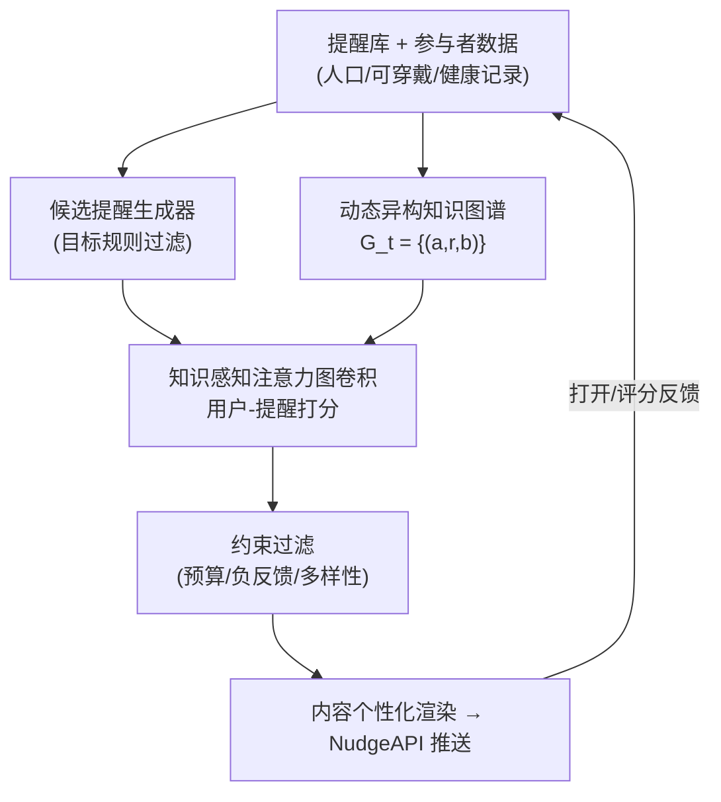
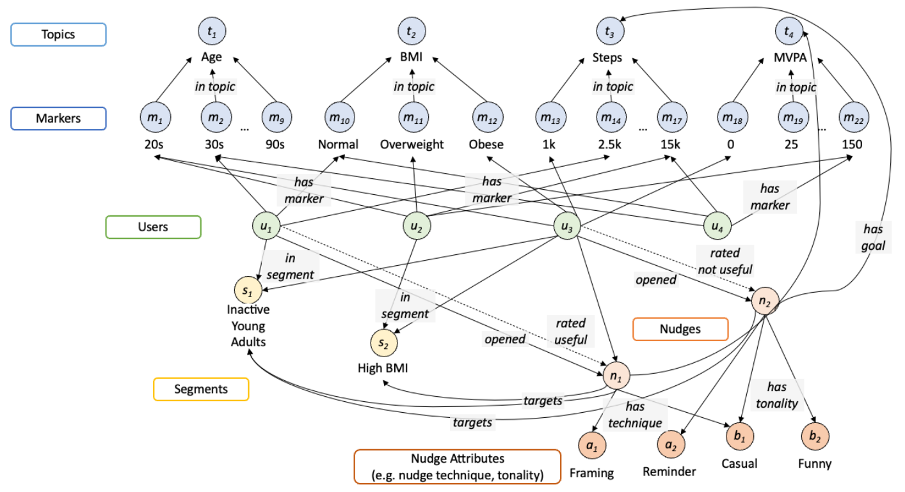

# NudgeRank: Digital Algorithmic Nudging for Personalized Health (面向个性化健康的数字算法化行为助推系统)

- **会议/期刊**: KDD 2024 (应用数据科学轨道，工业部署报告)
- **作者与机构**: Jodi Chiam, Aloysius Lim (CueZen Inc. 新加坡/西雅图)、Ankur Teredesai (CueZen Inc. & University of Washington Tacoma)
- **推荐链路定位**: 召回 + 精排（候选提醒生成 → 图神经推荐排序 → 约束过滤 → 内容渲染）
- **研究方向**: 图神经网络与知识图谱推荐 / 冷启动与长尾推荐
- **论文原文**: [https://arxiv.org/abs/2407.20241v1](https://arxiv.org/abs/2407.20241v1)
- **开源代码**: 暂未开源

## TL;DR (1分钟核心速览)

论文面向「大规模人群健康行为助推」痛点：规则式助推动作个性化不足，且缺乏可同时覆盖多健康目标的通用架构。作者提出 NudgeRank，用动态异构知识图谱（用户–提醒–属性–人群分段）承载上下文，叠加知识感知注意力的图卷积进行排序，配合约束过滤、多样性采样与并行批处理工程，实现每日对 110 万人实时推送个性化健康提醒。在离线 `Precision@3` 上最优两层图卷积达 0.0652（相对单层 +45%），12 周随机对照 A/B 中治疗组日均步数 +6.17%、每周 MVPA +7.61%，提醒打开率 13.1%（基线规则系统约 4%）。

## Background & Motivation (背景与核心矛盾)

- **主流范式**: 健康助推多依赖 JITAI 与硬编码决策规则（如 GPS 触发、1,500 条消息规则库），或单一目标的强化学习/聚类/LSTM 定制模型。
- **前人局限**: 其一，通用规则库缺乏对个体上下文的自适应，个性化能力受限；其二，现有研究多为单一健康目标的离线小样本，无法扩展到多病共存人群的上亿级多次推送场景。
- **核心洞察 (Key Insight)**: 作者认为助推效力始于「用户是否打开提醒」，因此把控目标转为「预测用户最可能交互的 Top-3 提醒」，并可用「提醒打开量」作为行为改变的代理前置指标。
- **本文切入点**: 把用户、提醒、人口属性、行为分段、健康知识统一建模为动态异构知识图谱（>130 种标记），用图神经推荐器捕捉高阶语义关系，并以工程化闭环支撑每日自动更新与全量推送。

## Method (核心方法设计)

### 1. 整体框架 (Overall Architecture)

系统以 Nudge Library（提醒模板库）与参与者数据（人口属性、可穿戴行为、交互反馈）为输入；Personal Candidate Nudge Generator 依目标规则（如「60 岁以上且上周步数<5000」）为每用户生成候选提醒；NudgeRank Knowledge Graph Constructor 构建并每日刷新异构图谱；知识图谱神经网络对候选（用户, 提醒）对打分排序；Constraints Filter 施加预算、负反馈屏蔽、多样性替换；Content Personalizer 渲染模板字段（如注入实际步数）；NudgeAPI 通过推送通知下发并回收打开/评分反馈，形成闭环，Model Trainer 每日增量微调。全文管网图见原文图 1，图谱结构见图 2，GNN 结构见图 3。

<figure class="paper-figure" markdown="span">
  <figcaption>图2：NudgeRank™知识图谱。</figcaption>
</figure>

### 2. 关键设计拆解 (Key Designs)

1. **知识感知注意力图卷积（Knowledge-Aware Attention）**：痛点在于异构图里不同关系（如 `in_segment`、`targets`）的信息量差异极大，均匀聚合会稀释信号。本文沿用 KGAT 式关系空间注意力，把邻居权重写成头尾节点在关系 $r$投影空间的相似度：$\alpha^{r}_{ab}=\mathrm{softmax}_{b}\big((\mathbf{W}_r\mathbf{e}_b)^{\top}\tanh(\mathbf{W}_r\mathbf{e}_a+\mathbf{e}_r)\big)$，节点按$\mathbf{e}_a^{(l)}=f\big(\mathbf{e}_a^{(l-1)},\sum_{b\in\mathcal{N}_a}\alpha_{ab}\mathbf{e}_b^{(l-1)}\big)$更新，$f$ 可取相加或拼接。直觉：同一用户可同时从「行为相似用户」和「目标分段」两类邻居获取不同强度证据，从而区分「该收到鼓励」还是「该收到催促」。
2. **动态图谱 + 冷启动与多样性采样**：新用户/新提醒入图时，仅凭注册人口属性与目标分段即可连边，节点用 Xavier 初始化（区别于对老节点复用 $\mathcal{G}_t$的已学习嵌入），从而无需任何交互即可推荐「同人群打开过的提醒」；同时以概率$p_{diversity}\in[0,1]$将已排序提醒替换为候选池均匀采样项，为长尾新提醒注入曝光与学习信号。最终下发数$k_{final}=\min(k_{daily},k_{recommended})$，负反馈在$d_{neg\_filter}$ 天内屏蔽该提醒。
3. **训练目标与推理效率**：指出采用隐式反馈的 BPR/点积评分 $\hat{y}_{u,i}=\mathbf{e}_u^{\top}\mathbf{e}_i$（原文未展开损失细节，属工业系统披露粒度）；推理侧采用 Parallel NudgeRank（算法 1），把$n$个用户均分为$b$批并行跑管道，失败批自动重试、成功批结果保留，端到端耗时随候选对数量线性增长（$R^2=0.9997$）。

## Experimental Setup & Evaluation Protocol (实验设置与评估协议)

- **数据集与预处理**: 生产环境真实数据，图谱日快照如下（含用户、提醒、属性、分段节点）：

| 数据/对象 | 规模 | 说明 |
| :--- | :---: | :--- |
| 活跃用户 | >1.1M | Healthy 365 App 用户，日均接收提醒 |
| 图谱节点数 | 3.1M | 用户 + 提醒 + 属性/分段实体 |
| 图谱边数 | 5.7M | 有向关系，含交互与归属边 |
| 图谱密度 | $5.93\times10^{-7}$ | 极稀疏异构图 |
| 属性标记 | >130 种 | 人口、BMI、步数、MVPA 等 |

- **数据划分与防穿越 (Splitting Strategy)**: 离线阶段在知识图谱上**随机隐藏 25% 用户–提醒交互**作为测试集，其余训练；非时间切分，通过每日增量微调（新图 $\mathcal{G}_{t+1}$继承$\mathcal{G}_t$ 嵌入）缓解穿越。
- **排名评测协议 (Ranking Protocol)**: 采用**采样候选内的 Top-3 排序**（每用户候选集由目标规则预过滤生成，并非全库 Full-Ranking），主指标 `Precision@3`，后补充 `MAP`、`NDCG@3`、`Recall@3`。
- **对比基线与超参设置**: 无外部 SOTA 基线，对比对象为 1/2/3 层图卷积配置；嵌入维度与隐层经网格搜索（实体/关系维度 $\{16,32,64\}$），选定 2 层$[32,16]$、实体与关系维度均 32；线上为匹配对照（年龄、性别、基线步数与 MVPA 对齐）的单尾独立样本$t$检验，$\alpha=0.05$。

## Key Experimental Results (实验关键数据)

### 1. 主实验对比 (Main Results)

模型层数配置对比（离线 `Precision@3`，同一候选生成协议）：

| 配置 | 实体维 | 关系维 | 隐层 | Precision@3 | 相对单层 |
| :--- | :---: | :---: | :---: | :---: | :---: |
| 1 层 | 64 | 64 | [64] | 0.0451 | — |
| **2 层 (最优)** | **32** | **32** | **[32,16]** | **0.0652** | **+45.0%** |
| 3 层 | 64 | 64 | [64,32,16] | 0.0401 | −11.1% |

线上 12 周随机对照（$n_{treat}=84{,}764$，$n_{control}=84{,}903$）：

| 指标 | 无提醒（对照） | 每日提醒（治疗） | 变化 | $p$ 值 |
| :--- | :---: | :---: | :---: | :---: |
| 日均步数 | 2,908.6 | 3,088.1 | **+6.17%** | $3.09\times10^{-4}$ |
| 每周 MVPA (分钟) | 47.0 | 50.6 | **+7.61%** | $1.16\times10^{-2}$ |
| 提醒打开率 | ~4%（基线系统） | **13.1%** | +9.1pp | — |

### 2. 消融实验 (Ablation Study)

论文未做组件级移除消融，仅提供层数与维度敏感性（等效于图卷积深度消融）：

| 变体 | 关键变化 | Precision@3 | 结论 |
| :--- | :--- | :---: | :--- |
| w/o 第二层卷积 | 1 层 [64] | 0.0451 | 高阶邻居聚合贡献 +0.0201 |
| 全配置（2 层） | [32,16] | 0.0652 | 最优 |
| 过深（3 层） | [64,32,16] | 0.0401 | 过平滑/过拟合导致下降 |

### 3. 关键实验发现 (Key Findings)

1. **两层是甜点，过深反降**：2 层相对 1 层提升 0.0201（45%），但 3 层跌至 0.0401，比 1 层还低 11%，与异构图极稀疏（密度 $5.93\times10^{-7}$）下深层聚合引入噪声、过平滑的判断一致。
2. **剂量–反应关系成立**：12 周内打开 0/1/2/≥3 条提醒的用户日均步数分别为 2,491 / 3,213 / 3,588 / 4,445，随打开量单调递增，支撑「交互是行为改变前置代理」的设计假设。
3. **规模近线性、稳定性可控**：执行时间与候选对数强线性（$R^2=0.9997$），30 万对 22 分钟、190 亿对 138 分钟；每日指标标准差仅 0.0068–0.0100，且步数效应 12 周全部显著、MVPA 10/12 周显著，说明增益可持续而非新奇效应。

## Highlights & Limitations (亮点、对比与审稿批判)

- **与代表作对比 (vs. Prior Work)**: 相较 RippleNet/KGCN/KGAT 等仅建模「物品侧知识」的 KG 推荐（且多在公开电商数据离线验证），本文额外编码**用户侧属性与动态分段**并落地 110 万人生产环境；相较 JITAI/规则库（Patrick 等 1,500 条规则）与单目标 RL（HeartSteps），本文以统一图谱支持多健康目标扩展与冷启动。
- **可迁移亮点**: (1) 用「动态分段节点 + 分段连边」把业务规则软化为图结构，避免大量特征工程；(2) 以 $p_{diversity}$ 概率替换排序结果，同时兼顾探索、长尾曝光与在线学习信号采集。
- **审稿级局限批判**: 其一，离线评测仅为候选集内 25% 随机留出的 `Precision@3`，缺 Full-Ranking 与外部 SOTA 基线，且无组件级消融（约束过滤、多样性、图谱属性各自的贡献未量化）；其二，线上效应量绝对值较小（步数 +180 步/日），且对照为匹配而非完全随机化，存在选择偏差与新奇效应隐忧；此外，日训 90–150 分钟 + 全量批打分对图规模继续增长的成本弹性未讨论。

## Rating (四维评分)

- **方法创新性 (Novelty)**: ⭐⭐⭐ （图谱结构本身沿用 KGAT 注意力，创新集中在用户侧知识 + 动态分段 + 冷启动工程化，学术新颖度中等但落地形态新颖）
- **评估协议与实验扎实度 (Protocol & Experiments)**: ⭐⭐⭐ （有 8.5 万 vs 8.5 万匹配对照与显著性检验、线性扩展性实测，但离线缺全库排序与外部基线、无组件消融）
- **写作与数学规范度 (Clarity & Rigor)**: ⭐⭐⭐⭐ （系统管道、约束参数与算法伪码描述清晰可复现，公式简洁；训练损失与负采样细节披露不足）
- **工业落地与复现价值 (Industrial & Practical Value)**: ⭐⭐⭐⭐⭐ （18 个月稳定运行、110 万日活、商品化云资源 + Kubernetes 并行与容错机制，工程参考价值极高）

