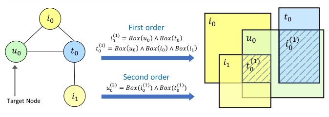
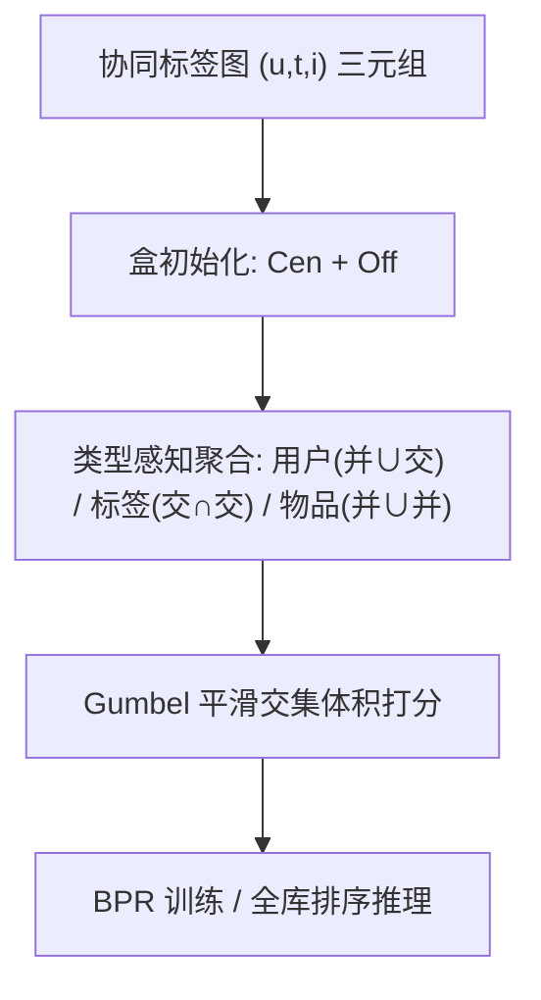

# When Box Meets Graph Neural Network in Tag-aware Recommendation (当盒嵌入遇见图神经网络：标签感知推荐)

- **会议/期刊**: KDD 2024
- **作者与机构**: Fake Lin, Ziwei Zhao, Xi Zhu, Da Zhang, Shitian Shen, Xueying Li, Tong Xu, Suojuan Zhang, Enhong Chen（中国科学技术大学、阿里巴巴、陆军工程大学）
- **推荐链路定位**: 召回（用户-物品匹配打分）
- **研究方向**: 图神经网络与知识图谱推荐 / 协同过滤与双塔召回
- **论文原文**: [https://arxiv.org/abs/2406.12020v1](https://arxiv.org/abs/2406.12020v1)
- **开源代码**: [https://github.com/critical88/BoxGNN](https://github.com/critical88/BoxGNN)

## TL;DR (1分钟核心速览)

标签感知推荐（TRS）的两条主线各有硬伤：特征/多热向量法丢失高阶协同信号，GNN 法把节点压成**点向量**，无法表达“同一用户购买 iPhone 可能因品牌、也可能因便携”这种偏好多样性与不确定性。BoxGNN 把用户、物品、标签统一嵌入为 $d$ 维超矩形盒（中心 + 偏移），用**交集/并集逻辑算子**重写消息聚合，并以 Gumbel 平滑的**交集体积**作为匹配分，使无重叠时梯度不消失。在 MovieLens / LastFm / 两个公开集与 LLM 造标签的 E-shop 上，全库排序 Recall@10 相对最强基线 LFGCF 提升 6.6% / 8.8% / 25.6%。

## Background & Motivation (背景与核心矛盾)

- **主流范式**: 一条线是特征法（多热标签 + MLP/注意力，如 DSPR），另一条线是 GNN 法（在 user-tag-item 三部图上做 LightGCN 式传播，如 TGCN、LFGCF）。
- **前人局限**: ① 特征法受标签稀疏拖累，且完全无视三部图上的多跳语义；② GNN 法把三类节点都压成共享空间中的**固定点**，无法表达偏好的“范围”与不确定性，也浪费了标签体系的层次包含结构（football ⊂ sport）；③ 已有的盒嵌入推荐（CBox4cr、CubeRec）只看一阶交互，没有高阶协同信号。
- **核心洞察 (Key Insight)**: 盒嵌入天然适配 TRS——用户兴趣是“一片区域”而非一个点，标签的层级包含关系可由盒的包含/交叠表达；但纯交集聚合会因盒的**各向异性**（各维长度差异极大）迅速退化。如图 2 所示，一阶聚合得到的 $i_0^{(1)}$与$t_0^{(1)}$ 已在空间中互不相交，二阶用户盒直接变成空集，层数堆叠会放大该病态。
- **本文切入点**: 不再“只做交集”，而是按节点类型设计交集/并集的**组合**规则，并把无重叠时的体积计算交给 Gumbel 分布平滑，使梯度始终可传导。

<figure class="paper-figure" markdown="span">
  <figcaption>图2：通过交集操作进行消息聚合的简单示例，其中 𝐵𝑜𝑥(·) 表示节点的盒嵌入，𝑢、𝑖 和 𝑡 分别表示用户、物品和标签。值得注意的是，我们无法获得二阶用户盒嵌入，因为 𝑡(1)</figcaption>
</figure>

## Method (核心方法设计)

### 1. 整体框架 (Overall Architecture)

输入是训练集上构建的协同标签图（每条标注三元组 $(u,t,i)$拆成$(u,i),(u,t),(i,t)$三条边）。三类节点先以$(Cen,Off)\in\mathbb{R}^{2d}$初始化为盒；随后$L$ 层“类型感知”盒消息聚合，每层对每个节点分别聚合异质子集后做交/并融合；最后以用户盒与物品盒的**Gumbel 期望交集体积**取对数作为打分，BPR 损失端到端训练，推理时对全库物品算体积排序。

### 2. 关键设计拆解 (Key Designs)

1. **逻辑算子重定义（交与并的区别只在 offset 的 min/max）**：传统 GNN 的均值/加权和在盒空间无定义。作者令交集取共享区域、并集取包络区域，中心一律用注意力加权，偏移分别取逐元素最小/最大：
$\boldsymbol{v}_{inter}=\bigcap_k \boldsymbol{v}_k:\ Cen=\sum_k a_k\odot Cen(\boldsymbol{v}_k),\ Off=\mathrm{Min}_k\{Off(\boldsymbol{v}_k)\}$，并集仅把$\mathrm{Min}$换成$\mathrm{Max}$。直觉：交集刻画“共同属性”，并集刻画“信息上界”，二者组合即可覆盖“共性与多样性”两种语义。

2. **类型感知聚合（三类节点三套组合规则）**：这是解决“交集易空集”的核心。用户侧，标签是显式兴趣、需保留多样性 → **并集**（$u_t^{(l+1)}=\bigcup_k t_k$）；历史物品反映隐式共性 → **交集**（$u_i^{(l+1)}=\bigcap_k i_k$）；二者再**并**成最终用户盒，偏移为$Off=\mathrm{Max}(\mathrm{Min}\{Off(i)\},\mathrm{Max}\{Off(t)\})$。标签侧，用户与物品邻居都只能确定其部分语义 → **交集 ∩ 交集**。物品侧，多用户多标签代表多面性与流行度（越热门盒越大，新用户盒更易被包含）→ **并集 ∪ 并集**。当所有 offset 置零时，该算子退化为 GAT，说明它是注意力聚合的严格推广。

3. **Gumbel 平滑体积目标与训练**：匹配分取交集盒体积，但两盒不相交时体积恒 0、梯度消失。作者将盒的最小/最大角视为 Gumbel 变量（尺度 $\beta$），利用 min/max 稳定性得到交集角$\mu^z_{ui}=\beta\ln(e^{\mu^z_u/\beta}+e^{\mu^z_i/\beta})$，期望体积含第二类修正 Bessel 函数$K_0$，再用 softplus 型$m(x)=\beta\log(1+e^{x/\beta-2\gamma})$ 替换以保证数值稳定：
$\hat{y}_{ui}=\log\mathrm{Vol}(\mathrm{Box}_{ui})=\sum_{k}\log\big[\beta\log(1+e^{-(\mu^Z_{ui,k}-\mu^z_{ui,k})/\beta-2\gamma})\big]$。
训练用 BPR：$\mathcal{L}=\sum_{(u,i^+,i^-)}-\log\sigma(\hat{y}_{ui^+}-\hat{y}_{ui^-})+\lambda\|\Theta\|^2$，负样本为标准均匀采样，无额外 hard negative 挖掘；打分需对每个候选做$d$ 维逐元素运算，开销与内积同阶但常数更大。

## Experimental Setup & Evaluation Protocol (实验设置与评估协议)

- **数据集与预处理**: 过滤出现次数 < 5 的稀有标签；E-shop 为真实电商数据，用 GPT-4 turbo 由商品标题反推用户/物品兴趣标签。

| 数据集 | #Users | #Items | #Tags | #Assignments | 说明 |
| :--- | :---: | :---: | :---: | :---: | :--- |
| MovieLens | 1,651 | 5,381 | 1,586 | 36,728 | 电影标注（HetRec 2011） |
| LastFm | 1,808 | 12,212 | 2,305 | 175,641 | 音乐人标注 |
| E-shop | 7,277 | 26,726 | 4,146 | 237,059 | LLM 生成标签的电商数据 |

- **数据划分与防穿越**: 按标注（assignment）随机 8:1:1 切分为训练/验证/测试，**协同标签图仅用训练数据构建**，避免图结构穿越。
- **排名评测协议**: 无偏 **Full-Ranking（全库未交互物品排序）**，指标 Recall@{10,20} 与 NDCG@{10,20}；每 5 epoch 验证、10 次无提升早停。
- **对比基线与超参**: BPR、NFM、IFM、NGCF、LightGCN、KGIN、KGRec、DSPR、LFGCF 共 9 个基线覆盖特征/GNN/KG/标签四类；统一 $d=64$、batch 1024、Adam，学习率$\{10^{-5},10^{-4},10^{-3}\}$、正则$\{10^{-6}\sim10^{-3}\}$网格搜索，$t$-test$p<0.05$ 显著性。

## Key Experimental Results (实验关键数据)

### 1. 主实验对比 (Main Results)

| 模型 | ML R@10 | ML N@10 | LastFm R@10 | LastFm N@10 | E-shop R@10 | E-shop N@10 |
| :--- | :---: | :---: | :---: | :---: | :---: | :---: |
| BPR | 0.0453 | 0.0320 | 0.0673 | 0.0563 | 0.3409 | 0.2632 |
| NGCF | 0.0352 | 0.0273 | 0.1149 | 0.0943 | 0.3748 | 0.2852 |
| LightGCN | 0.0446 | 0.0313 | 0.1020 | 0.0875 | 0.2749 | 0.2118 |
| KGIN | 0.0633 | 0.0516 | 0.1113 | 0.0924 | 0.2934 | 0.2300 |
| KGRec | 0.0468 | 0.0380 | 0.1166 | 0.0996 | 0.2681 | 0.2118 |
| DSPR | 0.0661 | 0.0476 | 0.0505 | 0.0438 | 0.2336 | 0.1686 |
| LFGCF | 0.0812 | 0.0601 | 0.1241 | 0.1058 | 0.3586 | 0.2598 |
| BoxGNN w/o tags | 0.0533 | 0.0362 | 0.1271 | 0.1023 | 0.4260 | 0.3298 |
| **BoxGNN** | **0.0866** | **0.0704** | **0.1350** | **0.1124** | **0.4505** | **0.3447** |
| Improv.% vs 最优基线 | +6.65% | +17.14% | +8.78% | +6.24% | +20.20% | +20.90% |

### 2. 消融实验 (Ablation Study)

| 变体 | ML Recall | ML NDCG | LastFm Recall | LastFm NDCG | E-shop Recall | E-shop NDCG |
| :--- | :---: | :---: | :---: | :---: | :---: | :---: |
| w/o GNN ($L=0$) | 0.0343 | 0.0237 | 0.0965 | 0.0840 | 0.3843 | 0.2961 |
| w/o Gumbel | 0.0652 | 0.0544 | 0.1083 | 0.0905 | 0.4040 | 0.3166 |
| BoxGNN ($L=3$) | **0.0866** | **0.0704** | **0.1350** | **0.1124** | 0.4490 | 0.3455 |

### 3. 关键实验发现 (Key Findings)

1. **去掉 GNN 层是最大杀手**：ML Recall 从 0.0866 掉到 0.0343（−60%），降幅远超去掉 Gumbel 的 0.0652，说明“盒”的收益必须叠加高阶协同信号才释放——单靠几何嵌入并不够。
2. **Gumbel 平滑稳定贡献 20%+**：移除后 ML NDCG 由 0.0704 降至 0.0544（−23%），验证无重叠盒的梯度消失是真实瓶颈，而非理论顾虑。
3. **层数存在场景相关的拐点**：ML/LastFm 在 $L=3$最优（$L=2$时 ML R@10 仅 0.0681），而 E-shop 在$L=2$最优（0.4490 vs 0.4343），作者归因于 LLM 生成标签自带噪声，过深传播引入过多噪声；$\beta$ 在三个数据集上均以 **0.2** 最佳，过大趋近均匀分布抹平盒间差异，过小退化为 hinge 函数重新触发梯度消失。

## Highlights & Limitations (亮点、对比与审稿批判)

- **与代表作对比 (vs. Prior Work)**: 相较 LFGCF（同样在三部图上传播但节点为点向量），本文把“范围 + 逻辑运算”引入聚合，NDCG@10 提升 17%；相较 CBox4cr（盒嵌入但仅一阶交互），补齐了多跳协同信号；相较 GAT，本文算子在 offset=0 时严格退化为 GAT，属带理论包含关系的推广。
- **可迁移亮点**: ① “交集=共性 / 并集=多样性”的类型化算子设计可直接搬到异构图多关系场景（如 KG 推荐中的意图聚合）；② Gumbel 平滑体积可为任何“几何交集类”打分函数（盒/锥/球嵌入）提供无重叠时的稳定梯度。
- **审稿级局限批判**: ① E-shop 的标签由 GPT-4 turbo 生成并作为监督信号，存在 LLM 幻觉标签被当成真值的风险，且该数据集未公开（待内部审核），复现链不完整；② 聚合依赖 bag-of-neighbor 的 min/max 操作，缺少对邻居权重的细粒度建模，且体积打分需 $d$ 次 exp/log 运算、常数开销高于内积，在线大规模召回延迟未做分析；③ 仅报告 Full-Ranking 的 Recall/NDCG，未做冷启动物品/低活跃用户分桶，无法证明“不确定性建模”确实在稀疏长尾侧生效。

## Rating (四维评分)

- **方法创新性 (Novelty)**: ⭐⭐⭐⭐ （把盒嵌入与 GNN 消息传递真正缝合，类型化交并算子 + Gumbel 平滑体积，且有“退化为 GAT”的理论对照）
- **评估协议与实验扎实度 (Protocol & Experiments)**: ⭐⭐⭐⭐ （三个数据集、9 个跨族基线、无偏全库排序、显著性检验与消融齐全；扣分在 E-shop 私有与缺分桶分析）
- **写作与数学规范度 (Clarity & Rigor)**: ⭐⭐⭐⭐ （算子定义与体积推导引用清晰，图 2 的空集反例极有说服力；但中心注意力公式在多处重复书写，符号略显冗）
- **工业落地与复现价值 (Industrial & Practical Value)**: ⭐⭐⭐⭐ （代码开源、仅 2–3 层即收敛、兼容 LightGCN 式构图，适合标签富集场景；体积打分常数开销与 LLM 标签噪声治理仍需工程侧验证）

