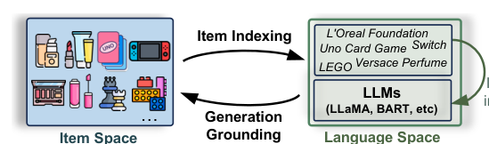
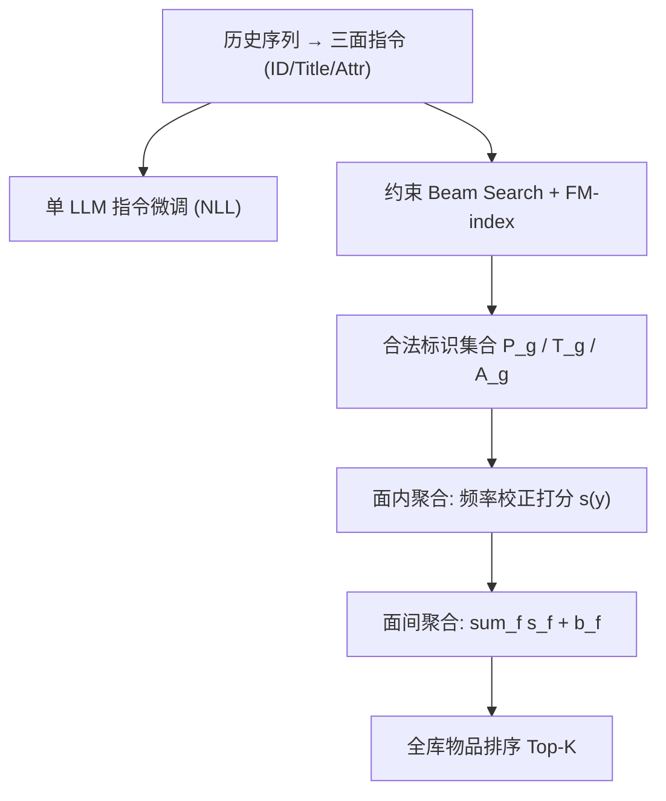
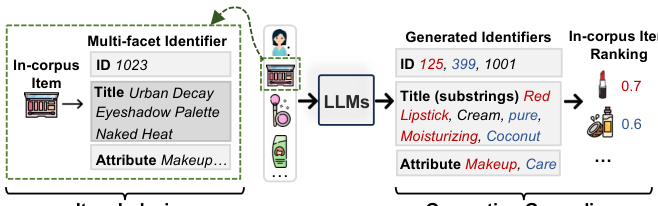

# Bridging Items and Language: A Transition Paradigm for Large Language Model-Based Recommendation (TransRec：打通物品与语言的过渡范式)

- **会议/期刊**: KDD 2024
- **作者与机构**: Xinyu Lin, Wenjie Wang, Yongqi Li, Fuli Feng, See-Kiong Ng, Tat-Seng Chua（新加坡国立大学、香港理工大学、中国科学技术大学）
- **推荐链路定位**: 端到端生成式召回（生成即排序）
- **研究方向**: 大语言模型推荐 (LLM4Rec) / 生成式推荐与离散语义 ID
- **论文原文**: [https://arxiv.org/abs/2310.06491v2](https://arxiv.org/abs/2310.06491v2)
- **开源代码**: [https://github.com/Linxyhaha/TransRec](https://github.com/Linxyhaha/TransRec)

## TL;DR (1分钟核心速览)

LLM 推荐的关键是打通「物品空间」与「语言空间」，涉及**物品索引**与**生成接地**两步。既有方案中，数字 ID 标识失去语义、标题/属性标识缺乏区分度且与协同信号错位；而无约束自回归解码会产出**语料外标识 (out-of-corpus)**，只能靠 L2 匹配事后补救，代价高昂。TransRec 提出多侧面标识（ID + 标题 + 属性三面并行）、基于 FM-index 的**位置无关受限生成**、以及面内/面间聚合接地排序。在 Beauty/Toys/Yelp 全库排序下，BART-large 主干较最强 LLM 基线 CID+IID 在 Yelp Recall@5 提升 **33.6%**、Beauty NDCG@10 提升 **9.2%**，接地的计算耗时同时降低 **2.6×**。

## Background & Motivation (背景与核心矛盾)

- **主流范式**: 以指令微调 LLM 为推荐器（P5、TIGER、CID+IID），把用户历史序列翻译为标识序列，自回归生成下一物品标识再做匹配。
- **前人局限 1（索引）**: ID 类标识（`15308`）保证唯一性却无显式语义，冷启动物品与长尾物品必须依赖大量交互才能学到可区分的 ID 表示；描述类标识（标题/属性）含大量通用词（如 "Will"、"Be"），区分度不足，且**语义相似 ≠ 交互相似**，与协同信号存在系统性错位。
- **前人局限 2（接地）**: 逐 token 在全词表上做 `argmax`，任何一步都可能生成不存在的标识；[1] 用 LLM 表征 + L2 距离兜底匹配，需额外前向推理，本报告表 3 实测每 5000 用户耗时约 577 秒。
- **核心洞察 (Key Insight)**: 标识设计应同时满足**区分性**（承载 CF 知识）与**语义性**（激活 LLM 世界知识）；而接地应当从"事后匹配"改为"**解码期结构约束**"。约束生成的代价是强依赖 beam search 首 token 质量（前缀树只允许从标识首位起生成），故需**位置无关**约束。
- **本文切入点**: 三面标识并行 + FM-index 支持任意起点的受限解码 + 面间加权聚合打分。

<figure class="paper-figure" markdown="span">
  <figcaption>图1：基于LLM的推荐器中两个关键步骤的示意图：物品索引与生成接地。</figcaption>
</figure>

## Method (核心方法设计)

### 1. 整体框架 (Overall Architecture)

TransRec 用**单个 LLM**（BART-large 全参微调 / LLaMA-7B 使用 LoRA）完成三面联合训练与推理解码。离线：为每个物品构造三侧面扁平化标识 `<IDS>1023<IDE> Urban Decay Eyeshadow Palette <AS>Makeup<AE><AS>Eyes<AE>`，写入 Wavelet Tree 上的 FM-index；并把每条交互序列按面重构成三份指令数据（ID 面输出数字 ID、标题面输出**任意长度子串**、属性面输出单个属性），用 facet 前缀区分。在线：给定三面历史指令，用约束 beam search 在 FM-index 允许的后继集合内逐 token 解码，得到若干合法标识集合；再经面内聚合（频率校正打分）与面间加权偏置，得到全库物品排序分数。

<figure class="paper-figure" markdown="span">
  <figcaption>图2：TransRec概览。物品索引为每个物品分配一个多侧面标识符。对于生成接地，TransRec在每个侧面生成一组标识符，然后将其接地到语料库内物品以进行排序。</figcaption>
</figure>

### 2. 关键设计拆解 (Key Designs)

**① 多侧面标识 + 子串监督（Multi-facet Identifier）**：痛点在于 ID 缺语义、描述缺区分度，二者不可兼得。TransRec 直接让三面并列存在：ID 面负责可区分性与 CF 知识，标题面负责丰富语义，属性面（类目）在标题信息不足时做语义补充；关键在于标题面训练时**不要求生成完整标题，而是随机采样 $l\in\{1,\dots,|T|\}$长度的子串作为监督目标**，并对同一序列采样$K$条，从而显式训练 LLM "从任意位置续写"，为位置无关解码铺路。属性面则把$|\mathcal{A}_L|$个属性各自作为独立输出，得到$|\mathcal{A}_L|$ 条样本。

**② FM-index 位置无关受限生成**：痛点是全词表自由生成会产出语料外标识，而普通前缀树只能从首位开始约束，一旦首个 token 选错就无法挽回。FM-index 是支持从任意位置检索的压缩后缀结构，可返回给定 token 的全部合法后继，复杂度 $O(V\log V)$（$V$ 为词表规模）：

$$\hat{y}_t=\arg\max_{v\in\mathcal{V}_{\text{FM}}(\hat{y}_{<t})}P_\theta(v\mid \hat{y}_{<t},x)$$

即把采样空间从整词表收窄为"合法后继集合"。这样既保证**只生成语料内标识**（免除事后匹配），又允许模型从标识中段（如 "Wireless Mouse"）起笔，摆脱对首 token 的过度依赖；对标题面甚至不设起止符，天然支持子串生成。

**③ 聚合接地 (Aggregated Grounding)**：痛点有二——自回归概率随序列变长单调衰减（"51770" 的概率必然小于 "517"），直接累加会偏好短标识；三个面在不同域中重要性不同（买书看标题、找餐厅看类目）。面内先用 PMI 式比值做频率校正，压制高频通用 token：

$$s(\hat{y})=\max\Big\{0,\ \log\frac{P(\hat{y}\mid x)\,(1-P(\hat{y}))}{P(\hat{y})\,(1-P(\hat{y}\mid x))}\Big\},\quad P(\hat{y})=\frac{F(\hat{y},\tilde{\mathcal{I}})}{\sum_{d\in\tilde{\mathcal{I}}}|d|}$$

再按物品标识的覆盖集合求和并做 $\gamma$幂次放大：$s_f(u,i)=\sum_{\hat{y}\in\tilde{i}}\big(s(\hat{y})\big)^{\gamma}$；面间用偏置平衡：$s(u,i)=\sum_{f}s_f(u,i)+b_f$，$f\in\{\text{ID},\text{title},\text{attr}\}$，$b_f$ 可按域调节各面话语权。

**④ 训练目标与推理开销**：三面数据合并为 $\mathcal{D}_{\text{instruct}}=\mathcal{D}_{ID}\cup\mathcal{D}_{title}\cup\mathcal{D}_{attr}$，沿用标准负对数似然$\mathcal{L}_\theta=-\sum_t\log P_\theta(y_t\mid y_{<t},x)$，**免负采样**（生成式范式天然无需 in-batch 负例）。推理为每面一次 beam search（beam=20）+ 全库打分，接地阶段实测 218 秒/5000 用户。

## Experimental Setup & Evaluation Protocol (实验设置与评估协议)

- **数据集与预处理**: 三个公开基准，沿用 [15] 的预处理，物品被赋予**随机唯一数字 ID**（避免顺序索引导致的数据泄漏）。

| 数据集 | 领域 | 规模统计 | 三面标识来源 | 说明 |
| :--- | :--- | :--- | :--- | :--- |
| Beauty | Amazon 美妆 | 见原文附录表 9 | 随机 ID / 标题 / 类目 | 标题含品牌与色号，语义密集 |
| Toys | Amazon 玩具 | 见原文附录表 9 | 随机 ID / 标题 / 类目 | 物品元信息（meta）尤其丰富 |
| Yelp | 本地餐饮 | 见原文附录表 9 | 随机 ID / 名称 / 类目 | 交互稠密、类目信号强 |

- **数据划分与防穿越**: `Leave-One-Out`——每个用户最后一件交互为测试、倒数第二件为验证、其余为训练；另设 **few-shot 划分**（随机取 $N=1024/2048$个用户训练），并额外抽取$N$ 个训练中未出现的用户作为 **cold-start 用户**，测试集再切分为 warm / cold 子集。
- **排名评测协议**: **Full-Ranking（全库未交互物品排序）**，遵循 P5/TIGER 等 LLM4Rec 的评测约定；指标 Recall@{5,10}、NDCG@{5,10}。
- **对比基线与超参**: 传统方法 MF、LightGCN、SASRec、ACVAE、DCRec；LLM 方法 P5、SID、SemID+IID、CID+IID、TIGER。所有 LLM 基线 beam size 统一为 20；TransRec-B 全参微调，TransRec-L 用 LoRA；显著性采用单样本 t 检验（$p<0.01$）。

## Key Experimental Results (实验关键数据)

### 1. 主实验对比 (Main Results)

全训练设定，BART-large 主干（R@5 / N@10，加粗为最优）：

| 模型 | Beauty R@5 | Beauty N@10 | Toys R@5 | Toys N@10 | Yelp R@5 | Yelp N@10 |
| :--- | :---: | :---: | :---: | :---: | :---: | :---: |
| LightGCN | 0.0305 | 0.0260 | 0.0322 | 0.0275 | 0.0255 | 0.0218 |
| SASRec | 0.0380 | 0.0313 | 0.0470 | 0.0373 | 0.0183 | 0.0152 |
| DCRec | 0.0452 | 0.0385 | 0.0498 | 0.0406 | 0.0207 | 0.0154 |
| ACVAE | 0.0503 | 0.0422 | 0.0488 | 0.0411 | 0.0211 | 0.0174 |
| P5 | 0.0059 | 0.0048 | 0.0031 | 0.0034 | 0.0039 | 0.0031 |
| CID+IID | 0.0484 | 0.0412 | 0.0169 | 0.0154 | 0.0265 | 0.0233 |
| TIGER | 0.0377 | 0.0310 | 0.0278 | 0.0223 | 0.0183 | 0.0156 |
| **TransRec-B** | **0.0504\*** | **0.0450\*** | **0.0518\*** | **0.0420\*** | **0.0354\*** | **0.0306\*** |
| Improv.% (vs. 次优) | +0.2% | +6.6% | +4.0% | +2.2% | +33.6% | +31.3% |

### 2. 消融实验 (Ablation Study)

Beauty 数据集；面消融读自原文图 6（趋势），接地策略为原表 3 精确值：

| 变体 | Recall@5 | NDCG@5 | 耗时/5000 用户 | 结论 |
| :--- | :---: | :---: | :---: | :--- |
| **TransRec (full)** | **0.0504** | **0.0365** | **218.43 s** | — |
| w/o FM-index（自由生成） | 近乎失效 ↓↓ | — | — | 产出语料外标识，必须约束 |
| w/o ID 面 | 显著下降 ↓↓ | ↓↓ | — | 丢失区分性与 CF 知识 |
| w/o 标题面 | 显著下降 ↓ | ↓ | — | 语义损失最伤排序 |
| w/o 属性面 | 轻微下降 ↓ | ↓ | — | 标题缺失时才是主力 |
| 仅 ID 面 / 仅标题面 / 仅属性面 | 均低于全量 | — | — | 单面不足以兼顾双准则 |
| 接地=点积 | 0.0016 | 0.0013 | 571.07 s | 语义相似度接地失效 |
| 接地=余弦相似 | 0.0096 | 0.0095 | 578.89 s | 同上 |
| 接地=负 L2 距离 | 0.0201 | 0.0148 | 577.64 s | 最优外部策略仍差 2.5× |

### 3. 关键实验发现 (Key Findings)

1. **提升幅度与域的语义依赖度正相关**：Yelp 上 R@5 由 0.0265 涨至 0.0354（+33.6%），Beauty 上仅 +0.2%——Beauty 的 ACVAE 已靠对抗+对比学习吃满协同信号，而 Yelp 的类目语义恰好被属性面捕获，说明多面标识的收益主要来自「语义有用但协同稀疏」的场景。
2. **受限解码是硬性必要条件而非增益项**：去掉 FM-index 后性能近乎归零（大量语料外输出），而采用 L2/余弦/点积等事后匹配的最好结果也只有 R@5 = 0.0201，且额外耗时约 577 秒；聚合接地同时做到 **2.5× 精度** 与 **2.6× 加速**（218 s）。
3. **数据规模决定主干选择**：few-shot（2048 shot）下 TransRec-B 的 warm R@5 仅 0.0057，反被 CID+IID（0.0150）压制；而 LLaMA-7B 版在 cold 集达 0.0198，远超 CID+IID 的 0.0078（约 2.5×），说明 400M 级中等模型数据饥渴，7B 模型的世界知识才是冷启动物品的真正来源。

## Highlights & Limitations (亮点、对比与审稿批判)

- **与代表作对比**: P5 用数字 ID + 全词表生成，语义贫乏且易越界；TIGER 用 RQ-VAE 学可训练语义码本但仍需精确匹配且依赖描述质量；CID+IID 改造 ID 生成方式（协同感知层次码）但本质仍是"单面 ID"。TransRec 的差异不在"造更好的 ID"，而在**三面并行 + 解码期结构约束 + 面间加权接地**，把接地从后处理搬进解码器。
- **可迁移亮点**: (1) FM-index/前缀树式受限解码可直接搬进任何生成式召回（语义 ID、扩散式检索），彻底消除 out-of-corpus；(2) PMI 式频率校正 $s(\hat{y})$ 与逐段位长度归一化，可迁移到任意生成式检索的打分归一化环节。
- **审稿级局限批判**: ① **并非真正 zero-shot 冷物品**——新物品必须先进入标识语料与 FM-index 才能被生成，索引需随物品库重建，且 few-shot 下中等规模主干明显劣于 ID 基线；② **多面依赖元数据完整性**，属性/标题缺失时退化策略未讨论，$b_f$与$\gamma$需逐域人工调参（$\gamma$ 过大偏向热门代表性物品）；③ 推理需三面分别做 beam=20 的受限搜索再全库聚合，相对双塔 ANN 召回延迟仍高一个量级。

## Rating (四维评分)

- **方法创新性 (Novelty)**: ⭐⭐⭐⭐ （"多侧面标识 + 位置无关受限解码 + 面间聚合接地"三点组合首次系统性地把 LLM4Rec 的两个瓶颈步骤同时重构，FM-index 引入生成式推荐颇具巧思）
- **评估协议与实验扎实度 (Protocol & Experiments)**: ⭐⭐⭐⭐ （三数据集 × 两主干 × 全量/few-shot × warm/cold 的多维设定齐全，含显著性检验与耗时对比；遗憾是主实验只报 BART 主干，LLaMA 仅出现在 few-shot 表）
- **写作与数学规范度 (Clarity & Rigor)**: ⭐⭐⭐⭐ （两步骤的问题—准则—方案叙事链条清晰，接地公式的 PMI 校正动机解释到位；但 $b_f$、$\gamma$ 缺乏理论指导，仅经验给出）
- **工业落地与复现价值 (Industrial & Practical Value)**: ⭐⭐⭐⭐ （代码已开源，模型无关可插拔任一 LLM；索引重建与多面 beam search 的在线开销是主要落地门槛）

