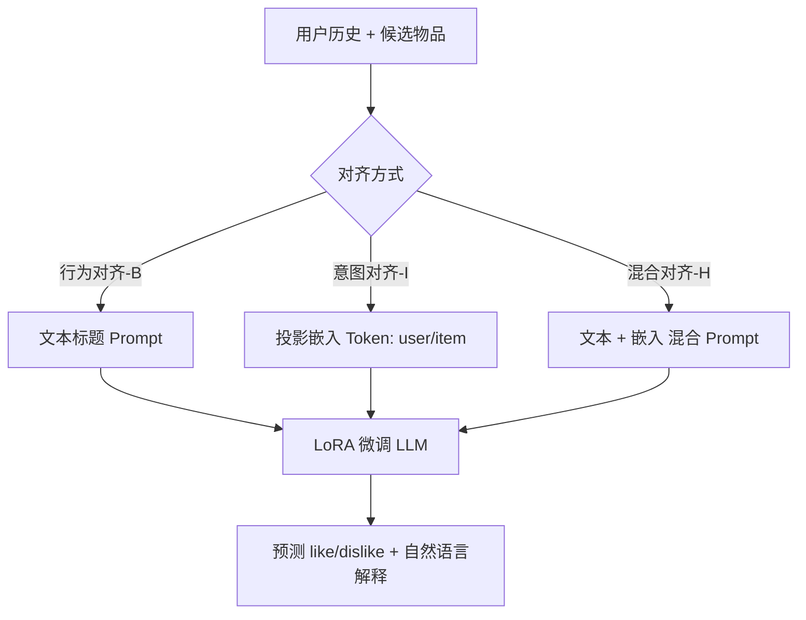
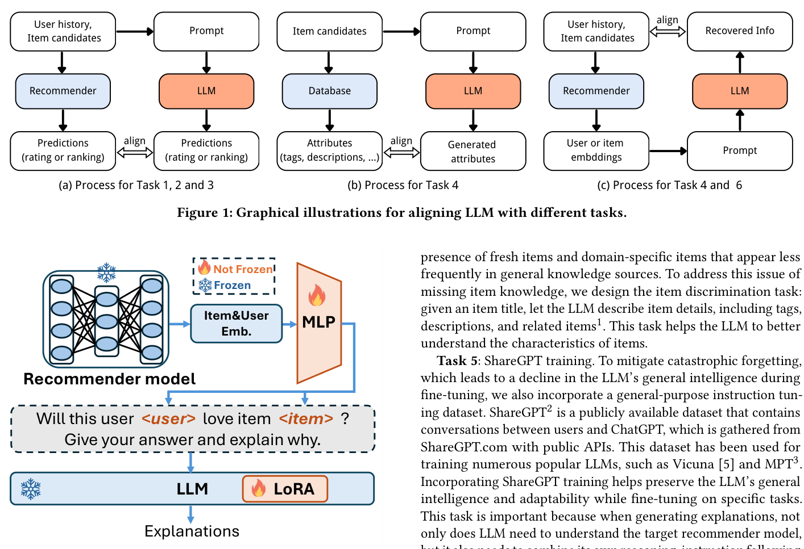
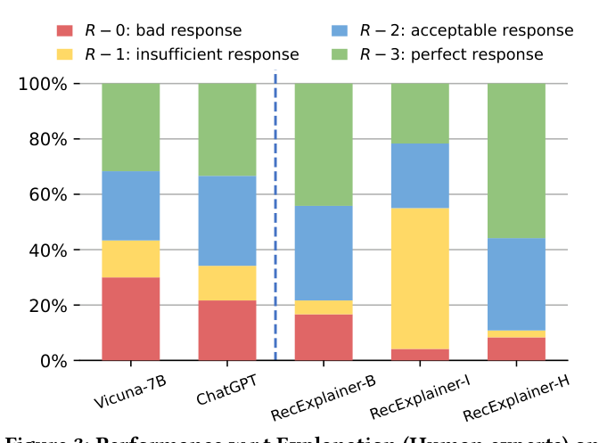
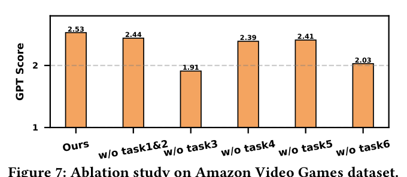

# RecExplainer: Aligning Large Language Models for Explaining Recommendation Models (RecExplainer：对齐大语言模型以解释推荐模型)

- **会议/期刊**: KDD 2024 (arXiv 2311.10947v2)
- **作者与机构**: Yuxuan Lei, Xu Huang, Defu Lian (USTC)；Jianxun Lian, Jing Yao, Xing Xie (Microsoft Research Asia)
- **推荐链路定位**: 精排/召回模型的**事后解释**（不改变原推荐模型，仅生成解释）
- **研究方向**: 大语言模型推荐 (LLM4Rec) / 对话推荐与智能体仿真（可解释性理由生成）
- **论文原文**: [https://arxiv.org/abs/2311.10947v2](https://arxiv.org/abs/2311.10947v2)
- **开源代码**: [https://github.com/microsoft/RecAI](https://github.com/microsoft/RecAI)

## TL;DR (1分钟核心速览)

黑盒嵌入式推荐模型难以自证决策逻辑，而传统代理解释器（线性模型/决策树）受"必须简单才能自解释"的悖论限制，保真度低且解释只是权重与规则、无自然语言语义。本文提出 RecExplainer：把 LLM 微调为目标双塔模型（SASRec）的代理解释器，给出**行为对齐**（文本空间模仿预测）、**意图对齐**（把用户/物品嵌入投影进 prompt，视作新模态）、**混合对齐**（文本+嵌入）三种方案。在 Video Games / Movies&TV / Steam 三数据集、Leave-One-Out 协议下，RecExplainer-I 的下一物品 HR@5 达 0.8436（超对齐基线 SASRec 的 0.6736 约 25%），RecExplainer-H 的 GPT-4 解释评分 2.52 高于 Vicuna 的 2.07。

## Background & Motivation (背景与核心矛盾)

- **主流范式**: 可解释推荐有两条路线——输入特征归因（integrated gradients、Shapley），以及训练一个"结构简单、天然可解释"的代理模型（线性模型、决策规则集）去逼近黑盒模型。
- **前人局限**: ① 代理模型必须低复杂度才可解释，于是保真度 (fidelity) 与可解释性直接冲突，复杂协同信号被牺牲；② 输出形式只能是加性权重或多条规则，缺少人类可读的语义叙述，也无法对单个用户定制解释风格。
- **核心洞察 (Key Insight)**: LLM 自带世界知识与多步推理，其"解释能力"是预训练涌现的，因此"自解释 ⇒ 必须简单"的悖论可以打破；若 LLM 能**复现**目标模型的预测，它就有可能复述其执行逻辑。进一步地，嵌入本身就是目标模型神经元的激活，可被视作与图像、音频并列的**新模态**送进 LLM。
- **本文切入点**: 冻结目标推荐模型，用其推断出的标签与自身嵌入做监督，把 LLM 训练成"行为可对齐 + 神经元可理解"的替身，再让 LLM 用自己的语言把预测理由讲出来。

## Method (核心方法设计)

### 1. 整体框架 (Overall Architecture)

目标模型 $f$为双塔 SASRec（用户序列$\mathbf{x}_u$与候选物品分别编码为$\mathbf{e}_u,\mathbf{e}_i$，内积打分），全程冻结、只用于生成伪标签与嵌入。LLM（vicuna-v1.3-7b, LoRA 微调）被训练在 6 个任务上：任务 1 下一物品检索、任务 2 列表重排、任务 3 兴趣二分类、任务 4 物品属性判别（缓解新物品知识缺失）、任务 5 ShareGPT 通用指令（抗灾难性遗忘）、任务 6 历史重建（由用户嵌入还原历史标题/GPT-4 偏好摘要）。三种对齐的差别只在 prompt 里放"物品标题"还是"投影后的嵌入"还是两者兼有。推理时以指令形式让 LLM 先判定"是否推荐"再给出解释，并可切换解释视角（如按游戏平台 / 按游戏品类）实现可控解释。

<figure class="paper-figure" markdown="span">
  <figcaption>图2：RecExplainer 框架。</figcaption>
</figure>

### 2. 关键设计拆解 (Key Designs)

1. **意图对齐：把推荐嵌入当作新模态 (Intention Alignment)**：行为对齐只在模型外部模仿观测输出，无法触达内部逻辑；本文用两层 MLP 把 32 维用户/物品嵌入升维到 LLM 词向量空间（4096），以特殊 token `<user>`/`<item>` 注入 prompt：
$\tilde{\mathbf{e}}_u = \mathrm{GELU}(\mathbf{e}_u \mathbf{W}_1 + \mathbf{b})\mathbf{W}_2$
直觉上这等价于 LLaVA 式的视觉-语言对齐，LLM 被迫完全依赖协同信号作答，从而学习"神经元语义"。代价是嵌入压缩带来信息损失，直接由嵌入还原文本时易幻觉（HCR 仅 0.12–0.13）。
2. **混合对齐 + 历史重建：互补与保真约束 (Hybrid & Reconstruction)**：纯意图对齐假设过强，故混合对齐在 prompt 中同时给标题与嵌入，用文本锚定语义、用嵌入传递协同信号，抑制幻觉。任务 6 则用 $\tilde{\mathbf{e}}_u$ 反推历史标题/偏好摘要，显式约束用户嵌入的信息保真度，弥补任务 2/3 只建模"用户-物品关系"而不挖掘"用户嵌入自身内容"的空白。
3. **训练目标、负采样与推理开销**：所有任务共享标准自回归语言建模损失，仅在回复 token 上计损：
$\mathcal{L} = -\sum_{t} \log p_\theta(y_t \mid y_{<t}, \mathbf{P})$监督标签全部来自$f$而非数据真值（任务 3 以$f(\mathbf{x}_u,a_j)>t^+$记正、$<t^-$记负，$t^+,t^-$ 取 top-20% / bottom-50%），故不存在负采样问题。推理为贪心解码 + 严格字符串匹配判对；LLM 前向是本方案唯一在线开销，显著重于原 SASRec。

## Experimental Setup & Evaluation Protocol (实验设置与评估协议)

- **数据集与预处理**: Amazon Video Games、Amazon Movies & TV、Steam 三个公开序列推荐数据集。

| 数据集 | 目标模型嵌入维度 | 最大序列长度 | 说明 |
| :--- | :---: | :---: | :--- |
| Video Games | 256 | 9 | 检索 0.0023/0.0077 | 
| Movies & TV | 192 | 13 | 解释人工评测 120 例取自该系列 |
| Steam | 256 | 16 | 规模最大，SASRec 基线最强 (H@5 0.9751) |

- **数据划分与防穿越**: `Leave-One-Out`——每用户序列最后一项为测试、其余训练；**目标模型用数据真值训练，LLM 只用目标模型推断的伪标签训练**，避免 LLM 偷看真值。
- **排名评测协议**: 任务 1 用 HR@5/NDCG@5（标签为目标模型 top-1 预测），任务 2 用 NDCG@5（5 候选，标签为目标模型排序），任务 3 用 ACC，任务 6 用自定义 HCR（预测序列中命中历史物品比例）。属"对齐保真度"评测，非全库 Full-Ranking 推荐效果评测。
- **对比基线与超参**: Random / Popularity / Vicuna-7B / Vicuna-7B-ICL / GPT4-ICL / SASRec（用 EMKD 知识蒸馏对齐目标模型）。LoRA + DeepSpeed ZeRO-2，8×V100-32G，10 epoch，batch 64，lr 1e-4，warmup 10%。

## Key Experimental Results (实验关键数据)

### 1. 主实验对比 (Main Results)

| 方法 | Games H@5 | Games N@5 | Games ACC | Movies H@5 | Movies N@5 | Movies ACC | Steam H@5 | Steam N@5 | Steam ACC |
| :--- | :---: | :---: | :---: | :---: | :---: | :---: | :---: | :---: | :---: |
| Random | 0.0023 | 0.0015 | 0.5030 | 0.0050 | 0.0030 | 0.4987 | 0.0060 | 0.0039 | 0.4977 |
| Popularity | 0.0077 | 0.0047 | N/A | 0.0150 | 0.0088 | N/A | 0.0321 | 0.0201 | N/A |
| Vicuna-7B | 0.0026 | 0.0014 | 0.5026 | 0.0091 | 0.0062 | 0.5011 | 0.0028 | 0.0015 | 0.5000 |
| Vicuna-7B-ICL | 0.0379 | 0.0304 | 0.5070 | 0.0144 | 0.0104 | 0.5079 | 0.0461 | 0.0332 | 0.5076 |
| GPT4-ICL | 0.1105 | 0.0864 | 0.6338 | 0.0886 | 0.0692 | 0.5964 | 0.3008 | 0.2525 | 0.5886 |
| SASRec (蒸馏) | 0.6736 | 0.5234 | 0.7768 | 0.6217 | 0.5025 | 0.6541 | **0.9751** | **0.8780** | 0.8914 |
| RecExplainer-B | 0.7460 | 0.6260 | 0.8365 | 0.8106 | 0.7027 | 0.7818 | 0.9310 | 0.8100 | 0.9554 |
| RecExplainer-I | **0.8436** | **0.6994** | **0.9385** | **0.9039** | **0.7709** | **0.8396** | 0.9615 | 0.8122 | **0.9904** |
| RecExplainer-H | 0.8057 | 0.6922 | 0.9189 | 0.8773 | 0.7750 | 0.8109 | 0.9358 | 0.8242 | 0.9815 |
| **Improv. (vs SASRec)** | +25.2% | +33.6% | +20.8% | +45.4% | +53.4% | +28.4% | -1.4% | -7.5% | +11.1% |

解释质量（GPT-4，0–3 分）：Vicuna 2.07/2.03/2.03，ChatGPT 1.93/1.84/1.96，RecExplainer-B 2.32/2.14/2.47，**RecExplainer-H 2.52/2.22/2.49**，而 RecExplainer-I 反而最低（1.67/1.47/1.34）。解释保真度（BERT 打分预测器 MSE，越低越好）：Games 上 RecExplainer-H 1.2786 vs Vicuna 3.6970、ChatGPT 3.4803。

<figure class="paper-figure" markdown="span">
  <figcaption>图3：在 Amazon Video Games 数据集上解释（人类专家）的性能。</figcaption>
</figure>

### 2. 消融实验 (Ablation Study)

| 变体 (Video Games, GPT-4 分) | Score |
| :--- | :---: |
| RecExplainer 完整 | **2.53** |
| w/o task1&2 (检索+排序) | 2.44 |
| w/o task3 (兴趣分类) | 1.91 |
| w/o task4 (物品判别) | 2.39 |
| w/o task5 (ShareGPT) | 2.41 |
| w/o task6 (历史重建) | 2.03 |

<figure class="paper-figure" markdown="span">
  <figcaption>图7：在 Amazon Video Games 数据集上的消融研究。</figcaption>
</figure>

### 3. 关键实验发现 (Key Findings)

1. **仅仅模仿行为不够，吃进神经元才有效**：RecExplainer-B 只在文本空间模仿，Games H@5 (0.7460) 略逊于蒸馏 SASRec；一旦注入嵌入（I/H），H@5 跃升至 0.8436/0.8057，ACC 从 0.8365 升到 0.9385，说明协同信号确实以"模态"形式被 LLM 消化。
2. **对齐保真 ≠ 解释可信，嵌入压缩是瓶颈**：RecExplainer-I 对齐指标最强却解释分最低（Games 1.67 < Vicuna 2.07），且 HCR 仅 0.1162，证明从 32 维嵌入反推文本会丢失历史信息并引发幻觉；混合对齐用标题做锚点，把解释分拉到 2.52 且 MSE 降到 1.28。
3. **分类与重建任务贡献最大**：去掉 task3 掉 0.62 分、去掉 task6 掉 0.50 分，而去掉 ShareGPT 只掉 0.12 分——LLM 在解释前必须"先判对 like/dislike"，且用户嵌入的信息保真度是解释可靠性的前提；通用指令主要保能力不保分数。

## Highlights & Limitations (亮点、对比与审稿批判)

- **与代表作对比 (vs. Prior Work)**: 与 LIME/决策规则类代理模型（如 [21,36,54]）相比，本文首次让 LLM 承担代理模型角色，把"保真度-简洁性"悖论换成"保真度-幻觉"新问题，并给出可落地的混合对齐解法；与 GPT4-ICL 相比，微调后的 7B 模型在 Games H@5 上 0.8436 远超 ICL 的 0.1105，说明"对齐训练 > 上下文提示"；与传统 LLM 直接解释相比，本文强调解释必须锚定目标模型的预测而非 LLM 自身的偏好。
- **可迁移亮点**: ① 把任意召回/精排塔的嵌入投影后作为伪 token 注入 LLM，可低成本扩展为"嵌入-语言"跨模态接口；② 用"历史重建"辅助任务约束嵌入信息保真度，可迁移到跨域迁移与用户画像生成。
- **审稿级局限批判**: ① 解释评测缺 ground truth，主要依赖 GPT-4 打分（人工仅 120 例单数据集），评分本身可能被 LLM 偏见污染，且"解释是否因果忠实于模型"未被严格验证；② 只支持双塔 + SASRec 单一种类目标模型，推理需 LLM 前向，延迟与成本远高于原模型，且混合对齐下 LLM 会过度依赖文本、反而削弱嵌入信号（Games/Steam 检索略低于纯意图对齐）。

## Rating (四维评分)

- **方法创新性 (Novelty)**: ⭐⭐⭐⭐ （首次把 LLM 当推荐模型的代理解释器，并将推荐嵌入正式定义为一种与视觉并列的模态）
- **评估协议与实验扎实度 (Protocol & Experiments)**: ⭐⭐⭐ （三数据集 + 判别器/打分预测器/MSE 多角度验证较完整，但解释质量主要靠 GPT-4 打分、人工样本偏少，无线上验证）
- **写作与数学规范度 (Clarity & Rigor)**: ⭐⭐⭐⭐ （三种对齐与六个任务的边界交代清楚，公式简洁；对齐损失与任务间关系略偏工程描述，缺理论分析）
- **工业落地与复现价值 (Industrial & Practical Value)**: ⭐⭐⭐ （代码已开源、LoRA 训练成本可控，但 LLM 推理延迟高、仅支持双塔，更适合作为离线解释/审计工具而非在线组件）

