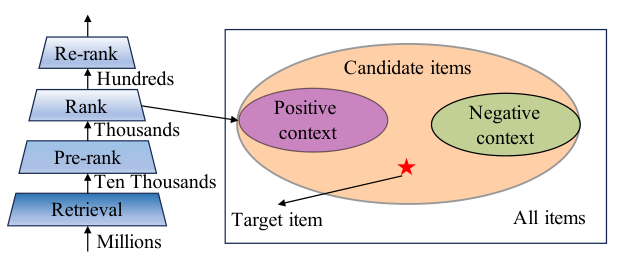
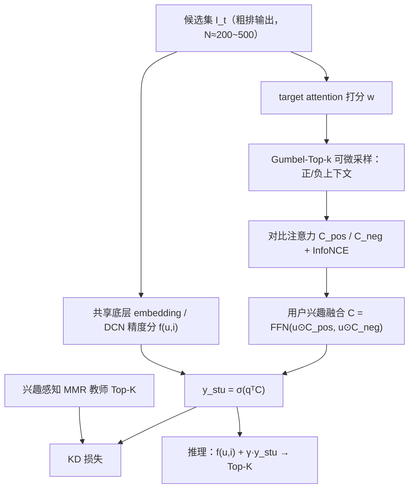

# Contextual Distillation Model for Diversified Recommendation (面向多样化推荐的上下文蒸馏模型)

- **会议/期刊**: KDD 2024 (ACM SIGKDD)
- **作者与机构**: Fan Li, Xu Si, Shisong Tang, Dingmin Wang, Kunyan Han, Bing Han, Guorui Zhou, Yang Song, Hechang Chen（中科大 / 清华 / 快手 / 牛津 / 吉林大学）
- **推荐链路定位**: 精排（可下延粗排、上接重排的通用打分模块）
- **研究方向**: 多任务学习与列表级重排 / CTR 预估与特征交叉
- **论文原文**: [https://arxiv.org/abs/2406.09021v2](https://arxiv.org/abs/2406.09021v2)
- **开源代码**: 暂未开源

## TL;DR (1分钟核心速览)

现有 DPP/MMR 类多样化方法走贪心迭代，复杂度 $O(NK^2)$，只能放在候选池仅数百的重排阶段；粗排/精排面对数十万候选时无法承担，导致"上游同质化、下游无米下锅"。本文提出 CDM：以**兴趣感知 MMR** 的 Top-$K$输出作软标签，训练一个 point-wise 学生模型——用同一 user request 内候选集构造正/负上下文（Gumbel-Top-$k$可微采样 + 对比注意力），预测每个物品"MMR 胜出概率"。在线推理仅需$f(u,i)+\gamma\cdot y_{stu}$，复杂度降至$O(N\log K)$。离线在京东、快手两个工业集上同时提升 Recall/MRR 与 ILAD/CC（快手@50 Recall 相对 DCN +14.9%），快手双 App 线上 10 天 A/B：观看时长 +0.406%、聚类系数 -0.957%。

## Background & Motivation (背景与核心矛盾)

- **主流范式**: 个体多样性由贪心式子集选择实现——MMR 逐轮按"精度 + 边际多样性"贪心选品，DPP 用行列式点过程做正交性惩罚，SSD 用滑动频谱分解建模长序列多样性；它们统一作为重排阶段的后处理插件。
- **前人局限**: ①复杂度 $O(NK^2)$且需反复计算物品两两相似度，无法进入候选量$10^4\!\sim\!10^5$ 的粗排/精排；②DPP/SSD 强推物品正交性，在快手@20 上把 ILAD 从 0.3922 拉到 0.4917 的同时 Recall 从 0.1057 掉到 0.0842（-20.3%），精度—多样性呈零和。
- **核心洞察 (Key Insight)**: 同一 user request 的候选集本身携带"集合信息"——每个目标物品在池中既有高度相似的**正上下文**（密集簇），也有显著不相似的**负上下文**（稀疏分布，见图 2 的密度对比）。让 point-wise 打分器"看到"这两类上下文，就能以 $O(1)$ 单物品代价近似 list-wise 的多样性收益。
- **本文切入点**: 把 list-wise 贪心算法当作教师做知识蒸馏，学生用对比上下文编码器端到端回归"是否被 MMR 选中"，从而在任意链路阶段以点式成本获得集合级多样性。

<figure class="paper-figure" markdown="span">
  <figcaption>图1：一个行业推荐流水线，以及针对单个用户请求的不同物品集合。候选物品指：在排序阶段，单个用户请求中待打分的物品集合。</figcaption>
</figure>

## Method (核心方法设计)

### 1. 整体框架 (Overall Architecture)

离线阶段先跑**兴趣感知 MMR** 教师：用精排骨干（DCN）的 $f(u,i)$作精度项、用用户兴趣门控后的 embedding 相似度作多样性项，贪心产出 Top-$K$列表$\mathcal{R}$，并令$y_{tea}=\mathbb{I}(i_t\in\mathcal{R})$。学生模型与 DCN 共享底层 embedding，额外接一条分支：对每个目标物品，用 target attention 打分并从同一候选集用 Gumbel-Top-$k$可微采样出$k$个正/负上下文，经对比注意力得$C_{pos},C_{neg}$，融合成上下文向量$C$，再与目标物品 embedding 点积得胜出概率$y_{stu}$。训练用 BCE + KD + InfoNCE 三路损失；在线只做一次前向 + 线性融合$f(u,i)+\gamma\,y_{stu}$后堆排取 Top-$K$。

### 2. 关键设计拆解 (Key Designs)

1. **兴趣感知 MMR 教师（把"多样性"变成用户主观量）**：原始 MMR 用物品级 cosine 度量差异，对所有人一致，忽略了同一物品对不同用户意味着不同兴趣面。本文把物品 embedding 与用户兴趣向量做 Hadamard 积后再算相似度，多样性定义为 $Div(\mathcal{R}\cup i\mid u)=1-\max_{i'\in\mathcal{R}}\sigma\big((\boldsymbol{e}_i\odot\boldsymbol{u})^{\top}(\boldsymbol{e}_{i'}\odot\boldsymbol{u})\big)$，首项仍取$\arg\max_i f(u,i)$。直觉：门控后相似度只在用户"在意的那一维兴趣"上比较，避免了跨兴趣的伪多样性惩罚。

2. **Gumbel-Top-$k$可微双上下文采样 + 对比注意力**：候选池$N$过大不宜全量入图，且随机采样会混淆正负分布。作者对注意力权重$w=q^{\top}K/\sqrt{d}$加 Gumbel 噪声$\tilde{w}_m=\log p_m+g_m,\ g_m=-\log(-\log(u_m))$，再用逐次 softmax 松弛$\alpha_m^{j+1}=\alpha_m^{j}+\log\!\big(1-\mathrm{P}(a_m^{j}=1)\big)$得到松弛$k$-hot 向量，$\tau$退火至 0 时收敛为硬 Top-$k$。随后正上下文走 target attention、负上下文走 **anti-attention**：$C_{pos}=\mathrm{softmax}(\tilde{w}_{pos})V_{pos}$，$C_{neg}=\mathrm{softmax}(-\tilde{w}_{neg})V_{neg}$，并以 InfoNCE$\mathcal{L}_{InfoNCE}=-\log\frac{\exp(q^{\top}C_{pos}/t)}{\sum_{C'\in\{C_{pos},C_{neg}\}}\exp(q^{\top}C'/t)}$ 强制正上下文贴近目标、负上下文远离。关键在于负上下文用负权重聚合，等价于"取池中最不相似方向的加权质心"，为物品提供竞争性参照系。

3. **训练目标、标签构造与推理效率**：标签不是点击而是教师选择，$y_{tea}=\mathbb{I}(i_t\in\mathcal{R})$，池内被选中者为正、其余为负（无需额外负采样器）。总损失$\mathcal{L}=\mathcal{L}_{BCE}+\beta_1\mathcal{L}_{KD}+\beta_2\mathcal{L}_{InfoNCE}$，其中 KD 项为$-y_{tea}\log y_{stu}-(1-y_{tea})\log(1-y_{stu})$。推理复杂度从 MMR 的$O(NK^2)$降为堆排的$O(N\log K)$，且分支与主模型共享底层 embedding，额外更新路径反向增强主干精度（信息交换效应）。

## Experimental Setup & Evaluation Protocol (实验设置与评估协议)

- **数据集与预处理**: 两个工业日志集，均以"单次 user request 的候选集"为建模单元。

| 数据集 | #Users | #Items | #Interactions | 候选/请求 | 特征/场景说明 |
| :--- | :---: | :---: | :---: | :---: | :--- |
| JingDong | 931,883 | 15,587,269 | 6,307,945（1.24M requests） | 213 | 电商广告搜索日志，item = ⟨id, category, vendor, price⟩，3,336 tag |
| KuaiShou | 0.5M | 24M | 74M（8M requests） | 500 | 快手 Feed 5 天日志，item = ⟨id, category, duration⟩，4k tag |

- **数据划分与防穿越 (Splitting Strategy)**: 论文按 request 组织样本、以日志天为单位构造（快手为连续 5 天活跃用户随机采样），**但正文未显式声明 Leave-One-Out / 比例 / 全局时间戳切分中的哪一种，也未给出训练-测试 request 划分比例**——这是复现上的主要缺口（见局限）。
- **排名评测协议 (Ranking Protocol)**: 在每个 request 的**真实候选池内**做排序评估（候选集来自线上粗排输出，非全库），因此是"候选池内 Full-Ranking"，天然包含大量未交互负样本；指标为 Recall@K、MRR@K（精度）与 ILAD@K（用户级、列表内平均余弦距离）、CC@K（系统级类目覆盖率）。京东取 $K=3,5$，快手取$K=20,50$。
- **对比基线与超参设置**: DCN（骨干）、IPW（逆倾向重加权）、DPP、SSD、MMR（重排后处理）。DCN 为 3 层 ReLU-MLP，Adam，batch 128/256，dropout 0.25，早停 patience=10；$\lambda,\gamma\in\{0,0.1,\dots,0.25\}$网格搜索，学习率$\{10^{-3},10^{-4},10^{-5}\}$。

## Key Experimental Results (实验关键数据)

### 1. 主实验对比 (Main Results)

| 数据集/指标 | DCN | IPW | DPP | SSD | MMR | **CDM** | Improv. vs DCN |
| :--- | :---: | :---: | :---: | :---: | :---: | :---: | :---: |
| 京东 Recall@3 | 0.0438 | 0.0421 | 0.0384 | 0.0407 | 0.0459 | **0.0488** | +11.4% |
| 京东 MRR@3 | 0.1001 | 0.0993 | 0.0929 | 0.0955 | 0.1038 | **0.1074** | +7.3% |
| 京东 ILAD@5 | 0.2464 | 0.2477 | 0.3025 | 0.2718 | 0.2609 | **0.2785** | +13.0% |
| 京东 CC@5 | 0.7210 | 0.7311 | 0.8329 | 0.8016 | 0.7642 | **0.7874** | +9.2% |
| 快手 Recall@20 | 0.1057 | 0.1006 | 0.0842 | 0.0891 | 0.1083 | **0.1205** | +14.0% |
| 快手 MRR@20 | 0.0638 | 0.0594 | 0.0513 | 0.0507 | 0.0652 | **0.0720** | +12.9% |
| 快手 ILAD@50 | 0.4502 | 0.4719 | 0.5719 | 0.5157 | 0.5294 | **0.5503** | +22.2% |
| 快手 CC@50 | 0.8223 | 0.8524 | 0.9640 | 0.8931 | 0.8902 | **0.9147** | +11.2% |

（在线 A/B，快手双页面 10 天：主端 观看时长 **+0.406%** [0.33,0.48]、#Vertical Categories **+0.188%**、Clustering Coefficient **-0.957%**；极速版 +0.412% / +0.264% / -1.106%，三项均显著。）

### 2. 消融实验 (Ablation Study)

| 变体 | 京东 R@5 | MRR@5 | ILAD@5 | CC@5 | 快手 R@50 | MRR@50 | ILAD@50 | CC@50 |
| :--- | :---: | :---: | :---: | :---: | :---: | :---: | :---: | :---: |
| CDM (full) | **0.0713** | **0.1192** | 0.2785 | **0.7874** | **0.2219** | **0.0894** | **0.5503** | **0.9147** |
| w/o InfoNCE | 0.0677 | 0.1139 | 0.2693 | 0.7785 | 0.2095 | 0.0803 | 0.5257 | 0.8920 |
| w/o CCE（退化为普通 target attention） | 0.0624 | 0.1110 | **0.2792** | 0.7862 | 0.2036 | 0.0786 | 0.5223 | 0.8884 |

### 3. 关键实验发现 (Key Findings)

1. **打破精度—多样性零和**：DPP 在快手@20 上把 ILAD 提到 0.4917 却牺牲 20.3% Recall；CDM 在快手@50 上同时取得 Recall +14.9%、ILAD +22.2%（相对 DCN），说明"上下文感知的软多样性"比"强制正交性"更贴合个性化推荐——正交惩罚会误伤用户真实的多兴趣共现。
2. **对比结构而非上下文本身才是精度来源**：去掉 CCE 后退化为单纯上下文聚合，快手@50 Recall 掉 8.2%（0.2219→0.2036）、MRR 掉 12.1%，但京东 ILAD 反而微升（0.2785→0.2792）。即纯聚合能"看见"集合因而略微更分散，却丢失了区分能力；InfoNCE 提供正负判别约束后（去掉它快手@50 Recall -5.6%、MRR -10.2%）才把上下文信息转化为胜出概率的可靠估计。
3. **$\gamma$的双向调控具有可运营性**：随$\gamma$增大 Recall 先升后降（抛物峰），而 ILAD/CC 单调上升——说明适量多样性反而帮助召回（探索效应），线上可用单一旋钮$\gamma$ 在固定骨干上做精度/多样性的连续调度，无需重训。

## Highlights & Limitations (亮点、对比与审稿批判)

- **与代表作对比 (vs. Prior Work)**: 相对 MMR/DPP/SSD 这些"重排后处理 + 贪心迭代"范式，CDM 首次把多样性前移到精排并以 $O(N\log K)$ 端到端完成，候选池从数百扩到数十万仍可用；相对 MMR 的粗粒度物品级 cosine，本文用用户兴趣门控 embedding 让多样性变成因人而异的量；相对 IPW 这类重加权去偏，CDM 不依赖高方差倾向分估计，而是直接学习教师决策边界。
- **可迁移亮点**: ①"list-wise 教师 → point-wise 学生"的蒸馏模板可复用到任何二次复杂度列表优化（如业务规则约束下的配额分配、EE 探索）；②Gumbel-Top-$k$ 逐次 softmax 松弛是无替代可微采样的通用组件，可用于序列推荐中的难负样本挖掘或集合型用户画像。
- **审稿级局限批判**: ①**学生天花板受教师约束**：MMR 只有 $(1-1/e)$近似且对$\lambda$敏感，论文未报告教师与学生 Top-$K$的一致性/上限，也未替换 DPP/GSP 教师做交叉验证（虽在 Discussion 中声称可替换）；②**评估披露不足**：未说明训练/测试 request 的划分方式与候选池构造细节（5 天窗口如何切、是否存在同一用户跨天泄漏），且仅在$K\le 50$报告，长列表（$K\ge 200$）下多样性收益是否保持未知；③**工程风险**：推理需在同 batch 内做全候选 attention + Gumbel 采样，$N=500$时该分支的时延与显存随 batch 内候选数波动，论文只给渐近复杂度$O(N\log K)$，未给线上 P99 时延与$\tau$退火/采样数$k$ 的敏感度分析。

## Rating (四维评分)

- **方法创新性 (Novelty)**: ⭐⭐⭐⭐ （把 list-wise 贪心多样性蒸馏为 point-wise 上下文打分，并用 anti-attention 构造"竞争参照系"，思路干净新颖，但组件本身均为已有技术组合）
- **评估协议与实验扎实度 (Protocol & Experiments)**: ⭐⭐⭐ （双工业集 + 双 App 10 天线上 A/B 很有说服力，四维指标覆盖用户级与系统级多样性；但划分方式、候选池构造、显著性检验与 $k/\tau$ 敏感度均未披露，削弱可复现性）
- **写作与数学规范度 (Clarity & Rigor)**: ⭐⭐⭐⭐ （Gumbel-Top-$k$松弛推导与复杂度对比清晰，公式编号完整；但 Eq.3 与 Eq.2 的符号衔接略跳，$\lambda$与$\gamma$ 的语义关系未充分说明）
- **工业落地与复现价值 (Industrial & Practical Value)**: ⭐⭐⭐⭐ （分支可插拔、与双塔/DCN 共享底层、单一 $\gamma$ 旋钮可在线调优，落地链路完整；扣分在于未开源且快手数据集"审稿后发布"尚未兑现）

