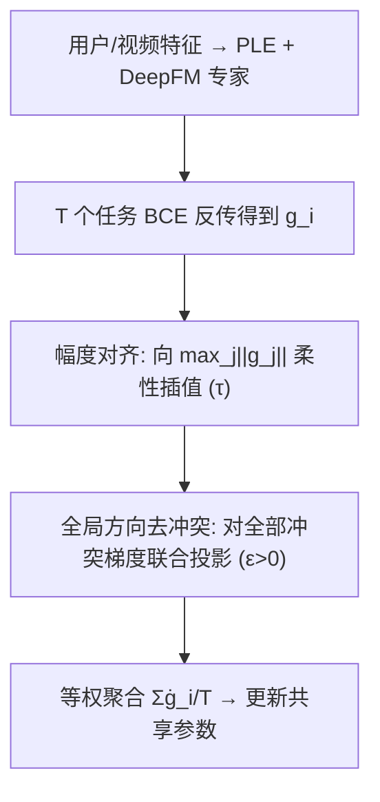
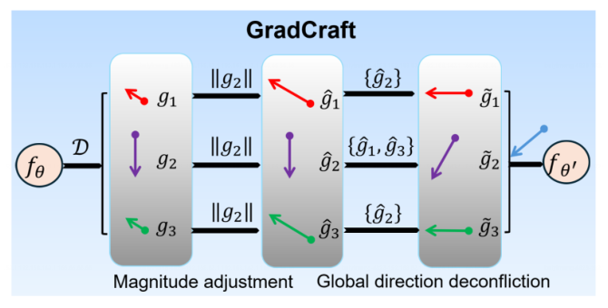
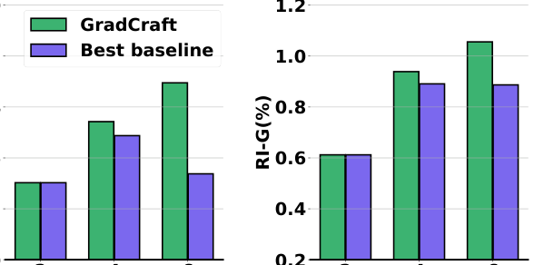

# GradCraft: Elevating Multi-task Recommendations through Holistic Gradient Crafting (以整体梯度整形提升多任务推荐)

- **会议/期刊**: KDD 2024 (arXiv 2407.19682v2)
- **作者与机构**: Yimeng Bai, Yang Zhang, Fuli Feng (USTC) 与 Jing Lu, Xiaoxue Zang, Chenyi Lei, Yang Song (快手)
- **推荐链路定位**: 精排（多目标预估的优化器层面，模型无关）
- **研究方向**: 多任务学习与列表级重排 / CTR/CVR 预估与特征交叉
- **论文原文**: [https://arxiv.org/abs/2407.19682v2](https://arxiv.org/abs/2407.19682v2)
- **开源代码**: [https://github.com/baiyimeng/GradCraft](https://github.com/baiyimeng/GradCraft)

## TL;DR (1分钟核心速览)

短视频推荐需同时优化完播、点赞、关注、转发等异质目标，任务间梯度范数相差数个数量级、更新方向互相拉扯，导致负迁移。现有做法要么只按 loss 重加权（治幅度不治方向），要么像 PCGrad 只做**成对**投影（后一次投影会破坏前一次已取得的非冲突，且不考虑幅度干扰）。GradCraft 把多任务优化拆成两步：先以最大梯度范数为锚做柔性插值对齐幅度，再让每个任务对**全部冲突任务同时**投影求解闭式权重，并以 $\epsilon>0$ 要求一定正相似度促进正迁移。在 PLE 主干的 Wechat/Kuaishou 上，AV-G 相对提升 1.056%/3.791%，线上快手 1500 万用户 A/B 一周 VV +0.950%、Share +1.746%。

## Background & Motivation (背景与核心矛盾)

- **主流范式**: 工业多任务推荐 = 软参数共享主干（MMoE/PLE）+ 梯度层面的优化器改造；后者分两支：按不确定性/更新速度重加权 loss（UC、DWA、DBMTL），或操纵梯度方向去冲突（MGDA、PCGrad、GradVac、CAGrad、IMTL）。
- **前人局限 1（方向）**: 方向类方法几乎都是**成对**投影，$T$个任务有$O(T^2)$ 个冲突对，前一对投影后的梯度会重新与第三任务冲突，无法保证全局非冲突；且投影时直接用原始梯度，被大幅值任务主导。
- **前人局限 2（幅度）**: 重加权类只调 loss 系数、不看梯度几何，在推荐场景的极端任务异质性（曝光稀疏 vs 稠密交互）下性能不稳定，甚至劣于 Equal Weight。
- **核心洞察 (Key Insight)**: 作者把多任务优化提炼为两个必须**同时**满足的目标——"适当的幅度平衡"与"全局方向平衡"；且幅度平衡应先行，因为幅度失衡会污染后续方向操纵；而且不必追求绝对等范数，只需防止范数跨越数量级，以保留任务特异性。
- **本文切入点**: 顺序式两阶段范式（幅度对齐 → 全局投影），且把方向目标从"正交"放宽到"适度正相似"。

## Method (核心方法设计)

### 1. 整体框架 (Overall Architecture)

输入用户/短视频特征，经 PLE 主干（共享专家 + 任务专属专家 + 门控 + 塔，专家为 DeepFM）输出 $T$个任务的 logits，各以 BCE 计算损失。每步迭代先反传得到各任务梯度$g_i$；再做梯度整形：①幅度对齐把$\|g_i\|$向全局最大范数柔性插值（$\tau$控制），②方向去冲突对每个任务一次性对所有冲突任务联合投影（$\epsilon$控制期望正相似度），解出闭式权重得到$\tilde{g}_i$；最后等权平均$\tilde{g}_i$ 更新**共享**参数，任务专属专家仍按各自梯度更新，可无缝嵌入 Adam/Adagrad。

<figure class="paper-figure" markdown="span">
  <figcaption>图 1：GradCraft 概览。它首先基于最大范数调整梯度幅度。随后，它基于冲突的任务梯度执行梯度投影，并聚合梯度以更新推荐模型，从而在方向上全局消除冲突。</figcaption>
</figure>

### 2. 关键设计拆解 (Key Designs)

1. **柔性幅度对齐 (Magnitude Adjustment)**：痛点是不对齐时范数可差数个数量级、投影被大任务支配，而 DBMTL 式硬对齐到最大范数又放大小任务的随机噪声。本文改为与原始梯度插值：
$$\hat{g}_i=\tau\frac{\max_j\|g_j\|}{\|g_i\|}g_i+(1-\tau)g_i$$
由此保证任务间最大/最小范数比不超过 $1/\tau$，$\tau$ 越小越贴近最大范数。物理直觉：只压缩"支配性差距"，保留任务本身的梯度尺度信息。

2. **全局方向去冲突 (Global Direction Deconfliction)**：对任务 $i$取其全部冲突梯度矩阵$G_i=[\hat{g}_{i1},\dots,\hat{g}_{in}]\in\mathbb{R}^{n\times d}$，不再逐对处理，而是同时要求解冲突后梯度与**所有**冲突任务达到目标内积：
$$G_i\tilde{g}_i^{\top}=z,\quad z=[\epsilon\|\hat{g}_i\|\|\hat{g}_{i1}\|,\dots,\epsilon\|\hat{g}_i\|\|\hat{g}_{in}\|]$$
令 $\tilde{g}_i=\hat{g}_i+w^{\top}G_i$，在$d\gg n$、$G_iG_i^{\top}$ 正定的前提下得闭式解
$$w=(G_iG_i^{\top})^{-1}\left(-G_i\hat{g}_i^{\top}+z\right)$$
$\epsilon=0$即正交化，$\epsilon>0$强制保留适度正相似以促进正迁移。该式是 PCGrad 的严格推广：当仅一个冲突对且$\epsilon=0$时退化为$\tilde{g}_i=\hat{g}_i-\frac{\langle\hat{g}_i,\hat{g}_{i1}\rangle}{\|\hat{g}_{i1}\|^2}\hat{g}_{i1}$；由于是一次性联合求解，投影之间不再相互破坏，从而"全局"非冲突。

3. **训练目标、开销与推理**：总损失即 $\sum_{i=1}^{T}\text{BCE}(f_\theta(x)_i,y_i)$，更新为$\theta'=\theta-\eta\frac{1}{T}\sum_i\tilde{g}_i$；无负采样（pointwise CTR 式训练）。额外开销仅为每任务一次$n\times n$（$n\le T-1$）矩阵求逆，与参数量$d$ 无关，可忽略；**推理阶段零额外开销**，纯训练期插件。

## Experimental Setup & Evaluation Protocol (实验设置与评估协议)

- **数据集与预处理**:

| 数据集 | #Users | #Items | #Interactions | 稀疏度/密度 | 特征/场景说明 |
| :--- | :---: | :---: | :---: | :---: | :--- |
| Wechat | 19,997 | 59,322 | 7,154,154 | 0.0060 | 微信大数据挑战赛短视频两周行为，**10-core** 过滤 |
| Kuaishou | 8,516 | 62,699 | 2,867,290 | 0.0054 | 快手 1 万用户 5 天真实短视频曝光，**20-core** 过滤 |

- **数据划分与防穿越**: **随机 8:1:1 比例划分**（train/valid/test），非时间戳切分，亦非冷启动划分。
- **排名评测协议**: 严格说是 **pointwise 多目标预估**协议，用逐样本 **AUC** 与用户内分组 **GAUC**，并非 Full-Ranking 全库排序，也无采样负样本比；报告跨任务均值 AV-A/AV-G 与相对 Single 的 RI-A/RI-G。
- **任务设置**: 6 个二值任务——观看类 EV(>50%)、LV(>75%)、CV(完播)，交互类 Like、Follow、Forward。
- **对比基线与超参**: 基线含 Single、EW、UC、DWA、MGDA、PCGrad、**PCGrad+**（作者自建：PCGrad + 式(5) 幅度对齐的公平对照）、GradVac、CAGrad、IMTL、DBMTL。统一 PLE + DeepFM 专家主干，embedding $d=16$，MLP 256×128×64，塔 32×16，Adam，early stopping patience 10；$\tau$以 0.1 步长网格搜$[0,1]$，$\epsilon\in\{0,10^{-12},\dots,10^{-7}\}$，最优$\tau=0.1$、$\epsilon=10^{-10}$。

## Key Experimental Results (实验关键数据)

### 1. 主实验对比 (Main Results)

| 方法 | Wechat AV-A | RI-A | AV-G | RI-G | Kuaishou AV-A | RI-A | AV-G | RI-G |
| :--- | :---: | :---: | :---: | :---: | :---: | :---: | :---: | :---: |
| Single | 0.8361 | 0.000% | 0.6770 | 0.000% | 0.8368 | 0.000% | 0.6849 | 0.000% |
| EW | 0.8369 | 0.091% | 0.6798 | 0.413% | 0.8390 | 0.280% | 0.7040 | 3.248% |
| DWA | 0.8367 | 0.078% | 0.6809 | 0.559% | 0.8384 | 0.197% | 0.7061 | 3.601% |
| MGDA | 0.8309 | -0.639% | 0.6718 | -0.809% | 0.8302 | -0.817% | 0.6860 | 0.457% |
| PCGrad | 0.8371 | 0.118% | 0.6830 | 0.887% | 0.8397 | 0.355% | 0.7039 | 3.243% |
| PCGrad+ | 0.8373 | 0.135% | 0.6802 | 0.472% | 0.8435 | 0.811% | 0.7064 | 3.671% |
| CAGrad | 0.8369 | 0.099% | 0.6815 | 0.653% | 0.8431 | 0.758% | 0.7045 | 3.351% |
| DBMTL | 0.8350 | -0.129% | 0.6796 | 0.380% | 0.8424 | 0.682% | 0.7048 | 3.402% |
| **GradCraft** | **0.8385** | **0.278%** | **0.6842** | **1.056%** | **0.8438** | **0.844%** | **0.7071** | **3.791%** |
| *Improv. vs 次优* | +0.12pp | +0.143pp | +0.12pp | +0.169pp | +0.03pp | +0.033pp | +0.07pp | +0.120pp |

单任务亮点：Wechat 上 Follow AUC 从 Single 的 0.8829 提升至 **0.8888**（+0.59pp），是该表最大的单点增益；Kuaishou 上 Forward GAUC 达 0.6425。

### 2. 消融实验 (Ablation Study)

| 变体 (Wechat) | AV-A | RI-A | AV-G | RI-G |
| :--- | :---: | :---: | :---: | :---: |
| GradCraft 完整版 | **0.8385** | **0.278%** | **0.6842** | **1.056%** |
| w/o 正相似目标 ($\epsilon=0$) | 0.8382 | 0.250% | 0.6837 | 0.981% |
| w/o 柔性幅度 ($\tau=1$，硬对齐 max norm) | 0.8365 | 0.039% | 0.6798 | 0.392% |
| w/o 幅度对齐 ($\tau=0$，保留原范数) | 0.8370 | 0.113% | 0.6835 | 0.959% |
| w/o 全局投影 (退回 PCGrad 成对投影) | 0.8371 | 0.118% | 0.6830 | 0.887% |

### 3. 关键实验发现 (Key Findings)

1. **幅度对齐是方向去冲突的前提条件**：去掉幅度对齐后，"全局投影"与"成对投影"几乎无差（AV-G 0.6835 vs 0.6830），说明幅度失衡时投影的解会被大梯度任务带偏、全局性无从体现；而带幅度对齐的 PCGrad+ 仍显著低于 GradCraft（AV-G 0.6802 vs 0.6842，RI-G 0.472% vs 1.056%），证明**两阶段耦合**而非单点改进带来收益。
2. **"适度"而非"绝对"对齐**：$\tau=1$硬对齐到最大范数是所有变体中最差（RI-G 仅 0.392%，甚至低于完全不对齐的 0.959%），因为小任务梯度被等比例放大、噪声同步放大；$\tau=0.1$为最优，且$\tau\in[0,0.3]$、$\epsilon\in[10^{-12},10^{-9}]$ 区间性能平稳，工程上可直接沿用默认值。
3. **优势随任务数扩大，且在 $T=2$时退化合理**：$T=2\to6$时 GradCraft 的 RI-A/RI-G 单调上升而最优基线基本持平，性能差距随$T$拉大；$T=2$ 时两者几乎重合，恰与式(11) 的单冲突对退化分析一致——这是方法自洽性的证据，也界定其适用边界（多任务越多越划算）。线上快手 1500 万用户一周 A/B：WT **+0.505%**、VV **+0.950%**、Share **+1.746%**，均超显著性阈值。

<figure class="paper-figure" markdown="span">
  <figcaption>图 4：Wechat 上不同任务数 𝑇 下 GradCraft 与最佳基线的性能比较结果。</figcaption>
</figure>

## Highlights & Limitations (亮点、对比与审稿批判)

- **与代表作对比**: vs **PCGrad**：成对投影且忽略幅度，本文改为一对多联合闭式投影 + 前置幅度对齐；vs **DBMTL**：硬绑最大范数并使所有梯度同尺度，本文用 $\tau$ 插值保留任务特异性（消融显示硬对齐反而最差）；vs **CAGrad**：只在平均梯度球内约束更新向量模长，未逐个修正任务梯度幅度；vs **MetaBalance**：以目标任务梯度为刚性锚点、面向多行为迁移，本文以全局最大范数动态为锚、面向多目标并重。
- **可迁移亮点**: ①"先幅度后方向"的顺序范式可直接套到任何多目标排序模型（MMoE、AdaTT、ESMM）的优化器上，推理零成本；②把去冲突目标从正交放宽到 $\epsilon$ 正相似，是可复用的"柔性约束"技巧，避免投影过度损伤共享知识。
- **审稿级局限批判**: ①评估仅有 pointwise AUC/GAUC，缺 NDCG/全库排序与长尾、冷启动分桶，且随机 8:1:1 划分存在同用户跨集泄漏风险，收益幅度可能被高估；②$\epsilon$最优值落在$10^{-10}$这种量纲强相关的小量级网格上，跨数据集需重搜，泛化成本不低；③只更新共享参数，任务专属专家未纳入整形，理论与实现间留有缝隙；④未给出$T$ 很大（如数十任务）时的求逆与吞吐实测，快手线上也只报了相对基线的收益、未报训练耗时增量。

## Rating (四维评分)

- **方法创新性 (Novelty)**: ⭐⭐⭐⭐ （把多任务优化重述为"幅度+全局方向"双平衡，并用一次联合投影取代成对投影，虽属梯度手术路线的自然延伸，但闭式推广与 $\epsilon$ 柔性目标是清晰增量）
- **评估协议与实验扎实度 (Protocol & Experiments)**: ⭐⭐⭐⭐ （两个真实短视频数据集 + 11 个基线 + 自建公平对照 PCGrad+ + 消融/超参/任务数分析 + 1500 万用户线上 A/B，唯缺排序类指标与时间戳切分）
- **写作与数学规范度 (Clarity & Rigor)**: ⭐⭐⭐⭐ （闭式解推导完整、给出退化到 PCGrad 的等价性证明与 $d\gg n$可逆性论证，符号统一；但$\epsilon$ 的量纲含义与最优量级缺乏理论解释）
- **工业落地与复现价值 (Industrial & Practical Value)**: ⭐⭐⭐⭐⭐ （推理零开销、模型无关、代码开源、线上三指标全正，是少见的可直接插入现有精排训练流程的优化器插件）

