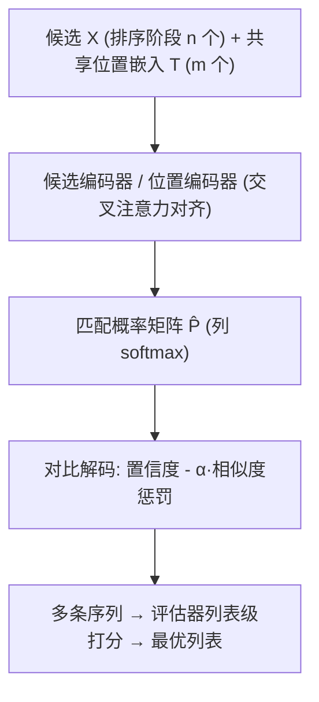
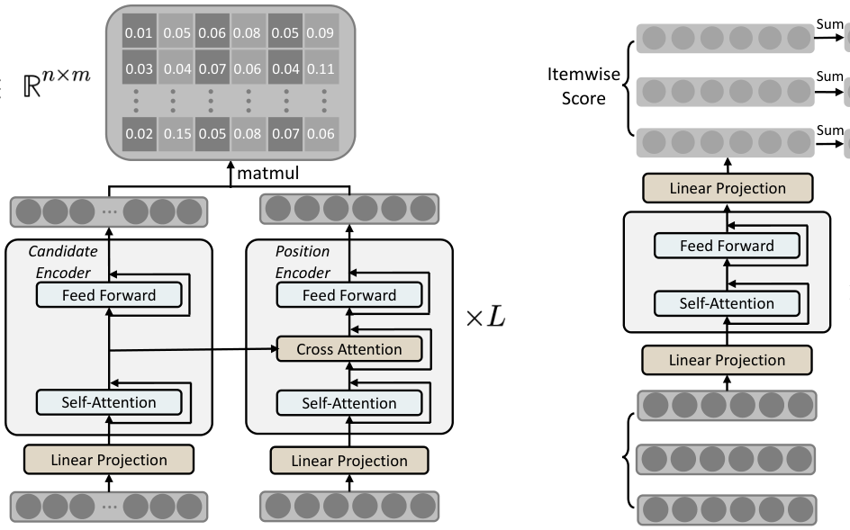

# Non-autoregressive Generative Models for Reranking Recommendation (面向重排推荐的非自回归生成模型)

- **会议/期刊**: KDD 2024 (Barcelona)
- **作者与机构**: Yuxin Ren, Qiya Yang, Yichun Wu, Wei Xu, Yalong Wang, Zhiqiang Zhang† — 快手科技、北京大学、清华大学
- **推荐链路定位**: 重排 (Reranking, 生成式端到端出列表)
- **研究方向**: 多任务学习与列表级重排 / 生成式推荐与离散语义 ID
- **论文原文**: [https://arxiv.org/abs/2402.06871v6](https://arxiv.org/abs/2402.06871v6)
- **开源代码**: 暂未开源

## TL;DR (1分钟核心速览)

生成器-评估器范式的重排依赖自回归 (AR) 生成器，推理逐项解码慢、训练-推理解码输入错配导致误差累积、左到右注意力看不见后继物品。本文提出 NAR4Rec：用"物品编码器 × 位置编码器 + 交叉注意力匹配矩阵"一次性并行输出全部 $m$ 个位置的候选概率，以序列级 unlikelihood 损失区分高低效用序列，并用对比解码注入列表内互斥性。在 Avito (AUC 0.7234 vs. PIER 0.7109) 与快手工业集 (Recall@6 74.86%) 上全面超越 SOTA，推理耗时较 Seq2Slate 降低约 5 倍，线上 A/B 完播率 +2.45%。

## Background & Motivation (背景与核心矛盾)

- **主流范式**: 重排建模曝光列表内物品相互影响，代表路线是"生成器-评估器"两阶段框架：生成器产出多条可行排列，评估器按列表级效用择优 (PIER、Edge-Rerank、Seq2Slate)。
- **前人局限一 (效率)**: 生成器普遍采用自回归逐项解码，时间复杂度随列表长度 $m$ 线性增长，难以满足实时系统毫秒级约束。
- **前人局限二 (性能)**: AR 训练时喂真值、推理时喂自己生成的 token，误差逐步累积；且因果注意力使每个位置只看前驱，浪费后继上下文，排列空间探索不充分。
- **核心洞察 (Key Insight)**: 重排的目标序列长度固定且极短 ($m<10$)，与文本变长生成本质不同——"顺序依赖"的必要性被削弱，理论上可整体并行解码，这使得非自回归 (NAR) 在重排场景比在翻译中更可行。
- **本文切入点**: 首次将 NAR 生成引入重排，并针对推荐特有的"稀疏样本文本、动态候选词表、反馈多样、列表互斥"四大失配，逐一给出算子级修补。

## Method (核心方法设计)

### 1. 整体框架 (Overall Architecture)

输入为排序阶段送来的 $n$个候选$\mathbf{X}\in\mathbb{R}^{n\times d}$与$m$个可学习位置嵌入$\mathbf{T}\in\mathbb{R}^{m\times d}$。两条 Transformer 编码器分别提纯候选表征与位置表征，位置编码器在自注意力与 FFN 之间插入交叉注意力对候选做 query，得到位置感知的隐表示；两者做矩阵乘 + 列 softmax 得到$m\times n$概率矩阵$\hat{P}$，每个位置独立取 argmax/采样即得一条完整序列。生成器可并行采样多条序列送入评估器（自注意力 + 加权求和打分），选列表效用最高者曝光。

### 2. 关键设计拆解 (Key Designs)

1. **匹配模型 + 共享位置嵌入（解稀疏与动态词表）**: 推荐列表样本几乎不重复，且候选 ID 是按请求动态变化的"变长词表"，无法像词表固定的文本那样学习输出分布。为此放弃"位置→token 分类"头，改为候选与位置做内积匹配，概率直接由两路表征相似度给出：$\hat{p}_{ij}=\frac{\exp(\mathbf{x}_i^{\top}\mathbf{t}_j)}{\sum_{i'=1}^{n}\exp(\mathbf{x}_{i'}^{\top}\mathbf{t}_{j})}$；位置嵌入跨所有请求共享，使$m$ 个位置槽位能从小样本中累积统计量。直觉上把"生成"退化为"匹配"，参数共享与动态候选同时被解决。
2. **序列级 Unlikelihood 训练（对齐效用而非似然）**: 最大似然只模仿曝光日志的分布，但重排目标是式 $\max_{\theta}R(u,Y)$的效用最大化，且用户反馈含大量"曝光未点击"的隐式负信号。作者按整体效用阈值$\tau$将序列二分类：正序列走交叉熵$-\sum p_{ij}\log\hat{p}_{ij}$，负序列走$\mathcal{L}_{ul}=-\sum_{i}\sum_{j}p_{ij}\log(1-\hat{p}_{ij})$，压低低效用排列的生成概率，把"多样性/负反馈"从数据噪声转为显式梯度。
3. **对比解码 + 对比表征约束（补回目标依赖）**: NAR 的独立假设会产生"位置 1 与位置 2 放同一/高度相似物品"这类不可行排列（类比翻译中的 "Danke Dank"）。解码时引入多样性先验：$y_t=\arg\max_{x\in X}(1-\alpha)\,p(x|p_t,X)-\alpha\max_{j<t}s(\mathbf{x},\mathbf{x}_j)$，其中$s$为余弦相似度，惩罚与前序已选物品最相似者。训练侧再加两个 margin 对比损失$\mathcal{L}_{item}$、$\mathcal{L}_{position}$（式 18–19，margin$\rho$），把不同物品/位置表征推开形成各向同性空间；总目标$\mathcal{L}=\mathcal{L}_{ul}+\mathcal{L}_{item}+\mathcal{L}_{position}$，$\rho=0$ 时退化为原始 unlikelihood。

**训练目标、负采样与推理效率**: 全程无显式负采样策略（负样本由"效用低于 $\tau$ 的曝光序列"天然提供），无需 in-batch/hard negative 挖掘；推理为单次前向 + 多次采样 + 评估器选优，Avito 上训练 0.112s/step、推理 0.037s/step，对比 Seq2Slate 的 0.558s/0.186s 约 5 倍加速。

<figure class="paper-figure" markdown="span">
  <figcaption>图2：生成器与评估器模型的架构概览。评估器评估生成器生成的多个序列，并估计列表级分数以选择最优序列。</figcaption>
</figure>

## Experimental Setup & Evaluation Protocol (实验设置与评估协议)

| 数据集 | #Users | #Items | #Interactions/Requests | 稀疏度/密度 | 特征/场景说明 |
| :--- | :---: | :---: | :---: | :---: | :--- |
| Avito | 1,324,103 | 23,562,269 (ads) | 53,562,269 列表 | 极稀疏 | 公开搜索日志，$n=m=5$，逐位置 CTR 预测 |
| Kuaishou | 82,230,788 | 26,835,337 | 1,811,625,438 请求 | 极稀疏 | 工业短视频，$n=60$、$m=6$，预测是否进入曝光 6 位 |

- **数据划分与防穿越**: Avito 采用**全局时间戳切分**（前 21 天训练 / 后 7 天测试）；快手为工业真实请求日志，按线上时间顺序采集，属时间切分而非 Leave-One-Out。
- **排名评测协议**: Avito 的 $n=m=5$，本质是给定列表输入预测逐位点击，报告 AUC / LogLoss / NDCG；快手为 **Sampled Ranking**（在每请求 60 个排序候选中预测前 6 曝光位），报告 Recall@6、Recall@10、LogLoss——即候选集内排序，非全库 Full-Ranking。
- **对比基线与超参**: 6 个基线覆盖 pointwise (DNN, DCN)、one-stage listwise (PRM)、two-stage (Edge-Rerank, PIER, Seq2Slate，其中 Seq2Slate 为 AR 生成器)；Adam，学习率 $10^{-3}$，Avito batch=1024、快手 batch=256；默认$\rho=0.5$、$\omega=0.01$。

## Key Experimental Results (实验关键数据)

### 1. 主实验对比 (Main Results)

| 数据集 | 模型 | AUC ↑ | LogLoss ↓ | NDCG ↑ | Recall@6 ↑ | Recall@10 ↑ |
| :--- | :--- | :---: | :---: | :---: | :---: | :---: |
| Avito | DNN | 0.6614 | 0.0598 | 0.6920 | — | — |
| Avito | DCN | 0.6623 | 0.0598 | 0.7004 | — | — |
| Avito | PRM | 0.6881 | 0.0594 | 0.7380 | — | — |
| Avito | Edge-Rerank | 0.6953 | 0.0574 | 0.7203 | — | — |
| Avito | Seq2Slate | 0.7034 | 0.0486 | 0.7225 | — | — |
| Avito | PIER | 0.7109 | 0.0409 | 0.7401 | — | — |
| Avito | **NAR4Rec** | **0.7234** | **0.0384** | **0.7409** | — | — |
| Avito | Improv. | +1.76% | −6.11% | +0.11% | — | — |
| 快手 | PRM | — | 0.5328 | — | 73.17% | 92.25% |
| 快手 | Edge-Rerank | — | 0.5252 | — | 73.63% | 92.90% |
| 快手 | PIER | — | 0.5361 | — | 73.50% | 92.44% |
| 快手 | **NAR4Rec** | — | **0.5199** | — | **74.86%** | **93.16%** |
| 快手 | Improv. | — | −0.54% | — | +1.23pt | +0.26pt |

| 效率 (Avito, T4, batch=1024) | DNN | PIER | Seq2Slate | **NAR4Rec** |
| :--- | :---: | :---: | :---: | :---: |
| 训练 (s/step) | 0.102 | 0.160 | 0.558 | **0.112** |
| 推理 (s/step) | 0.034 | 0.053 | 0.186 | **0.037** |

### 2. 消融实验 (Ablation Study)

线上 A/B（Kuaishou，10% 流量、10 天，相对 NAR4Rec 全量配置的变化）：

| 移除/替换组件 | Views | Watch Time | 结论 |
| :--- | :---: | :---: | :--- |
| `w/o Unlikelihood` (退化为 vanilla 训练) | −0.370%* | −0.277%* | 效用对齐损失贡献显著 |
| Decoding → Deep DPP | −0.363%* | −0.361%* | 纯多样性先验不如相似度惩罚 |
| Decoding → Beam Search | −0.327%* | −0.214%* | 无列表互斥约束即掉点 |
| Decoding → Greedy Search | −0.216%* | −0.178%* | 逐位贪心忽略位置互斥 |
| Decoding → Top-k Sampling | −0.254%* | −0.131%* | 采样无惩罚仍次优 |

（* 为统计显著；超参 $\omega$、$\rho$、$\alpha$ 曲线显示 LogLoss 在较宽区间内平稳，对学习率/batch/epoch 不敏感。）

### 3. 关键实验发现 (Key Findings)

1. **并行解码几乎"零代价换 5 倍加速"**: NAR4Rec 推理 0.037s/step 与 pointwise DNN 的 0.034s 持平，仅比 PRM 慢 1ms，而 AR 的 Seq2Slate 需 0.186s；同时 AUC 反升 0.02（0.7034→0.7234），说明 AR 的误差累积与单向上下文确实是重排的净损失而非必要复杂度。
2. **增益主要来自"效用对齐"而非"更强的拟合"**: 去掉 unlikelihood 只保留 MLE，线上 Views −0.370%、Watch Time −0.277% 且显著；Avito LogLoss 从 PIER 的 0.0409 降至 0.0384（−6.1%），表明把负效用序列显式压低概率比单纯拟合曝光分布更贴近重排目标。
3. **对比解码优于纯多样性解码**: Deep DPP（经典多样性重排）替换后 Views −0.363%，反低于 Greedy 的 −0.216%，说明"为多样而多样"会牺牲相关性；而基于表征相似度的惩罚 + 对比训练使表征各向同性，实现相关性与互斥性的平衡，快手 Recall@6 提升 1.23pt。

## Highlights & Limitations (亮点、对比与审稿批判)

- **与代表作对比**: 相比 PRM 等 one-stage 方法，本文在生成器-评估器框架下真正"探索"了多种排列而非只对初始列表重打分；相比 PIER 的哈希筛选 + AR 生成器，本文用匹配矩阵避开变长词表并消除顺序解码；相比 Seq2Slate 的指针网络逐项输出，本文以 $O(1)$步解码替代$O(m)$ 步，且双向上下文可见。
- **可迁移亮点**: ①"共享位置嵌入 + 候选-位置内积匹配"可低成本迁移到任何候选集动态变化的列表生成任务（如捆绑推荐、多槽位广告分配）；②序列级 unlikelihood 阈值化损失可直接复用于把线上负反馈（快速划走、不感兴趣）注入生成式重排训练。
- **审稿级局限批判**: ①评估协议偏弱——快手采用 60 候选内采样排序而非全库 Full-Ranking，且 Avito 上 $n=m=5$使"选择"与"排序"退化，泛化到$n\gg m$的难度未被公开数据充分验证；②NAR 的位置条件独立假设仅靠解码期相似度惩罚与 margin 对比损失软性修补，缺少对排列合法性（如物品重复）的硬约束与理论保证；③关键超参$\alpha$（置信度-惩罚权衡）与$\rho$ 在文中仅给出曲线，未报告跨数据集最优值稳定性，且缺离线端到端消融表，难以判断各组件在离线指标上的独立贡献。

## Rating (四维评分)

- **方法创新性 (Novelty)**: ⭐⭐⭐⭐ （首次将非自回归生成引入重排，并用匹配矩阵 + unlikelihood + 对比解码系统性地解决推荐场景四大失配，思路清晰但各组件均为已有技术的组合式改造）
- **评估协议与实验扎实度 (Protocol & Experiments)**: ⭐⭐⭐⭐ （Avito + 快手双数据、6 基线、效率对比与 10 天线上 A/B 齐备，但缺离线逐组件消融、快手为候选内采样排序而非全库排序）
- **写作与数学规范度 (Clarity & Rigor)**: ⭐⭐⭐⭐ （公式 12–20 定义完整、退化关系 ($\rho=0$) 说明清楚、复杂度论证直观；不足之处是符号$\alpha$在解码与阈值处复用、式 15 中$\tau$与文字$\alpha$ 出现笔误）
- **工业落地与复现价值 (Industrial & Practical Value)**: ⭐⭐⭐⭐⭐ （3 亿 DAU 快手全量部署，推理与 pointwise 模型同级、5 倍于 AR，工程价值极高；可惜代码未开源，复现需自行补齐数据处理细节）

