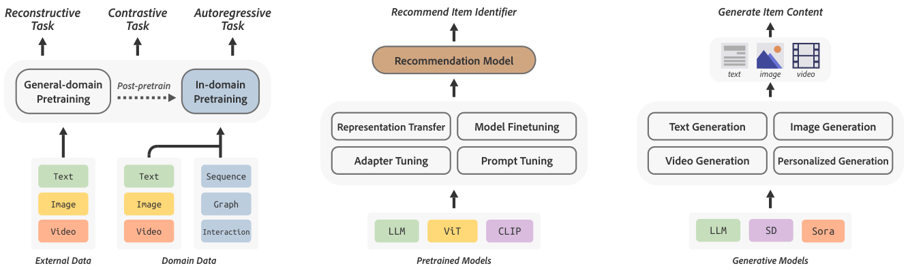
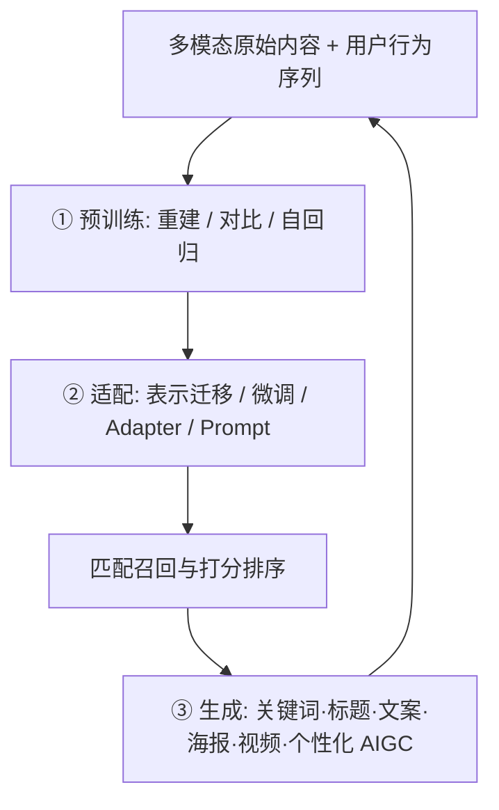

# Multimodal Pretraining, Adaptation, and Generation for Recommendation: A Survey (面向推荐的多模态预训练、适配与生成：综述)

- **会议/期刊**: KDD 2024 (Survey Track)
- **作者与机构**: Qijiong Liu, Jieming Zhu, Yanting Yang, Quanyu Dai, Zhaocheng Du, Xiao-Ming Wu, Zhou Zhao, Rui Zhang, Zhenhua Dong（港理工、华为诺亚方舟、浙大、华中科大）
- **推荐链路定位**: 召回 / 精排 / 端到端生成式（横跨内容理解与内容生产）
- **研究方向**: 多模态推荐 / 大语言模型推荐 / 生成式推荐
- **论文原文**: [https://arxiv.org/abs/2404.00621v2](https://arxiv.org/abs/2404.00621v2)
- **开源代码**: 暂未开源（仅维护教程与文献资源库 [mmrec.github.io](https://mmrec.github.io)）

## TL;DR (1分钟核心速览)

针对传统推荐仅用 ID 与类别特征、忽视图文音视频原始内容的问题，本文不再重复"提特征—拼接融合"的旧叙事，而以**多模态预训练 (Pretraining) → 多模态适配 (Adaptation) → 多模态生成 (Generation)** 三轴重构文献地图：预训练侧归纳重建/对比/自回归三大范式，适配侧建立"表示迁移→全量微调→Adapter→Prompt"的参数效率谱系，生成侧梳理关键词/标题/文案/海报/视频与个性化生成。论文为综述，**无统一实验与基准数字**，其价值在于指出语义空间与行为空间错配这一贯穿性矛盾，并列出六个开放挑战。

## Background & Motivation (背景与核心矛盾)

- **主流范式**: 十余年来多模态推荐的主流是"用 CLIP/ViT/BERT 抽冻结特征 $\to$与 ID 嵌入早/中/晚融合$\to$ 训练 BPR/CTR 模型"，代表如 MMSSL、MISSRec、MM-Rec。
- **前人局限之一**: 已有综述（[14,73,84,157]）止步于*特征提取、表征、交互、对齐、增强、融合*六个特征工程层面，完全未覆盖通用大模型的**预训练权重复用**与**AIGC 内容生产**这两条新范式。
- **前人局限之二**: 直接把通用语义向量拼进推荐模型存在**域泛化鸿沟**——语义空间与协同行为空间不对齐，实践中常常不涨点；KDSR 甚至观察到训练后模态特征被"遗忘"，表征退化回无模态输入的水平。
- **核心洞察 (Key Insight)**: 大模型时代的核心矛盾已从"如何融合特征"迁移为"**如何把通用多模态先验高效适配进行为空间，并让生成能力反哺推荐**"，因此需要一条以*模型生命周期*而非*特征处理流程*为骨架的分类轴。
- **本文切入点**: 用预训练/适配/生成三段式正交框架统一零散工作，并以"可训练参数量 vs 域对齐能力"的权衡解释适配技术的选型逻辑。

## Method (核心方法设计)

### 1. 整体框架 (Overall Architecture)

综述按内容流与模型生命周期组织：原始多模态内容（文本/图像/音频/视频）与用户行为序列先经**预训练**获得通用语义表征（可用域外语料自监督、也可用域内推荐数据继续预训练）；再经**适配**注入推荐模型（表示迁移冻结编码器、全量微调、LoRA 类 Adapter、软/硬 Prompt 四种代价递增手段）；适配后的表征进入匹配召回与打分排序；最终由**生成**模块产出关键词、个性化标题、营销文案、广告海报与商品视频，生成内容又回流为新的物品内容与训练信号，形成闭环。

<figure class="paper-figure" markdown="span">
  <figcaption>图1：面向推荐的多模态预训练、适配与生成任务概览。</figcaption>
</figure>

### 2. 关键设计拆解 (Key Designs)

1. **三阶段正交分类轴（本文最核心的结构性贡献）**：前人按"模态"或"技术手段"切分，导致预训练与生成两类新工作无处安放。本文改以**数据—模型契约**切分：预训练回答"知识从哪来"，适配回答"知识如何进模型"，生成回答"模型如何造内容"。该轴的价值在于把跨域序列推荐 (UniSRec)、新闻推荐 (MINER)、电商多模态 (ECLIP) 等看似无关的工作放进同一坐标系，暴露"域内预训练严重不足"这一空白。
2. **适配技术的参数效率谱系（选型决策依据）**：痛点是大模型全量微调在日均亿级样本的推荐场景下不可承受，且灾难性遗忘严重。四类手段的可训练参数量单调递减：
 - 表示迁移：$\mathbf{e}_i=[\mathbf{e}^{\text{ID}}_i;\ f_{\theta}^{\text{frozen}}(\mathbf{x}_i)]$，$|\theta_{\text{train}}|=0$- 全量微调：$\min_{\theta,\phi}\ \mathcal{L}_{\text{rec}}(f_\theta(\mathbf{x}),\phi)$，对齐最强但开销最大
 - Adapter/LoRA：$\mathbf{h}'=\mathbf{h}+\mathbf{W}_{\uparrow}\phi(\mathbf{W}_{\downarrow}\mathbf{h})$，$|\theta_{\text{ad}}|\ll|\theta|$- Prompt 调优：$\min_{\mathbf{P}}\mathcal{L}_{\text{rec}}\big(\mathcal{M}(\mathbf{P},\mathbf{x}),y\big)$，$\theta$ 全冻结

 直觉上，参数量越少越"安全"（不遗忘、可多域共享），但语义—行为对齐能力越弱；综述据此指出适配器设计"效果与效率的平衡"仍是活跃问题。
3. **自监督目标与训练/推理开销**：预训练侧给出三类代表性目标——重建 $\mathcal{L}_{\text{rec}}=-\mathbb{E}\sum_{t\in\mathcal{M}}\log p_\theta(x_t\mid x_{\setminus\mathcal{M}})$（Bert4Rec、Recformer）、对比$\mathcal{L}_{\text{cl}}=-\log\frac{\exp(\mathrm{sim}(\mathbf{z}_i,\mathbf{z}_i^+)/\tau)}{\sum_{j}\exp(\mathrm{sim}(\mathbf{z}_i,\mathbf{z}_j)/\tau)}$（MGCL、MMSSL）、自回归逐 token 生成（P5、VIP5、TIGER 式语义 ID 生成）。工程侧提出两条降本路径：**合并物品集合批量编码**避免重复前向，以及**离线缓存物品/用户表征**加速在线推理。

## Experimental Setup & Evaluation Protocol (实验设置与评估协议)

**本文为综述，不含自建实验、无主实验表格与消融实验**。其"评估协议"体现为文献组织与代表性工作的评测惯例归纳，笔记如实标注：

- **文献纳入标准**: 以 KDD/WWW/SIGIR/RecSys/CIKM 等 2019–2024 年工作为主，按三轴归类；配套 WWW 2024 教程与 GitHub 资源库持续更新。
- **数据集惯例（被引工作常用）**: Amazon 系列（多采用 **5-core 过滤**，按时间戳 **Leave-One-Out** 或比例划分）、MIND（新闻，含标题/摘要/封面图）、MicroLens（微视频，多模态侧信息丰富）、Last.fm / KKBox（音乐，音频+歌词+标签）、Pinterest（视觉）。
- **排名评测协议**: 被引文献普遍采用 **Full-Ranking（全库未交互物品排序）** 报告 HR@K / NDCG@K，序列推荐部分常用 **Sampled Ranking（1 正 : 100 负）**；负采样以均匀采样为主，图对比方法多用批内负样本。
- **基线类别与超参**: 基线分为 ID-only（BPR、SASRec、LightGCN）、多模态融合（VBPR、MMGCN、LATTICE）、预训练增强（UniSRec、MISSRec、MMSSL）三档；表征维度多以 $d=64$或$64\times$模态数 对齐，显著性检验多采用配对$t$检验$p<0.05$。

## Key Experimental Results (实验关键数据)

### 1. 主实验对比 (Main Results)

由于综述未做统一复现，以下以**分类学对照表**替代主实验表，横向对比三轴中各类方法的机制与代价（"最优"标注本文推荐的首选范式）：

| 阶段 | 代表范式/方法 | 知识来源 | 可训练参数 | 核心风险 |
| :--- | :--- | :--- | :---: | :--- |
| 预训练 | 重建（Bert4Rec、Recformer） | 掩码自监督 | 全量 | 难捕获协同邻近性，需配对比学习 |
| 预训练 | 对比（MGCL、MMSSL、MISSRec） | 图/序列增广 | 全量 | **增广策略敏感**，负样本质量决定上限 |
| 预训练 | 自回归（P5、VIP5、TIGER） | LLM/语义 ID | 全量 | 语义 ID 冲突与解码延迟 |
| 适配 | 表示迁移（VBPR、MM-Rec） | 冻结 CLIP/ViT | 0 | **语义—行为域鸿沟**，模态特征被遗忘 |
| 适配 | 全量微调（MINER、TransRec） | 同上 | 100% | 训练开销不可承受 + 灾难性遗忘 |
| 适配 | Adapter（**UniSRec、ONCE、M3SRec**） | LoRA/MoE 适配器 | **<5%** | 适配器容量与位置需人工设计 |
| 适配 | Prompt（PromptMM、Prompt4NR） | 软提示 | <1% | 个性化提示尚属空白 |
| 生成 | 文本/图像视频 AIGC（AutoPoster、AtomoVideo） | 扩散/LLM | — | **可控性与事实一致性无保障** |

### 2. 消融实验 (Ablation Study)

原文无消融实验，此处以**"三轴覆盖度"结构分析**替代：预训练轴覆盖 3 范式 × 4 模态（12 格），适配轴覆盖 4 手段 × 2 任务类型（8 格），生成轴覆盖 3 模态 × 2 用途（6 格），其中"域内多模态预训练"（仅 M5Product、K3M、ECLIP、CommerceMM 等电商工作）与"个性化提示调优"两格明显稀疏。

### 3. 关键实验发现 (Key Findings)

1. **适配手段的选择本质是参数量与对齐能力的帕累托前沿**：全量微调虽对齐最彻底，但在亿级日样本下不可行；LoRA/MoE 适配器（如 ONCE、UniSRec）以 <5% 参数取得接近全量微调的效果，是当前工业折中首选。
2. **单纯表示迁移并不保证正收益**：综述明确记录"语义空间与行为空间不对齐时，冻结特征拼接可能不涨反跌"，且 KDSR 观测到模态特征在训练中被模型"忽略"，说明需显式约束或语义离散化（tokenization）兜底。
3. **生成能力目前主要停留在"内容侧增强"而非"推荐决策"**：关键词生成、个性化标题、广告海报/商品视频已被验证可用于提升 CTR 与内容吸引力，但可控生成与领域知识注入两大障碍未解，尚未进入排序主链路。

## Highlights & Limitations (亮点、对比与审稿批判)

- **与代表作对比**: 相较 [14,73,157] 等"特征工程视角"综述，本文首次把**预训练权重复用**与**AIGC 生成**纳入同一框架；相较 LLM4Rec 类综述，本文不局限于文本，而覆盖图像/音频/视频与多模态大模型（BLIP-2、LLaVA、ImageBind），覆盖面更宽。
- **可迁移亮点**: ① "参数量—对齐能力"谱系可直接用于新场景下适配方案的选型决策树；② 缓存物品/用户表征与合并批量编码两条降本技巧，可迁移到任何大模型增强的召回/粗排系统。
- **审稿级局限批判**: ① **缺少统一基准与复现实验**，全文无一处定量对比，"哪种适配最优"缺乏实证支撑，读者难以据此选型；② 三轴划分存在重叠（如 VIP5 同时属预训练、适配与生成），分类互斥性不足；③ 对训练/推理延迟只有定性讨论，未给出任何计算复杂度或线上延迟量级，工业落地指导偏弱。

## Rating (四维评分)

- **方法创新性 (Novelty)**: ⭐⭐⭐ （分类轴本身有新意，将预训练/适配/生成统一，但不提出新算法，属结构化梳理型贡献）
- **评估协议与实验扎实度 (Protocol & Experiments)**: ⭐⭐ （无自建实验、无统一基准、无复现与显著性检验，评测部分仅为文献惯例归纳）
- **写作与数学规范度 (Clarity & Rigor)**: ⭐⭐⭐⭐ （三轴脉络清晰、应用与挑战归纳到位，但公式极少、缺少形式化的问题定义与复杂度分析）
- **工业落地与复现价值 (Industrial & Practical Value)**: ⭐⭐⭐⭐ （LoRA/Adapter 选型、表征缓存与批量编码等工程建议直接可用，配套资源库便于跟进，但无开源代码与可运行基线）

