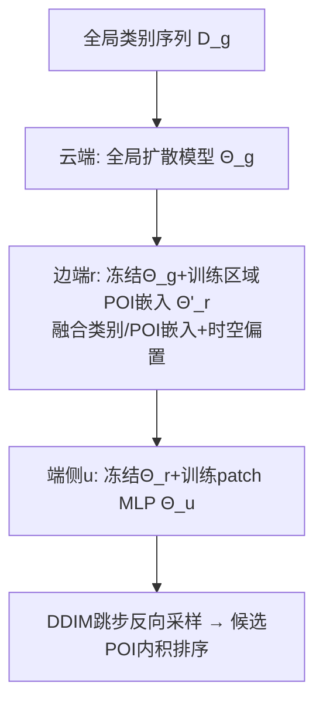
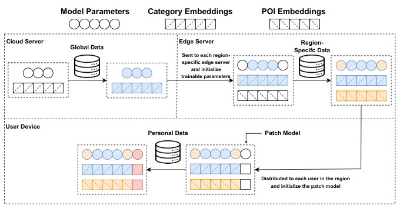

# Diffusion-Based Cloud-Edge-Device Collaborative Learning for Next POI Recommendations (基于扩散的云-边-端协同学习用于下一兴趣点推荐)

- **会议/期刊**: KDD 2024
- **作者与机构**: Jing Long, Guanhua Ye, Tong Chen, Yang Wang, Meng Wang, Hongzhi Yin* (The University of Queensland / Deep Neural Computing Company / Hefei University of Technology)
- **推荐链路定位**: 端到端生成式召回（扩散模型生成下一POI表征）
- **研究方向**: 时空轨迹与POI本地生活推荐 / 去偏公平、可信隐私与工业架构
- **论文原文**: [https://arxiv.org/abs/2405.13811v1](https://arxiv.org/abs/2405.13811v1)
- **开源代码**: 暂未开源

## TL;DR (1分钟核心速览)

本文针对端侧POI推荐的两大痛点：联邦/去中心化协同要求全设备参与训练导致算力过载，以及新用户/新区域难以快速适配。提出DCPR——云-边-端三层渐进式扩散学习框架：云端用**类别序列**（不含敏感坐标）训练全局扩散模型，边端冻结全局参数仅训练区域内POI嵌入并注入时空距离偏置，端侧仅用轻量patch MLP微调。配合DDIM式跳步采样将反向步数从1024压到16。在Foursquare/Weeplace的`Leave-One-Out` + `200候选采样排序`协议下，HR@10分别达0.4623/0.5082，超越Diff-POI等集中式与全部端侧SOTA，且端侧模型尺寸、训练/推理时间均最低。

## Background & Motivation (背景与核心矛盾)

- **主流范式**: 集中式DNN（STAN/DRAN/Diff-POI）靠云端算力与全量数据取得高精度；端侧路线以联邦学习（PREFER）、去中心化邻居协作（DCLR/MAC）或压缩预训练（LLRec/DCCL）保障隐私与响应速度。
- **前人局限**: ①联邦/去中心化需**全设备参与训练与通信**，端侧算力与带宽不堪重负；②新区域与新用户必须**从零重学**，迁移性差；③集中式跨城市知识迁移存在噪声干扰。
- **核心洞察 (Key Insight)**: POI的**类别序列不含敏感地理坐标**，可安全上传云端；而扩散模型具备强生成多样性与分布式生成特性，天然适合"由粗到细"的渐进式个性化。
- **本文切入点**: 用扩散模型的层级生成能力替代"聚合/通信"，把个性化拆成云端（类别模式）→边端（区域POI）→端侧（个人patch）三层，逐层冻结上层、只训练少量参数。

## Method (核心方法设计)

### 1. 整体框架 (Overall Architecture)

DCPR分三阶段闭环：**云端**在匿名类别序列 $\mathcal{D}_g$上训练全局扩散网络$\Theta_g$，学习类别级移动模式；**边端**对每个区域$r$接收$\Theta_g$并冻结其参数，仅训练区域POI嵌入$\Theta'_r$（用对应类别嵌入初始化），在扩散阶段融合类别+POI嵌入与时空距离偏置，输出区域模型$\Theta_r$；**端侧**为每用户外挂一个3层MLP patch$\Theta_u$，冻结$\Theta_r$仅训练$\Theta_u$以捕捉个人偏好。推理时从纯高斯噪声$x_T$出发，经跳步反向采样得到$\hat{x}_0$，再与候选POI嵌入内积排序。云端/边端均不做反向推理，仅端侧执行，大幅降低端侧负载。

<figure class="paper-figure" markdown="span">
  <figcaption>图1：我们提出的 DCPR 概览。</figcaption>
</figure>

### 2. 关键设计拆解 (Key Designs)

1. **区域端融合类别+POI嵌入与时空偏置**：全局式(7)仅用类别嵌入 $z_{c_m}=e_{c_m}+\lambda(x_t+e_t)$，无法刻画区域内POI细粒度差异与移动的时空相关性。区域端改写为
$z_m=e_{p_m}+\gamma e_{c_m}+\lambda(x_t+d_t)$，
并用 $\Delta s_{ab},\Delta t_{ab}$构造时空关系矩阵$e_{\Delta_{ab}}=\Delta s_{ab}\times e_{\Delta s}+\Delta t_{ab}\times e_{\Delta t}$，注入注意力：
$E=\text{Softmax}\!\big(\frac{QK^{T}+\Delta}{\sqrt{d}}\big)V$。
$\gamma$控制类别知识注入比例，$\Delta$ 让注意力感知"10km/5小时"这类地理-时间间隔，正是POI场景区别于电商序列的关键。
2. **端侧Patch Learning**：直接全量微调区域模型参数过多、端侧不可行；只微调子集又因稳定/可变向量冲突导致表征破坏。本文冻结 $\Theta_r$，仅训练轻量MLP：
$\hat{x}_0\leftarrow\Theta_u(\Theta_r(x_t,X))$，
$\Theta_u=\Theta_u-\gamma\frac{\partial\mathcal{L}_{CE}}{\partial\Theta_u}$。
用外挂patch承揽个性化而不扰动已学好的区域生成能力，且MLP深度可随设备算力弹性调整。
3. **DDIM式跳步加速与训练目标**：标准扩散反向需1024步，端侧不可接受。仅在最子序列 $\{x_{T_S},\dots,x_{T_0}\}$ 上采样：
$x_{T_s-1}=\sqrt{\alpha_{T_s-1}}\big(\frac{x_{T_s}-\sqrt{1-\alpha_t}\hat{x}_0}{\sqrt{\alpha_{T_s}}}\big)+\sqrt{1-\alpha_{T_s-1}}\hat{x}_0$。
训练目标为带负采样的交叉熵：
$\mathcal{L}_{CE}=-\big[\log\sigma(\hat{x}_0^{T}x_0)-\frac{1}{|Y^-|}\sum_{e_n\in Y^-}\log\sigma(\hat{x}_0^{T}e_n)\big]$，
三层均使用该损失，使用均匀负采样。

## Experimental Setup & Evaluation Protocol (实验设置与评估协议)

- **数据集与预处理**:

| 数据集 | #Users | #Items(POI) | #Interactions | 稀疏度/密度 | 特征/场景说明 |
| :--- | :---: | :---: | :---: | :---: | :--- |
| Foursquare | 7,507 | 80,962 | 1,214,631 | 约 $2.0\times10^{-3}$ | 三城(NY/LA/Chicago)，436类，k-means分5区域/城 |
| Weeplace | 4,560 | 44,194 | 923,600 | 约 $4.6\times10^{-3}$ | 三城，625类，同上 |

过滤方式：用户与POI交互数 **<10 移除**；每城 k-means 划分5个区域，每区域50%序列做边端训练、其余用于端侧训练/验证/测试。

- **数据划分与防穿越**: `Leave-One-Out`——端侧每条序列最后一个POI做测试、倒数第二个做验证、其余训练；$\mathcal{D}_g$ 中每条类别序列去掉最后两个check-in以防穿越；最大序列长度200。
- **排名评测协议**: `Sampled Ranking`——每个真值仅与**同区域内未访问且最近的200个POI**配对排序，理由是POI推荐受地理位置强约束，用户不会在相距很远的POI间连续移动。指标 HR@5/NDCG@5/HR@10/NDCG@10。
- **对比基线与超参**: 集中式 MF/LSTM/STAN/DRAN/Diff-POI，端侧 LLRec/DCCL/PREFER/DCLR/MAC；$T=1024$,$T_R=16$,$\gamma=0.7$,$\lambda=0.003$,$d=64$, dropout=0.2, batch=16, lr=0.002, max epoch=200。

## Key Experimental Results (实验关键数据)

### 1. 主实验对比 (Main Results)

| Baseline | Foursquare HR@10 | Foursquare NDCG@10 | Weeplace HR@10 | Weeplace NDCG@10 |
| :--- | :---: | :---: | :---: | :---: |
| MF | 0.0965 | 0.0661 | 0.1316 | 0.0889 |
| LSTM | 0.2782 | 0.1668 | 0.3251 | 0.1549 |
| STAN | 0.4327 | 0.2598 | 0.4663 | 0.2876 |
| DRAN | 0.4345 | 0.2655 | 0.4775 | 0.2974 |
| Diff-POI | 0.4585 | 0.2838 | 0.4933 | 0.2994 |
| PREFER | 0.3723 | 0.2251 | 0.3914 | 0.2367 |
| DCLR | 0.4406 | 0.2740 | 0.4357 | 0.2797 |
| MAC | 0.4520 | 0.2780 | 0.4852 | 0.2829 |
| **DCPR** | **0.4623** | **0.2913** | **0.5082** | **0.3063** |
| **Improv.%** | +0.83% | +2.64% | +3.02% | +2.30% |

### 2. 消融实验 (Ablation Study)

| 变体 | Foursquare HR@10 | Weeplace HR@10 | 说明 |
| :--- | :---: | :---: | :--- |
| DCPR (完整) | **0.4623** | **0.5082** | 三层协同 |
| DCPR-T (区域模型从零训练，无云端迁移) | 0.4252 | 0.4709 | 移除云端→边端迁移，GPU训练用时Foursquare 5708s vs 4143s |
| γ=0 (丢弃全局类别嵌入) | 最低(约0.44) | 最低 | 图4显示 $\gamma=0$ 时精度最低 |
| 无加速 ($T_R=1024$) | 略升 | 略升 | 精度收敛于$T_R\ge16$，但推理时间线性攀升 |

### 3. 关键实验发现 (Key Findings)

1. **云端类别迁移是核心增益源**：DCPR-T去掉全局模型后Foursquare HR@10从0.4623掉到0.4252（↓8.0%），且训练时间从4143s升到5708s，证明"类别级预训练+冻结迁移"同时带来精度与收敛速度双收益。
2. **$\gamma$与$\lambda$存在明显最优区间**：$\gamma$从0增至0.7精度上升，超过0.7反而下降（类别知识占比过高抑制POI个性化）；$\lambda=0.003$ 为甜点，噪声不足则多样性不够，噪声过多则破坏POI表征。
3. **DDIM加速近乎无损**：$T_R$从1024降到16，推理时间从约400ms降至约15ms量级，而HR@10在$T_R\ge16$后基本收敛；且$N_C>1000$ 后精度稳定，说明DCPR对区域内check-in量要求不高，适合冷启动区域。

## Highlights & Limitations (亮点、对比与审稿批判)

- **与代表作对比 (vs. Prior Work)**: 相较PREFER/DCLR/MAC需全设备参与训练与通信，DCPR用**冻结迁移**替代聚合，端侧仅训练一个MLP，训练时间与模型尺寸显著更低；相较集中式Diff-POI，DCPR首次把扩散模型引入云边端分级，在保持竞争力的同时实现隐私与响应速度。
- **可迁移亮点**: ①"类别序列可安全上传云端、POI序列留边端"的分级隐私切分思路，可直接迁移到短视频/电商的"类目-商品"分级联邦场景；②用冻结主干+轻量patch做端侧个性化，避免全量微调破坏生成能力，可复用到任何端侧生成模型。
- **审稿级局限批判**: ①评估仅为**同区域最近200 POI采样排序**，非全库排序，可能对强依赖地理邻近的模型过于乐观，缺乏Full-Ranking与跨区域真实场景验证；②虽然 $T_R=16$已大幅加速，但扩散模型端侧15ms级推理仍显著高于传统双塔/序列模型，且文中未报告显著性检验；③区域划分依赖k-means、$\gamma/\lambda$ 需按数据集调参，工业落地需重新标定。

## Rating (四维评分)

- **方法创新性 (Novelty)**: ⭐⭐⭐⭐ （首次将扩散模型引入云-边-端三层渐进式个性化，类别/POI/个人三层解耦的隐私-个性化权衡设计新颖，但扩散与联邦的结合思路非从零原创）
- **评估协议与实验扎实度 (Protocol & Experiments)**: ⭐⭐⭐ （双数据集+集中式/端侧两类共10个基线+迁移与效率分析较全，但仅200候选采样排序、无全会话全库评测、无显著性检验，鲁棒性论证略欠）
- **写作与数学规范度 (Clarity & Rigor)**: ⭐⭐⭐⭐ （公式推导清晰、式7/11/14/19层层递进可读，符号定义完备；$\gamma$与$\lambda$ 符号在式11与更新式中有复用，细节稍显混淆）
- **工业落地与复现价值 (Industrial & Practical Value)**: ⭐⭐⭐⭐ （云边端架构、端侧MLP弹性patch、DDIM加速均具明确工程价值，模型尺寸与训练时间优势可量化；不足之处是未开源、跨城市Full-Ranking部署验证缺失）

