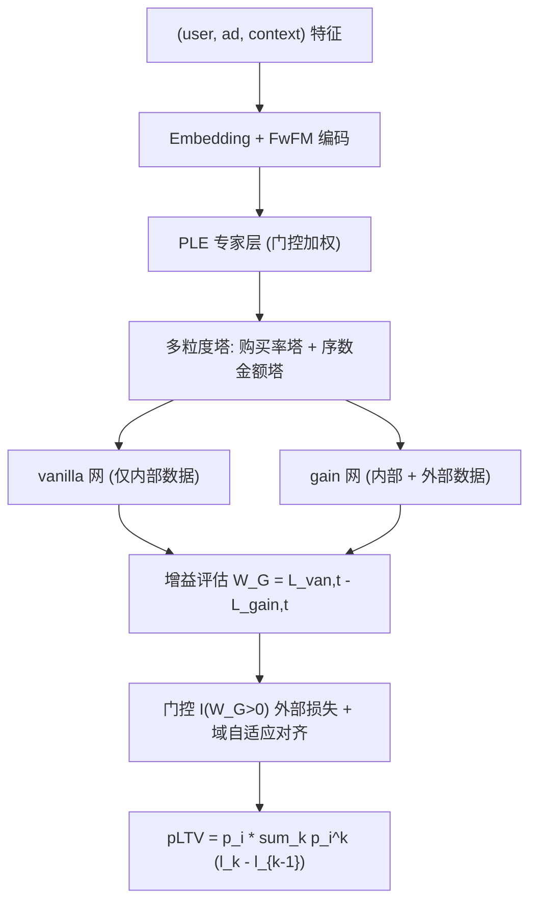
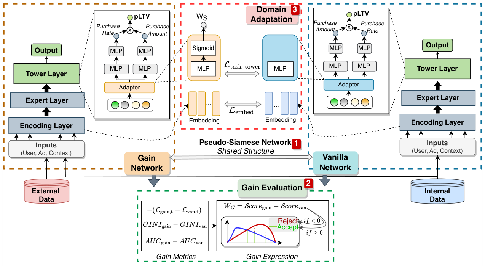

# ADSNet: Cross-Domain LTV Prediction with an Adaptive Siamese Network in Advertising (面向广告跨域 LTV 预测的自适应差分孪生网络)

- **会议/期刊**: KDD 2024 (Barcelona)
- **作者与机构**: Ruize Wang, Hui Xu, Qi He, Xing Zhou, Wei Xu, Lei Huang, Jie Jiang (Tencent Inc.)；Ying Cheng, Rui Feng (复旦大学)
- **推荐链路定位**: 精排 / 价值预估（pLTV 直接支撑 ROI 出价与排序）
- **研究方向**: 强化学习与动态探索推荐（长期价值 LTV 优化） / 跨域与多场景推荐
- **论文原文**: [https://arxiv.org/abs/2406.10517v1](https://arxiv.org/abs/2406.10517v1)
- **开源代码**: 暂未开源

## TL;DR (1分钟核心速览)

广告平台 LTV 预测受制于“购买”位于转化漏斗最深处导致的样本极度稀疏。本文提出 ADSNet：用伪孪生双网（vanilla 仅吃内部数据、gain 吃内部+外部数据），在同一批内部样本上比较两网损失差得到逐样本信息增益 $W_G=\mathcal{L}_{van,t}-\mathcal{L}_{gain,t}$，仅当$W_G>0$ 时外部样本才参与梯度，辅以域自适应模块与迭代对齐策略维持增益信号可用。在腾讯广告 3 个内部业务域 + 外部域、按时间轴 70/10/10 天切分的工业数据上，全量测试集平均 AUC 从 0.834 升至 0.842、Norm GINI 从 0.836 升至 0.845（GINI 相对提升约 2%）；线上 A/B 中 LTV +3.47%、GMV +3.89%。

## Background & Motivation (背景与核心矛盾)

- **主流范式**: LTV 建模长期以 ZILN（零膨胀对数正态）等参数化回归为主，OMDN 用分布专家切分多峰；特征侧用 FwFM/DCN 编码、PLE 做专家层，跨域则靠 STAR（分区归一化）/MMoE/Share-Bottom 的联合训练隐式缓解域差。
- **前人局限**: ①购买是漏斗最深行为，内部购买样本量比曝光低数个量级，模型容量无法被数据支撑；②跨域引入外部数据时域间分布差异巨大（内部 Domain#3 平均 LTV 4.82 vs 外部 8.02），朴素混训直接触发负迁移——实测 Share-Bottom+ZILN 的 GINI 0.790 反而低于单域 ZILN 的 0.794。
- **核心洞察 (Key Insight)**: 负迁移不是“域级”而是“样本级”的——同一条外部样本对目标域可能正增益也可能有害（训练后期稳定有 64% 外部样本被判为负增益），缺少参照系时才只能全盘接收或全盘拒收。
- **本文切入点**: 构造非对称输入的双网作为参照系，把“外部知识是否有益”化为可在线计算的标量门控信号。

## Method (核心方法设计)

### 1. 整体框架 (Overall Architecture)

输入 (user, ad, context) 特征先经 Embedding + FwFM 做域间交叉编码，再入 PLE 专家层（MLP 专家 + softmax 门控加权），最后进入多粒度塔：一支二分类购买概率塔、一支对金额分段做序数分类的塔。网络结构一分为二且**不共享参数**：vanilla 网只喂内部样本，gain 网同时喂内部与外部样本；每步用内部样本在两网上的损失差 $W_G$门控外部损失是否生效，域自适应模块（塔底 adapter + 两级 MSE 蒸馏）拉近两网表征，每 500 步把 gain 参数同步回 vanilla 以防两网漂移到门控失效。线上推理只走单网一次前向，输出$pLTV$。

<figure class="paper-figure" markdown="span">
  <figcaption>图3：我们提出的ADSNet方法概览。采用伪孪生架构（第1部分）建立度量以对比两个网络之间的差异，从而能够计算每个输入的增益并支持拒绝负增益样本（第2部分）。提出域自适应模块（第3部分）以促进不同域之间的一致性。</figcaption>
</figure>

### 2. 关键设计拆解 (Key Designs)

1. **多粒度序数分类塔（替代 ZILN 的强 backbone）**：ZILN 只拟合单峰对数正态，无法刻画零膨胀 + 多峰（如 $6/$30/$98/$198 档位）的真实金额分布。本文先估购买率$p_i$，再按频数等分 K 段并用$s_i^k=\mathbb{I}(y_i>r_k)$展开为 K-1 个二分类，直接学累积分布：$pLTV_i=p_i\cdot\sum_{k=1}^{K-1}p_i^k(l_k-l_{k-1})$。直觉上分段使样本均衡且保留序数递进，比拟合分布均值/方差更稳，损失为$\mathcal{L}_{amount}=\mathbb{I}\{y_i>0\}\sum_{k}\mathrm{BCE}(s_i^k,p_i^k)$。

2. **伪孪生增益评估策略 (GES)**：联合训练无法判断哪条外部样本有害。方法是对同一批内部样本比较两网损失：$W_G=\mathcal{L}_{van,t}-\mathcal{L}_{gain,t}$，并把外部损失乘上示性门控，$\mathcal{L}_{gain}=W_s\cdot\mathcal{L}_{gain,s}\mathbb{I}(W_G>0)+\mathcal{L}_{gain,t}$。物理直觉是：$W_G$ 衡量“额外数据训练出的网在目标分布上是否更准”，为正才说明外部知识真正迁移成功，从而把样本级拒收变成可微训练流程中的在线判据。

3. **域自适应模块 + 迭代对齐 + 训练目标**：塔底 adapter 为外部样本给出重要性权重 $W_s=1/\exp(\mathrm{sigmoid}(\mathrm{MLP}(e_i)))$，并以$\mathcal{L}_{domain}=\mathrm{MSE}(\boldsymbol{E}_V,\boldsymbol{E}_G)+\mathrm{MSE}(\boldsymbol{H}^{ad}_V,\boldsymbol{H}^{ad}_G)$在 embedding 与塔层两级对齐；总损失$\mathcal{L}_{total}=\mathcal{L}_{gain}+\mathcal{L}_{van}+\beta\mathcal{L}_{domain}$（$\beta=0.1$）。若不对齐，gain 网随训练越来越强会令$W_G$ 恒正、门控退化，故采用“warmup 训 vanilla → 双网联合、每 500 步同步”的迭代对齐。训练每步多一次 vanilla 前向（约 2× 开销），线上推理无额外成本。

## Experimental Setup & Evaluation Protocol (实验设置与评估协议)

- **数据集与预处理**: 腾讯广告 90 天转化日志采样，4 个内部流量域 + 授权外部数据；未披露曝光总量，仅公布日均购买样本量与平均 LTV。

| 数据集 | #Users | #Items | #Interactions (日均购买样本) | 稀疏度/密度 | 特征/场景说明 |
| :--- | :---: | :---: | :---: | :---: | :--- |
| Domain#1 (内部) | — | — | 9,136 | 未披露 | Avg.LTV 0.34，小流量业务域 |
| Domain#2 (内部) | — | — | 15,706 | 未披露 | Avg.LTV 0.53，最低价值域 |
| Domain#3 (内部) | — | — | 34,129 | 未披露 | Avg.LTV 4.82，高价值域 |
| External (外部) | — | — | 225,490 | 未披露 | Avg.LTV 8.02，分布显著偏移 |

- **数据划分与防穿越**: 全部按**时间轴切分**，70 / 10 / 10 天分别作训练 / 验证 / 测试，天然防穿越；跨域方法训练时混用内外数据，但验证与测试**只在内部域**上做。
- **排名评测协议**: 无负采样，在测试集全部样本上直接计算 AUC（购买与否判别）与 Normalized GINI（预测 LTV 与真实 LTV 的排序一致性），属**全量排序质量**而非采样排序，GINI 对离群值与业务解释更鲁棒。
- **对比基线与超参**: 单域 DeepFM / ZILN / FiBiNet / GateNet / 本文 backbone；跨域 Share-Bottom / MMoE / STAR / CCTL（均配 ZILN 或本文 backbone）。FTRL 训稀疏参数、FTML 训稠密参数，学习率 $\{5\times10^{-3},10^{-2}\}$，batch 512，$d=32$，专家 MLP$[128,64]$，塔隐层 32，$\beta=0.1$（验证集网格搜索）。

## Key Experimental Results (实验关键数据)

### 1. 主实验对比 (Main Results)

| 方法 | D#1 GINI | D#2 GINI | D#3 GINI | Avg AUC | Avg GINI |
| :--- | :---: | :---: | :---: | :---: | :---: |
| DeepFM (单域) | 0.731 | 0.633 | 0.9029 | 0.771 | 0.755 |
| ZILN (单域) | 0.759 | 0.701 | 0.9237 | 0.794 | 0.794 |
| GateNet (单域) | 0.767 | 0.732 | 0.9411 | 0.811 | 0.813 |
| ADSNet-Backbone (单域) | 0.770 | 0.745 | 0.9467 | 0.822 | 0.820 |
| Share-Bottom + ZILN | 0.746 | 0.705 | 0.9201 | 0.789 | 0.790 |
| MMoE + ZILN | 0.754 | 0.726 | 0.9222 | 0.801 | 0.800 |
| STAR + ZILN | 0.775 | 0.753 | 0.9448 | 0.826 | 0.824 |
| CCTL + ZILN | 0.781 | 0.758 | 0.9522 | 0.831 | 0.830 |
| CCTL + ADSNet-Backbone | 0.792 | 0.761 | 0.9537 | 0.834 | 0.836 |
| **ADSNet (Ours)** | **0.807** | **0.771** | **0.9570** | **0.842** | **0.845** |
| **Improv.** | +1.9% | +1.3% | +0.35% | +0.96% | **+1.08%** |

（Improv. 相对最强基线 CCTL+ADSNet-Backbone；相对 CCTL+ZILN 的 Avg GINI 提升 1.8%，原文口径约 2%。）

### 2. 消融实验 (Ablation Study)

| 变体 | AUC | GINI | ΔGINI |
| :--- | :---: | :---: | :---: |
| ADSNet (full) | 0.851 | **0.856** | — |
| w/o Domain Adaptation Module | 0.833 | 0.835 | −0.021 |
| w/o Gain Evaluation Strategy (GES) | 0.822 | 0.824 | −0.032 |
| w/o Iterative Alignment Strategy | 0.839 | 0.843 | −0.013 |
| w/o All Components (= backbone) | 0.819 | 0.820 | −0.036 |

（验证集口径，与主实验测试集数值不完全可比。）

### 3. 关键实验发现 (Key Findings)

1. **负迁移是真实且大量的，GES 贡献最大**：朴素混训的 Share-Bottom+ZILN（Avg GINI 0.790）甚至低于只用内部数据的 ZILN（0.794）；而 GES 移除后 GINI 由 0.856 掉到 0.824（−3.7%），是单模块最大损失，训练过程中负增益拒收率最终稳定在 **0.64**，即约 2/3 外部样本若直接使用反而有害。
2. **外部数据主要补的是稀疏广告**：按广告样本量分桶，最稀疏区间 `[0,15]` 的 GINI 从 backbone 0.6317 提升到 0.7832（原文口径 +15.2%，图中数值约 +24%），而头部 `[250,+inf)` 区间仅 0.9467→0.9570，说明增益几乎全部来自长尾。
3. **域自适应与迭代对齐是“让门控持续可用”的前提**：去掉 DA 掉 2.1 点、去掉迭代对齐掉 1.3 点 GINI；若两网表征漂移、$W_G$ 恒正，GES 就退化为全盘接收外部噪声。线上 A/B（各 5% 流量、基线为 STAR 变体）LTV +3.47%、GMV +3.89%，验证了“拒收噪声 + 保留正增益”在真实出价链路的价值。

## Highlights & Limitations (亮点、对比与审稿批判)

- **与代表作对比 (vs. Prior Work)**: 相比 ZILN/ODMN 只在内部稀疏数据上做参数化分布拟合，本文用序数分类塔直接学 CDF 并引入外部样本扩容；相比 STAR/MMoE/PLE 依赖参数共享与门控隐式吸收域差，本文用非对称伪孪生显式给出逐样本增益并硬门控；相比 CCTL 的对称 companion network + 全域级增益（且只做 CTR），ADSNet 面向稀疏回归任务，额外补了域自适应模块与迭代对齐以防增益信号退化。
- **可迁移亮点**: ①“损失差门控”是一套与任务无关的选择性迁移范式，可搬到任何多场景联合训练（无需额外标注、只需一路仅目标域数据的参照网）；②多粒度序数分类塔可替代 ZILN 处理零膨胀 + 多峰金额预估。
- **审稿级局限批判**: ①数据全部来自腾讯内部 3 个业务域，无公开数据与代码，跨公司可复现性弱；②GES 需每步额外一次 vanilla 前向与周期性参数同步（训练约 2×），且门控阈值固定为 0、对损失尺度与噪声敏感，$W_G$ 未做方差/显著性分析；③增益相对幅度在 1% 量级，主实验未给置信区间或显著性检验，外部数据的合规性与线上分布漂移风险也未讨论。

## Rating (四维评分)

- **方法创新性 (Novelty)**: ⭐⭐⭐⭐ （把“外部数据是否有益”化为逐样本损失差门控，思路清晰且有效，但整体是 PLE + 伪孪生 + 蒸馏的工程化重组）
- **评估协议与实验扎实度 (Protocol & Experiments)**: ⭐⭐⭐ （全量 GINI/AUC + 真实线上 A/B 值得肯定，但仅 3 个内部域、无开源、无显著性检验与方差报告）
- **写作与数学规范度 (Clarity & Rigor)**: ⭐⭐⭐⭐ （框架图与训练算法交代清楚，但 Eq.9 的权重定义反直觉、$W_s$ 符号在样本权重与 adapter 权重间复用，序数损失符号略乱）
- **工业落地与复现价值 (Industrial & Practical Value)**: ⭐⭐⭐⭐ （线上 LTV +3.47%/GMV +3.89% 是可观的真实收益，推理零额外开销；但双网训练成本与不开源代码削弱复现价值）

