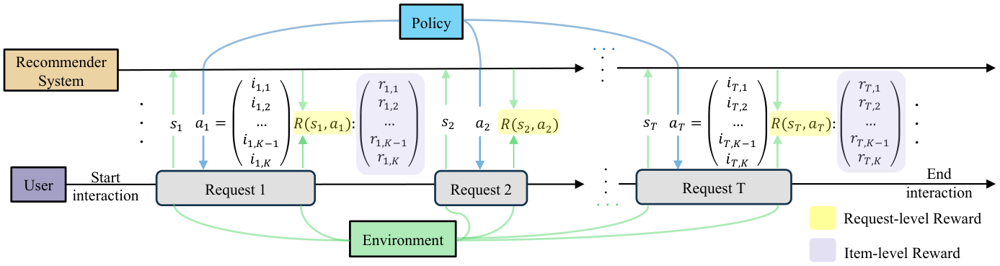
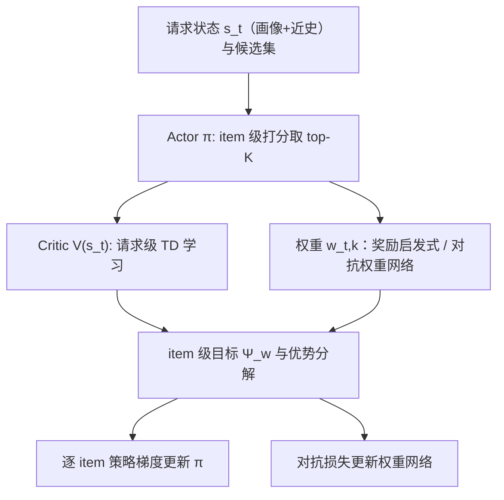

# Future Impact Decomposition in Request-level Recommendations (请求级推荐中的未来影响分解)

- **会议/期刊**: KDD 2024 (Research Track)
- **作者与机构**: Xiaobei Wang, Shuchang Liu (共同一作), Xueliang Wang, Qingpeng Cai, Lantao Hu, Han Li, Peng Jiang, Kun Gai, Guangming Xie；北京大学 / 快手科技
- **推荐链路定位**: 精排 (Refined Ranking) —— RL 策略直接输出候选集top-K 列表
- **研究方向**: 强化学习与动态探索推荐 / 多任务学习与列表级重排
- **论文原文**: [https://arxiv.org/abs/2401.16108v5](https://arxiv.org/abs/2401.16108v5)
- **开源代码**: [https://github.com/wangxiaobei565/ItemDecomposition](https://github.com/wangxiaobei565/ItemDecomposition)

## TL;DR (1分钟核心速览)

本文直指 RL4RS 中被普遍忽略的一个建模错配：系统以"一次请求返回 K 条列表"的**请求级** MDP 更新状态，而用户实际是**逐条消费**的 item 级行为，导致列表中各 item 的长程价值被均匀摊薄。作者提出 ItemA2C：在**不改变请求级状态转移**的前提下，把 critic 的 TD 目标与 actor 的优势函数按 item 奖励分解，并用奖励驱动/模型对抗两种权重再分配"未来影响"。在 ML1M 与 KuaiRand1K 模拟器（在线伪训练 + 最后 100 步评测）上，ItemA2C-M 相对最强请求级基线 HAC 在 KuaiRand 上提升累计奖励 26.7%、会话深度 20.9%；工业短视频平台 A/B 中 like +1.10%、collect +0.96%，且无额外推理开销。

## Background & Motivation (背景与核心矛盾)

- **主流范式**: 将用户-系统交互序列建模为 MDP，用 A2C/DDPG/HAC 等 actor-critic 方法优化累计奖励，动作为长度为 $K$ 的 item 列表（SlateQ、HAC 为代表）。
- **前人局限一（视角错配）**: 系统状态仅在"每个 request"后更新，但用户是逐条观看、逐条改变兴趣的；列表级反馈把"运动片被点赞、纪录片被跳过"这类关键 item 级差异平均掉了，策略无法学到用户对细粒度内容的偏好。
- **前人局限二（未来影响均摊）**: SlateQ 式分解假设"列表内单选项"且不利用已可观测的 item 级奖励；HAC 只做 item 级监督，未区分同一列表中不同 item 对**未来**留存/信任度的非均匀因果贡献。
- **核心洞察 (Key Insight)**: item 级即时反馈 $r_{t,k}$ 是**可观测**的，而 item 级状态转移**不可观测**——因此可以在保留请求级状态与请求级 critic 的前提下，只在目标函数层面做 item 分解，并让分解权重与即时奖励正相关。
- **本文切入点**: 用"权重和恒为 1"的分解恒等式，保证 item 级目标之和精确重构请求级目标，从而在不动 MDP、不加推理成本的前提下获得 item 级优化的收益。

<figure class="paper-figure" markdown="span">
  <figcaption>图1：具有可观测物品级奖励的请求级MDP。特殊情况K=1等价于物品级MDP。</figcaption>
</figure>

## Method (核心方法设计)

### 1. 整体框架 (Overall Architecture)

输入是以 request 为粒度的样本 $(s_t,a_t,r_{t,1},...,r_{t,K},s_{t+1},d)$，$a_t$为固定长度$K$的列表，$R(s_t,a_t)=\sum_{k}r_{t,k}$。actor$\pi_\theta(i|s_t)$对候选逐一打分并取 top-$K$；critic$V(s_t)$仍以请求级 TD 学习（保留列表内 item 相互作用的建模）。关键改动发生在 actor 侧：把每个 item 的目标值$\Psi_w(s_t,i_{t,k})$与请求级$V(s_t)$的$1/K$份额比较得到 item 级优势，逐条做策略梯度。权重$w_{t,k}$ 有两种来源：奖励启发式（ItemA2C-W）或带对抗损失的权重网络（ItemA2C-M）。三组网络交替优化，线上推理与 A2C 完全一致。

### 2. 关键设计拆解 (Key Designs)

1. **Item 级 TD 目标分解 (Item-wise Decomposition)**：针对列表级目标"无法区分 item 长期贡献"的问题，利用奖励线性可加性把请求级目标 $\Psi(s_t,a_t)=R(s_t,a_t)+\gamma(1-d)V(s_{t+1})$拆成$\Psi(s_t,i_{t,k})=r_{t,k}+\tfrac{1}{K}\gamma(1-d)V(s_{t+1})$。由于 item 级状态转移不可观测，同一列表内所有 item 共享$s_{t+1}$，$V(s_{t+1})$被复用$K$ 次；这一"等分"已能凭即时奖励区分好坏 item，是相对 HAC 的最小增量。
2. **未来影响重加权 (Future Impact Re-weighting)**：等分假设"每个 item 对未来贡献相同"显然过强。作者令权重与即时奖励正相关：$w_{t,k}=\frac{\alpha r_{t,k}+(1-\alpha)}{\alpha R(s_t,a_t)+(1-\alpha)K}$，对应目标$\Psi_w(s_t,i_{t,k})=r_{t,k}+w_{t,k}\gamma(1-d)V(s_{t+1})$。$\alpha=0$退化为等分、$\alpha=1$退化为纯奖励占比；$\alpha>1$表示对等分项施加负偏置。因$\sum_k w_{t,k}=1$，恒有$\sum_k\Psi_w(s_t,i_{t,k})=\Psi(s_t,a_t)$，故 critic 的 TD 最小化与请求级 A2C **完全等价**，分解只改变 actor 侧信用分配。
3. **模型化权重与对抗学习 + 训练目标**：把权重推广为 $w_{t,k}=w(i_{t,k},s_t,s_{t+1},r_{t,k})$（softmax 保证和为 1），并用对抗目标$\mathcal{L}_{weight}=-\mathcal{L}_{actor}=\sum_{k}A(s_t,i_{t,k},w_{t,k})\log\pi_\theta(i_{t,k}|s_t)$学习，即让权重去寻找"当前 actor 最难拟合"的分配，从而探索比$\alpha$网格更广的可行加权空间。总损失为$\mathcal{L}_{critic}=(\Psi(s_t,a_t)-V(s_t))^2$、$\mathcal{L}_{actor}=-\sum_{k}A(s_t,i_{t,k},w_{t,k})\log\pi_\theta(i_{t,k}|s_t)$（其中$A=\Psi_w-V(s_t)/K$）、$\mathcal{L}_{weight}$ 三者交替；负采样为 replay buffer 中的真实曝光样本（免负采样）；推理零额外开销。

## Experimental Setup & Evaluation Protocol (实验设置与评估协议)

- **数据集与预处理**: ML1M（电影评分）与 KuaiRand1K（短视频交互），沿用 KuaiSim 流程按时间排序并做 `10-core` 过滤（用户/物品交互 <10 剔除）；候选池规模 ML1M 3,706 items、KuaiRand 11,643 items。

| 数据集 | #Users | #Items | #Interactions | 稀疏度/密度 | 特征/场景说明 |
| :--- | :---: | :---: | :---: | :---: | :--- |
| ML1M | 6,040 | 3,706 | ~1.0M | ~4.5% | 电影评分，偏好一致性弱 |
| KuaiRand1K | ~1,000 | 11,643 | — | — | 短视频，单行为 click 奖励 |

- **数据划分与防穿越**: 基于 KuaiSim 的**在线用户模拟器**（按时间序组织交互、由交互模型采样点击），采用 pseudo-online 训练；episode 最大深度 20、列表长度 $K=6$、每步并行 64 个用户，新 episode 随机补用户。
- **排名评测协议**: 非静态 top-N 排序，而是 **在线模拟 rollout 的累计指标**——Total Reward（不折扣）与 Session Depth，评测窗口为**最后 100 个 episode step（≥320 user episodes）**，5 个随机种子取均值 ± 标准差，$p<0.05$。
- **对比基线与超参**: Supervision（SASRec 式编码 + 点积 + BCE）、DDPG（超动作向量）、A2C（请求级）、HAC（SOTA 请求级）、SlateQ（item 分解但不用 item 奖励）；actor 为 4 层 MLP，输入 400 维，约 3 万次迭代收敛，$\alpha$在$[0,2]$ 网格搜索。

## Key Experimental Results (实验关键数据)

### 1. 主实验对比 (Main Results)

5 seed 均值（括号内为标准差）；`Improv.` 为 ItemA2C-M 相对最佳请求级基线 HAC：

| 类型 | 模型 | ML1M Reward | ML1M Depth | KuaiRand Reward | KuaiRand Depth |
| :--- | :--- | :---: | :---: | :---: | :---: |
| 请求级 | Supervision | 12.57 | 13.71 | 9.78 | 11.32 |
| 请求级 | DDPG | 12.97 | 13.72 | 11.71 | 12.93 |
| 请求级 | A2C | 16.88 | 17.32 | 10.01 | 11.56 |
| 请求级 | HAC | 17.53 | 17.90 | 12.65 | 13.72 |
| item 级 | SlateQ | 4.62 | 6.96 | 3.39 | 5.99 |
| item 级 | ItemA2C ($\alpha{=}0$) | 17.58 | 17.94 | 13.45 | 14.41 |
| item 级 | ItemA2C-W ($\alpha{=}1$) | 17.80 | 18.12 | 15.48 | 16.13 |
| item 级 | **ItemA2C-M** | **17.94** | **18.24** | **16.03** | **16.59** |
| — | **Improv. vs HAC** | +2.3% | +1.9% | **+26.7%** | **+20.9%** |

**线上 A/B（亿级短视频平台，精排阶段，候选 ~500、$K{=}6$、各 10% 流量、持续一周，全部显著）**：

| 对比组 | Watch Time | Like | Follow | Collect | Comment |
| :--- | :---: | :---: | :---: | :---: | :---: |
| 请求级 A2C vs. 监督基线 | -0.073% | +0.713% | +0.205% | +0.736% | +0.328% |
| ItemA2C vs. 请求级 A2C | **+0.129%** | **+1.103%** | +0.300% | **+0.963%** | +0.221% |
| ItemA2C-W ($\alpha{=}1$) vs. ItemA2C | -0.013% | +0.451% | **+0.636%** | +0.616% | **+0.258%** |

### 2. 消融实验 (Ablation Study)

| 变体 / 设置 | ML1M Reward | KuaiRand Reward | 说明 |
| :--- | :---: | :---: | :--- |
| 请求级 A2C（无分解） | 16.88 | 10.01 | 去掉 item 分解 |
| ItemA2C 等分 ($\alpha{=}0$) | 17.58 | 13.45 | 仅用 item 即时奖励 |
| ItemA2C-W ($\alpha{=}0.5$) | 17.57 | 14.77 | 半强度重加权 |
| ItemA2C-W ($\alpha{=}1$) | 17.80 | 15.48 | 纯奖励占比 |
| ItemA2C-M（对抗权重） | **17.94** | **16.03** | 学习式权重 |
| ItemA2C-M, $K{=}4$ | 18.39 | 16.29 | HAC 同设为 18.14 / 13.37 |
| ItemA2C-M, $K{=}32$ | 14.85 | 11.39 | HAC 为 14.72 / 10.37 |

### 3. 关键实验发现 (Key Findings)

1. **分解本身即有效，且收益随候选池变大而放大**：仅做等分分解（$\alpha{=}0$）就把 KuaiRand 奖励从 A2C 的 10.01 抬到 13.45；ML1M 上 ItemA2C-M 仅 +2.3%（3,706 个 item、用户偏好一致性弱，基线已近饱和），KuaiRand 则 +26.7%（11,643 个 item、行为更一致），说明**item 级信用分配的价值与动作空间粒度正相关**。
2. **"即时奖励正相关于未来影响"的假设被 $\alpha$单调性直接验证**：KuaiRand 上$\alpha{=}0/0.5/1$对应 13.45/14.77/15.48，搜索最优落在$[1.0,1.5]$，即需要**超额**加权未来项；模型化对抗权重进一步到 16.03，且其权重与启发式权重的余弦相似度/皮尔逊相关系数在训练中先降后稳，证明存在比线性启发式更优的加权空间。
3. **列表越长，请求级视角的失真越严重**：$K$从 1 增至 32 时所有方法指标单调下降，但 ItemA2C-M 相对 HAC 的优势从$K{=}1$的打平扩大到$K{=}4$ 的 +21.8%（KuaiRand 16.29 vs 13.37），从经验上坐实了"系统列表级状态更新 vs 用户 item 级消费"的错配假设；线上 ItemA2C 还在 DAU +0.028%、次周留存 +0.016% 上取得小幅正增益。

## Highlights & Limitations (亮点、对比与审稿批判)

- **与代表作对比 (vs. Prior Work)**: 相比 **SlateQ**（分解列表 Q 值但依赖"单选项"假设、浪费可观测 item 奖励），本文直接以 item 奖励做信用分配；相比 **HAC**（超嵌入 + item 级监督，但未来影响仍整体摊在列表上），本文补齐了"未来影响如何分配给具体 item"这一环；相比标准 **A2C**，分解后的目标之和严格等于请求级目标（$\sum_k\Psi_w=\Psi$），是**零推理成本**的等价改造而非新范式。
- **可迁移亮点**: ①"权重和为 1 的分解恒等式"可直接套用到任何 list-wise RL（DDPG、HAC、GRPO 式列表策略）做 item/位置级信用分配；②用"负 actor 损失"作为权重网络的对抗信号，是一种无需额外标注的自适应加权技巧，可用于多目标融合权重学习。
- **审稿级局限批判**: ①离线结论高度依赖 KuaiSim 模拟器的保真度，模拟器中"item 级状态不可观测"被简化为共享 $s_{t+1}$，真实系统中列表内 item 顺序、位置偏置与相互干扰未被建模；②权重网络引入额外训练开销与对抗不稳定性，论文未给收敛性保证，且$\alpha$ 的最优区间在不同数据集上发生移动（ML1M 更平缓、KuaiRand 更敏感），超参迁移性存疑；③仅支持"每条 item 都有反馈"的末级排序，前置粗排阶段输出非固定 K 且反馈稀疏，作者亦承认需要额外改造。

## Rating (四维评分)

- **方法创新性 (Novelty)**: ⭐⭐⭐⭐ （问题诊断精准——"请求级 MDP vs item 级行为"的错配长期被默认接受，分解恒等式 + 对抗加权的组合简洁且有理论自洽性，但核心算子仍属 A2C 的目标重写，非架构级突破）
- **评估协议与实验扎实度 (Protocol & Experiments)**: ⭐⭐⭐⭐ （模拟器 + 双数据集 + 5 seed + 显著性检验 + 亿级线上 A/B 与留存/DAU 长期指标齐全，$K$与$\alpha$ 双维敏感性分析到位；扣分在离线环境为合成模拟器而非真实日志回放）
- **写作与数学规范度 (Clarity & Rigor)**: ⭐⭐⭐⭐ （分解恒等式 $\sum_k w_{t,k}=1$的重构性质证明干净，$\alpha$的三种特殊情形讨论清楚；但$\alpha>1$ 的"负偏置"语义解释略绕，部分指标提升幅度（如 ML1M depth 1.8%）在正文与表格间口径不完全一致）
- **工业落地与复现价值 (Industrial & Practical Value)**: ⭐⭐⭐⭐⭐ （推理零额外参数与零延迟、直接嵌在现有精排 MLP 打分器上，代码已开源，且论文给出快手全链路部署位置与多行为奖励线性组合方案，落地价值极高）

