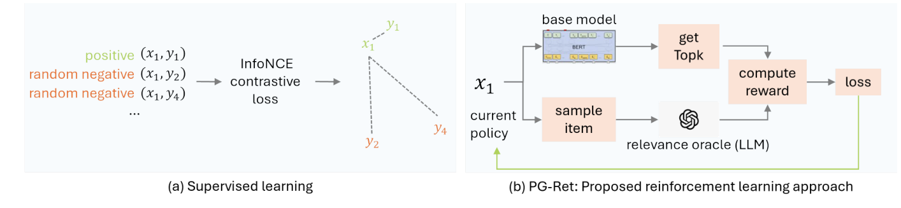
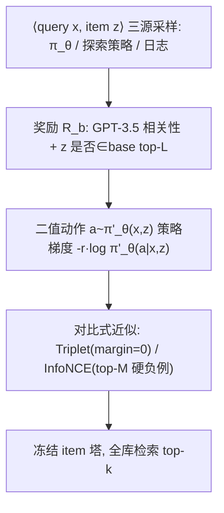

# Optimizing Novelty of Top-k Recommendations using Large Language Models and Reinforcement Learning (基于大语言模型与强化学习的 Top-k 推荐新颖性优化)

- **会议/期刊**: KDD 2024
- **作者与机构**: Amit Sharma（Microsoft Research）、Hua Li、Xue Li、Jian Jiao（Microsoft Bing Ads）
- **推荐链路定位**: 召回（Retrieval Layer，top-k = 200 送入下游精排）
- **研究方向**: 强化学习与动态探索推荐 / 大语言模型推荐
- **论文原文**: [https://arxiv.org/abs/2406.14169v1](https://arxiv.org/abs/2406.14169v1)
- **开源代码**: 暂未开源

## TL;DR (1分钟核心速览)

线上已部署 base 模型的系统若要上线"能带来新 item"的新召回模型，需优化 Novelty@k（top-k 与 base top-L 的不重叠数量），但 top-k 排序不可微、且新 item 天然无点击反馈。本文用 GPT-3.5 作相关性奖励模型补上缺失反馈，并将一次性 RL 的"query 为状态、top-k 列表为动作"重构为"⟨query,item⟩ 为状态、二值动作为动作"，理论证明收敛误差由 $O(A^2)$降为$O(A)$。在 33.2M 候选的工业 Query-Keyword 任务上，Novelty@200 从监督微调的 79.1 提升至 107.8（+36.3%），Recall@200 反升至 56.4，线上 A/B 点击产出 +0.26%。

## Background & Motivation (背景与核心矛盾)

- **主流范式**: 召回层普遍用双塔 bi-encoder + InfoNCE 对比损失，以点击/相关性为目标做全库向量近邻检索。
- **前人局限一**: Novelty@k 依赖对预测分数的 top-k 排序，是**不可微**算子，梯度无法回传；直接多目标加权或启发式（低热度、冷门类目）只能优化"新颖性代理"，无法优化"相对已部署模型的真实新颖性"。
- **前人局限二**: 真正新颖的 ⟨query,item⟩ 从未被曝光，**没有任何用户反馈**，缺少相关性信号时新颖性与相关性只能硬性对冲；靠线上探索收集反馈成本极高。
- **核心洞察 (Key Insight)**: LLM 在 query-item 相关性标注上已可媲美众包人工（>85% 准确率），且换 prompt 即可跨域复用——新颖 item 的奖励可由 LLM 廉价规模化生成。同时，策略梯度对动作空间的依赖是**平方级**的，这正是大规模召回（百万级动作）失效的根因。
- **本文切入点**: 先用 LLM 补齐新颖 item 的奖励，再把 top-k 列表奖励**可加分解**并把动作空间压成二值，使 policy gradient 在百万级候选上可用。

<figure class="paper-figure" markdown="span">
  <figcaption>图1：我们的目标是为新颖性优化检索模型。左：使用对比损失的监督学习无法直接优化新颖性，因为它涉及不可微的 top-k 排序操作。右：所提出的 RL 方法利用基于 LLM 的相关性反馈，显式优化 top-𝑘 检索项（相对于基础模型）的新颖性。</figcaption>
</figure>

## Method (核心方法设计)

### 1. 整体框架 (Overall Architecture)

以已上线的 base 模型 $\psi$与监督微调模型为初始策略$\pi_{\theta_0}$（保证$\pi_{\theta_0}$优于随机策略，即 Assumption 2 中的$\rho$有限），每步从三种来源采样 ⟨query,item⟩ 状态：当前策略$\pi_\theta$（概率$\alpha$）、独立训练器/超出 base top-L 的探索策略（$\beta$）、原始日志反馈（$1-\alpha-\beta$），以避免对 LLM 奖励过拟合而"遗忘"真实用户反馈。对每个状态查询 GPT-3.5 得相关性、结合 item 是否落在 base top-L 计算奖励$R_b$，采样二值动作$a$ 后以 REINFORCE 更新；训练时把 softmax 策略用对比损失近似（Triplet 或 InfoNCE），并**冻结 item 编码器、只更新 query 编码器**，从而无需每 batch 重算全库 item 向量，直接复用已有 ANN 索引推理。

### 2. 关键设计拆解 (Key Designs)

1. **奖励模型化与不可微目标的 RL 化（LLM as Reward）**：新颖 item 无反馈 $\to$以 LLM 作相关性 oracle，定义四项奖励：相关且不在 base top-$L$得$+1$；相关但在 top-$L$得$-0.5$；其余为$0$：
$$R_b(x,z)=\begin{cases}1 & \text{Rel}(x,z)=1,\; z\notin \text{top-}L(x,\psi)\\ -0.5 & \text{Rel}(x,z)=1,\; z\in \text{top-}L(x,\psi)\\ 0 & \text{otherwise}\end{cases}$$
即"相关但已在榜"只轻罚，避免噪声 oracle 的假阴性把策略推向无关 item；这是监督学习完全无法表达的 top-k 条件奖励。

2. **二值动作重构（把 $A^2$降为$A$）**：标准建模以 query 为状态、top-k 子集为动作，$A=\binom{|Z|}{k}$组合爆炸（Prop.1 误差$\propto SA^2\rho^2/t$）。本文改令状态为 ⟨query,item⟩、动作为"选/不选"$\{0,1\}$，奖励反对称$R((x,z),a)=aR_b-(1-a)R_b$，梯度为
$$\nabla \approx \frac{1}{B}\sum_{i}\left[a^{(i)}R_b^{(i)}-(1-a^{(i)})R_b^{(i)}\right]\nabla\log\pi'_\theta(a^{(i)}|x^{(i)},z^{(i)})$$
状态数增至 $SA$、动作数降为 2，Prop.2 给出误差$\propto SA\rho^2/t$；当$\rho^2\ll A\sim10^7$ 时收敛显著加速，且**奖励仍可依赖当前策略的 top-k 列表**，这是监督损失做不到的。

3. **训练目标、负采样与推理效率**：总损失即上式负梯度。以对比损失近似 softmax：**Conservative-Novelty** 用 Triplet（margin=0，等价 $M=1$，仅取 base top-1 为负例）、**Aggressive-Novelty** 用 InfoNCE 取 base top-$M$（$M=5$）作硬负例。因初始策略已很强，随机 in-batch 负例梯度几乎为零，故必须用 base 模型头部 item 作负例才有梯度信号。优化器 Adam，lr$10^{-5}$，batch 128；推理与 base 模型完全同构（双塔点积），仅 query 塔参数变化。

## Experimental Setup & Evaluation Protocol (实验设置与评估协议)

- **数据集与预处理**:

| 数据集 | #Train | #Test | #Actions(候选池) | 说明 |
| :--- | :---: | :---: | :---: | :--- |
| Query-Keyword（工业） | 1.23M | 6.2K | 33.2M | 搜索日志 ⟨query, ad keyword⟩，phrase-match 意图 |
| ORCAS | 1M（+16.5M 训练 base） | 8.5K | 1.07M | 过滤空 query/title，⟨query, 网页标题⟩ |
| AmazonReviews | 11K 用户 | 每用户最后 1 条 | 5K items | Industrial & Scientific 域，RecFormer 文本化 item，时间序切分 |

- **数据划分与防穿越**: 模拟"生产 + 少量新数据"范式——base 模型用历史大规模日志训练（Query-Keyword 20M+ 对；ORCAS 16.5M 对，SimCSE 初始化 5 epoch），再用 1M 新数据做新颖性微调；Amazon 按用户历史时间切分，倒第二条为验证、最后一条为测试（Leave-One-Out 式），微调集为 train+val，**测试集全程不参与训练**（固定 epoch，不早停）。
- **排名评测协议**: **Full-Ranking（全库未交互排序）**——候选池固定且训练测试一致（33.2M / 1.07M），在上亿级全库上取 top-k 打分，无负采样近似。指标：Novelty@k（相对 base top-$L$，Query-Keyword$L=200$，其余$L=50$）、Recall@k（测试点击对）、Precision@k（用**与训练不同的 GPT-4** 判定 top-3/top-1 相关性，避免自评偏差，prompt 经人工标注验证 >85% 准确）。
- **对比基线与超参**: Base 模型、监督微调（InfoNCE + 随机负例，同数据同 epoch）；另有 3 epoch / 10 epoch 两个监督版本作 Recall 对齐参照。工业任务另做 10 天线上 A/B。

## Key Experimental Results (实验关键数据)

### 1. 主实验对比 (Main Results)

Query-Keyword（工业搜索广告，$L=200$）：

| Model | Nov@50 | Nov@100 | Nov@200 | R@100 | R@200 | P@3 |
| :--- | :---: | :---: | :---: | :---: | :---: | :---: |
| Base Model | – | – | – | 45.0 | 54.1 | 63.7 |
| Supervised Finetuning | 6.6 | 22.7 | 79.1 | 49.1 | 53.5 | 65.5 |
| **PG-Ret (Conservative)** | **14.5** | **39.6** | **107.8** | 46.8 | **56.4** | **70.0** |
| PG-Ret (Aggressive) | 32.8 | 70.2 | 151.8 | 27.6 | 37.7 | 51.8 |
| Improv.（Cons. vs Sup.） | +119.7% | +74.4% | +36.3% | -4.7% | +5.4% | +6.9% |

ORCAS 与 AmazonReviews：

| Dataset / Model | Nov@10 | Nov@20 | Nov@50 | Recall | Precision |
| :--- | :---: | :---: | :---: | :---: | :---: |
| ORCAS Base | – | – | – | 81.0 (R@50) | 70.0 (P@1) |
| ORCAS SupFT (3 ep) | 0.007 | 0.04 | 0.65 | 79.7 | 69.9 |
| ORCAS SupFT (10 ep) | 0.07 | 0.33 | 2.82 | 78.7 | 68.4 |
| **ORCAS PG-Ret (Cons.)** | **0.17** | **0.47** | 2.64 | **79.8** | **68.7** |
| ORCAS PG-Ret (Aggr.) | 0.33 | 0.85 | **4.03** | 78.3 | 67.9 |
| Amazon SupFT | 1.9 | 5.8 | 24.4 | 22.6 (R@50) | – |
| **Amazon PG-Ret (Cons.)** | **3.6** | **9.5** | **32.4** | 22.4 | – |

### 2. 消融实验 (Ablation Study)

原文未设正式消融，以"初始化 + 负例策略"变体对比替代：

| 变体 | 初始化 | 负例/损失 | Nov@200(工业) | R@200 | P@3 |
| :--- | :--- | :--- | :---: | :---: | :---: |
| w/o RL（纯监督） | base | 随机 in-batch + InfoNCE | 79.1 | 53.5 | 65.5 |
| w/o 二值重构（列表动作） | base | – | 未报告（$A=\binom{|Z|}{k}$ 不可训） | – | – |
| w/o LLM 奖励（仅日志） | base | – | 新颖 item 无奖励，退化为监督 | – | – |
| PG-Ret Cons. | SupFT | Triplet, $M=1$ | 107.8 | 56.4 | 70.0 |
| PG-Ret Aggr. | SupFT | InfoNCE, $M=5$ | 151.8 | 37.7 | 51.8 |

### 3. 关键实验发现 (Key Findings)

1. **新颖性收益主要来自"线上 top-k 条件奖励"而非更强编码器**：同等数据、同等编码器容量下，监督微调只把 Nov@200 从 0（base 自身）推到 79.1，而 PG-Ret 达 107.8，说明增益源自 RL 目标而非表征能力；且 Cons. 版本 P@3 反而比 base 高 6.3 个点（70.0 vs 63.7），提示新颖性惩罚可使模型跳出单词面重叠的局部最优。
2. **负例强度是新颖性—精度的单旋钮**：$M=1$（Triplet）时 Nov@50 = 14.5 且 R@200 微升 4.3%；$M=5$（InfoNCE）时 Nov@50 飙至 32.8 但 R@200 暴跌 30.3%（56.4→37.7）。即"用 base 头部 item 做硬负例"是有效手段，但强度过大会摧毁相关性，需按下游可容忍的 Recall 损失选定$M$。
3. **跨域与线上均成立**：ORCAS 在 Recall 略优（79.8 vs 79.7）前提下 Nov@50 是监督版的 4.1 倍；Amazon 在 Recall 仅降 0.9% 时 Nov@10 提升 89.5%；线上 10 天 A/B 中检索密度 +1.0%、覆盖率 +0.14%、每 query 广告点击数 +0.26%，证实 LLM 判定的"新颖且相关"确为用户认可。

## Highlights & Limitations (亮点、对比与审稿批判)

- **与代表作对比**: 早期 RL 新颖性工作（如 popularity/diversity 优化）只能优化"低热度"等**代理指标**，且多在列表级小动作空间或从零训练；本文用 LLM 奖励消除代理鸿沟，并用二值重构解决百万动作空间的收敛问题，与"LLM 直接当推荐器"路线（推理昂贵）互补——LLM 只离线当 reward model，线上仍是轻量双塔。
- **可迁移亮点**: ①"状态 = ⟨query,item⟩ + 二值动作"的降维技巧，可套用于任何 top-k 不可微指标（覆盖度、EE、公平性）；②冻结 item 塔只训 query 塔 + 复用 base 头部作硬负例，是低成本落地范式。
- **审稿级局限批判**: ①主指标 Novelty 与 P@k 均依赖 GPT-3.5/4 判定，奖励噪声与评测偏置耦合，"新颖即更好"未被用户留存等长期指标验证；②缺少正式消融与 $M$、$\alpha/\beta$、$\rho$的敏感性分析，$M=5$时 Recall 崩塌说明方法对负例强度高度敏感；③理论界依赖"初始策略优于随机且$\rho^2\ll A$"的假设，对$\rho$ 的实际估计未给出测度方法。

## Rating (四维评分)

- **方法创新性 (Novelty)**: ⭐⭐⭐⭐ （把 top-k 不可微奖励重构为二值动作并将收敛误差从 $A^2$降到$A$，有定理支撑且工程直觉清晰）
- **评估协议与实验扎实度 (Protocol & Experiments)**: ⭐⭐⭐ （三数据集全库 Full-Ranking + 10 天线上 A/B 较扎实，但无正式消融、主指标依赖 LLM 法官）
- **写作与数学规范度 (Clarity & Rigor)**: ⭐⭐⭐⭐ （两个 Proposition 与算法伪代码链条完整，奖励函数设计动机解释到位；$\rho$ 的实证估计略欠）
- **工业落地与复现价值 (Industrial & Practical Value)**: ⭐⭐⭐⭐ （仅改 query 塔、复用 ANN 索引、已上线验证 +0.26% 点击，落地成本极低；可惜未开源）

