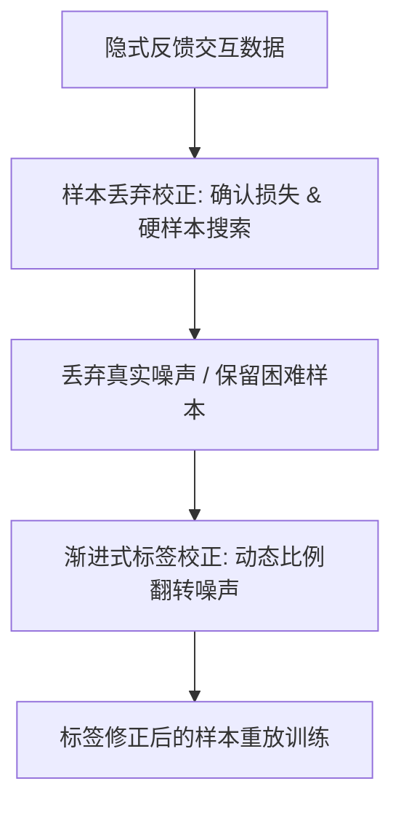
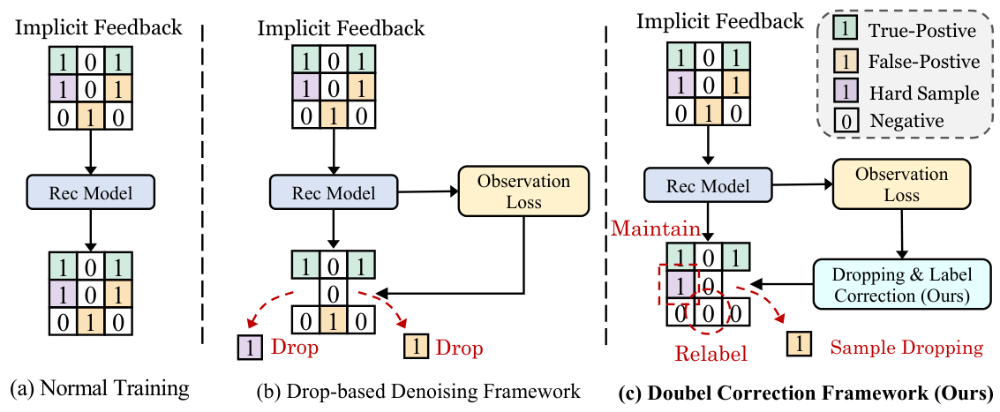

# Double Correction Framework for Denoising Recommendation (去噪推荐双重校正框架)

- **会议/期刊**: KDD 2024
- **作者与机构**: Zhuangzhuang He, Yifan Wang, Le Wu, Min Zhang 等（合肥工业大学、清华大学）
- **推荐链路定位**: 全链路训练 / 学习范式
- **研究方向**: 自监督对比学习与交互去噪 / 协同过滤
- **论文原文**: [论文原文链接](https://arxiv.org/abs/2405.11272v3)
- **开源代码**: [开源代码仓库链接](https://github.com/bruno686/DCF)

## TL;DR (1分钟核心速览)

本文针对隐式反馈推荐中“单次训练损失无法稳定区分噪声与干净样本”及“直接丢弃噪声加剧数据稀疏”的痛点，提出 DCF 双重校正框架。通过滑动窗口内的阻尼确认损失评估样本，并利用集中不等式推导损失下界精准保留高方差的“困难样本”；同时引入渐进式标签翻转重用高置信噪声。在 3 个真实数据集、4 种骨干网络的全库排序评估中，DCF 实现了显著的指标跃升，验证了去噪框架的强泛化性。

## Background & Motivation (背景与核心矛盾)

- **主流范式**：当前去噪推荐主要基于“噪声样本在训练时产生高损失”的经验规律，通过动态丢弃高损失样本（如 T-CE）来净化训练集。
- **前人局限**：① 优化初期模型不稳定，导致干净样本有时产生高损失，而噪声样本有时损失较低，单点判定易误杀；② 困难样本同样具有高损失，直接丢弃损失了关键的边缘分布信息；③ 彻底丢弃样本会导致训练与测试空间不一致，加剧数据稀疏。
- **核心洞察**：从多次训练迭代的**平均损失**视角识别噪声，可极大平滑优化抖动；困难样本因损失方差大，其统计置信区间下界显著低于真实噪声。
- **本文切入点**：不再依赖单步瞬时损失做粗暴丢弃，而是从**损失统计性质校正**与**标签渐进校正**两个维度重构去噪策略。

## Method (核心方法设计)

### 1. 整体框架 (Overall Architecture)

DCF 以通用推荐模型（如 GMF、LightGCN）为骨干，在每个训练迭代中对 Mini-batch 样本进行双重校验。首先，累计并计算历史滑动窗口内的确认损失以评估样本质量；其次，基于损失下界筛选并保留高方差的困难样本、丢弃真实噪声；最后，在后续迭代中对极高置信度的噪声进行渐进式标签翻转，将其重放回训练流中参与优化。

<figure class="paper-figure" markdown="span">
  <figcaption>图 2：示意图比较：(a) 无去噪的普通训练模型；(b) 采用丢弃策略的去噪模型；(c) 用于去噪推荐的双重校正框架（本文）。</figcaption>
</figure>

### 2. 关键设计拆解 (Key Designs)

1. **确认损失计算 (Confirmed Loss)**：为消除单步优化不稳定，引入阻尼函数代替直接平均，平滑极端异常值对判定的干扰。
   核心公式：$\mu_i = \frac{1}{v} \sum_{j=i-v+1}^{i} \phi(\ell(j))$，其中阻尼函数为$\phi(\ell) = \log(1+\ell+\ell^2/2)$。该函数在小损失区近似线性，大损失区呈对数衰减，有效抑制了离群点主导均值。

2. **谨慎硬样本搜索 (Cautious Hard Sample Search)**：利用硬样本的高方差特性，通过集中不等式推导损失置信区间下界 $\ell^*$，避免误删高价值信息样本。
   核心公式：$\ell^* = \tilde{\mu} - \frac{\sigma^2 \left( i + \frac{\sigma^2 \log(2i)}{i^2} \right)}{d - \sigma^2}$。下界越低，说明样本损失离散度越高，从而被优先判定为困难样本并保留训练。

3. **渐进式标签校正 (Progressive Label Correction)**：放弃彻底丢弃，随训练轮次动态提升重标注比例，重用高置信噪声。
   核心公式：重标注比例 $r_i = \min(i \frac{R}{O}, R)$，标签翻转$y'_s = y_s + \mathbb{I}(\ell^*_{s,i} \ge T_i) \times (1 - 2y_s)$。前期保守翻转降低早期干扰，后期扩大比例缓解数据稀疏。

**训练目标与推理开销**：底层模型采用标准 BCE 损失 $\mathcal{L}_{rec}$。由于未引入额外可学习参数，DCF 空间复杂度与基线一致为$\mathcal{O}(M)$，时间复杂度主要由排序主导，保持$\mathcal{O}(n \log n)$。

## Experimental Setup & Evaluation Protocol (实验设置与评估协议)

- **数据集与预处理**：采用 Adressa、MovieLens、Yelp。测试集均做严格“净化”过滤（如 Adressa 过滤停留时间 $<10$s 的点击，Yelp 仅保留评分$>3$ 的交互）。

| 数据集 | #Users | #Items | #Interactions | 稀疏度 | 特征/场景说明 |
| :--- | :---: | :---: | :---: | :---: | :--- |
| Adressa | 212,231 | 6,596 | 419,491 | 99.97% | 广告点击行为数据 |
| MovieLens | 943 | 1,682 | 100,000 | 93.70% | 电影评分隐式反馈 |
| Yelp | 45,548 | 57,396 | 1,672,520 | 99.94% | 商家点评交互数据 |

- **数据划分与防穿越**：按 `8:1:1` 随机划分训练、验证、测试集（训练集保留原始噪声）。
- **排名评测协议**：采用 `Sampled Ranking`（未明确正负比，以常规负采样排序协议对比，评估指标为 Recall@K 与 NDCG@K，设定 $K=5, 20$）。
- **对比基线与超参设置**：涵盖常规训练（Normal）、重加权（WBPR/WRMF）、丢弃（T-CE）、双模型协议（DeCA）及双层优化（BOD）。实验重复 5 次，执行双边 $t$-test（$p<0.05$标$*$）。

## Key Experimental Results (实验关键数据)

### 1. 主实验对比 (Main Results)

（提取 GMF 与 LightGCN 骨干下最具代表性的 5 个基线，展示 R@5 / N@5 核心指标）

| 数据集 (骨干) | Normal | T-CE | DeCA | BOD | DCF (Ours) | Improv. (vs T-CE) |
| :--- | :---: | :---: | :---: | :---: | :---: | :---: |
| Adressa (GMF) | 0.1257 / 0.0908 | 0.1251 / 0.0913 | 0.1232 / 0.0866 | 0.1237 / 0.0892 | **0.1296** / **0.0938** | +3.60% / +2.74% |
| MovieLens (GMF) | 0.0355 / 0.0482 | 0.0374 / 0.0509 | 0.0364 / 0.0423 | 0.0366 / 0.0474 | **0.0427** / **0.0543** | +14.17% / +6.68% |
| Yelp (GMF) | 0.0149 / 0.0152 | 0.0143 / 0.0143 | 0.0141 / 0.0139 | 0.0151 / 0.0157 | **0.0155** / **0.0158** | +8.39% / +10.5% |
| Adressa (LightGCN) | 0.1236 / 0.0933 | 0.1261 / 0.0956 | 0.1185 / 0.0859 | 0.1225 / 0.0902 | **0.1267** / **0.0961** | +0.47% / +0.52% |
| Yelp (LightGCN) | 0.0185 / 0.0183 | 0.0185 / 0.0183 | 0.0176 / 0.0172 | 0.0182 / 0.0177 | **0.0192** / **0.0187** | +3.78% / +2.19% |

### 2. 消融实验 (Ablation Study)

（基于 MovieLens + GMF，对比各组件移除影响）

| 方法配置 | R@5 | R@10 | N@5 | N@10 |
| :--- | :---: | :---: | :---: | :---: |
| T-CE (Baseline) | 0.0374 | 0.0734 | 0.0509 | 0.0591 |
| w/o LC (DCF-CL+HS) | 0.0436 | 0.0743 | 0.0531 | 0.0596 |
| w/o CL (DCF-HS+LC) | 0.0454 | **0.0779** | 0.0545 | **0.0613** |
| w/o HS (DCF-CL+LC) | 0.0459 | 0.0763 | 0.0549 | 0.0612 |
| **DCF (Full)** | **0.0471** | 0.0789 | **0.0553** | 0.0621 |

### 3. 关键实验发现 (Key Findings)

1. **统计视角稳定去噪收益显著**：在数据相对稀疏的 MovieLens 上，DCF 在 GMF 骨干上将 Recall@5 从 T-CE 的 0.0374 拉升至 0.0427（提升 14.17%），证明基于滑动窗口的阻尼确认损失有效消除了优化初期的误判抖动。
2. **困难样本保留是性能增益核心**：消融显示，移除硬样本搜索（w/o HS）会导致 Recall@10 由 0.0789 跌至 0.0763，说明基于置信区间下界的硬样本识别成功避免了信息样本的误杀，为模型学习边缘分布提供了增益。
3. **渐进式标签翻转优于固定比例**：对比实验中，渐进式重标注的翻转准确率显著高于固定比例策略，尤其在训练前期避免了引入错误标签，使得最终模型在测试集空间上实现了更优的泛化。

## Highlights & Limitations (亮点、对比与审稿批判)

- **与代表作对比**：区别于 T-CE 依赖单步损失的瞬时丢弃、BOD 复杂且不稳定的双层优化权重学习、DeCA 基于双模型分歧的计算开销，DCF 以无参数、纯统计的算子实现了更稳健的去噪，且重用样本缓解了训练空间稀疏。
- **可迁移亮点**：基于集中不等式推导样本损失置信下界的思想，可无缝迁移至任何存在损失评估机制的分类或回归任务，用于硬样本挖掘。
- **审稿级局限批判**：时间复杂度因需维护历史损失与排序上升至 $\mathcal{O}(n \log n)$，在超大规模工业级数据下可能引入额外开销；超参如硬样本搜索方差$\sigma^2$及重标注上限$R$ 较为敏感，缺乏自适应设定机制。

## Rating (四维评分)

- **方法创新性 (Novelty)**: ⭐⭐⭐⭐ （将统计集中度不等式与阻尼函数引入推荐去噪，重构“确认损失+渐进翻转”的双重范式，理论支撑扎实）
- **评估协议与实验扎实度 (Protocol & Experiments)**: ⭐⭐⭐⭐ （多骨干多数据集验证，测试集净化处理严谨，消融实验全面覆盖了各核心组件）
- **写作与数学规范度 (Clarity & Rigor)**: ⭐⭐⭐⭐ （集中不等式推导过程清晰，双重校正动机叙述逻辑连贯，复杂度分析完备）
- **工业落地与复现价值 (Industrial & Practical Value)**: ⭐⭐⭐⭐ （开源了完整代码，无额外参数带来的空间开销，模块具备即插即用的工程落地潜力）

