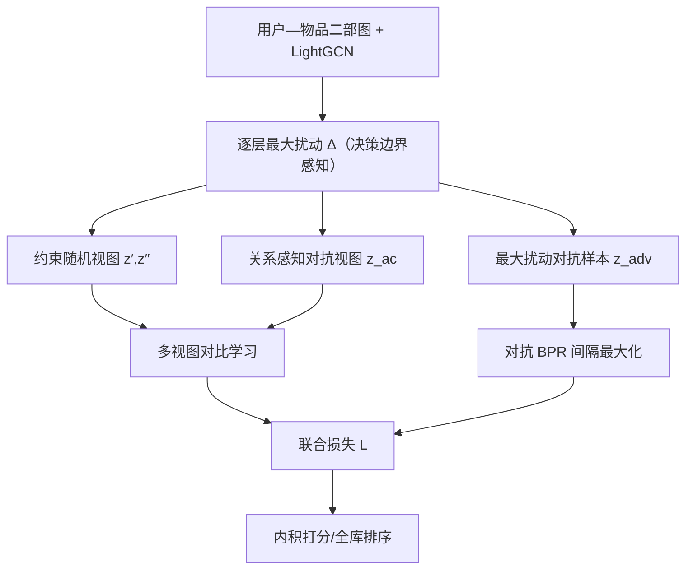
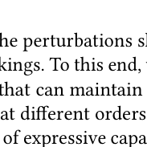

# Towards Robust Recommendation via Decision Boundary-aware Graph Contrastive Learning (面向鲁棒推荐的决策边界感知图对比学习)

- **会议/期刊**: KDD 2024
- **作者与机构**: Jiakai Tang, Sunhao Dai, Zexu Sun, Xu Chen, Jun Xu 等；中国人民大学高瓴人工智能学院、快手科技
- **推荐链路定位**: 召回/排序（LightGCN-based top-N 推荐）
- **研究方向**: 自监督对比学习与交互去噪 / 图神经网络与知识图谱推荐
- **论文原文**: [论文原文链接](https://arxiv.org/abs/2407.10184v2)
- **开源代码**: [RGCL 项目页](https://tangajakai.github.io/RGCL/)（元数据另检测到 `https://github.com/wenyuer/POG`，疑似错配，需核验）

## TL;DR (1分钟核心速览)

针对现有图对比推荐在语义不变性与视图硬度间失衡、且忽略用户—用户/物品—物品全局关系的问题，RGCL 用决策边界感知扰动约束增广空间，以关系感知对抗对比生成难视图，再用最大扰动对抗样本做间隔最大化。在 5 个公开数据集、Full-Ranking、R@10/20/50 与 N@10/20/50 上，较 12 个基线最高相对提升 14.14%（Kuaishou R@10），ML-1M R@20 提升 3.69%。

## Background & Motivation (背景与核心矛盾)

- **主流范式**: GNN 推荐以 LightGCN 为骨干，GCL 通过随机/启发式增广构造正负视图，缓解稀疏与低度节点表征退化。
- **前人局限**: hardness-driven 方法（SGL/GraphCL）盲目追求难样本，可能删掉任务关键节点/边；rationality-driven 方法（SimGCL/RocSE）仅加微小噪声，难样本不足，且两类方法均假设实体独立。
- **核心洞察 (Key Insight)**: 对抗鲁棒性给出的“最大可容忍扰动边界”恰可作为对比增广的可行探索空间，既保留任务语义，又动态匹配模型能力；高阶层表征更适合加扰，初始特征应保持干净。
- **本文切入点**: 以决策边界感知扰动约束随机增广，用关系感知对抗对比构造难正/负视图，再用最大扰动对抗样本最大化样本到决策边界的间隔。

## Method (核心方法设计)

### 1. 整体框架 (Overall Architecture)

输入用户—物品二部图，经 LightGCN 逐层传播得到 $L$层表征；对每层高阶表征求最大可容忍扰动$\Delta_u^{(k)}$，据此投影约束随机视图$z'_u,z''_u$。同时最大化关系感知对比损失生成实例级对抗扰动$\eta$，得到第三视图$z_u^{ac}$；再用最大扰动构造对抗样本$z_u^{adv}$ 做 BPR 间隔最大化。最终联合优化 BPR、对比与对抗三项损失，推理仍用原始 LightGCN 表征内积，不增加在线参数与结构。

<figure class="paper-figure" markdown="span">
  <figcaption>图2：所提出的动态决策边界感知图对比学习框架RGCL的总体框架。</figcaption>
</figure>

### 2. 关键设计拆解 (Key Designs)

1. **决策边界感知扰动约束（保语义的增广空间）**：现有随机扰动对所有实例一视同仁，脆弱节点易被破坏语义。RGCL 对用户 $u$的正负物品对定义排序函数$g(u,i^+,i^-)=\langle\tilde{z}_u,z_{i^+}\rangle-\langle\tilde{z}_u,z_{i^-}\rangle$，求维持排序的最大扰动方向：
   $\Delta_u^{(k)}=-\frac{g(u,i^+,i^-)}{\|f(h_u^{(k)})\|_1}\cdot\mathrm{sign}(f(h_u^{(k)}))$，
   其中 $f=\partial g/\partial h_u^{(k)}$。再把随机扰动投影到该$\ell_\infty$球内：$\tilde{r}_u^{(l)}=\Pi(r_u^{(l)})=\min(|\Delta_u^{(l)}|,\max(-|\Delta_u^{(l)}|,r_u^{(l)}))$。直觉：最难方向仍保排序，其他方向在球内更安全，兼顾硬度与合理性。

2. **关系感知对抗对比视图（打破实体独立假设）**：传统 GCL 只对同一节点做增广，忽略全局用户/物品关系。RGCL 最大化对比损失以混淆实例身份，用 FGSM 一阶近似生成实例级扰动：
   $\eta_u^{(l)}=\delta_u^{(l)}\cdot\mathrm{sign}(\partial\mathcal{L}_{UCL}(\tilde{z}_u,z_u'')/\partial\eta_u^{(l)})$，
   并合成 $z_u^{ac}=\frac{1}{L+1}[h_u^{(0)}+\sum_{l=1}^{L}(h_u^{(l)}+\tilde{r}_u^{(l)}\odot\mathrm{sign}(\eta_u^{(l)}))]$。该视图由 user-user/item-item 全局关系驱动，且随训练动态调整，难而不过界。

3. **间隔最大化与联合训练**：GCL 过度追求均匀性会压缩样本到决策边界的间隔。RGCL 用最大扰动 $\Delta$构造$z_u^{adv}$，优化对抗 BPR：
   $\mathcal{L}_{ADV}=-\sum_{u}\sum_{i^+\in I_u^+}\sum_{i^-\in I_u^-}\ln\sigma(\hat{r}_{u,i^+}^{adv}-\hat{r}_{u,i^-}^{adv})$，
   总损失 $\mathcal{L}=\mathcal{L}_{BPR}+\mu\mathcal{L}_{ADV}+\alpha\mathcal{L}_{CL}$。对比侧用三元组$(z',z'',z^{ac})$两两对齐；BPR 每正样本采一个未观测负样本，对比负样本为 batch 内其他用户/物品。无额外可学习参数，推理复杂度同 LightGCN，训练复杂度$O((L|E|+B^2)d)$。

## Experimental Setup & Evaluation Protocol (实验设置与评估协议)

- **数据集与预处理**: 五个公开数据集：ML-1M、Alibaba、Kuaishou、Gowalla、Yelp。正文未列统计量，过滤/预处理见附录 C.1；下表标注类型与使用方式：

| 数据集 | 领域/来源 | #Users | #Items | #Interactions | 过滤/说明 |
| :--- | :--- | :---: | :---: | :---: | :--- |
| ML-1M | 电影 | — | — | — | 公开基准，附录 C.1 |
| Alibaba | 电商 | — | — | — | 公开/工业数据，附录 C.1 |
| Kuaishou | 短视频/工业 | — | — | — | 公开/工业数据，附录 C.1 |
| Gowalla | 地点签到 | — | — | — | 公开基准，附录 C.1 |
| Yelp | 本地生活 | — | — | — | 公开基准，附录 C.1 |

- **数据划分与防穿越 (Splitting Strategy)**: 正文仅明确标准 GCL 推荐评测流程，具体划分（LOO/比例）在附录 C.3；测试阶段严格对未交互物品全库排序，避免采样泄露。
- **排名评测协议 (Ranking Protocol)**: 无偏 `Full-Ranking`，候选为测试用户全部未交互物品；指标 NDCG@K、Recall@K，$K\in\{10,20,50\}$。
- **对比基线与超参设置**: 12 个基线，含 BPRMF、NeuMF、GCMC、NGCF、GCCF、LightGCN、GraphCL、SGL、LightGCL、CGI、RocSE、SimGCL；LightGCN 为骨干，$d$按附录 C.3，$L\in\{1,2,3\}$，$\tau,\alpha,\epsilon$网格搜索；多数$p<0.01$，显著性充分。

## Key Experimental Results (实验关键数据)

### 1. 主实验对比 (Main Results)

下表摘取 ML-1M 与 Yelp 的 R@20/N@20（完整 5 数据集见原文表 1）；RGCL 在全部数据集均优于最强基线。

| 模型 | ML-1M R@20 | ML-1M N@20 | Yelp R@20 | Yelp N@20 |
| :--- | :---: | :---: | :---: | :---: |
| BPRMF | 0.2582 | 0.2576 | 0.0844 | 0.0509 |
| NGCF | 0.2673 | 0.2647 | 0.0842 | 0.0507 |
| LightGCN | 0.2680 | 0.2670 | 0.1001 | 0.0614 |
| SGL | 0.2745 | 0.2725 | 0.1098 | 0.0677 |
| LightGCL | 0.2722 | 0.2693 | 0.1021 | 0.0624 |
| RocSE | 0.2699 | 0.2676 | 0.1052 | 0.0650 |
| SimGCL | 0.2798 | 0.2758 | 0.1182 | 0.0736 |
| **RGCL** | **0.2901** | **0.2821** | **0.1191** | **0.0744** |
| **Improv.** | **+3.69%** | **+2.29%** | **+0.78%** | **+1.09%** |

### 2. 消融实验 (Ablation Study)

| 变体 | ML R@20 | ML N@20 | Yelp R@20 | Yelp N@20 |
| :--- | :---: | :---: | :---: | :---: |
| w/o cons | 0.2882 | 0.2798 | 0.1185 | 0.0733 |
| w/o rand | 0.2838 | 0.2793 | 0.1183 | 0.0736 |
| w/o ac | 0.2872 | 0.2813 | 0.1182 | 0.0737 |
| w/o adv | 0.2832 | 0.2801 | 0.1180 | 0.0737 |
| **RGCL** | **0.2901** | **0.2821** | **0.1191** | **0.0744** |

### 3. 关键实验发现 (Key Findings)

1. **全库排序下全面领先**：RGCL 在 5 数据集、12 基线上均取得最佳；Kuaishou R@10 达 0.0899（+14.14%），Alibaba N@10 达 0.0528（+5.00%），ML-1M R@20 达 0.2901（+3.69%），且多数 $p<0.01$。
2. **对抗间隔项是鲁棒性关键**：去掉 $\mathcal{L}_{ADV}$ 后 ML-1M R@20 从 0.2901 降至 0.2832（-2.4%），Yelp N@20 从 0.0744 降至 0.0737；仅优化 GCL 会压缩决策边界间隔。
3. **约束与难视图均不可缺**：去掉扰动约束 ML R@20 降至 0.2882（-0.65%），去掉关系感知对抗视图降至 0.2872（-0.99%），去掉随机扰动降至 0.2838；稀疏用户/长尾物品分组提升更显著（原文图 4）。

## Highlights & Limitations (亮点、对比与审稿批判)

- **与代表作对比 (vs. Prior Work)**: SGL 用边/节点 dropout 造难视图，易删任务语义；SimGCL 用均匀微扰保语义，但难样本不足且对 $\epsilon$ 敏感；LightGCL 的静态 SVD 视图不随训练演化。RGCL 以决策边界约束探索空间，并用动态对抗视图补足硬度。
- **可迁移亮点**: 将随机增广投影到“最大保序扰动球”内，可直接迁移到其他对比推荐；用对抗对比损失生成实例级难视图，可替代手工启发式增广。
- **审稿级局限批判**: 训练需多视图前向与符号梯度，计算开销高于 SimGCL；评测仅离线 Full-Ranking，无线上 A/B；$\tau,\alpha,L$ 在不同数据集上敏感，理论分析依赖局部线性/二阶可微假设。

## Rating (四维评分)

- **方法创新性 (Novelty)**: ⭐⭐⭐⭐ （把决策边界扰动与关系感知对抗视图结合，理论给出硬度感知与间隔最大化解释）
- **评估协议与实验扎实度 (Protocol & Experiments)**: ⭐⭐⭐⭐ （5 数据集、12 基线、Full-Ranking、显著性检验与消融完整；划分细节略欠透明）
- **写作与数学规范度 (Clarity & Rigor)**: ⭐⭐⭐⭐ （公式清晰、推导完整；部分符号与附录依赖较多）
- **工业落地与复现价值 (Industrial & Practical Value)**: ⭐⭐⭐ （推理零额外开销、易挂 LightGCN；训练对抗开销与超参调优成本需评估）

