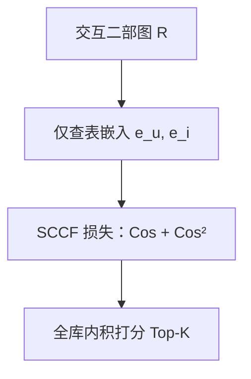

# Unifying Graph Convolution and Contrastive Learning in Collaborative Filtering (统一图卷积与对比学习的协同过滤)

- **会议/期刊**: KDD 2024
- **作者与机构**: Yihong Wu, Le Zhang, Fengran Mo, Tianyu Zhu, Weizhi Ma, Jian-Yun Nie；Université de Montréal / Mila / Beihang University / Tsinghua University
- **推荐链路定位**: 召回
- **研究方向**: 自监督对比学习与交互去噪 / 协同过滤
- **论文原文**: [论文原文链接](https://arxiv.org/abs/2406.13996v2)
- **开源代码**: [开源代码仓库链接](https://github.com/wu1hong/SCCF)

## TL;DR (1分钟核心速览)

本文针对图协同过滤中图卷积层被默认视为高阶连通建模必需、但易过平滑且机理不清的痛点，理论证明对比损失梯度等价于“对齐低通+均匀高通”双重图卷积；据此提出仅查表嵌入与改良对比损失的SCCF。在Beauty/Gowalla/Yelp2018/Pinterest按用户80/10/10划分、全库排序下，Recall@20与NDCG@20均达最优，Yelp2018 NDCG@20较DAU提升6.4%。

## Background & Motivation (背景与核心矛盾)

- **主流范式**: 图CF用LightGCN多层邻域传播建模高阶连通；对比CF用Sampled Softmax、DirectAU等对齐/均匀损失增强表征。
- **前人局限**: 图卷积层离散且不可控，层数增加易过平滑；对比学习虽有效，但其学习动力学、平衡态及与图卷积的关系缺乏CF场景下的理论解释。
- **核心洞察 (Key Insight)**: 对比损失的梯度更新可分解为两条消息传递：正样本对应用户-物品图做低通平滑，负样本对应亲和图做高通扩散；平衡时模型估计须匹配经验交互分布。
- **本文切入点**: 既然对比学习本身可堆叠出高阶连通，图卷积层并非必需；去掉GCN，仅保留naive embedding与改良对比损失。

## Method (核心方法设计)

### 1. 整体框架 (Overall Architecture)

SCCF只维护用户/物品查表嵌入，不进行任何图传播层。训练时对batch内正样本最大化余弦相似度，并以batch内所有用户-物品组合作为负样本做均匀化；相似度由一阶余弦与二阶余弦核混合，温度$\tau$调节难负样本权重。推理时切回内积打分以保留用户/物品活跃度幅度，全库排序输出Top-K。整体训练复杂度主要受batch内全对负样本影响，推理仅需$O(1)$查表。

### 2. 关键设计拆解 (Key Designs)

1. **对比损失=双重图卷积**：将损失拆为$\ell=\ell_{\text{align}}+\ell_{\text{uniform}}$，其中$\ell_{\text{align}}=-\frac{1}{|\mathcal{D}|}\sum_{(u,i)\in\mathcal{D}}\boldsymbol{e}_u^\top\boldsymbol{e}_i$，$\ell_{\text{uniform}}=\log\sum_{(u,i)\in\mathcal{U}\times\mathcal{I}}d_ud_i\exp(\boldsymbol{e}_u^\top\boldsymbol{e}_i)$。其梯度更新为$\boldsymbol{E}(t+1)=(\boldsymbol{I}+\gamma\boldsymbol{A}''(t))\boldsymbol{E}(t)$，$\boldsymbol{A}''=\boldsymbol{A}/|\mathcal{D}|-\boldsymbol{A}'(t)$；前项低通平滑，后项高通扩散。平衡条件$\boldsymbol{A}'=\boldsymbol{A}/|\mathcal{D}|$给出$\boldsymbol{E}\boldsymbol{E}^\top=\log(\boldsymbol{D}^{-1}\boldsymbol{A}\boldsymbol{D}^{-1})-\log|\mathcal{D}|+\log Z$，即隐式矩阵分解。
2. **高阶连通可由对比学习堆叠实现**：迭代展开更新得$\boldsymbol{E}(T)=\prod_{t=0}^{T-1}(\boldsymbol{I}+\gamma\boldsymbol{A}''(t))\boldsymbol{E}(0)$，等价于$T$层无线性/非线性的图卷积。负样本防止嵌入坍缩，使平滑度可渐进控制；而GCN层离散叠加不可控，层数过多反而过平滑，因此图卷积层非高阶连通建模必需。
3. **SCCF损失与训练/推理错配**：相似度定义为$\text{sim}(\boldsymbol{e}_u,\boldsymbol{e}_i)=\exp(\frac{\boldsymbol{e}_u^\top\boldsymbol{e}_i}{\tau\|\boldsymbol{e}_u\|_2\|\boldsymbol{e}_i\|_2})+\exp(\frac{1}{\tau}(\frac{\boldsymbol{e}_u^\top\boldsymbol{e}_i}{\|\boldsymbol{e}_u\|_2\|\boldsymbol{e}_i\|_2})^2)$，损失为$\ell=-\frac{1}{m}\sum_{(u,i)\in B}\log\text{sim}(\boldsymbol{e}_u,\boldsymbol{e}_i)+\log(\frac{1}{m^2}\sum_{(u',i')\in B_N}\text{sim}(\boldsymbol{e}_{u'},\boldsymbol{e}_{i'}))$。训练用余弦抑制流行度幅度偏置，推理用内积恢复热度信号；无额外负采样器，batch内全对负样本即负例集合。

## Experimental Setup & Evaluation Protocol (实验设置与评估协议)

- **数据集与预处理**: 四个公开隐式反馈数据集，未额外K-core过滤；统计如下：

| 数据集 | #Users | #Items | #Interactions | 稀疏度 |
| :--- | :---: | :---: | :---: | :---: |
| Amazon-Beauty | 22,363 | 12,101 | 198,502 | 99.93% |
| Gowalla | 29,858 | 40,891 | 1,027,370 | 99.92% |
| Yelp2018 | 31,668 | 38,048 | 1,561,406 | 99.87% |
| Pinterest | 55,187 | 9,912 | 1,445,622 | 99.74% |

- **数据划分与防穿越 (Splitting Strategy)**: 每个用户交互随机按80%/10%/10%划分为训练/验证/测试，属比例划分；验证集选最优epoch。
- **排名评测协议 (Ranking Protocol)**: 基于RecBole的Top-K评测，按默认全库未交互物品排序（Full-Ranking），非采样排序；报告Recall@20与NDCG@20。
- **对比基线与超参设置**: 基线含BPR、DAU、LightGCN-B/D、Mult-VAE、SimpleX、NGCF、DGCF、SGL；嵌入维度统一$d=64$，Xavier初始化，训练300 epoch；SCCF用SGD，batch size分别为10k/100k/100k/60k，$\tau$为0.25/0.1/0.2/0.1；显著性采用$t$-test，$p<0.05$。

## Key Experimental Results (实验关键数据)

### 1. 主实验对比 (Main Results)

| 方法 | Beauty R@20 / N@20 | Gowalla R@20 / N@20 | Yelp2018 R@20 / N@20 | Pinterest R@20 / N@20 |
| :--- | :---: | :---: | :---: | :---: |
| BPR | 0.1210 / 0.0564 | 0.1303 / 0.0771 | 0.0612 / 0.0375 | 0.1278 / 0.0645 |
| DAU | 0.1344 / 0.0665 | 0.2020 / 0.1145 | 0.1097 / 0.0684 | 0.1477 / 0.0834 |
| LGCN-D | 0.1437 / 0.0683 | 0.1994 / 0.1136 | 0.1070 / 0.0675 | 0.1764 / 0.0921 |
| Mult-VAE | 0.1114 / 0.0541 | 0.1775 / 0.1008 | 0.0922 / 0.0559 | 0.1692 / 0.1010 |
| NGCF | 0.1072 / 0.0490 | 0.1580 / 0.0904 | 0.0808 / 0.0485 | 0.1334 / 0.0675 |
| DGCF | 0.1142 / 0.0538 | 0.1825 / 0.1076 | 0.0852 / 0.0527 | 0.1571 / 0.0807 |
| SGL | 0.1387 / 0.0681 | 0.2139 / 0.1271 | 0.1064 / 0.0669 | 0.1775 / 0.0952 |
| **SCCF** | **0.1470 / 0.0713** | **0.2185 / 0.1304** | **0.1160 / 0.0728** | **0.1776 / 0.1035** |

SCCF相对最强基线：Beauty Recall +2.3%、NDCG +4.4%；Gowalla Recall +2.2%、NDCG +2.6%；Yelp2018 Recall +5.7%、NDCG +6.4%；Pinterest Recall仅+0.06%，NDCG +2.5%。

### 2. 消融实验 (Ablation Study)

| 变体 | Beauty R/N | Gowalla R/N | Yelp2018 R/N | Pinterest R/N |
| :--- | :---: | :---: | :---: | :---: |
| SCCF full (Cos→IP + Cos²) | **0.1470 / 0.0713** | **0.2185 / 0.1304** | **0.1160 / 0.0728** | **0.1776 / 0.1035** |
| w/o 二阶Cos | 0.1419 / 0.0701 | — | — | 0.1734 / 0.1015 |
| Cos→Cos | 0.1127 / 0.0551 | 0.1501 / 0.0785 | — | — |
| IP→IP | 0.0773 / 0.0370 | 0.1487 / 0.0805 | — | — |
| LGCN-2编码器 + 同损失 | 0.1437 / 0.0685 | 0.2065 / 0.1203 | 0.1079 / 0.0679 | 0.1768 / 0.0992 |

### 3. 关键实验发现 (Key Findings)

- **主实验收益在稀疏Yelp2018最明显，图像Pinterest偏弱**：Yelp2018 NDCG@20从DAU的0.0684升至0.0728（+6.4%），但Pinterest Recall@20仅从SGL的0.1775升至0.1776（+0.06%），说明简单CF在强视觉/内容场景存在上限。
- **同损失下去掉GCN反而更强，直接支持本文论断**：Gowalla Recall@20由LGCN-2的0.2065升至NE的0.2185（+5.8%），Yelp2018由0.1079升至0.1160（+7.5%），表明图卷积层并非高阶连通必需，且可能引入过平滑。
- **训练/推理相似度错配与二阶核均是关键增益源**：训练Cos、推理IP最优；若改为IP→IP，Beauty Recall@20从0.1470跌至0.0773；去掉二阶Cos后Beauty从0.1470降至0.1419，Pinterest从0.1776降至0.1734，说明训练期去流行度幅度偏置、推理期保留热度及非线性核均有效。

## Highlights & Limitations (亮点、对比与审稿批判)

- **与代表作对比 (vs. Prior Work)**: LightGCN/NGCF依赖多层图传播，DirectAU用user-user/item-item负样本做对齐/均匀，SGL依赖图增广；SCCF无GCN、无图增广，仅用naive embedding与user-item对比损失，却从图滤波角度解释并替代GCN。
- **可迁移亮点**: 训练用余弦相似度减轻流行度偏置、推理切回内积保留活跃度；把对比损失视为可学习图滤波器，用负样本控制平滑度，可迁移到其他隐式反馈召回。
- **审稿级局限批判**: 理论分析依赖小学习率、均匀采样与近似无限batch假设；batch内全对负样本带来$O(m^2)$训练开销，且未报告线上延迟；仅四个公开数据集，缺工业A/B与长尾/冷启动分桶；Pinterest Recall提升近乎持平，简单CF上限可见。

## Rating (四维评分)

- **方法创新性 (Novelty)**: ⭐⭐⭐⭐⭐ （首次在CF中严格证明对比损失等价双重图卷积，并给出平衡态隐式MF解释，理论视角新颖）
- **评估协议与实验扎实度 (Protocol & Experiments)**: ⭐⭐⭐⭐ （四数据集、全库排序、t检验、主实验与消融完整；但缺多随机种子方差与长尾分桶）
- **写作与数学规范度 (Clarity & Rigor)**: ⭐⭐⭐⭐ （定理与推论链条清晰，图滤波解释直观；Eq.24全对负样本的实现细节略欠）
- **工业落地与复现价值 (Industrial & Practical Value)**: ⭐⭐⭐⭐ （推理O(1)查表、代码开源、部署简单；训练全对负样本的平方开销需工程近似）

