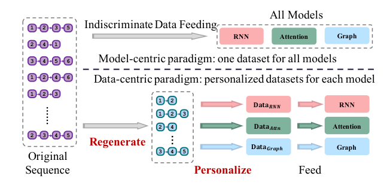
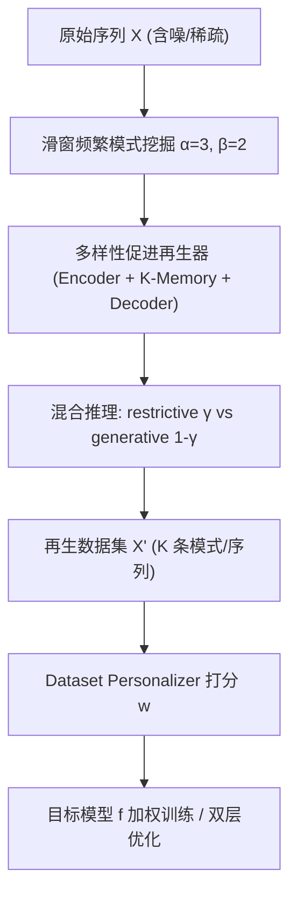

# Dataset Regeneration for Sequential Recommendation (面向序列推荐的数据集再生)

- **会议/期刊**: KDD 2024 (Barcelona)
- **作者与机构**: Mingjia Yin, Hao Wang, Wei Guo, Yong Liu, Suojuan Zhang, Sirui Zhao, Defu Lian, Enhong Chen（中国科学技术大学 MIRA Lab / 认知智能全国重点实验室；华为新加坡研究院）
- **推荐链路定位**: 召回/精排的**训练数据侧**（离线数据构造，模型无关，可与任意 SR 模型耦合）
- **研究方向**: 序列与会话推荐 / 自监督与交互去噪
- **论文原文**: [https://arxiv.org/abs/2405.17795v3](https://arxiv.org/abs/2405.17795v3)
- **开源代码**: [https://github.com/USTC-StarTeam/DR4SR](https://github.com/USTC-StarTeam/DR4SR)

## TL;DR (1分钟核心速览)

现有序列推荐（SR）几乎全部遵循"模型中心"范式：数据集固定，只卷模型结构，而隐式反馈序列中的噪声与稀疏性问题从未被当作一等公民处理。本文提出"数据中心"范式 DR4SR——先用滑窗频繁模式挖掘构造自监督预训练任务，训练一个带多样性促进器的 Transformer 再生器，把每条原始序列一对多地再生为 K 个显式转移模式，并以 restrictive/generative 混合解码平衡利用与探索；再用 DR4SR+ 的 dataset personalizer 按目标模型偏好给样本打分，通过隐式微分求解双层优化。在 Beauty/Sports/Toys/Yelp 四数据集、5 类骨干上，采用 Leave-One-Out + 全库排序协议，NDCG@20 相对提升 7.8%–21.1%。

## Background & Motivation (背景与核心矛盾)

- **主流范式**: 模型中心范式在固定数据集上改进编码器（GRU4Rec/SASRec/FMLP/GCE-GNN/CL4SRec），或加入对比学习、去噪模块，数据集本身被视为不可动的常量。
- **前人局限**: 其一，序列中噪声与误点击会被模型直接拟合放大（去噪方法只做"减法"，删掉数据，不产生新信息）；其二，数据集蒸馏（∞-AE、DConRec、Farzi 等）目标是训练效率或隐私，即使扩大合成集规模，性能也只会收敛到原始数据的上界，无法突破；MELT 虽面向长尾生成，但仍是规则/启发式的局部补丁。
- **核心洞察 (Key Insight)**: 作者把推荐建模拆成 $X \to X'$（抽取物品转移模式）与$X' \to Y$（模式到用户偏好）两段隐式映射，认为真正的瓶颈在前一段；若能显式造出一个"已含转移模式"的数据集$X'$，则后一段$X' \to Y$ 显著更易学。该映射是**一对多**的（一条序列可蕴含多个模式），恰是规则挖掘会漏掉低频模式、且训练时互相冲突的根源。
- **本文切入点**: 把 $X \to X'$ 学成一个模型无关的生成器，并额外引入模型感知的打分器对再生样本加权，形成"数据/模型互补"。

<figure class="paper-figure" markdown="span">
  <figcaption>图 1：以模型为中心的范式与以数据为中心的范式对比。</figcaption>
</figure>

## Method (核心方法设计)

### 1. 整体框架 (Overall Architecture)

三阶段闭环：(A) 预训练——用滑窗（窗口 $\alpha=3$、频次阈值$\beta=2$）在原始序列上挖掘频繁物品转移模式，构造$(s_u, p_i)$序列-模式对，训练编码器-解码器再生器，并加入多样性促进器消解一对多冲突；(B) 推理——固定窗口大小$K$，将编码器产出的$K$个记忆分别送入解码器生成$K$条模式，每个 token 以概率$\gamma$走 generative 模式、$1-\gamma$走 restrictive 模式；(C) 个性化——DR4SR+ 用 dataset personalizer 对每条再生样本打分$w_{i,t}$，以加权损失训练目标模型，并通过双层优化（隐式微分）更新打分器。

### 2. 关键设计拆解 (Key Designs)

1. **多样性促进再生器（Diversity-promoted Regenerator）**：痛点是一条序列对应多个模式（如 $(1,2,3,4,5)$同时蕴含$(1,2)$与$(4,5)$），普通 seq2seq 在 teacher forcing 下收到互相矛盾的监督信号而无法收敛。做法是把编码器记忆$\mathbf{m}$投影为$K$个语义子空间$\{\mathbf{m}'_k\}$，再用目标模式自身编码$\mathbf{h}_{pattern}$ 生成软选择权重，加权融合为最终记忆：

$$\boldsymbol{\pi}=\mathrm{Softmax}(\mathrm{MLP}(\mathbf{h}_{pattern})),\qquad \mathbf{m}_{final}=\sum_{k=1}^{K}\pi_k \mathbf{m}'_k$$

关键在于**不做 hard selection 且用软权重**（防止模型退化恒等复制输入），使不同模式绑定不同记忆槽，训练目标仍为逐 token 的重构交叉熵 $\mathcal{L}_{recon}$。

2. **混合推理策略（Hybrid Inference）**：推理时无目标模式、无法算出 $\boldsymbol{\pi}$，故直接把$K$个记忆分别解码，得到一对多的$K$条样本。restrictive 模式限定解码词表为输入序列内物品（利用/exploitation），generative 模式解除限制（探索/exploration），从而能合成原始数据中不存在的高阶转移，例如由$(1,2)$、$(2,6)$推出$(1,2,6)$。$\gamma$ 控制二者平衡。

3. **模型感知个性化器与双层优化**：再生过程与目标模型解耦，故对特定模型次优。personalizer $g_\phi$以模式位置表征$\mathbf{h}_i^t$为输入，加 Gumbel 噪声后取 softmax 首元素得$w_{i,t}\in[0,1]$，直接乘到 BPR 式损失上：$\mathcal{L}_{rec}=\sum_i\sum_t w_{i,t}\mathcal{L}_{next\text{-}item}(i,t)$。若端到端同训会塌缩到$w\equiv 0$，故写成双层问题并用隐式微分求上层的超梯度：

$$\nabla_\phi \mathcal{L}_{dev}=-\nabla_\theta \mathcal{L}_{dev}\cdot\sum_{n=0}^{K}\left(\mathbf{I}-\nabla^2_\theta \mathcal{L}_{train}\right)^{n}\nabla_\phi\nabla_\theta \mathcal{L}_{train}$$

实现上每 $T$ 步下层优化才做一步上层更新，并用 vector-Jacobian product 近似，避免展开计算图。训练负采样为每步随机 1 个负例（Uniform），推理无额外开销（只需一次前向再生离线完成）。

## Experimental Setup & Evaluation Protocol (实验设置与评估协议)

- **数据集与预处理**: 三个 Amazon 品类 + Yelp，均按前人工作做 **5-core** 过滤（用户/物品至少 5 次交互）。

| 数据集 | #Users | #Items | #Interactions | 稀疏度 | 平均序列长 |
| :--- | :---: | :---: | :---: | :---: | :--- |
| Beauty | 22,363 | 12,101 | 0.20m | 99.95% | 8.9 |
| Sports | 35,598 | 18,357 | 0.30m | 99.95% | 8.3 |
| Toys | 19,412 | 11,924 | 0.17m | 99.93% | 8.6 |
| Yelp | 30,431 | 20,033 | 0.30m | 99.95% | 8.3 |

再生后数据集规模扩大（如 Beauty 0.20m→0.32m、Yelp 0.30m→0.52m），但平均序列长降至 3.7–4.2，即**样本更多、单条更短、模式更稠密**。

- **数据划分与防穿越**: `Leave-One-Out`（最后一项为测试、倒数第二项验证，其余训练）；再生器仅在训练段序列上挖掘/预训练，测试项不参与。
- **排名评测协议**: **Full-Ranking 全库排序**（whole item set 作为候选，遵循 Krichene & Rendle 的建议），指标 Recall@{10,20}、NDCG@{10,20}，报告 $p<0.05$/*、$p<0.01$/** 显著性。
- **对比基线与超参**: 数据中心基线 ∞-AE、MELT；目标骨干覆盖 GRU4Rec（RNN）、SASRec（Transformer）、FMLP（去噪 MLP）、GCE-GNN（图）、CL4SRec（对比学习）。统一 RecStudio 实现，$d=64$、batch 256、lr 1e-3、最大序列长 50、最多 1000 epoch + 早停（NDCG@20 连续 20 轮不升），集成时**固定各骨干原超参**。

## Key Experimental Results (实验关键数据)

### 1. 主实验对比 (Main Results)

下表汇总 NDCG@20（各骨干为各自 Backbone → DR4SR → DR4SR+，加粗为该骨干最优，Improv.% 为 DR4SR+ 相对 Backbone）：

| 目标模型 | Beauty | Sports | Toys | Yelp | Improv.(Beauty) |
| :--- | :---: | :---: | :---: | :---: | :---: |
| ∞-AE (数据生成) | 0.0308 | 0.0173 | 0.0304 | 0.0162 | — |
| MELT (长尾生成) | 0.0379 | 0.0208 | 0.0473 | 0.0195 | — |
| GRU4Rec | 0.0150 | 0.0115 | 0.0136 | 0.0143 | — |
| **+ DR4SR+** | **0.0194** | **0.0151** | **0.0179** | **0.0164** | **+29.3%** |
| SASRec | 0.0368 | 0.0194 | 0.0448 | 0.0193 | — |
| **+ DR4SR+** | **0.0412** | **0.0235** | **0.0527** | **0.0211** | **+12.0%** |
| FMLP (去噪) | 0.0394 | 0.0217 | 0.0447 | 0.0197 | — |
| **+ DR4SR+** | **0.0449** | **0.0253** | **0.0524** | **0.0231** | **+14.0%** |
| GCE-GNN | 0.0384 | 0.0211 | 0.0469 | 0.0166 | — |
| **+ DR4SR+** | **0.0414** | **0.0238** | **0.0521** | **0.0184** | **+7.81%** |
| CL4SRec (SOTA) | 0.0441 | 0.0259 | 0.0530 | 0.0212 | — |
| **+ DR4SR+** | **0.0517** | **0.0299** | **0.0567** | **0.0241** | **+17.2%** |

值得注意的是，DR4SR 单独使用（不加 personalizer）已在全部 20 组骨干×数据集组合上全部显著为正（如 SASRec/Sports Recall@20 +14.0%，CL4SRec/Beauty NDCG@10 +14.3%），体现跨架构泛化性。

### 2. 消融实验 (Ablation Study)

以 SASRec 为目标模型，NDCG@20：

| 变体 | Beauty | Sports | Toys | Yelp | 说明 |
| :--- | :---: | :---: | :---: | :---: | :--- |
| SASRec (Backbone) | 0.0368 | 0.0194 | 0.0448 | 0.0193 | 原始数据 |
| **DR4SR+** | **0.0412** | **0.0235** | **0.0527** | **0.0211** | 完整框架 |
| (A) w/o diversity | 0.0365 | 0.0211 | 0.0470 | 0.0196 | 换成 vanilla Transformer |
| (B) 仅规则模式 | 0.0181 | 0.0184 | 0.0407 | 0.0141 | 直接用挖掘出的模式做数据集 |
| (C) 端到端训练 | 0.0026 | 0.0029 | 0.0067 | 0.0035 | 打分器与目标模型同训 |

### 3. 关键实验发现 (Key Findings)

1. **一对多建模是性能主引擎，而非"多造数据"**：去掉多样性促进器后 Beauty 从 0.0412 掉回 0.0365（几乎等于原始 SASRec），而仅用规则挖掘的频繁模式当数据集反而崩到 0.0181（比 Backbone 低 51%）——说明收益来自"可学习的、覆盖低频模式的再生器"，而非模式本身；规则法丢弃低频模式是致命伤。
2. **端到端优化必然塌缩，双层优化是必要条件**：变体 (C) 全面崩到 0.0026–0.0067，即 personalizer 学到 $w\equiv 0$ 的平凡解；而隐式微分的代价极小——Beauty 每 epoch 训练时间 7.62s→9.48s、显存 1930MB→2342MB（约 +24%/+21%），换来 NDCG@20 相对 +12%，性价比明确。
3. **数据/模型范式互补，且不同模型确实"偏好不同数据"**：DR4SR（模型无关）→ DR4SR+ 在每个骨干上再涨 3%–14%；可视化显示 GRU4Rec 的样本打分方差 0.0280 明显高于 SASRec/GNN/CL4SRec（0.0241–0.0248），即强自注意力/滤波 MLP 能自适应利用序列内物品，弱编码器更依赖数据侧加权。超参上 $K$从 1 增到 ~5 单调升后饱和，$\gamma$ 呈先升后降的倒 U 形（过大则过度探索、生成不可靠）。

## Highlights & Limitations (亮点、对比与审稿批判)

- **与代表作对比 (vs. Prior Work)**: 对比 **MELT/ASReP**，本文不做长尾规则补丁而是全局再生整个训练集；对比 **∞-AE / DConRec / Farzi 等数据集蒸馏**，本文目标不是压缩效率，而是突破原始数据上界（蒸馏的已知瓶颈恰是"收敛到原数据性能"）；对比 **FMLP/CLEA 等去噪 SR**，本文证明去噪只是数据开发的子集——FMLP 接入 DR4SR+ 后仍再涨 14.0%。
- **可迁移亮点**: ①"滑窗频繁模式挖掘 → 自监督 seq2seq 预训练 → 一对多混合解码"这一套可无痛迁移到会话推荐、跨域序列、甚至 POI 轨迹数据；②把不可微的样本选择松弛为 Gumbel 打分 + 双层隐式微分，可用于任意"数据加权/课程学习"场景。
- **审稿级局限批判**: ①再生数据把平均序列长从 8.9 砍到 4.0，长序列中的长程依赖信息被压缩，文中未给出长序列（>20）分桶分析；②personalizer 的上层优化依赖从训练集切出的验证集，验证集分布偏移时打分器可靠性存疑，且 Gumbel 温度 $\tau$、$K$、$\gamma$三者耦合，文中只做了单变量敏感性；③再生阶段需对全库序列各生成$K$ 条样本，工业级（亿级序列）离线成本与存储放大未被讨论；④图与数据增强实验（图 5）结论模糊——原始图在约半数数据集上反而更好，说明"再生一切数据形态"的主张证据不足。

## Rating (四维评分)

- **方法创新性 (Novelty)**: ⭐⭐⭐⭐⭐ （首次把"训练数据开发"正式定义为 SR 中的新问题，一对多再生器 + 双层个性化组合在范式层面有新意，而非模块堆叠）
- **评估协议与实验扎实度 (Protocol & Experiments)**: ⭐⭐⭐⭐⭐ （5 类异构骨干 × 4 数据集 × Full-Ranking 全库排序，全部标注显著性，消融与效率分析齐备）
- **写作与数学规范度 (Clarity & Rigor)**: ⭐⭐⭐⭐ （隐式微分超梯度推导清晰、算法伪代码完整；但 $X\to X'$的可解性缺少理论刻画，模式挖掘阈值$\beta$ 的选取偏经验）
- **工业落地与复现价值 (Industrial & Practical Value)**: ⭐⭐⭐⭐ （代码开源、模型无关可插拔、个性化仅增 ~20% 开销；但全库再生的一次性离线成本与存储放大在大规模场景仍需工程折中）

