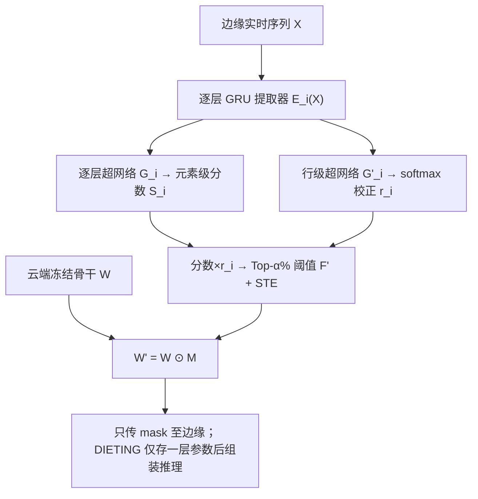
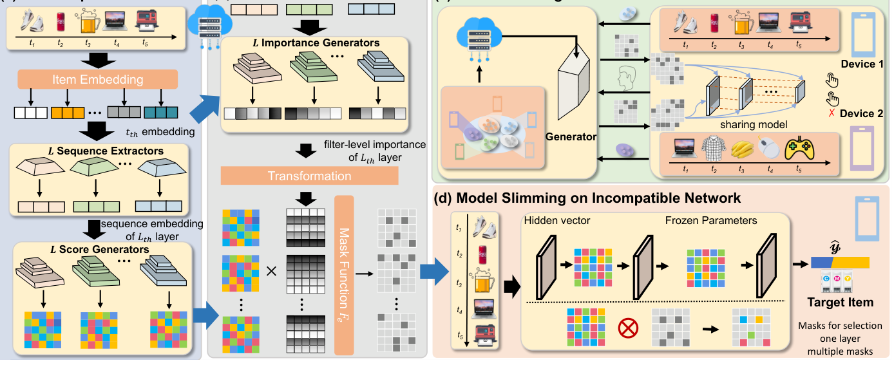

# DIET: Customized Slimming for Incompatible Networks in Sequential Recommendation (面向序列推荐的异构网络定制化瘦身)

- **会议/期刊**: KDD 2024 (ACM SIGKDD)
- **作者与机构**: Kairui Fu, Shengyu Zhang, Zheqi Lv, Jingyuan Chen, Jiwei Li（浙江大学 / 浙大上海高研院）
- **推荐链路定位**: 端侧重排推理（reranking）+ 端云协同模型下发
- **研究方向**: 序列推荐 / 工业级端云协同架构
- **论文原文**: [https://arxiv.org/abs/2406.08804v2](https://arxiv.org/abs/2406.08804v2)
- **开源代码**: 暂未开源

## TL;DR (1分钟核心速览)

边缘端云协同推荐的两难：频繁下发整模型吃带宽，端侧微调吃算力且小数据易过拟合。DIET 让云端只保留一个**冻结通用骨干**，用逐层 GRU 序列提取器 + 超网络，从边缘上传的实时交互序列直接生成**该边缘专属的二进制子网 mask（diet）**，再用 filter 级行重要性做校正，使整行置零以跳过计算。在 4 个数据集 × SASRec/Caser 上（Leave-One-Out，Hit@10/NDCG@10），传输参数从 1.3107 降至 0.0410（约 3.1%，×31.97），FLOPs 降幅 ≥50%，SASRec-ML-100K 的 NDCG 提升 22.8%。

## Background & Motivation (背景与核心矛盾)

- **主流范式**: 端云协同推荐分为「模型切分」（Embedding 留云端、轻量层放端侧，如 EdgeRec/Auto-Split）与「端侧个性化」（端侧算梯度、云端聚合，如 DCCL/DUET），另有一支靠剪枝压缩模型（LTH/SNIP/GEM-MINER/SuperMask）。
- **前人局限**: ①个性化派需端侧微调 + 高频下发，兴趣漂移（图 1(b)）时带宽与延迟不可接受；②压缩派找到的"彩票子网"对整个云端分布最优，对**异构边缘并不兼容**，且非结构化剪枝不改变 FLOPs、结构化剪枝（Gater）虽快却要传 1.4459 参数且精度不稳。
- **核心洞察 (Key Insight)**: 随机初始化网络中"存在可用的稀疏子网"这一 Lottery-Ticket 性质，若把"选哪个子网"变成**以实时序列为条件的生成问题**，就能同时拿到个性化（结构+参数）、低传输（只传 mask）与低推理（整 filter 置零）。
- **本文切入点**: 只传 mask 不传权重，让云端做"编译器"、边缘做"执行器"。

## Method (核心方法设计)

### 1. 整体框架 (Overall Architecture)

云端持有 K 层 Transformer/CNN 骨干，权重 $W$全程冻结；每个线性层配一个独立 GRU 序列提取器$E_i$与超网络$G_i$（均驻留云端，不下发）。用户实时序列$X$上行后，逐层产出元素级重要性分数，经$F'$取 top-$\alpha\%$二值化为 mask，再由行级（filter 级）softmax 重要性$r_i$回乘校正，最终生成该边缘的 diet。下发内容仅为一串二进制 mask（DIETING 变体连权重也只需存一层），边缘用$W'=W\odot M$ 现场组装子网做重排推理。

<figure class="paper-figure" markdown="span">
  <figcaption>图 2：DIET 概览。(a)：云端将基于实时交互，为边缘上的各种数据分布生成边缘特定的 diets（子网）。(b)：云端另一个模块用于发现网络中的层间滤波器关系，生成的滤波器级重要性将对来自 (a) 的 diets 进行后处理，以纠正较不重要的连接。(c)：DIET 和 DIETING 的简要示意图（橙色虚线标记部分）。边缘发送其实时样本，云端为其定制 diets。网络上的传输由一系列二值掩码组成，且……</figcaption>
</figure>

### 2. 关键设计拆解 (Key Designs)

1. **冻结骨干 + 逐元素二值 mask（把"微调"换成"选参数"）**：痛点是不兼容参数必须被剔除而非被重训。为绕开 $F'$不可导，用 straight-through estimator 直接回传梯度：$\frac{\partial \mathcal{L}}{\partial s^0_i}\approx\frac{\partial \mathcal{L}}{\partial W'_i}\frac{\partial W'_i}{\partial F'(s^0_i)}$，其中
$$\boldsymbol{W}'_i=[\boldsymbol{w}^0_i\odot F'(\boldsymbol{s}^0_i),\dots,\boldsymbol{w}^{p-1}_i\odot F'(\boldsymbol{s}^{p-1}_i)],$$
$F'$在层内按$|\boldsymbol{s}|$取 top-$\alpha\%$ 置 1。直觉：权重不动、只动"哪些位置可用"，传输量从浮点权重退化为比特串。
2. **序列条件化超网络生成 per-edge diet（个性化来源）**：原超网络 $w_G=G(z)$需端侧重训$z$，不可行；改由$w_G=G(E(X))$ 直接从最近行为推断分布，每层独立提取器避免层间干扰。这样同一骨干可服务兴趣截然不同的边缘，且生成模块的开销全部留在云端。
3. **Filter 级连接校正 + DIETING（用结构化换推理速度）**：元素级 mask 各行独立，无法整行置零。引入行重要性 $r^0_i=\mathrm{softmax}(G'^0_i(E^0_i(X)))$（softmax 保证非负，配合$F'$ 的绝对值判定），并回乘到元素分数：
$$\boldsymbol{w}'^0_i[a,b]=\boldsymbol{w}^0_i[a,b]\cdot F'\big(G^0_i(E^0_i(X))[a,b]\times r^0_i[a]\big).$$
低重要度 filter 内所有元素分数被整体压低而集体落榜，形成**全零行 → 可跳过矩阵乘**，这是唯一同时改善精度与延迟的组件。DIETING 进一步利用块重复性，令 $\boldsymbol{w}^0_i=W_{\max}[:\text{size}(\boldsymbol{w}^0_i)]$，全网由一层参数 + 多组 mask 表示。
4. **训练与推理开销**：损失沿用冻结骨干上的 next-item 交叉熵（沿 SASRec 全 softmax 设定，无额外负采样设计），只更新 $E$、$G$、$G'$；推理时云端仅并行跑若干轻量 GRU/MLP 生成 mask（毫秒级可忽略），边缘不做任何梯度计算。

## Experimental Setup & Evaluation Protocol (实验设置与评估协议)

- **数据集与预处理**:

| 数据集 | #Users | #Items | #Interactions | #SeqLen | 稀疏度 |
| :--- | :---: | :---: | :---: | :---: | :---: |
| ML-1M | 6,040 | 3,012 | 994,852 | 164.71 | 94.52% |
| ML-100K | 943 | 928 | 94,672 | 100.45 | 89.16% |
| Amazon-CD | 78,318 | 57,326 | 1,955,164 | 24.96 | 99.96% |
| Amazon-TV | 31,482 | 68,308 | 867,853 | 27.56 | 99.96% |

  过滤：MovieLens 采用 `20-core`、Amazon 采用 `10-core`，正反馈定义为正评分交互。
- **数据划分与防穿越**: `Leave-One-Out`——按时间排序后取每用户最后一个交互为测试样本。
- **排名评测协议**: 论文主文**未明示**是 Full-Ranking 还是 100 负采样 Sampled Ranking（沿 SASRec 惯例应为采样排序），此为可复现性隐忧；效率侧另有 Param（传输参数量，M 级）与 FLOPs（单次推理）两项指标。
- **对比基线与超参**: 9 个基线（Base / Random / LTH / SNIP / GEM-MINER(Rare Gem) / SuperMask / PEMN / Gater / STTD），骨干为 SASRec（Transformer）与 Caser（CNN），结果取 5 个随机种子均值；稀疏率 $\alpha\in\{0.6,0.7,0.8,0.9,0.95\}$ 做敏感性扫描，**未见显著性检验**。

## Key Experimental Results (实验关键数据)

### 1. 主实验对比 (Main Results)

| 骨干 | 方法 | ML-1M NDCG | ML-1M Hit | ML-100K NDCG | CD NDCG | CD Hit | TV NDCG | Param↓ | FLOPs↓ |
| :--- | :--- | :---: | :---: | :---: | :---: | :---: | :---: | :---: | :---: |
| SASRec | Base | 0.0974 | 0.1849 | 0.0517 | 0.0386 | 0.0529 | 0.0665 | 1.3107 | 0.2086 |
| SASRec | Random | 0.0926 | 0.1836 | 0.0569 | 0.0409 | 0.0557 | 0.0694 | 0.2618 | 0.2086 |
| SASRec | LTH | 0.0962 | 0.1852 | 0.0564 | 0.0408 | 0.0564 | 0.0703 | 0.2618 | 0.2082 |
| SASRec | SuperMask | 0.0723 | 0.1505 | 0.0518 | 0.0301 | 0.0398 | 0.0574 | 0.0410 | 0.2086 |
| SASRec | Gater | 0.0963 | 0.1886 | 0.0555 | 0.0412 | 0.0568 | 0.0701 | 1.4459 | 0.1167 |
| SASRec | STTD | 0.0863 | 0.1714 | 0.0582 | 0.0385 | 0.0503 | 0.0692 | 0.0461 | 0.3110 |
| SASRec | **DIET** | **0.1008** | **0.1929** | **0.0635** | **0.0425** | **0.0590** | **0.0707** | **0.0410** | **0.1022** |
| SASRec | Improv. | +3.49% | +4.33% | +22.82% | +10.96% | +11.53% | +6.32% | ×31.97 | ×2.04 |
| Caser | Base | 0.0984 | 0.1820 | 0.0518 | 0.0310 | 0.0424 | 0.0569 | 0.4922 | 0.0586 |
| Caser | Random | 0.0826 | 0.1565 | 0.0483 | 0.0251 | 0.0363 | 0.0468 | 0.0983 | 0.0580 |
| Caser | LTH | 0.0959 | 0.1759 | 0.0477 | 0.0322 | 0.0424 | 0.0586 | 0.0986 | 0.0580 |
| Caser | SuperMask | 0.0797 | 0.1572 | 0.0360 | 0.0213 | 0.0318 | 0.0403 | 0.0154 | 0.0586 |
| Caser | Gater | 0.0837 | 0.1573 | 0.0541 | 0.0257 | 0.0358 | 0.0537 | 0.3891 | 0.0298 |
| Caser | STTD | 0.0989 | 0.1826 | 0.0566 | 0.0270 | 0.0360 | 0.0555 | 0.0231 | 0.0996 |
| Caser | **DIET** | 0.0987 | 0.1821 | **0.0572** | **0.0356** | **0.0488** | **0.0617** | **0.0154** | **0.0280** |
| Caser | Improv. | +0.31% | +0.06% | +10.42% | +14.84% | +15.09% | +8.44% | ×31.96 | ×2.09 |

### 2. 消融实验 (Ablation Study)

| 配置（SASRec / Caser） | ML-1M NDCG | ML-100K NDCG | CD NDCG | FLOPs（ML-1M） |
| :--- | :---: | :---: | :---: | :---: |
| Base | 0.0974 / 0.0984 | 0.0517 / 0.0518 | 0.0386 / 0.0310 | 0.2086 / 0.0586 |
| +mask（全局共享 mask） | 0.0859 / 0.0781 | 0.0538 / 0.0371 | 0.0408 / 0.0213 | 0.2078 / 0.0364 |
| +MG（个性化逐元素 mask） | 0.0990 / 0.0930 | 0.0631 / 0.0546 | 0.0409 / 0.0357 | 0.2078 / 0.0364 |
| **DIET（+filter 校正）** | **0.1009** / **0.0987** | **0.0635** / **0.0572** | **0.0425** / 0.0356 | **0.1022** / **0.0280** |

### 3. 关键实验发现 (Key Findings)

1. **个性化 mask 是精度主引擎，而非剪枝本身**：全局共享 mask 在 Caser 上全面崩塌（ML-1M 0.0984→0.0781、CD 0.0310→0.0213，OOD 合成集更跌至 0.0114），一旦换成序列条件化的 +MG 即反超 Base（SASRec-ML-100K 0.0517→0.0631，+22%），说明"不兼容参数"确实存在且逐用户而异——SuperMask/PEMN 平均掉 20+ 点正源于此。
2. **filter 级校正是"精度与延迟双赢"的唯一组件**：它在 +MG 基础上把 SASRec-ML-1M 的 NDCG 再推至 0.1009，同时 FLOPs 从 0.2078 砍到 0.1022（−50.8%）；机理是行重要性压低使整 filter 全零（图 5），可整行跳过矩阵乘，而元素级剪枝只减存储不减算力。
3. **存储/传输收益可叠加且近乎免费**：DIETING 用单层参数表示全网（$w^0_i=W_{\max}[\cdot]$），Caser 端仅存 0.0154 参数，ML-1M 上 NDCG 0.1008 vs 0.1005、CD 0.0424 vs 0.0425 基本无损，验证"初值不重要、mask 组合才重要"。

## Highlights & Limitations (亮点、对比与审稿批判)

- **与代表作对比 (vs. Prior Work)**: 相比 SuperMask/PEMN 的**单一全局 mask**，DIET 以实时序列为条件生成逐边缘 mask；相比 Gater 的结构化剪枝，DIET 在传输上省 35 倍（0.0410 vs 1.4459）且精度更稳；相比 STTD 的矩阵分解压缩，DIET 不引入半张量乘算，FLOPs 从 0.3110 降至 0.1022；相比 DCCL/DUET 的端侧微调，完全免除端侧梯度计算。
- **可迁移亮点**: ①"冻结骨干 + 序列条件超网络出 mask"可平移到 LLM4Rec 的 adapter/LoRA 门控，实现按会话动态选参数；②行级 softmax 重要性回乘元素分数这一招可无侵入地加在任何 unstructured pruning 框架上，把"省存储"升级为"省算力"。
- **审稿级局限批判**: ①**评估协议含糊**——未交代候选集是全库排序还是 100 负采样，无显著性检验，仅 5 seed 均值，且 Caser-ML-1M 提升仅 +0.31%/+0.06%，统计上难称显著；②**端侧收益为理论值**，只报 FLOPs 与传输比特数，未报真实 wall-clock 延迟与端侧内存占用，mask 组装/索引开销被忽略；③每次兴趣漂移都需上行实时序列、下行 mask，上行带宽与边缘数据隐私成本未量化；④仅验证 Transformer/CNN 两骨干，RNN/Mamba/LLM-based 序列模型下的迁移性与 $\alpha$ 敏感性（图 4 显示需逐模型调参）仍是空白。

## Rating (四维评分)

- **方法创新性 (Novelty)**: ⭐⭐⭐⭐ （把彩票票假设从"全局找一个子网"翻转为"按序列生成子网"，并用 filter 校正打通结构与算力收益，思路清爽但组件均为已有技术组合）
- **评估协议与实验扎实度 (Protocol & Experiments)**: ⭐⭐⭐ （4 数据集 × 2 骨干 × 9 基线的覆盖面足够，消融与 OOD、$\alpha$ 敏感性齐全，但排序协议未明示、无显著性检验，部分提升幅度在噪声量级）
- **写作与数学规范度 (Clarity & Rigor)**: ⭐⭐⭐⭐ （公式链 $S\to F'\to W'$ 与校正项定义连贯、符号一致，但缺少 FLOPs 的理论复杂度推导与 mask 组装的显式开销分析）
- **工业落地与复现价值 (Industrial & Practical Value)**: ⭐⭐⭐⭐ （只传 mask、端侧零训练、天然支持多场景共享一套权重，工程诱惑力强；扣分在代码未开源、真实端侧时延与上行隐私成本未验证）

