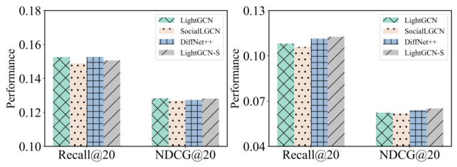
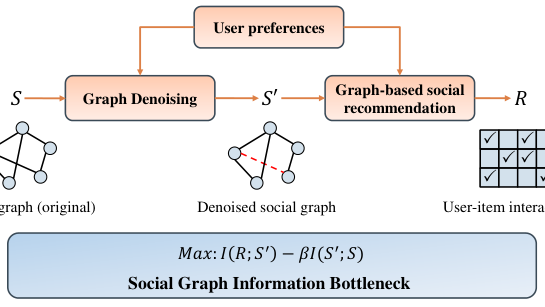
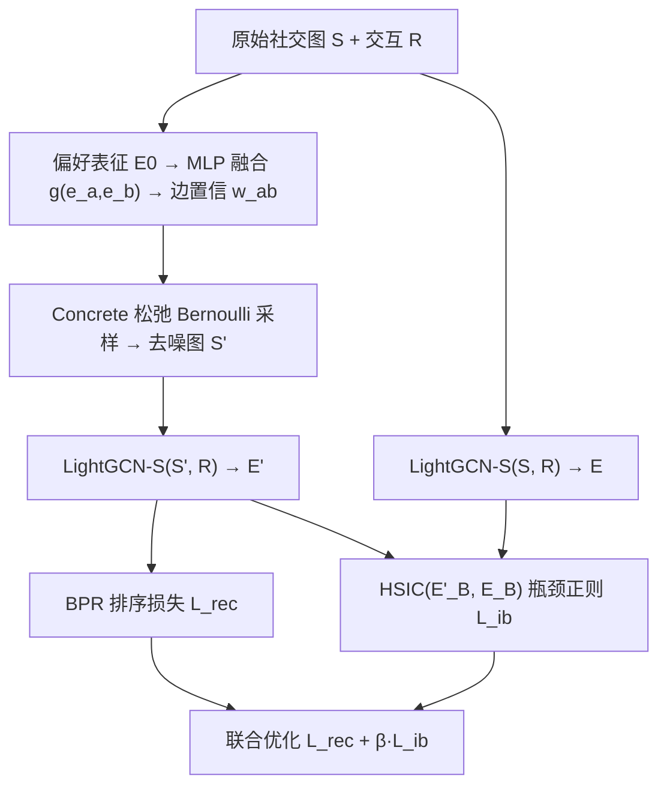

# Graph Bottlenecked Social Recommendation (图瓶颈社交推荐)

- **会议/期刊**: KDD 2024 (ACM SIGKDD)
- **作者与机构**: Yonghui Yang, Le Wu (通讯), Zihan Wang, Zhuangzhuang He, Richang Hong, Meng Wang — 合肥工业大学
- **推荐链路定位**: 召回 / 图表征学习（用户表示增强）
- **研究方向**: 社交与群组推荐 / 图神经网络与知识图谱推荐
- **论文原文**: [论文原文链接](https://arxiv.org/abs/2406.08214v2)
- **开源代码**: [开源代码仓库链接](https://github.com/yimutianyang/KDD24-GBSR)

## TL;DR (1分钟核心速览)

真实社交图含大量冗余关系，直接把观测图 $S$灌进 GNN 反而会稀释用户偏好表征（论文实测 LightGCN-S 在 Douban-Book 上不及无社交的 LightGCN）。GBSR 将社交去噪重写为信息瓶颈问题$\max I(R;S')-\beta I(S';S)$：用偏好相似度驱动 MLP 产出边保留概率并经 Concrete 松弛实现可微边丢弃，同时以下界推导证明 BPR 即$I(R;S')$的变分下界、以 HSIC 无先验地替代$I(S';S)$ 最小化。三数据集 Full-Ranking 下 NDCG@20 相对最强基线提升 17.06%/10.00%/11.27%，且可插拔到 4 种 backbone。

## Background & Motivation (背景与核心矛盾)

- **主流范式**: 图神经社交推荐把用户-物品交互图与用户-用户社交图拼接成一张异质图，用 LightGCN 式高阶传播 (DiffNet++、SocialLGN) 注入社交影响力，隐式假设观测社交图是"干净"的。
- **前人局限**: ①真实社交边包含不可靠关系与低偏好亲和关系，噪声边在多层传播中被反复放大；②去噪缺乏边级 ground-truth 标签，Rule-based、ESRF、GDMSR 依赖相似度阈值或对抗/课程式假设，"去多少"与"推荐精度"之间无法保证权衡，往往只换来边际收益甚至负收益。
- **核心洞察 (Key Insight)**: 论文的实证先行实验（图 1）显示，社交推荐方法在 Douban-Book 上全面劣于 LightGCN，说明噪声社交边净效应为负；理想社交结构应是**最小但充分 (minimal yet sufficient)** 的——恰好覆盖推荐所需偏好信息、其余全部丢弃。这正是 Information Bottleneck 的 $Z^{*}=\arg\max I(Y;Z)-\beta I(X;Z)$ 形式。
- **本文切入点**: 令 $S'=\mathcal{F}_\phi(U,S)$，直接在 IB 框架下联合学习"去噪器$\phi$"与"推荐器$\theta$"，用任务信号监督去噪，用瓶颈项约束压缩。

<figure class="paper-figure" markdown="span">
  <figcaption>图1：LightGCN 与 SOTA 基于图的社交推荐方法的性能比较。</figcaption>
</figure>

## Method (核心方法设计)

### 1. 整体框架 (Overall Architecture)

输入原始社交图 $S$与交互矩阵$R$。**去噪分支**：取初始用户嵌入$E_0[:M]$作为偏好表征$P$，对每条观测社交边用 MLP 融合两端偏好得到置信度$w_{ab}$，再经 Bernoulli 采样（Concrete 松弛保证可微）得到去噪图$S'$。**推荐分支**：把$S'$与$R$拼成$\mathbf{A}=\begin{bmatrix}S'&R\\R^{\top}&0\end{bmatrix}$，走 LightGCN-S 得到$E'$；同时对原图$S$走同构 backbone 得到$E$。**优化**：BPR 排序损失（即$I(R;S')$的下界）+$\beta\cdot$HSIC 瓶颈项（压缩$E'$与$E$的统计依赖）联合反传，端到端更新$\theta,\phi$。推理时只需一次去噪采样 + 一次图卷积。

<figure class="paper-figure" markdown="span">
  <figcaption>图2：所提出的 GBSR 框架概览。</figcaption>
</figure>

### 2. 关键设计拆解 (Key Designs)

**设计一：偏好引导的可微社交边丢弃**——在没有边标签时，以社会同质性（偏好相似者更可能有真实社交关系）作为可信度代理。边保留概率 $w_{ab}=g(e_a,e_b)$（$g$为 MLP），采样$s'_{ab}=s_{ab}\odot\rho_{ab},\ \rho_{ab}\sim\mathrm{Bern}(w_{ab})+\epsilon$，其中$\epsilon=0.5$为观测偏置；为解决 Bernoulli 不可导，用 Concrete 松弛$\rho_{ab}=\mathrm{sigmoid}\big((\log\frac{\delta}{1-\delta}+w_{ab})/t\big)$，$\delta\sim U(0,1)$、$t=0.2$。这样梯度可穿过离散丢弃算子回传到去噪器，使"哪些边该留"由推荐损失直接教会。

**设计二：$I(R;S')$的下界 = BPR 损失**——直接用图结构与非欧氏交互矩阵算互信息不可行，作者以全部节点为中间变量推导：$I(R;S')\ge\sum_{(a,i,j)\in\mathcal{D}}\log\sigma\big(\mathcal{G}(a,i,S')-\mathcal{G}(a,j,S')\big)$，即标准 BPR。该推导把"BPR 是排序启发式"提升为"互信息最大化的变分下界"，为去噪提供了任务充分性保证：任何被保留的社交边都必须能解释交互。

**设计三：HSIC 替代 $I(S';S)$最小化**——MI 上界估计依赖变分先验、易失准。HSIC 度量 RKHS 中交叉协方差算子范数，无需先验：$\hat{\mathrm{HSIC}}(E',E)=(n-1)^{-2}\mathrm{Tr}(K_{E'}HK_{E}H)$，核取 RBF$K(x_i,x_j)=\exp(-\|x_i-x_j\|^2/2\sigma^2)$，$H=I-\frac{1}{n}\mathbf{1}\mathbf{1}^{\top}$。直觉：迫使去噪图上的节点表征与原图表征统计独立（只保留预测必需的那一小部分共享信息），从而抹掉冗余边的传播痕迹；batched 采样使其复杂度仅$O(B^2d)$，可 mini-batch 训练。

**训练目标、负采样与推理效率**：$\mathcal{L}=\mathcal{L}_{rec}+\beta\mathcal{L}_{ib}$，$\mathcal{L}_{rec}=\sum_{a}\sum_{(i,j)\in D_a}-\log\sigma(\hat r_{ai}-\hat r_{aj})+\lambda\|E_0\|^2$，每正样本随机采 1 个未交互负样本（Uniform 单负采样，免 hard negative），$\lambda$搜$\{1e\text{-}4,1e\text{-}3,1e\text{-}2\}$。额外参数仅为 MLP 的$\phi$（全边共享），可忽略；额外开销来自两条图卷积 + 核矩阵，但收敛快 2–3 倍，总成本可接受。

## Experimental Setup & Evaluation Protocol (实验设置与评估协议)

- **数据集与预处理**:

| 数据集 | #Users | #Items | #Interactions | 社交边数 | 交互密度 | 特征/场景说明 |
| :--- | :---: | :---: | :---: | :---: | :---: | :--- |
| Douban-Book | 13,024 | 22,347 | 792,062 | 169,150 | 0.048% | 图书评分 + 社交关注，社交噪声最重 |
| Yelp | 19,593 | 21,266 | 450,884 | 864,157 | 0.034% | 本地商户点评 + 好友网络，社交边最稠密 |
| Epinions | 18,202 | 47,449 | 298,173 | 381,559 | 0.035% | 信任网络 + 评分，物品最稀疏 |

- **数据划分与防穿越 (Splitting Strategy)**: 采用 `随机比例划分`——80% 交互训练、20% 测试；未做全局时间戳切分，未报告验证集构造方式（超参应在测试集上网格搜索得到，存在轻微信息泄漏风险）。
- **排名评测协议 (Ranking Protocol)**: 无偏 `Full-Ranking (全库未交互排序)`，把所有未交互物品作为候选，报告 Recall@10/20 与 NDCG@10/20，5 次重复取均值。训练侧为 1:1 随机负采样 BPR。
- **对比基线与超参设置**: 两类基线——图社交推荐 (GraphRec、DiffNet++、SocialLGN、LightGCN-S) 与社交图去噪 (Rule-based、ESRF、GDMSR)，全部去噪方法统一挂在 LightGCN-S backbone 上以保证公平；嵌入维度 $d=64$，Adam、lr=1e-3、batch=2048，GCN 层数搜 1–4，$\epsilon=0.5$。原文未报告显著性检验（如配对 t-test）。

## Key Experimental Results (实验关键数据)

### 1. 主实验对比 (Main Results)

| 模型 | Douban R@20 | Douban N@20 | Yelp R@20 | Yelp N@20 | Epinions R@20 | Epinions N@20 |
| :--- | :---: | :---: | :---: | :---: | :---: | :---: |
| LightGCN (无社交) | 0.1526 | 0.1283 | 0.1081 | 0.0623 | 0.0675 | 0.0385 |
| GraphRec | 0.1453 | 0.1237 | 0.1077 | 0.0607 | 0.0681 | 0.0387 |
| DiffNet++ | 0.1489 | 0.1270 | 0.1114 | 0.0640 | 0.0727 | 0.0406 |
| SocialLGN | 0.1537 | 0.1274 | 0.1059 | 0.0620 | 0.0634 | 0.0371 |
| LightGCN-S (backbone) | 0.1506 | 0.1281 | 0.1126 | 0.0651 | 0.0716 | 0.0417 |
| Rule-based | 0.1518 | 0.1289 | 0.1126 | 0.0652 | 0.0716 | 0.0414 |
| ESRF | 0.1534 | 0.1301 | 0.1123 | 0.0645 | 0.0727 | 0.0406 |
| GDMSR | 0.1538 | 0.1245 | 0.1148 | 0.0658 | 0.0721 | 0.0414 |
| **GBSR (本文)** | **0.1694** | **0.1523** | **0.1243** | **0.0724** | **0.0793** | **0.0464** |
| **Improv.%** | +10.14% | +17.06% | +8.28% | +10.00% | +9.08% | +11.27% |

### 2. 消融实验 (Ablation Study)

| 变体 | Douban R@20 | Douban N@20 | Yelp R@20 | Yelp N@20 | Epinions R@20 | Epinions N@20 |
| :--- | :---: | :---: | :---: | :---: | :---: | :---: |
| LightGCN-S | 0.1506 | 0.1281 | 0.1126 | 0.0651 | 0.0716 | 0.0417 |
| w/o HSIC (仅偏好引导边丢弃) | 0.1482 | 0.1259 | 0.1119 | 0.0644 | 0.0688 | 0.0388 |
| w/o 去噪 ($S'=S$) | 0.1506 | 0.1281 | 0.1126 | 0.0651 | 0.0716 | 0.0417 |
| **GBSR (完整)** | **0.1694** | **0.1523** | **0.1243** | **0.0724** | **0.0793** | **0.0464** |

泛化性（Top-20, NDCG@20）：GraphRec **+5.58%**、DiffNet++ **+12.66%**（Yelp）、SocialLGN **+8.87%**、LightGCN-S **+11.21%**，四种 backbone 全面正收益。

### 3. 关键实验发现 (Key Findings)

1. **瓶颈项才是真正起作用的部分**：去掉 HSIC 后，仅保留偏好引导的边丢弃在三个数据集上全部**跌破 backbone**（Douban N@20 0.1259 vs 0.1281，Epinions 0.0388 vs 0.0417）。说明"按偏好相似度删边"本身是启发式近似，缺了压缩约束反而丢失有用社交信号；而完整模型把 N@20 从 0.1281 拉到 0.1523（+18.9%），证明"最小但充分"必须由 IB 目标的两项共同界定。
2. **社交图越脏，收益越大，且与统计量严格对应**：图 4(b) 显示 Douban-Book 的平均社交置信度最低（0.6~0.8）、噪声最重，GBSR 在此取得最大相对提升 17.06%；Yelp 社交边最稠密、置信度最稳定，提升收敛到 10.00%。这解释了图 1 中社交方法在 Douban 上反而不如 LightGCN 的现象——噪声净效应可被 IB 显式抵消。
3. **去噪带来"效率红利"而非仅仅是精度**：GBSR 在 Douban-Book 第 82 轮、Yelp 第 67 轮即达最优，backbone 需 509/261 轮；单 epoch 耗时 3.61s vs 6.97s（Yelp 3.08s vs 6.84s）。删边后图更稀疏，传播与收敛同时加速，说明去噪不仅是精度问题也是算力问题。
4. **超参 $\beta,\sigma^2$强数据集相关**：最优组合为 Douban$(\beta=40,\sigma^2=2.5)$、Yelp$(2.0,0.25)$、Epinions$(3.0,0.25)$，跨数据集相差 20 倍。

## Highlights & Limitations (亮点、对比与审稿批判)

- **与代表作对比 (vs. Prior Work)**: 与 **GDMSR**（偏好置信度蒸馏 + 渐进式裁剪）相比，GBSR 不再用手工阈值/课程调度决定删边节奏，而由可微采样器 + 互信息目标自动给出"删到什么程度最优"；与 **DiffNet++/SocialLGN** 相比，后两者把社交图当干净先验、用注意力建模影响强度，本质是"给噪声边加权"，GBSR 则允许边被真正删除，是结构级操作。
- **可迁移亮点**: ①HSIC 瓶颈项是一个与具体 GNN 无关的图压缩正则，可直接移植到交互图去噪、多行为图、跨域共享图的门控；②Concrete 松弛的边采样器可作为"可微图结构学习"通用插件，替代 Gumbel-Softmax 做稀疏化。
- **审稿级局限批判**: ①每个 epoch 需跑两条图卷积并构造 $B\times B$核矩阵，$O(B^2d)$显存开销在百万级 batch 场景会掣肘，论文只报 epoch 时间未报峰值显存与总墙钟时间；②仅采用随机 80/20 划分，无全局时间切分、无冷启动/新用户划分，社交边本身可能含未来信息，线上泛化性存疑，且未提供显著性检验；③$\beta$与$\sigma^2$ 强数据集依赖，工业部署需逐业务重搜，调参成本高。

## Rating (四维评分)

- **方法创新性 (Novelty)**: ⭐⭐⭐⭐ （把社交去噪第一次严格形式化为信息瓶颈，并给出"BPR = MI 下界"的完整推导链 + HSIC 无先验压缩，理论闭环相当漂亮）
- **评估协议与实验扎实度 (Protocol & Experiments)**: ⭐⭐⭐ （三数据集 + Full-Ranking + 4 backbone 泛化 + 消融与可视化齐全，但缺时间切分、显著性检验与验证集说明，划分略显单薄）
- **写作与数学规范度 (Clarity & Rigor)**: ⭐⭐⭐⭐ （Eq.9 的五步下界推导清晰，HSIC 与 Concrete 松弛交代完整，复杂度分析到位；遗憾未给出 HSIC 与 MI 之间近似误差的定量讨论）
- **工业落地与复现价值 (Industrial & Practical Value)**: ⭐⭐⭐⭐ （代码已开源、模型无关可插拔、收敛快 2–3 倍；扣分点在于双图卷积的显存成本与逐数据集调 $\beta$ 的工程负担）

