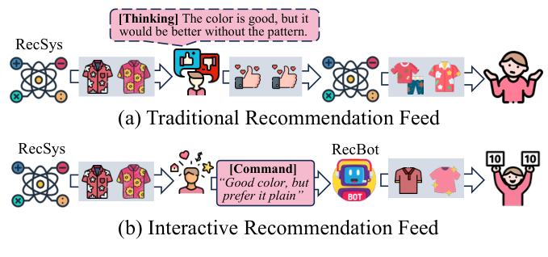
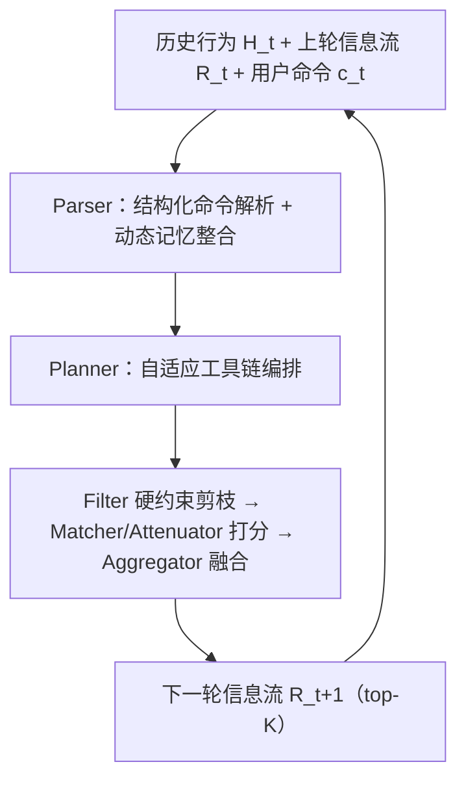
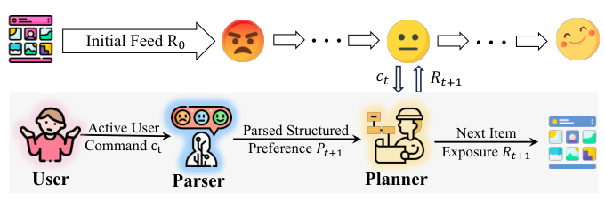

# Interactive Recommendation Agent with Active User Commands (以主动用户命令驱动的交互式推荐智能体)

- **会议/期刊**: KDD 2026 (Under Review, arXiv v2)
- **作者与机构**: Jiakai Tang, Sunhao Dai, Xu Chen 等（中国人民大学高瓴人工智能学院 / 中科院大学 / 阿里巴巴集团）
- **推荐链路定位**: 重排（对既有信息流候选按命令实时重打分 + 在线策略调整）
- **研究方向**: 对话推荐与智能体仿真 / 大语言模型推荐 (LLM4Rec)
- **论文原文**: [https://arxiv.org/abs/2509.21317v2](https://arxiv.org/abs/2509.21317v2)
- **开源代码**: 暂未开源

## TL;DR (1分钟核心速览)

传统信息流只给用户“点赞/点踩”这类粗粒度被动反馈，算法无法判断究竟哪个商品属性驱动了满意或不满，形成意图—解读的长期错配。本文提出 **IRF（Interactive Recommendation Feed）** 范式：用户可在主流推荐信息流里直接打一句自然语言命令（如“颜色可以，但不要花纹”），由 **Parser** 把命令解析成含正/负、硬/软四类约束的结构化偏好，再由 **Planner** 自适应编排 Filter/Matcher/Attenuator/Aggregator 工具链实时改写打分。为可落地，用 GPT-4.1 扮演用户与教师的仿真蒸馏出 Qwen3-14B 学生模型。在 Amazon/MovieLens/Taobao 的 Leave-One-Out 全库排序下，RecBot-GPT 在 Taobao 单轮把 Pass Rate 从最强基线 15.72% 提升到 39.31%（+150%）；线上三月 A/B 中 GMV +1.40%、NFF −0.71%。

## Background & Motivation (背景与核心矛盾)

- **主流范式**: 信息流推荐依赖隐式反馈闭环（点击、停留、点赞），把用户回应粗粒度地归因到整条物品表征上。
- **前人局限**: ①用户侧接口刚性，无法表达“喜欢 A 属性但排斥 B 属性”，负反馈在生产环境中占比高达 57%，却只能以点踩表达；②算法侧只能做“无差别偏好归因”，把所有属性等权背锅，进一步加剧过滤气泡。
- **核心洞察 (Key Insight)**: 症结不是排序模型不够强，而是**用户与算法之间缺少一条显式语言通道**——只要把自由文本命令结构化为可执行约束，排序策略就能在不动召回/精排主干的前提下被即时修正。
- **本文切入点**: 用双 Agent 做“语义解析 + 工具编排”的解耦，把开放语言 $\to$ 打分增量这一跨模态映射拆成两个可蒸馏的窄任务；并与需要独立对话框的 CRS 划清界限——IRF 是嵌在信息流里的轻量输入框，面向探索式浏览而非目标明确的任务型检索。

<figure class="paper-figure" markdown="span">
  <figcaption>图1：传统与新型交互式推荐信息流的比较。(a) 传统系统依赖受限且隐式的反馈信号（如点赞/点踩），难以准确推断用户的真实意图。(b) 我们的交互范式支持自由形式的自然语言命令，RecBot 根据用户的主动命令即时响应并调整推荐策略。</figcaption>
</figure>

## Method (核心方法设计)

### 1. 整体框架 (Overall Architecture)

系统把交互推荐形式化为序贯决策：第 $t$轮展示$K$条信息流$R_t$，用户给出命令$c_t$，状态$S_t=\{R_t,c_t,P_t,H_t\}$，其中$P_t$为语言反馈提炼的显式偏好、$H_t$为历史行为隐式偏好。Parser 执行$P:(R_t,c_t,P_t)\to P_{t+1}$，输出 JSON 化偏好；Planner 执行$A:(P_{t+1},H_t,I)\to S_{t+1}$，按需激活工具链改写全库打分，取 top-$K$组成$R_{t+1}$。闭环在目标命中或达到$T_{\max}=5$ 轮（用户疲劳阈值）时终止。两个 Agent 共用一个 LLM 主干，用 GPT-4.1 教师生成的仿真轨迹做混合 SFT。

<figure class="paper-figure" markdown="span">
  <figcaption>图2：用于交互式推荐的 RecBot 框架概览。该框架包括一个 Parser Agent，将用户自然语言命令 𝑐𝑡 转换为结构化偏好 𝑃𝑡+1；以及一个 Planner Agent，编排工具链以动态调整推荐策略并生成下一推荐信息流 𝑅𝑡+1。反馈至结构化偏好表示。隐式偏好由用户历史交互序列 𝐻𝑡= {𝑖1,𝑖2, . . . ,𝑖𝑚} 捕获，反映长期行为模式。</figcaption>
</figure>

### 2. 关键设计拆解 (Key Designs)

1. **双向 × 双硬度的结构化偏好解析**：痛点是把“这件不够高级、颜色也太素”这类噪声口语映射成可计算约束。Parser 把偏好拆成正/负两正交维度，再按约束强度细分：$P_{t+1}=\{P^+_{t+1},P^-_{t+1}\}$，$P^{\pm}_{t+1}=\{C^{\pm,\text{hard}}_{t+1},C^{\pm,\text{soft}}_{t+1}\}$。硬约束走确定性属性匹配（价格阈值、发行年份），软倾向走语义嵌入相似度。显式建模负向偏好是本文与既有交互推荐（多只做正向需求）的关键差异，直接对应生产中 57% 的抱怨型命令。

2. **动态记忆整合（有界复杂度的多轮状态管理）**：既有做法要么堆积全量对话历史（算力涨、语义漂移），要么过度压缩（丢失演化意图）。本文用三分支上下文判别函数替代长历史拼接：
$$P_{t+1}=\begin{cases}P_t & \text{if }\phi_{\text{sat}}(c_t,R_t)\\ P_t\oplus \text{Extract}(c_t) & \text{if }\phi_{\text{com}}(P_t,c_t,R_t)\\ \text{Resolve}(P_t,c_t,R_t) & \text{if }\phi_{\text{con}}(P_t,c_t,R_t)\end{cases}$$
即“满意则保持 / 兼容则合并 / 冲突则解析替换（靠 instead of、no longer 等语言线索定位被推翻的子约束）”。直觉是把 LLM 推理集中在“压缩旧偏好 × 当前命令”的增量合成上，而非重复读长历史，使多轮开销近似有界。

3. **意图感知工具链与双路打分**：Matcher 融合语义路与协同路，$s_{\text{match}}(i)=\alpha\,s_{\text{sem}}(i,P^+_{t+1})+(1-\alpha)\,s_{\text{aia}}(i,P^+_{t+1},H_t)$；其中 AIA 路径把正向意图编码为 query，对多模态融合后的行为序列做 MHCA，实现“命令引导的协同检索”。Attenuator 施加软惩罚$s_{\text{atten}}(i)=-\beta\cdot\text{sim}(e_{\text{item}}(i),e_{\text{intent}}(P^-_{t+1}))$，最终$s_{\text{final}}(i)=s_{\text{match}}(i)+s_{\text{atten}}(i)$。Filter 先把$I\to I'$剪枝（违反硬约束记$-\infty$），既保证硬约束严格满足，又降低后续打分算力。Planner 依据偏好组合自适应伸缩链条：仅正向软偏好则跳过 Attenuator，多维权衡才启用全链并行。

4. **仿真增强蒸馏与训练目标**：教师 GPT-4.1 与人格化用户模拟器 $c^{\text{sim}}_t=U_{\text{sim}}(R_t,i_{\text{target}},G_{\text{persona}})$多轮对弈生成轨迹，抽取$\mathcal{D}_{\text{Parser}}$与$\mathcal{D}_{\text{Planner}}$，合并为$\mathcal{D}_{\text{Mixed}}$后对共享学生模型做标准 NTP：$\mathcal{L}(\theta)=\sum_{(x,y)}\sum_{j}-\log P_\theta(y_j\mid x,y_{<j})$。Parser 被实现为单次前向即完成“解析 + 记忆整合”，避免多阶段调用；Qwen3-14B + LoRA(r=32) 在 8×A100 上训 3 epoch，推理侧无负采样、无全库重训，仅是工具链上的打分改写。

## Experimental Setup & Evaluation Protocol (实验设置与评估协议)

- **数据集与预处理**:

| 数据集 | #Users | #Items | 过滤/规模 | 硬约束 | 软条件 |
| :--- | :---: | :---: | :---: | :---: | :--- |
| Amazon Books | 1,000 (采样) | — | `20-core` | 价格/语言/装帧 | 图书类目 |
| MovieLens | — | — | 评分 >3 记正反馈 | 上映日期 | 电影类型 |
| Taobao | 3,000 (采样) | 十亿级平台采样 | 首页“猜你喜欢”场景 | 价格/风格/材质 | 多级类目 + 封面图（多模态） |

- **数据划分与防穿越**: 统一 `Leave-One-Out`，按时间序把每个用户序列最后一条留作测试。
- **排名评测协议**: `Full-Ranking`（在候选物品池全库未交互集合上排序，不做负采样）。除 Recall@N/NDCG@N（$N\in\{10,20,50\}$）外，另设三项交互专属指标：CSR@N（top-N 命中目标属性覆盖率）、PR（有限轮次内目标是否进入 top-5 的二值通过率）、AR（平均所需轮次，越低越好，失败罚$T+1$）。
- **交互场景模拟**: GPT-4.1 模拟用户，设三档难度：SR（单轮说清）、MR（多轮正向补充 + 负向反馈）、MRID（第 3 轮起意图漂移）。每轮 $K=5$，最多 5 轮，用户对 top-1 发命令。
- **基线**: 序列模型 SASRec/BERT4Rec/MoRec/UniSRec；命令感知检索 BM25/BGE；交互 Agent GOMMIR/InteRecAgent/Instruct2Agent。
- **超参**: $d$维多模态融合表征、BGE 作语义嵌入、$\alpha$平衡语义/协同、$\beta$控制惩罚强度；LoRA rank=32、lr=$5e^{-6}$、batch=256；离线指标以$p<0.05$ 显著性报告。

## Key Experimental Results (实验关键数据)

### 1. 主实验对比 (Main Results)

单轮场景（SR）主表（R@10 / N@10 / PR）：

| Method | Amazon R@10 | Amazon N@10 | Amazon PR | ML R@10 | ML PR | Taobao R@10 | Taobao PR |
| :--- | :---: | :---: | :---: | :---: | :---: | :---: | :---: |
| SASRec | 0.0098 | 0.0061 | 0.76% | 0.0236 | 1.61% | 0.0267 | 1.67% |
| BERT4Rec | 0.0076 | 0.0054 | 0.65% | 0.0364 | 1.71% | 0.0210 | 1.20% |
| UniSRec | 0.0370 | 0.0202 | 2.18% | 0.0664 | 4.07% | 0.1535 | 9.41% |
| BM25 | 0.0283 | 0.0128 | 1.31% | 0.0257 | 1.28% | 0.0000 | 0.00% |
| BGE | 0.0598 | 0.0284 | 3.16% | 0.1370 | 7.49% | 0.2025 | 14.25% |
| GOMMIR | 0.0011 | 0.0004 | 0.00% | 0.0021 | 0.11% | 0.0003 | 0.03% |
| InteRecAgent | 0.0609 | 0.0321 | 3.81% | 0.1103 | 6.64% | 0.2122 | 15.72% |
| Instruct2Agent | 0.0033 | 0.0011 | 0.00% | 0.0214 | 1.28% | 0.0230 | 1.20% |
| RecBot-Qwen (Align.) | 0.2198 | 0.1207 | 14.58% | 0.3383 | 25.70% | 0.4531 | 35.37% |
| **RecBot-GPT** | **0.2459** | **0.1391** | **16.76%** | **0.4293** | **32.76%** | **0.4918** | **39.31%** |
| Improv. (vs 最强基线) | +303.8% | +333.3% | +339.9% | +213.4% | +337.4% | +131.8% | +150.1% |

多轮场景（MR / MRID）通过率与轮次效率：

| Method | Taobao-MR PR↑ | Taobao-MR AR↓ | Taobao-MRID PR↑ | ML-MRID R@10↑ | ML-MRID PR↑ |
| :--- | :---: | :---: | :---: | :---: | :---: |
| BGE | 17.18% | 5.1235 | 9.68% | 0.0974 | 6.64% |
| InteRecAgent | 18.42% | 5.0791 | 16.85% | 0.1039 | 7.17% |
| RecBot-Qwen (Orig.) | 35.14% | 4.5122 | 20.42% | 0.2955 | 24.52% |
| RecBot-Qwen (Align.) | 38.47% | 4.3827 | **25.60%** | **0.3940** | **33.51%** |
| RecBot-GPT | **41.14%** | **4.2809** | 22.92% | 0.3158 | 26.02% |

### 2. 消融实验 (Ablation Study)

Amazon 上逐组件拆解（数值读自原文图 5，坐标轴刻度为百分比）：

| 变体 | 组成 | CSR@20 (SR) | CSR@20 (MR) | PR (MR) | AR (MR)↓ |
| :--- | :--- | :---: | :---: | :---: | :---: |
| V1 | 仅 Matcher 语义路 | 最低（区间下沿） | 最低 | 最低 | 5.83 |
| V2 | 仅 AIA 协同路 | 提升 | 提升 | 提升 | 5.66 |
| V3 | Matcher 全量 + Attenuator | 再提升 | 再提升 | 再提升 | 5.62 |
| V4 | 纯 BGE 正负语义（去个性化） | 回落 | 回落 | 回落 | 5.78 |
| **Full** | 全工具链（+Filter） | **最高** | **最高** | **最高** | **5.42** |

### 3. 关键实验发现 (Key Findings)

1. **命令的结构化拆解比模型容量更值钱**：纯 ID 序列模型（SASRec，Taobao PR 1.67%）与最强命令感知检索（BGE，14.25%）之间的差距，几乎全部来自“能否对齐显式命令”；而把命令进一步拆成正/负 × 硬/软四类后，RecBot 在 Taobao 把 PR 推到 39.31%，相对 InteRecAgent（15.72%）提升 150%，说明瓶颈在**预解析粒度**而非 LLM 规模。
2. **负向偏好的增量是主导项**：消融中 V1（仅正向语义）在所有指标垫底，加入 AIA 协同路（V2）后显著上升，再加 Attenuator（V3）继续上升；V4 把个性化协同换成纯 BGE 语义即明显回落（AR 5.78 vs 5.62），量化验证了“负反馈占 57%”这一生产观察——不建模负向与个性化，命令通道的收益会被吃掉大半。
3. **蒸馏可反超教师，且多轮场景收益最大**：MovieLens-MRID 上学生 RecBot-Qwen(Align.) 达 R@10 0.3940 / PR 33.51%，超过教师 GPT-4.1 的 0.3158 / 26.02%；Taobao-MR 上 PR 41.14% 且 AR 从 InteRecAgent 的 5.0791 降到 4.2809，说明记忆整合让“更少轮次命中目标”成为可能，而非靠多轮穷举。

## Highlights & Limitations (亮点、对比与审稿批判)

- **与代表作对比 (vs. Prior Work)**: InteRecAgent 是“LLM 做大脑 + 传统推荐模型做工具”的计划-执行框架，但限定在独立对话窗且不做命令的细粒度分解；Instruct2Agent 依赖 LLM 内在知识做重排，缺协同信号（Taobao PR 仅 1.20%）；GOMMIR 用浅层 Transformer 编码目标，在本任务近乎失效（PR≈0）。本文的差异在于**把命令解析与工具编排解耦为两个可蒸馏窄任务**，并把交互嵌回信息流而非另开对话框。
- **可迁移亮点**: ①三分支“保持/合并/冲突替换”的有界记忆整合，可直接搬到任何多轮 Agent 会话状态管理；②以模拟用户 + 教师蒸馏生成结构化监督对（输入元组 $\to$ 结构化偏好/工具链），是低标注成本获取 Agent 训练数据的通用配方。
- **审稿级局限批判**: ①线上指标幅度有限（NFF −0.71%、GMV +1.40%），且图 6 全为 min-max 归一化，缺少绝对量与方差/置信区间，长期新奇效应是否衰减未被证伪；②离线用户由 GPT-4.1 模拟，命令分布可能比真实用户更“规范”，PR 的绝对提升存在乐观偏置；③工具链调用 LLM 两次（Parser + Planner），在线时延与 token 成本未给出，且新增的输入命令 UI 会改变用户行为分布，A/B 存在界面混淆；④记忆整合三分支的阈值判定 $\phi_{\text{sat}}/\phi_{\text{com}}/\phi_{\text{con}}$ 由 LLM 隐式判断，其稳定性与可解释性缺乏敏感性分析。

## Rating (四维评分)

- **方法创新性 (Novelty)**: ⭐⭐⭐⭐ （从“被动反馈”升级为“可下达命令的信息流”范式，双向×双硬度偏好与三分支记忆整合是清晰的算子级增量，但工具链本身皆为常规检索/打分构件）
- **评估协议与实验扎实度 (Protocol & Experiments)**: ⭐⭐⭐⭐ （三数据集 × 三交互难度 × Full-Ranking + CSR/PR/AR 新指标，外加三月线上 A/B 与 18 万条命令履约评估，扎实；扣分在离线用户为 LLM 模拟与在线指标未给置信区间）
- **写作与数学规范度 (Clarity & Rigor)**: ⭐⭐⭐⭐ （公式简洁、符号自洽，Table 1 的能力对比表定位清楚；但消融仅以图形给出、缺少逐项数值表，且部分指标定义边界略含糊）
- **工业落地与复现价值 (Industrial & Practical Value)**: ⭐⭐⭐⭐⭐ （已在头部电商首页全量部署并给出 GMV/ATC 级收益，蒸馏 + 单次前向解析使 14B 学生模型可上线，工程参考价值极高；遗憾的是未开源）

