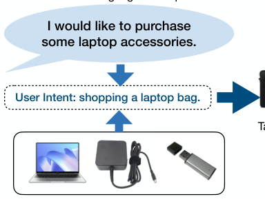
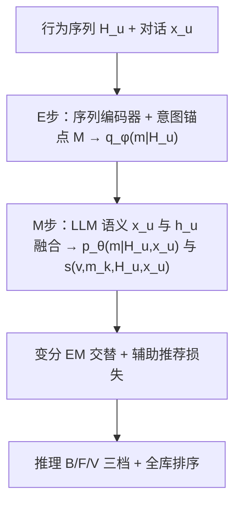
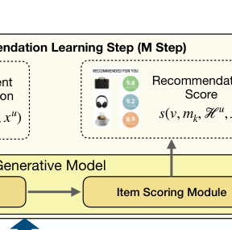

# LatentCRS: A Variational EM Framework for Bridging Semantics and Behavior in LLM-based Conversational Recommendation（LatentCRS：以变分EM桥接LLM对话推荐中语义与行为的框架）

- **会议/期刊**: KDD 2026
- **作者与机构**: Guanrong Li, Kuo Tian, Jinnan Qi, Qinghan Fu, Zhen Wu, Rui Xia, Xinyu Dai（南京大学）
- **推荐链路定位**: 对话推荐中的召回/精排与后处理重排（端到端对话推荐）
- **研究方向**: 对话推荐与智能体仿真 / 大语言模型推荐
- **论文原文**: [https://arxiv.org/abs/2503.10703v2](https://arxiv.org/abs/2503.10703v2)
- **开源代码**: [https://github.com/kylokano/LatentCRS](https://github.com/kylokano/LatentCRS)

## TL;DR (1分钟核心速览)

LLM 对话推荐存在语义空间与行为空间的表示鸿沟：LLM 擅长解析话语，却难以编码物品共现等协同模式。LatentCRS 将用户潜在意图视为连接两种模态的隐变量，用离散意图锚点与变分 EM 交替推断（E步）和意图条件生成（M步），无需微调 LLM。在 MovieLens-1M、VideoGames、CDs 的 500 条采样测试实例上，单轮全库排序的 Recall@5 相对最强 LLM 基线 CRAG 提升 73.1%/350%/70.6%；基础推理仅 87ms，远低于纯 LLM 基线。

## Background & Motivation (背景与核心矛盾)

- **主流范式**: 当前 LLM-CRS 多采用 Agent 框架，把推荐模型当作工具调用；或将物品转为文本描述，用用户行为数据微调 LLM。
- **前人局限**: Agent 框架将对话理解与推荐解耦，推荐模型看不到当前对话中的细粒度偏好；文本化+微调则受 LLM 上下文窗口限制，难以覆盖大规模物品库，且微调成本高。
- **核心洞察 (Key Insight)**: 对话话语与行为序列不是独立信号，而是同一潜在用户意图的两种表层观测。如图1，用户说“想买笔记本配件”与“已买笔记本但没买包”都指向“买笔记本包”这一意图。
- **本文切入点**: 将潜在意图建模为离散隐变量，用变分 EM 让行为推断意图、意图条件化推荐，从而在不微调 LLM 的前提下对齐语义与协同信号。

<figure class="paper-figure" markdown="span">
  <figcaption>图1：从行为序列和自然语言描述中推断用户意图。这表明自然语言描述和用户行为序列均可作为潜在用户意图的观测。</figcaption>
</figure>

## Method (核心方法设计)

### 1. 整体框架 (Overall Architecture)

输入用户行为序列 $H_u$与$N$轮对话$x_u$。E步用预训练序列推荐编码器得到行为表示$\mathbf{h}_u$，并把它映射到$K$个意图锚点上的分布$q_\phi(m|H_u)$；M步用 LLM 编码对话得到语义表示$\mathbf{x}_u$，与$\mathbf{h}_u$融合后输出意图先验$p_\theta(m|H_u,x_u)$，并以意图条件打分$s(v,m_k,H_u,x_u)$ 对物品全库排序。两模块先 warm-up，再交替优化 ELBO；推理时提供 Base/Filtered/Verified 三档 LLM 增强。

<figure class="paper-figure" markdown="span">
  <figcaption>图2：LatentCRS 的整体结构。左侧部分表示意图推断步骤（E步），旨在用推断模型准确估计用户的潜在意图分布 𝑞𝜙(𝑚| H𝑢)。右侧部分描绘推荐学习步骤（M步），其中生成模型被优化，以使其意图先验 𝑝𝜃(𝑚| H𝑢,𝑥𝑢) 与推断分布对齐，并最大化目标物品的似然。为避免在整个物品空间上归一化带来的计算成本过高，我们估计未归一化的推荐得分 𝑠(𝑣,𝑚, H𝑢,𝑥𝑢)，而非精确</figcaption>
</figure>

### 2. 关键设计拆解 (Key Designs)

1. **离散意图锚点（把不可解积分变成可学习的行为基）**：连续潜在空间积分不可 tractable，纯文本又缺行为 grounding。作者用 K-Means 对全局行为上下文聚类得到 $K$个锚点$\mathcal{M}=\{\mathbf{m}_k\}_{k=1}^{K}$，训练中锚点仍随梯度更新：
$$
q_\phi(m|H_u)=\mathrm{Softmax}\!\left(\frac{\mathbf{h}_u\mathbf{W}_q\mathbf{M}^{\top}}{\sqrt{d}}\right),\quad
p_\theta(m_k|H_u,x_u)=\mathrm{Softmax}\!\left(\mathrm{FFN}([\mathbf{h}_u;\mathbf{x}_u])\mathbf{W}_m\mathbf{m}_k^{\top}\right)
$$
直觉是：锚点把“意图”压缩成可解释、可共享的离散原型，既降低方差，又让 LLM 语义与协同行为在同一组基上对齐。

2. **变分 EM + 辅助推荐正则（防后验坍塌）**：直接联合训练两个模块会因相互噪声监督而不稳定。E步固定生成模型，最小化推断分布与目标后验的 KL：
$$
\mathcal{L}_E=\sum_{(u,v)\in\mathcal{D}}\mathrm{KL}\!\left(q_\phi(m|H_u)\,\|\,\bar{p}_\theta(m|v,H_u,x_u)\right)
$$
M步固定推断，优化负采样 NCE 与先验对齐：
$$
\mathcal{L}_{NCE}=-\sum_{(u,v)}\sum_{m_k}\bar{q}_\phi(m_k|H_u)\log\frac{\exp(s(v,m_k,H_u,x_u))}{\sum_{v'\in\{v\}\cup\mathcal{V}_{neg}}\exp(s(v',m_k,H_u,x_u))}
$$
$$
\mathcal{L}_M=\mathcal{L}_{NCE}+\lambda\,\mathrm{KL}\!\left(\bar{q}_\phi(m|H_u)\,\|\,p_\theta(m|H_u,x_u)\right)
$$
其中意图条件打分采用低秩交互：
$$
s(v,m_k,H_u,x_u)=(\mathbf{W}_v\mathbf{v})^{\top}\left(\mathrm{FFN}([\mathbf{h}_u;\mathbf{x}_u])\odot(\mathbf{W}_z\mathbf{m}_k)\right)
$$
辅助损失 $\mathcal{L}_{rec}^{E}$、$\mathcal{L}_{rec}^{M}$强制“推断出的意图本身足以解释目标物品”，防止$q_\phi$退化为均匀分布；总目标为$\mathcal{L}_{total}^{E}=\mathcal{L}_E+\alpha_E\mathcal{L}_{rec}^{E}$、$\mathcal{L}_{total}^{M}=\mathcal{L}_M+\alpha_M\mathcal{L}_{rec}^{M}$。

3. **训练目标、负采样与推理效率**：训练负采样为均匀负采样，未使用 hard negative；E步的 assistant 模块与 M步的自边缘化 $\hat{s}_\theta(v|H_u,x_u)=\sum_{m_k}s(v,m_k,H_u,x_u)p_\theta(m_k|H_u,x_u)$仅用于 warm-up。推理分三档：Base 只用 LLM 做语义编码；Filtered 让 LLM 抽取硬约束并裁剪候选；Verified 让 LLM 作 critic 重排。Base 只需一次 LLM 编码，打分复杂度为$O(Kd)$，适合在线低延迟召回。

## Experimental Setup & Evaluation Protocol (实验设置与评估协议)

- **数据集与预处理**: 三数据集覆盖电影与 Amazon 评论；MovieLens-1M 含 18 个属性，CDs 含 531 个细粒度属性。Amazon 两集正文未披露精确统计，细节在附录 D.1。

| 数据集 | #Users | #Items | #Interactions | 稀疏度/密度 | 特征/场景说明 |
| :--- | :---: | :---: | :---: | :---: | :--- |
| MovieLens-1M | 6,040 | 3,706 | ~1.0M | 4.47% | 电影评分，18 属性 |
| VideoGames | n.r. | n.r. | n.r. | n.r. | Amazon 视频游戏评论，正文未披露 |
| CDs | n.r. | n.r. | n.r. | n.r. | Amazon CD/黑胶，531 属性 |

- **数据划分与防穿越 (Splitting Strategy)**: 沿用 ICLRec 的序列推荐协议构造训练/测试，正文未给全局时间戳切分；为控制 LLM 与多轮模拟成本，每数据集采样 500 条测试实例。
- **排名评测协议 (Ranking Protocol)**: 单轮为无偏 `Full-Ranking`，即在完整物品库上对未交互物品排序；LLM 基线在同采样集、同全库候选下评测。多轮采用 Gemini-1.5-Pro 角色扮演用户模拟器，指标为 S@3/S@5 与平均轮数 AT；并用 30 组真人会话做盲评校验模拟器偏差。
- **对比基线与超参设置**: 传统基线 CRM、UNICORN、CRIF；LLM 基线 Llama-3.1-8B、Gemini-1.5-Pro、GPT-4、Chat-Rec、InteRecAgent、UniCRS、CRAG。LatentCRS 与 UniCRS 同用 Llama-3.1-8B，序列 backbone 为 ICLRec；锚点数 $K\ge128$后性能波动约 1%，显著性用$t$-test，$p<0.05$。

## Key Experimental Results (实验关键数据)

### 1. 主实验对比 (Main Results)

下表为单轮、采样测试集上的结果；传统方法在 full 数据集上的结果另述。表内加粗为采样协议内最优。

| 方法 | ML R@5 | ML N@5 | ML N@20 | VG R@5 | VG N@20 | CDs R@5 | CDs N@20 |
| :--- | :---: | :---: | :---: | :---: | :---: | :---: | :---: |
| Llama-3.1-8B | 0.054 | 0.0396 | 0.0507 | 0.020 | 0.0182 | 0.012 | 0.0085 |
| Gemini-1.5-Pro | 0.068 | 0.0414 | 0.0604 | 0.034 | 0.0409 | 0.018 | 0.0433 |
| GPT-4 | 0.064 | 0.0421 | 0.0622 | 0.032 | 0.0400 | 0.028 | 0.0476 |
| Chat-Rec | 0.086 | 0.0546 | 0.0950 | 0.038 | 0.0630 | 0.016 | 0.0787 |
| InteRecAgent | 0.006 | 0.0043 | 0.0087 | 0.014 | 0.0118 | 0.018 | 0.0163 |
| UniCRS | 0.092 | 0.0551 | 0.1067 | 0.078 | 0.1291 | 0.038 | 0.0389 |
| CRAG | 0.104 | 0.0823 | 0.0849 | 0.040 | 0.1011 | 0.034 | 0.0469 |
| LatentCRS_B | 0.142 | 0.0879 | 0.1426 | 0.140 | 0.1326 | 0.040 | 0.0454 |
| LatentCRS_F | **0.180** | **0.1209** | **0.1604** | 0.146 | 0.1347 | **0.058** | **0.0573** |
| LatentCRS_V | 0.160 | 0.1139 | 0.1582 | **0.180** | **0.1592** | 0.048 | 0.0489 |

相对 CRAG，LatentCRS 的 R@5 在 ML/VG/CDs 上分别提升 **73.1%/350%/70.6%**（F 或 V 取最优）。但需注意：在 full 协议下，CDs 的 UNICORN R@5=0.0839、N@20=0.0833，仍高于 LatentCRS_F，说明 531 个细粒度属性的硬过滤在该集单轮场景有结构性优势。

### 2. 消融实验 (Ablation Study)

| 变体 | ML R@5 | ML N@20 | VG R@5 | VG N@20 | CDs R@5 | CDs N@20 |
| :--- | :---: | :---: | :---: | :---: | :---: | :---: |
| LatentCRS_B | **0.1437** | **0.1449** | **0.1378** | **0.1310** | **0.0485** | **0.0494** |
| w/o Inference Module | 0.0232 | 0.0271 | 0.0309 | 0.0283 | 0.0240 | 0.0269 |
| Direct KL Alignment | 0.0847 | 0.0911 | 0.0728 | 0.0756 | 0.0258 | 0.0285 |
| w/o RecLoss | 0.0755 | 0.0805 | 0.1006 | 0.1098 | 0.0241 | 0.0264 |

多轮结果（采样集）显示：LatentCRS_V 在 MovieLens 取得 S@3=0.532、AT=3.298，在 VideoGames 取得 S@3=0.378、AT=3.706，均优于 Chat-Rec/UniCRS/CRAG；但 S@5 上 Chat-Rec 仍以 0.686/0.724 略高，说明重排提升前期命中、却未必扩大最终覆盖。CDs 多轮更弱（V 的 S@5=0.220 vs Chat-Rec 0.558），窄属性域下对话澄清反而更难收敛。

### 3. 关键实验发现 (Key Findings)

1. **推断模块是主增益来源**：移除后 MovieLens R@5 从 0.1437 跌至 0.0232（-83.9%），VideoGames 从 0.1378 跌至 0.0309；纯语义生成无法恢复行为协同信号。直接联合 KL 仅恢复到 0.0847，证明交替 EM 的解耦优化不可替代。
2. **辅助推荐损失是防坍塌关键**：去掉 $\mathcal{L}_{rec}$ 后 MovieLens R@5=0.0755（-47.5%）、VideoGames=0.1006（-27.0%）、CDs=0.0241（-50.3%）；CDs 上生成先验本身区分度低，没有判别式正则时意图分布迅速退化。
3. **效率与效果可兼得**：Base 变体仅 85.5 输入 token、1 输出 token、87ms，较 Llama-3.1-8B 的 119.5/148.2/2568ms 降低约 96.6% 延迟；其 MovieLens R@5=0.142 已超过所有 LLM 基线（CRAG 0.104），说明意图桥本身贡献主要收益，Verified 的 810 token/2168ms 主要用于多轮语义重排。

## Highlights & Limitations (亮点、对比与审稿批判)

- **与代表作对比 (vs. Prior Work)**: 相较 InteRecAgent 的“LLM 规划 + 推荐工具”解耦架构，LatentCRS 让对话语义与行为序列在意图层联合优化（MovieLens R@5 0.180 vs 0.006，差距极端但反映工具调用在细粒度排序上的失配）；相较 Chat-Rec 的 prompt 上下文拼接，本文引入行为 grounding（0.180 vs 0.086）；相较同 backbone 的 UniCRS prompt learning，EM 意图桥在 ML/VG 上分别提升 95.7%/130.8%。
- **可迁移亮点**: K-Means 初始化 + 梯度更新的离散锚点可作为通用“语义-行为”瓶颈；warm-up + 辅助推荐损失是变分推荐中防后验坍塌的轻量配方；B/F/V 三档推理可按延迟预算分级调用 LLM。
- **审稿级局限批判**: 评测依赖 Gemini-1.5-Pro 模拟器与 500 条采样，虽盲评 30 组会话偏差接近平衡，仍缺真实线上 A/B；CDs 上不如 UNICORN 的硬属性过滤，说明高细粒度属性域泛化不足；意图被建模为静态隐变量，未处理长对话中的意图漂移，且 $K$、$\alpha_E$、$\alpha_M$、$\lambda$ 需逐数据集调参。

## Rating (四维评分)

- **方法创新性 (Novelty)**: ⭐⭐⭐⭐ （把变分 EM 与离散意图锚点用于 LLM-CRS 的语义-行为对齐，机制清晰且有 ELBO 支撑；意图桥思想并非全新，增量主要在跨模态落地。）
- **评估协议与实验扎实度 (Protocol & Experiments)**: ⭐⭐⭐ （三数据集、单/多轮、全库排序、消融与效率分析较完整，并有 30 组盲评；但主评测仍由模拟器与 500 条采样驱动，缺线上验证。）
- **写作与数学规范度 (Clarity & Rigor)**: ⭐⭐⭐⭐ （ELBO、E/M 步与 NCE 推导完整，符号统一；部分附录依赖较重，正文对数据划分与统计披露不足。）
- **工业落地与复现价值 (Industrial & Practical Value)**: ⭐⭐⭐⭐ （代码开源，Base 变体 87ms 极具部署性价比；但 EM 调参、锚点初始化与 LLM 编码依赖仍需工程化，Verified 档延迟接近纯 LLM。）

