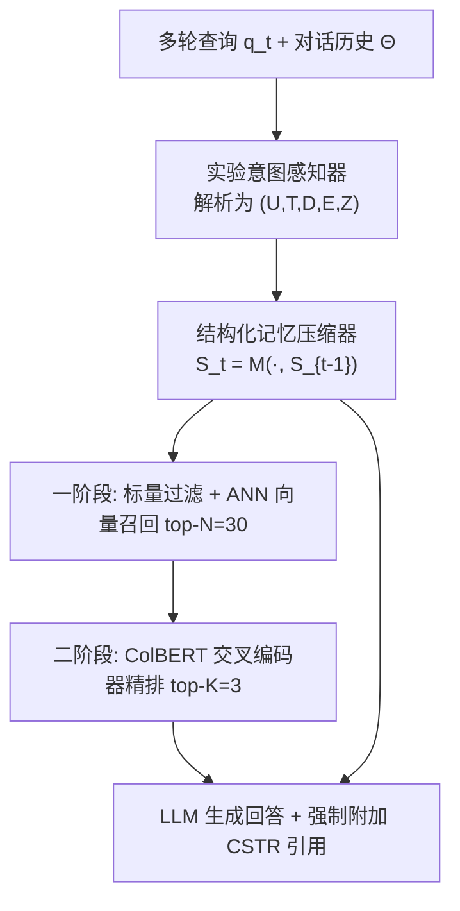

# ScienceDB AI: An LLM-Driven Agentic Recommender System for Large-Scale Scientific Data Sharing Services（面向大规模科学数据共享的 LLM 驱动智能体推荐系统）

- **会议/期刊**: KDD 2026
- **作者与机构**: Qingqing Long, Haotian Chen, Chenyang Zhao, Xiaolei Du, Xuezhi Wang, Pengyao Wang, Chengzan Li, Yuanchun Zhou, Hengshu Zhu（中国科学院计算机网络信息中心）
- **推荐链路定位**: 端到端生成式（对话式检索—重排—生成一体化）
- **研究方向**: 对话推荐与智能体仿真 / 大语言模型推荐
- **论文原文**: [https://arxiv.org/abs/2601.01118v1](https://arxiv.org/abs/2601.01118v1)
- **开源代码**: 暂未开源（线上系统：[https://ai.scidb.cn/en](https://ai.scidb.cn/en)）

## TL;DR (1分钟核心速览)

科学数据集推荐的核心痛点在于需求由**科研任务**驱动而非历史偏好驱动，且查询是长篇的实验级自然语言描述，传统 CF 与关键词/浅层语义匹配双双失效；直接套用 LLM Agent 又会幻觉出不存在的数据集、并在长对话中遗忘约束。本文提出 ScienceDB AI：用**实验意图感知器**把长查询解析成结构化实验要素，用**结构化记忆压缩器**做递归摘要抑制遗忘，用**可信两阶段 RAG（ANN 向量召回+标量过滤+ColBERT 重排）**并给每条结果附加 CSTR 可引用标识。在 1,000 万真实数据集上，离线 Recall@1 达 0.4064，较最强 Agent 基线 InteRecAgent 提升约 51%，线上 A/B 的 CTR 相对关键词检索提升 200%+。

## Background & Motivation (背景与核心矛盾)

- **主流范式**: 数据集推荐分两支——行为型（CF / 图表示学习）与内容型（关键词检索、BERT 语义向量匹配）；现有平台（Google Dataset Search、DataCite、OpenAIRE 等 14 家）几乎全部停留在关键词检索，无一提供对话式推荐。
- **前人局限**: ① 行为型失效——统计显示下载量 ≥9 的活跃用户其主题分布高度发散（图 1(b)），需求随实验任务漂移，历史交互几乎无同质性可学；② 内容型失效——`"single-cell fate trajectory inference, cross-organ differentiation in human/mouse, respond to genetic perturbations"` 这类查询要求实验级语义理解，TF-IDF/BERT 相似度无能为力。
- **核心洞察 (Key Insight)**: 科学场景的推荐单元不是"物品"，而是**一次实验的约束集合**（物种、模态、设置、评价指标）；同时科学场景对**可信、可访问、可引用**有硬性要求，通用 Agent 的幻觉在此不可接受。
- **本文切入点**: 不做多 Agent 协作（通信延迟高），而用**单 Agent + 结构化意图 + 检索兜底**替代自由生成，让 LLM 只负责"理解与组织"，事实永远来自 1,000 万真实库。

## Method (核心方法设计)

### 1. 整体框架 (Overall Architecture)

输入第 $t$轮查询$\boldsymbol{q}_t$与历史$\Theta_{1:t-1}$；意图感知器将查询改写为结构化意图$\tilde{\boldsymbol{q}}_t=(U,T,D,E,Z)$（研究对象、任务、数据模态、实验设置、评价指标）；记忆压缩器把全部对话与工具日志压成结构化记忆$\mathbf{S}_t$；随后以$\tilde{\boldsymbol{q}}_t$与$\mathbf{S}_t$融合的意图向量在 Qdrant 集群（1,000 万数据集、十亿级向量）上做"标量过滤 + ANN"召回 top-$N$（默认$N{=}30$），再由 ColBERT 交叉编码器精排取 top-$K$（默认$K{=}3$）；最后由 LLM 结合系统提示强制输出每条数据集的 CSTR 链接生成回答。若记忆冲突无法消解，Agent 主动发起澄清追问。

### 2. 关键设计拆解 (Key Designs)

1. **实验意图感知器（把长文查询变成可检索的结构化槽位）**：通用对话推荐只做 query rewriting，槽位粒度停留在"品类/价格"；本文依据科研流程定义两级要素体系（一级 Data/Topic/Experimental Constraints/Evaluation Metrics，二级 Species/Modality/Source/Annotation）。作用在于把"跨器官分化 + 人/鼠 + 扰动响应"这类隐含约束显式化，使后续标量过滤成为可能——这是把 RAG 从"语义最近"推向"实验可行"的关键一步。

2. **结构化记忆压缩器 SSRC（显式摘要替代隐式压缩，抗遗忘与冲突）**：LLM 上下文虽达 126K，但直接塞入超长对话会导致模型遗忘系统提示或候选集，从而幻觉。本文采用显式、递归、新近优先的压缩：
$$\mathbf{S}_t=\begin{cases}\Theta_{1:1}, & t=1\\ \mathcal{M}\big(\tilde{\boldsymbol{q}}_t,\boldsymbol{\tau}_t,\boldsymbol{r}_t,\mathbf{S}_{t-1}\big), & t>1\end{cases}$$
其中 $\boldsymbol{\tau}_t$为工具调用日志（避免重复检索），$\boldsymbol{r}_t$ 为系统回复。相比隐式 KV/摘要压缩，显式保留意图模板槽位，使"新约束覆盖旧约束"的冲突消解可被显式触发（生成澄清问句），而非让模型自行遗忘。

3. **可信两阶段检索与训练/推理开销**：一阶段用 $\cos(\boldsymbol{e}(\tilde{\boldsymbol{q}}_t),\boldsymbol{e}(\boldsymbol{d}_i))$在预过滤后的子空间（发表年份、分类、机构等标量）内取 top-$N$，解决千万级库上纯精排不可行的问题；二阶段 ColBERT 以 token 级 late interaction 计算$s(\tilde{\boldsymbol{q}}_t,\boldsymbol{d}_i)=\sum_{i}\max_{j}\boldsymbol{E}_{q_i}^{\top}\boldsymbol{E}_{d_j}$，捕捉"非共晶组分""同步诊断输出"等细粒度约束。**本系统为免训练方案**：无 BPR/InfoNCE 损失、无需负采样，全部依赖预训练编码器与提示工程；每条样本端到端推理耗时显著低于带反思模块的 InteRecAgent（518s），具备在线可部署性。

## Experimental Setup & Evaluation Protocol (实验设置与评估协议)

- **数据集与预处理**: 从 ScienceDB 近两年点击日志中采样约 1 万用户与 1.5 万下载数据集；候选池为全平台 **1,000 万**数据集。

| 数据集 | #Users | #Items | #Interactions | 稀疏度/密度 | 特征/场景说明 |
| :--- | :---: | :---: | :---: | :---: | :--- |
| ScienceDB-Offline | ~10,000 | ~15,000（已下载） | ~15,000 条点击 | 极稀疏（候选池 10M 级，命中率 <0.15%） | 元数据+描述文本+CSTR+分类/机构/年份标量 |
| ScienceDB-Online | 全站真实流量 | 10M | 线上曝光日志 | — | 线上 A/B，Top-4 位置 CTR |

- **数据划分与防穿越 (Splitting Strategy)**: 采用**用户历史点击模拟对话**的构造式划分——把用户曾下载的数据集作为 ground-truth，用 Qwen-Plus 依据数据集描述反向生成 3–5 轮的实验设计对话作为输入，天然避免"未来信息泄漏"，但属于 LLM 合成的半人工测试集。
- **排名评测协议 (Ranking Protocol)**: **Sampled/Constrained Ranking**——候选由查询经 ANN 从 1,000 万库中检索得到，并非严格 Full-Ranking；指标为 Recall/NDCG/MRR@{1,3,5} 与平均成功轮数 AT（$t$轮内未命中记为$t+1$）。
- **对比基线与超参设置**: 三类基线——数据集推荐（DataFinder、DataLinking）、对话 LLM+RAG（DeepSeek-V3 671B、Qwen3 235B）、Agent 型（InteRecAgent、CoSearchAgent）；核心 LLM 为 Qwen-Plus（2025-04-28，126K 输入），向量库为分布式 Qdrant，$N{=}30$，$K$ 默认 3；基线均用默认超参，不支持多轮的模型将多轮拆为单轮。

## Key Experimental Results (实验关键数据)

### 1. 主实验对比 (Main Results)

| Model | R@1 | R@3 | R@5 | N@1 | N@5 | MRR@1 | MRR@5 | AT@3 | AT@5 |
| :--- | :---: | :---: | :---: | :---: | :---: | :---: | :---: | :---: | :---: |
| DataFinder | 0.0115 | 0.0726 | 0.1481 | 0.0115 | 0.0764 | 0.0115 | 0.0533 | 3.09 | 3.01 |
| DataLinking | 0.2605 | 0.3003 | 0.3084 | 0.2605 | 0.2871 | 0.2605 | 0.2800 | 3.06 | 3.03 |
| DeepSeek-V3+RAG | 0.2277 | 0.2513 | 0.2530 | 0.2277 | 0.2428 | 0.2277 | 0.2392 | 3.24 | 3.23 |
| Qwen3+RAG | 0.2559 | 0.2778 | 0.2824 | 0.2559 | 0.2712 | 0.2559 | 0.2673 | 3.17 | 3.15 |
| CoSearchAgent | 0.1608 | 0.1988 | 0.2386 | 0.1608 | 0.1984 | 0.1608 | 0.1854 | 3.31 | 3.25 |
| InteRecAgent | 0.2686 | 0.3083 | 0.3141 | 0.2686 | 0.2950 | 0.2684 | 0.2884 | 3.06 | 3.05 |
| **ScienceDB AI** | **0.4064** | **0.4187** | **0.4196** | **0.4065** | **0.4146** | **0.4065** | **0.4128** | **2.89** | **2.83** |
| **Improv.% (vs 最强基线)** | +51.3% | +35.8% | +33.6% | +51.3% | +40.5% | +51.4% | +43.1% | -5.6% | -7.2% |

### 2. 消融实验 (Ablation Study)

原文未给出逐模块数值消融表，而是用"同构替代基线"做代理对照（下表数值取自表 2 与图 5，归因由本文给出）：

| 配置（代理对照） | Recall@1 | NDCG@1 | AT@3 | 单样本耗时 |
| :--- | :---: | :---: | :---: | :---: |
| 完整 ScienceDB AI | **0.4064** | **0.4065** | **2.89** | 低（<150s） |
| w/o 意图感知器（≈ Qwen3+RAG，直接用原查询） | 0.2559 | 0.2559 | 3.17 | 较低 |
| w/o 结构化记忆（≈ 多轮拆单轮的 DataFinder） | 0.0115 | 0.0115 | 3.09 | 中 |
| w/o Agent 结构 / 换成多 Agent（CoSearchAgent） | 0.1608 | 0.1608 | 3.31 | 中 |
| 叠加规划+反思模块（InteRecAgent） | 0.2686 | 0.2686 | 3.06 | **518s** |

### 3. 关键实验发现 (Key Findings)

1. **意图结构化是最大增益源**：从 Qwen3+RAG（0.2559）到完整系统（0.4064），Recall@1 提升 0.15 绝对值，而 DeepSeek-V3+RAG 反而低于 Qwen3+RAG，说明**增益来自查询侧的结构化改写而非底座模型规模**。
2. **复杂 Agent 模块是负收益**：加入规划/反思的 InteRecAgent 仅 0.2686 且单样本耗时 518s，远慢于其余模型；多 Agent 的 CoSearchAgent 更差（0.1608），验证了作者"意图理解+检索+记忆 > 复杂规划"的判断。
3. **Top-1 精度换取排序头部饱和**：CoSearchAgent 从 @1 到 @5 的 Recall 提升 48.4%，而本文仅提升 3.2%，说明正确数据集已被稳定排到首位——这在只展示 top-3 的对话界面里比提升 @5 更有业务价值。
4. **线上验证语义匹配优于字符串匹配**：A/B 中相对关键词检索的 CTR 提升 200%+，且在精确匹配（Exact）条件下提升更显著，说明 Rel./DL. 两类基线无论模糊或精确匹配都只是字符串层面操作，无法理解科研意图。

## Highlights & Limitations (亮点、对比与审稿批判)

- **与代表作对比 (vs. Prior Work)**: 相比 DataFinder/DataLinking 的"整句向量相似度"，本文把查询拆到实验要素级并引入标量过滤，本质是把单阶段语义检索升级为"结构化约束 + 语义 + 交叉精排"；相比 InteRecAgent/CoSearchAgent 的通用 Agent 栈，本文砍掉规划与反思模块、以检索可信性替代自由生成，用 CSTR 硬约束消除幻觉；相比 DeepSeek/Qwen+RAG 的"检索后让 LLM 挑"，本文让重排器而非 LLM 做最终排序决策。
- **可迁移亮点**: ① **CSTR/DOI 式唯一标识挂载 + 系统提示强制引用**，是任何需要可审计推荐的场景（文献、法规、医疗）低成本可复用的抗幻觉手段；② **递归显式结构化记忆 + 新近优先冲突检测 → 主动澄清问句**，可直接移植到多轮电商导购与会话式检索。
- **审稿级局限批判**: ① **评估协议偏弱**——离线测试集由 Qwen-Plus 依据数据集描述反向合成对话，存在分布自洽与标签泄漏风险（合成器与系统同源），且候选由 ANN 检索产生而非全库 Full-Ranking，指标偏乐观；② **无可训练参数、无逐模块数值消融**，方法更像系统集成工程，缺少对"意图槽位体系 vs 记忆压缩"各自贡献的定量拆解，也缺少对 ColBERT 重排 vs 纯向量召回的对照；③ 1,000 万库的标量过滤阈值与 $N{=}30$ 的超参敏感性未讨论，跨平台（如 Zenodo、OpenAIRE）迁移性未知。

## Rating (四维评分)

- **方法创新性 (Novelty)**: ⭐⭐⭐（首个面向大规模科学数据共享的 LLM 单智能体推荐系统，意图槽位体系与 CSTR 可信引用有场景新意，但组件本身多为已有技术的组合式落地）
- **评估协议与实验扎实度 (Protocol & Experiments)**: ⭐⭐⭐（含 1,000 万真实库离线评测与线上 A/B，AT 指标设计合理；但合成对话测试集、非全库排序、缺逐模块数值消融削弱了说服力）
- **写作与数学规范度 (Clarity & Rigor)**: ⭐⭐⭐（框架图与算法伪代码清晰、系统链路完整；形式化偏浅，记忆压缩与重排公式较简，缺复杂度与超参敏感性分析）
- **工业落地与复现价值 (Industrial & Practical Value)**: ⭐⭐⭐⭐（已上线可访问、单样本延迟远优于反思型 Agent、免训练易部署；但代码未开源、依赖 Qwen-Plus 与 Qdrant 集群，复现门槛中等）

