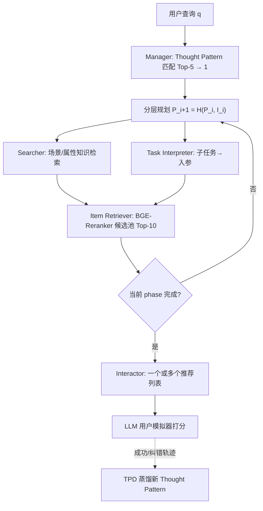
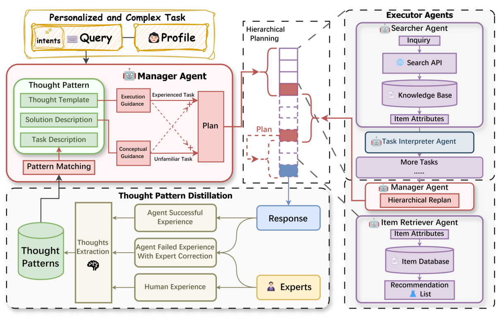

# Thought-Augmented Planning for LLM-Powered Interactive Recommender Agent (思维增强规划的 LLM 交互式推荐智能体)

- **会议/期刊**: KDD 2026（arXiv:2506.23485v1）
- **作者与机构**: Haocheng Yu, Hao Wang, Yuyang Ye, Enhong Chen (USTC)；Yaxiong Wu, Wei Guo, Yong Liu (华为诺亚方舟实验室)；Yawen Li, Junping Du (BUPT)
- **推荐链路定位**: 端到端对话交互式推荐（自然语言查询 → 任务规划 → 检索 → 列表生成）
- **研究方向**: 对话推荐与智能体仿真 / 大语言模型推荐
- **论文原文**: [https://arxiv.org/abs/2506.23485v1](https://arxiv.org/abs/2506.23485v1)
- **开源代码**: [https://github.com/Alcein/TAIRA](https://github.com/Alcein/TAIRA)

## TL;DR (1分钟核心速览)

针对 LLM 交互推荐智能体在"直觉化 / 未精炼 / 含糊"复杂意图下规划与泛化能力不足（CoT、Reflexion 类失败率超 60%）的痛点，本文提出 TAIRA：Manager Agent 先检索匹配一个"思维模式"(Thought Pattern)，再据此做分阶段分层规划，交由 Searcher / Task Interpreter / Item Retriever 执行；配套 Thought Pattern Distillation (TPD) 从智能体成功轨迹、专家纠错后的失败轨迹、人类专家经验三源蒸馏多尺度思维模板。在 Amazon Clothing/Beauty/Music 三个域共 1120 条模拟查询上，HR@10、NDCG@10、成功率 SR 全面超越 11 个基线，SR 相对提升 9.72%–15.34%。

## Background & Motivation (背景与核心矛盾)

- **主流范式**: 交互推荐从模板化属性问答走向 LLM 驱动的对话推荐与多智能体框架（MACRec、InteRecAgent），通过工具调用完成任务分解与推荐。
- **前人局限**: ① 分解优先型（Plan&Solve、CoT）一次性定死计划，遇到执行中的不确定性无法回退；② 反思型（ReAct、Reflexion）只能事后自我纠错，缺乏跨任务可复用的先验，模糊需求下常"越搜越偏"（案例中 Reflexion 反复收敛到更冷门的属性词）。
- **核心洞察**: 作者发现 Reflexion 已凭自反馈优于纯规划基线，InteRecAgent 凭外部 LLM 生成的示例任务描述也更强——说明真正起作用的不是"多一步推理"，而是**高层次思维先验**；但二者的先验仍是单步示例或局部反馈，未形成可跨任务迁移的"解题套路"。
- **本文切入点**: 把"成功解题路径"蒸馏成结构化 Thought Pattern（任务描述 + 方案描述 + 思维模板），以检索匹配 + 分层规划的方式注入 Manager Agent，实现"经验复用 + 新任务泛化"。

## Method (核心方法设计)

### 1. 整体框架 (Overall Architecture)

用户给出自然语言查询 $q$ 后，Manager Agent 先做 Thought Pattern 匹配，从模式库中召回最相关的先验；随后以该模式为高层指引生成**分阶段**计划，每个 phase 内调度 Searcher Agent（调 Google Search API + 属性映射器补齐"什么属性符合该场景"）与 Item Retriever Agent（用 BGE-Reranker 在候选池内按属性-商品描述相似度排序出 Top-10），Task Interpreter Agent 负责把子任务描述翻译成下游智能体可接受的结构化入参。若当前 phase 计划指定 PlannerAgent 收尾，则触发下一轮重规划，否则由 Interactor Agent 汇总生成可能包含多个推荐列表的最终回复。系统无梯度训练，全部能力来自 prompt 与模式库的增量更新；TPD 在每个任务结束后把成功轨迹、专家纠错轨迹蒸馏回模式库，形成闭环。

<figure class="paper-figure" markdown="span">
  <figcaption>图2：TAIRA 的整体架构。Manager Agent 为每个用户查询定位匹配的 Thought Pattern，然后分阶段分解并规划任务。Executor Agents 完成这些子任务。同时，Thought Pattern Distillation 将成功、修正和专家经验收集并精炼为思维模式。</figcaption>
</figure>

### 2. 关键设计拆解 (Key Designs)

1. **三段式多尺度 Thought Pattern（可检索、可降级使用）**：以往经验注入要么是 few-shot 单步示例、要么是自由文本反思，既不可检索也无法分层降级。本文把模式 $p=(\tau,\sigma,T)$拆成任务描述$\tau$（抽象任务类型，用于匹配）、方案描述$\sigma$（概念级"这类问题怎么破"）、思维模板$T$（含多个 phase 的执行级步骤）。匹配时先按任务描述相似度取 Top-$K$（$K{=}5$）：$\mathcal{P}_q=\mathrm{TopK}_{p\in\mathcal{P}}\,\mathrm{Sim}(q,\tau_p)$，再由 Manager 二次判定选出唯一模式。关键在于**命中则照抄$T$的执行步骤，未命中则只借鉴$\sigma$ 的概念指引**——这正是新任务上仍能保持基本成功率的物理来源。

2. **分层规划（Hierarchical Planning）代替一次性分解**：分解优先方案在动态环境中僵化，纯交错方案（ReAct）又缺乏全局关联。本文取折中：每个 phase 只规划当前可执行的少数步骤，phase 结束后依据已获信息集 $I_i$重新规划，$P_{i+1}=H(P_i,I_i),\ i\ge 0$。这使"先探明有哪几类聚会场景 → 再对每类分别规划检索与重排"这种**需求分桶**成为可能，直接对应图 1 中"多场景分别给列表"的用户预期。

3. **TPD 三源蒸馏与推理开销**：蒸馏不只看成功经验，还纳入（i）智能体成功轨迹、（ii）失败轨迹 + 人类专家纠正后的路线、（iii）人类专家直接经验，用统一 prompt 让 LLM 按"任务描述 / 方案描述 / 思维模板"三栏重写旧模式。形式上是非参数化的模式库更新 $\mathcal{P}\leftarrow\mathcal{P}\cup\{\mathrm{TPD}(\text{route},\text{expert},\mathcal{P})\}$，无损失函数、无负采样。代价是推理侧的多次 GPT-4o 调用：1 次匹配 + 每 phase 一次规划 + 每子任务一次执行，延迟随 phase 数近似线性增长。

## Experimental Setup & Evaluation Protocol (实验设置与评估协议)

原文未报告 #Users / #Items / #Interactions 统计，仅报告按难度切分的查询规模（每条查询由最后一个交互作为目标物品反推构造）：

| 数据集 | Dev 查询 | Test 查询 | 难度构成 (Easy/Medium/Hard) | 场景覆盖 |
| :--- | :---: | :---: | :---: | :--- |
| Amazon Clothing | 60 | 358 | 119 / 131 / 108 | 服饰电商，属性粒度细 |
| Amazon Beauty | 60 | 395 | 129 / 135 / 131 | 美妆个护 |
| Amazon Music | 60 | 367 | 124 / 119 / 124 | 音乐风格/场景推荐 |

- **查询构造与难度分层**: 7 类语义（直接指代 33.2%、使用场合 13.6%、搭配追加 11.2%、多品类 9.7%、套装 Bundle 10.7%、模糊需求 11.5%、多场合 10.1%），Easy 为明确商品请求，Medium 需需求转换推理，Hard 需多目标 + 多轮知识获取与规划。
- **数据划分与防穿越**: 每个"数据集 × 难度"生成 100+ 条查询，20 条作 dev，其余全部作 test（非 Leave-One-Out、非时间戳切分）。
- **排名评测协议**: 非传统 Full-Ranking。Item Retriever 在**数据集候选池**内检索并返回 10 条列表，再由 LLM 用户模拟器逐条打分（命中目标物品 2 分、符合需求 1 分、不符合偏好降为 0.5 分、整列表不满足需求则全 0），据此计算 HR@10、NDCG@10 与任务级 SR（子任务迭代超阈值或候选不足即判失败）。属**LLM-as-Judge 的采样式列表评估**。
- **对比基线与超参**: 检索类 BM25 / BGE-M3 / BGE-Reranker；规划类 Zero-shot / One-shot / CoT / Plan&Solve / ReAct / Reflexion；智能体推荐系统 MACRec / MACRS / InteRecAgent。主干 LLM 统一为 GPT-4o，显著性用 paired t-test（$p<0.05$）。

## Key Experimental Results (实验关键数据)

### 1. 主实验对比 (Main Results)

| 方法 | Clothing (HR/NDCG/SR) | Beauty (HR/NDCG/SR) | Music (HR/NDCG/SR) |
| :--- | :---: | :---: | :---: |
| BM25 | 0.0801 / 0.2543 / 0.4929* | 0.2171 / 0.4546 / 0.4886* | 0.1628 / 0.3336 / 0.3910* |
| BGE-Reranker | 0.2970 / 0.5031 / 0.6095* | 0.2980 / 0.4946 / 0.5152* | 0.1763 / 0.3516 / 0.4687* |
| CoT | 0.3686 / 0.6160 / 0.6857* | 0.3466 / 0.5505 / 0.6333* | 0.2494 / 0.4351 / 0.5448* |
| Plan & Solve | 0.4050 / 0.6855 / 0.7966 | 0.3244 / 0.5265 / 0.6573* | 0.3190 / 0.4857 / 0.6219* |
| ReAct | 0.4217 / 0.6912 / 0.7231* | 0.3921 / 0.6012 / 0.6034* | 0.2323 / 0.4012 / 0.4713* |
| Reflexion | 0.4218 / 0.7002 / 0.7750* | 0.4001 / 0.6203 / 0.6444* | 0.3234 / 0.4900 / 0.5915* |
| InteRecAgent | 0.4207 / 0.7035 / 0.6883* | 0.3919 / 0.6136 / 0.6485* | 0.2919 / 0.4585 / 0.6155* |
| MACRec | 0.4205 / 0.6846 / 0.6717* | 0.3834 / 0.5999 / 0.6345* | 0.2634 / 0.4876 / 0.6335* |
| **TAIRA** | **0.4489 / 0.7314 / 0.8824** | **0.4293 / 0.6579 / 0.7569** | **0.3513 / 0.5546 / 0.7483** |
| Improv. | +4.54% / +3.97% / +9.72% | +6.80% / +5.72% / +13.16% | +8.40% / +11.40% / +15.34% |

### 2. 消融实验 (Ablation Study)

| 变体 | Clothing HR@10 | Clothing SR | Beauty HR@10 | Beauty SR | Music HR@10 | Music SR |
| :--- | :---: | :---: | :---: | :---: | :---: | :---: |
| TAIRA 全量 | **0.4489** | **0.8824** | **0.4293** | **0.7569** | **0.3513** | **0.7483** |
| w/o Thought Pattern Matching (T) | 0.4023 | 0.7935 | 0.3278 | 0.6552 | 0.3176 | 0.6396 |
| w/o Hierarchical Planning (H) | 0.4080 | 0.8478 | 0.3621 | 0.7143 | 0.3486 | 0.6809 |
| w/o Experts' Experience (E) | 0.4074 | 0.8236 | 0.3587 | 0.6812 | 0.3381 | 0.6712 |
| w/o Agents' Experience (A) | 0.4013 | 0.8081 | 0.3546 | 0.6824 | 0.3484 | 0.6592 |

### 3. 关键实验发现 (Key Findings)

1. **匹配机制是增益的绝对主源**：去掉 T 后 SR 在三个域分别跌落 8.9 / 10.2 / 10.9 个点（Clothing 0.8824→0.7935），远超去掉 H（3.5 点）、E（5.9 点）、A（7.4 点）。这说明"检索到哪套套路"比"怎么在套路内微调"更决定成败——没有先验的模式模板，分层规划只是在错误的计划上更精细地执行。
2. **增益随难度单调放大，而非均匀分摊**：相对 Reflexion，Easy 上差距极小，Hard 上显著拉开（Music Hard SR 0.5118 vs 0.4023，+27.2%）；同时 Plan&Solve 在 Clothing 上 SR 已达 0.7966 却在 Music 上仅 0.6219，说明仅靠一次性分解在跨域复杂意图上不可靠，必须靠分阶段重规划 + 场景分桶。
3. **概念级方案描述支撑零样本泛化**：在人为移除整类场景模板的 novel task 上，TAIRA 的 SR 仍全面优于 Reflexion（Clothing Hard 0.7834 vs 0.7212，Beauty Hard 0.5431 vs 0.5023），Music Hard 甚至出现反向正迁移（0.5597 > 有经验的 0.5118）；代价是 Clothing/Beauty 的 Hard 分别下降 7.4 / 6.8 点——泛化能力主要来自 $\sigma$的抽象指引，而执行级模板$T$ 缺失仍会造成可量化损失。

## Highlights & Limitations (亮点、对比与审稿批判)

- **与代表作对比**: 相比 Reflexion 只用单次失败的自反馈修正，TAIRA 复用跨任务可检索的结构化先验；相比 InteRecAgent 依赖外部 LLM 生成的单步示例，TAIRA 的 Thought Pattern 含 phase 级执行模板；相比 BoT 只蒸馏成功经验，TPD 额外纳入"专家纠错后的失败轨迹"，这是其在高难任务上胜出的关键差异。
- **可迁移亮点**: ① "任务描述 / 方案描述 / 执行模板"三段式经验结构，可直接搬到多轮 CRS 的会话策略库或 Agent 化搜索的 query 规划库；② 命中用模板、未命中降级用方案描述的**双通道降级策略**，是低成本零样本泛化的通用技巧。
- **审稿级局限批判**: ① **评估可信度**：全部指标由 LLM 用户模拟器打分，且模拟器 prompt 与目标物品强绑定（命中给 2 分），存在自我偏好与评分饱和风险，缺少真人 A/B 或与人工标注的一致性校验；② **成本与统计**：每查询需多次 GPT-4o 调用 + 在线检索，论文未报告 token/延迟/费用，模式库随任务增长而无淘汰机制，长期检索开销与噪声累积均未分析；③ 仅支持单轮用户输入（作者自认数据限制），"交互式"名不副实。

## Rating (四维评分)

- **方法创新性 (Novelty)**: ⭐⭐⭐⭐ （把"经验蒸馏"从自由文本反思升级为可检索、可分层降级的三段式模式，思路虽承袭 BoT，但与分层规划的组合确实切中复杂意图这一真实痛点）
- **评估协议与实验扎实度 (Protocol & Experiments)**: ⭐⭐⭐ （3 域 × 3 难度 × 11 基线的覆盖面充足且有 paired t-test，但评估完全依赖 LLM 模拟器、无人工校验，SR 指标对 prompt 敏感）
- **写作与数学规范度 (Clarity & Rigor)**: ⭐⭐⭐ （系统流程与 prompt 交代完整、附录详尽，但形式化仅停留在 $P_{i+1}=H(P_i,I_i)$ 一行，缺乏复杂度与收敛性分析）
- **工业落地与复现价值 (Industrial & Practical Value)**: ⭐⭐⭐⭐ （代码已开源、以现成工具链与 GPT-4o 搭建，工程可复制性高；但多智能体多轮调用的延迟与成本，使其更适合作离线推荐顾问而非在线主链路）

