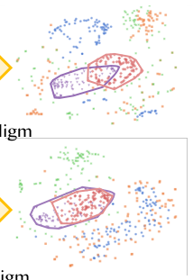
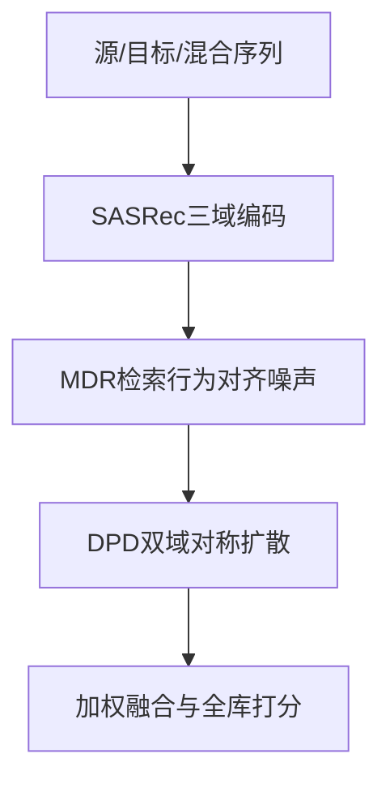
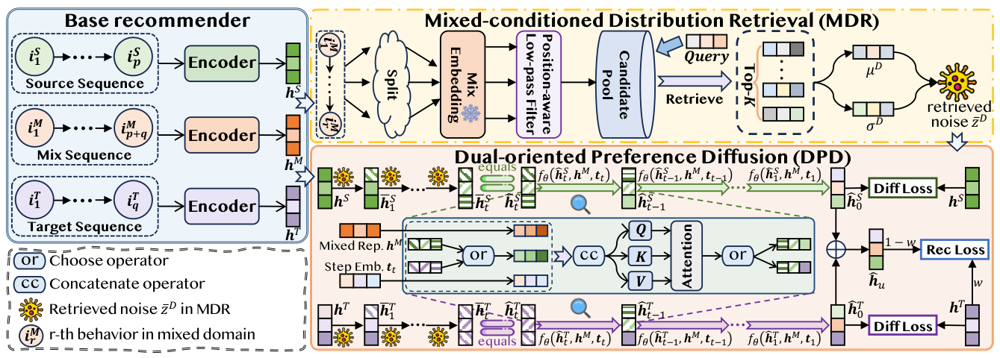

# Align-for-Fusion: Harmonizing Triple Preferences via Dual-oriented Diffusion for Cross-domain Sequential Recommendation (面向跨域序列推荐的双向扩散对齐融合)

- **会议/期刊**: KDD 2026
- **作者与机构**: Yongfu Zha, Xinxin Dong, Haokai Ma, Yonghui Yang, Xiaodong Wang；国防科技大学、新加坡国立大学
- **推荐链路定位**: 端到端序列推荐（Next-Item 全库排序）
- **研究方向**: 跨域与多场景推荐 / 序列与会话推荐
- **论文原文**: [论文原文链接](https://arxiv.org/abs/2508.05074v1)
- **开源代码**: 暂未开源

## TL;DR (1分钟核心速览)

针对CDSR中“先对齐再机械融合”造成目标域分布偏移与跨域噪声，HorizonRec提出align-for-fusion：MDR从混合域真实行为检索用户特定噪声，DPD以混合表示为条件对源/目标双域对称扩散，最终加权融合。在Douban/Amazon四组Last-item排序上，HR@10最高提升8.22%、NDCG@10最高提升8.19%，训练/推理显著快于Tri-CDR。

## Background & Motivation (背景与核心矛盾)

- **主流范式**: CDSR用源域序列缓解目标域稀疏与兴趣漂移；Tri-CDR/ABXI等先做表示级跨域对齐，再拼接或MLP融合。
- **前人局限**: ① align-then-fusion机械组合三域表示，易引入源域噪声、丢失目标域细粒度信号，最终用户表示与目标物品分布存在明显间隙；② 现有DM推荐多用随机高斯噪声，破坏跨域细微相关，DMCDR等又忽略序列动态。
- **核心洞察 (Key Insight)**: T-SNE显示三域表示虽有重叠，但最终表示远离目标物品嵌入；随机噪声是DM推荐不稳定的关键来源，而“行为可检索”的噪声可作为跨域语义桥。
- **本文切入点**: 用混合域检索分布替代无信息高斯噪声，并在源/目标双域同时扩散，实现“融合过程中对齐”。

<figure class="paper-figure" markdown="span">
  <figcaption>图1：在 Music→Book 设置下，Align-then-Fusion 与 Align-for-Fusion 范式在用户表示和目标物品嵌入上的示意图与 T-SNE 可视化对比。我们的方法实现了更好的对齐和目标感知表示。</figcaption>
</figure>
图1：Music→Book上align-then-fusion与align-for-fusion的用户表示/目标物品T-SNE对比。

## Method (核心方法设计)

### 1. 整体框架 (Overall Architecture)

输入源域、目标域及按时间合并的混合域序列，经SASRec分别编码为$\boldsymbol{h}^S,\boldsymbol{h}^T,\boldsymbol{h}^M$；MDR从混合域候选子序列检索top-$K$片段并构造用户特定噪声；DPD以$\boldsymbol{h}^M$为条件对$\boldsymbol{h}^S,\boldsymbol{h}^T$对称扩散去噪；最终按权重$w$融合目标域原表示，经内积softmax预测下一目标物品。训练联合推荐CE与扩散MSE，推理复用预计算检索库。

<figure class="paper-figure" markdown="span">
  <figcaption>图2：我们提出的 HorizonRec 框架概览。2.3 用于推荐的扩散模型</figcaption>
</figure>
图2：HorizonRec整体框架：MDR检索分布、DPD双域扩散与融合打分。

### 2. 关键设计拆解 (Key Designs)

1. **MDR：混合条件分布检索**：随机高斯噪声会破坏跨域相关。MDR先取混合序列中以目标物品结尾的连续子序列$\mathcal{D}_u$，用位置感知低通滤波$\mathbf{e}_d=\sum_{j=k}^{l}\left(c^{-1/(1+(p(i_j)/(l-j+1))^n)}\right)\mathbf{e}(i^M_j)$强调近期行为；再以$\boldsymbol{h}^S/\boldsymbol{h}^T$检索top-$K$片段，构造$\bar{\boldsymbol{z}}_D=\boldsymbol{\mu}_D+\boldsymbol{\sigma}_D\boldsymbol{\xi}$。直觉是均值指向目标结尾轨迹、方差更低，噪声不再是“无信息扰动”。

2. **DPD：双导向偏好扩散**：前人常只让目标域扩散并条件于源域，忽略源域动态。本文将检索噪声同时注入双域：$\bar{\boldsymbol{h}}^D_t=\sqrt{\bar{\alpha}_t}\boldsymbol{h}^D+\sqrt{1-\bar{\alpha}_t}\bar{\boldsymbol{z}}_D$；反向过程以$\boldsymbol{h}^M$和步嵌入为条件做注意力：$\hat{\boldsymbol{h}}^D_{t-1}=\mathrm{Softmax}(\boldsymbol{Q}\boldsymbol{K}^\top/\sqrt{d})\boldsymbol{V}$。对称去噪可抑制域内噪声、突出目标相关兴趣；文中Lemma 4.1/Prop 4.2/4.4给出低方差与W2收敛优势。

3. **训练目标、负采样与推理效率**：最终表示$\tilde{\boldsymbol{h}}_u=(1-w)(\hat{\boldsymbol{h}}^S_0+\hat{\boldsymbol{h}}^T_0)+w\boldsymbol{h}_u$；推荐损失为全物品softmax交叉熵，分母覆盖全库，未额外负采样；总损失$\mathcal{L}=\mathcal{L}_{rec}+\lambda\mathcal{L}_{diff}$。推理复用预计算检索库，额外复杂度$O(Td^2+|\mathcal{D}|d)$，$T=32$，实测推理低于1秒。

## Experimental Setup & Evaluation Protocol (实验设置与评估协议)

- **数据集与预处理**:

| 设置 | #Users | #Items(S/T) | #Interactions(S/T) | 密度(S/T) |
| :--- | :---: | :---: | :---: | :---: |
| Amazon Toy→Game | 7,994 | 37,840 / 11,735 | 113,605 / 82,855 | 0.0376% / 0.1211% |
| Amazon Game→Toy | 7,994 | 11,735 / 37,840 | 82,855 / 113,605 | 0.1211% / 0.0376% |
| Douban Book→Music | 6,367 | 50,448 / 36,504 | 189,971 / 181,570 | 0.0591% / 0.0781% |
| Douban Music→Book | 6,367 | 36,504 / 50,448 | 181,570 / 189,971 | 0.0781% / 0.0591% |

保留双域各至少3次交互用户，域内按时间排序，混合序列按时间合并。**划分**：目标域倒数第二交互验证、最后交互测试（Last-item / Leave-One-Out）。**排名协议**：原文只报告HR/NDCG，未给负采样比例；按全库未交互排序（Full-Ranking）口径理解，复现需以代码为准。基线覆盖单域（GRU4Rec、SASRec、CL4Rec、DiffuRec）、跨域（SSCDR、UniCDR、DMCDR）与CDSR（C2DSR、Tri-CDR、SyNCRec、ABXI）；$d=64$、batch=512、最大长度200、$T=32$、$K\in\{5,10,15\}$、$c=1.5,n=2$，5个随机种子，配对t检验$p<0.01$。

## Key Experimental Results (实验关键数据)

### 1. 主实验对比 (Main Results)

| 模型 | Music→Book HR@10 | NDCG@10 | HR@20 | NDCG@20 | Toy→Game HR@10 | NDCG@10 | HR@20 | NDCG@20 |
| :--- | :---: | :---: | :---: | :---: | :---: | :---: | :---: | :---: |
| SASRec | 0.0821 | 0.0373 | 0.1151 | 0.0451 | 0.0758 | 0.0417 | 0.1079 | 0.0497 |
| CL4Rec | 0.0913 | 0.0468 | 0.1211 | 0.0549 | 0.0782 | 0.0436 | 0.1113 | 0.0526 |
| DiffuRec | 0.0942 | 0.0491 | 0.1279 | 0.0577 | 0.0631 | 0.0414 | 0.0878 | 0.0492 |
| UniCDR | 0.1078 | 0.0541 | 0.1418 | 0.0646 | 0.0908 | 0.0561 | 0.1235 | 0.0638 |
| DMCDR | 0.1101 | 0.0562 | 0.1465 | 0.0658 | 0.0841 | 0.0527 | 0.1131 | 0.0588 |
| Tri-CDR | 0.1083 | 0.0538 | 0.1443 | 0.0655 | 0.0896 | 0.0556 | 0.1215 | 0.0623 |
| SyNCRec | 0.1089 | 0.0549 | 0.1436 | 0.0649 | 0.0921 | 0.0578 | 0.1265 | 0.0651 |
| ABXI | 0.1093 | 0.0551 | 0.1445 | 0.0652 | 0.0916 | 0.0566 | 0.1234 | 0.0641 |
| **HorizonRec** | **0.1166** | **0.0604** | **0.1543** | **0.0698** | **0.0949** | **0.0602** | **0.1299** | **0.0680** |
| **Rel.Improv.** | **+5.90%** | **+7.47%** | **+5.32%** | **+6.08%** | **+3.04%** | **+4.15%** | **+2.69%** | **+4.45%** |

### 2. 消融实验 (Ablation Study)

原文图3仅给趋势，未披露逐项数值；下表为相对完整模型的定性汇总。

| 变体 | 关键改动 | 相对完整模型趋势 |
| :--- | :--- | :--- |
| HorizonRec-DPD_S | 仅源域扩散 | HR@10/NDCG@10明显下降 |
| HorizonRec-DPD_T | 仅目标域扩散 | 下降，单侧扩散不足 |
| HorizonRec-MDR | 检索噪声换回高斯噪声 | 下降，语义先验失效 |
| HorizonRec-DMs | 去掉扩散 | 明显下降，静态融合不足 |
| HorizonRec-DPD-MDR | 去DPD+MDR，仅拼接 | 最大降幅，朴素聚合最弱 |

### 3. 关键实验发现 (Key Findings)

1. **全面领先但增益随域差异变化**：Douban Book→Music的HR@5提升12.16%、Music→Book的NDCG@10提升7.47%；Amazon Toy→Game增益较小（HR@10 +3.04%、NDCG@10 +4.15%），说明辅助域信息越稀疏/越不对称，检索扩散收益越明显。
2. **对称双域扩散是主因**：仅源域或仅目标域扩散均显著掉点，去DPD+MDR最大降幅；MDR换回高斯噪声也下降，验证“行为对齐噪声”比“随机噪声”更能稳定三域融合。
3. **效率与稳定性兼得**：Book→Music总训练261.60s vs Tri-CDR 1466.88s、ABXI 26110.74s；推理0.73s vs 36.86s/2.65s。参数上$K=0$退化最差，$t=32$达峰值，过大$K$或$t$反而引入噪声/过平滑。

## Highlights & Limitations (亮点、对比与审稿批判)

- **与代表作对比 (vs. Prior Work)**: Tri-CDR用三重对比做表示对齐后静态融合；ABXI抽取域不变表示但融合仍偏静态；DMCDR引入扩散却缺序列建模。HorizonRec把“对齐”嵌入“融合”：检索噪声提供用户特定先验，双域扩散在混合条件约束下逐步去噪。
- **可迁移亮点**: ① 用真实行为子序列检索替代高斯噪声，可直接迁移到跨域/多行为序列去噪；② 双域对称扩散+混合条件注意力，适合多源信息融合与目标感知表示学习。
- **审稿级局限批判**: ① 检索库需存$O(|\mathcal{D}|d)$片段，$K$与$t$敏感，超大候选池的在线内存/延迟未充分讨论；② 仅两平台离线Last-item评测，无冷启动、零样本与线上A/B，且全文未明示全库排序细节，复现需核对代码。

## Rating (四维评分)

- **方法创新性 (Novelty)**: ⭐⭐⭐⭐ （align-for-fusion范式与检索噪声双域扩散组合新颖，且有低方差/收敛性质支撑）
- **评估协议与实验扎实度 (Protocol & Experiments)**: ⭐⭐⭐⭐ （四设置、11个基线、5种子与$p<0.01$显著性强，但消融缺逐项数值、排序协议表述不够透明）
- **写作与数学规范度 (Clarity & Rigor)**: ⭐⭐⭐⭐ （MDR/DPD公式清晰，命题给出直觉解释；部分符号省略用户下标，理论证明主要留附录）
- **工业落地与复现价值 (Industrial & Practical Value)**: ⭐⭐⭐⭐ （推理<1s、训练快于Tri-CDR/ABXI，预计算检索库利于部署；但检索库内存与超参敏感度仍需工程验证）

