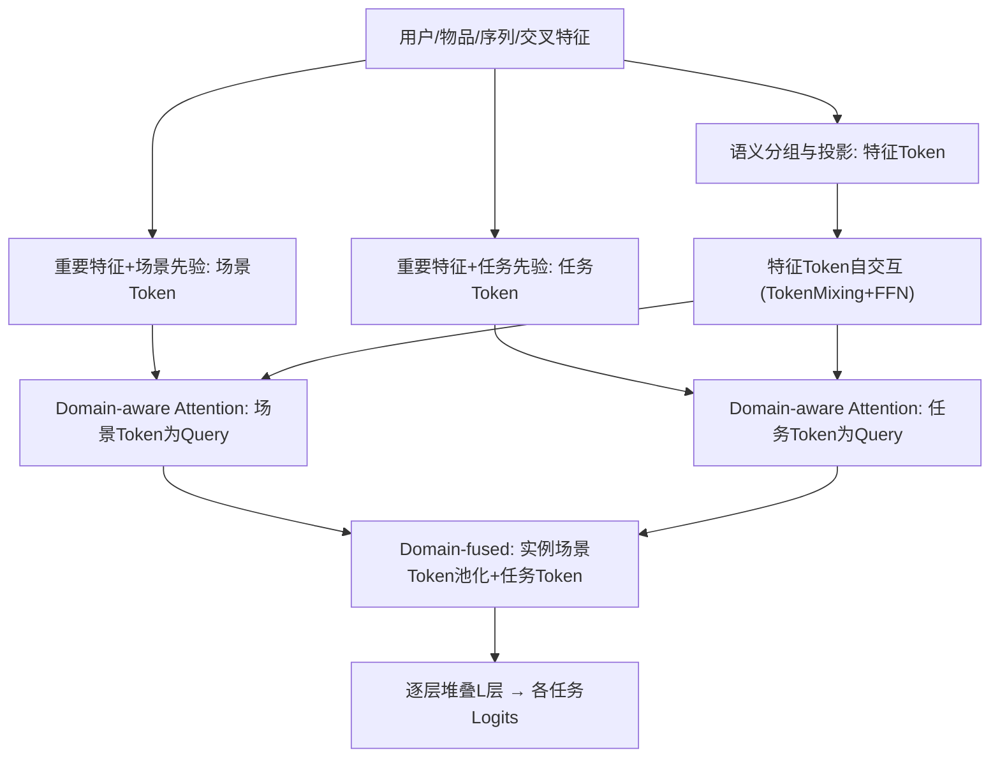
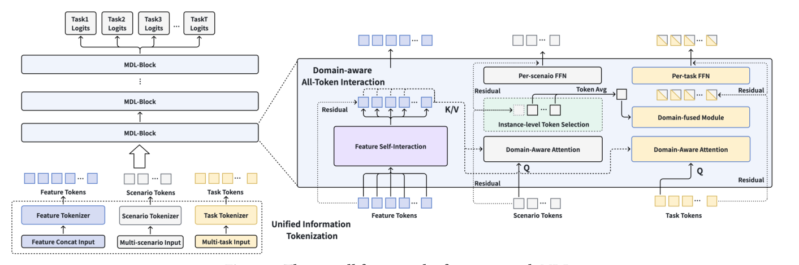

# MDL: A Unified Multi-Distribution Learner in Large-scale Industrial Recommendation through Tokenization（面向大规模工业推荐、通过Token化的统一多分布学习器）

- **会议/期刊**: KDD 2026
- **作者与机构**: Shanlei Mu, Yuchen Jiang, Shikang Wu 等；ByteDance Search / AML
- **推荐链路定位**: 精排（搜索多场景多任务预估）
- **研究方向**: 跨域与多场景推荐 / 多任务学习与列表级重排
- **论文原文**: [论文原文链接](https://arxiv.org/abs/2602.07520v2)
- **开源代码**: 暂未开源

## TL;DR (1分钟核心速览)

针对大规模推荐中场景/任务信息仅作用于门控或输出层、难以激活大参数特征交互的问题，MDL 将特征、场景、任务统一 Token 化，并用逐层 Domain-aware Attention 让场景/任务 Token 作为 Query 聚合特征。在抖音搜索 3 场景、20+ 任务、约 0.5B 参数模型上，离线 QAUC 相对提升 0.23%–0.77%，线上 LT30 +0.0626%、改查率 -0.3267%。

## Background & Motivation (背景与核心矛盾)

- **主流范式**: 大规模推荐以 RankMixer、OneTrans、HSTU 等堆叠特征 Token 交互；MSL/MTL 则用 SharedBottom、MMoE、STAR、PEPNet、HMoE 的 shared-specific、MoE 或动态门控。
- **前人局限**: 场景/任务信号通常只进入中间层或浅层输出，无法逐层调制大参数特征 backbone；MSL 管输入分布、MTL 管标签分布，共享-特异结构分开设计，难以统一。
- **核心洞察 (Key Insight)**: LLM 中 prompt token 可通过自注意力激活大模型知识；场景/任务同样可作为 prompt token 进入同一 latent space，从底层逐层参与交互。
- **本文切入点**: 提出 “Tokenize-and-Interact”，把场景/任务从辅助输入变成核心主干中的活跃 Token。

## Method (核心方法设计)

### 1. 整体框架 (Overall Architecture)

输入用户、物品、序列、交叉特征经语义分组投影为 $N_f$个特征 Token；场景与任务先拼接重要特征和场景/任务先验，经 per-token FFN 生成$N_s$个场景 Token（含 global Token）与$N_t$个任务 Token。每层 MDL Block 先做特征 Token 自交互，再让场景/任务 Token 作为 Query 对特征 Token 做 Domain-aware Attention；任务 Token 进一步与实例对应场景 Token 池化融合，最后各任务 Token 接 logits 输出。堆叠$L$ 层后，场景与任务可解耦组合预测。

<figure class="paper-figure" markdown="span">
  <figcaption>图1：我们方法 MDL 的整体框架。</figcaption>
</figure>

### 2. 关键设计拆解 (Key Designs)

1. **统一信息 Token 化（Unified Information Tokenization）**：前人把场景/任务留在门控或输出塔，MDL 将原始特征按语义分组投影为 $N_f$个特征 Token$\mathbf{T}_f=[\mathbf{t}_1;\dots;\mathbf{t}_{N_f}]$，$\mathbf{t}_j=\mathrm{Proj}(\mathbf{e}_j)$；场景/任务 Token 由重要特征嵌入与场景/任务先验拼接后经 per-token FFN 生成：$\mathbf{t}_s=\mathrm{ReLU}(\mathrm{FFN}(\hat{\mathbf{e}}_{imp}\oplus\hat{\mathbf{e}}_{spec}))$，并额外设 global 场景 Token 学共性。这样场景/任务与特征共享同一语义空间，可从底层注入。

2. **Domain-aware Attention（场景/任务-特征逐层交互）**：把场景/任务 Token 当 Query，特征 Token 当 Key/Value，做逐层 cross-attention：$\hat{\mathbf{T}}_t^{(l+1)}=\mathrm{softmax}\left(\frac{(\mathbf{W}_Q\mathbf{T}_t^{(l)})(\mathbf{W}_K\mathbf{T}_f^{(l)})^\top}{\sqrt{d}}\right)\mathbf{W}_V\mathbf{T}_f^{(l)}$。相比只在输出层加 gate，这使每个场景/任务在每层选择不同特征子空间，直接调制 0.5B 参数 backbone。

3. **场景-任务融合与训练/推理**：每个样本只取所属场景 Token 与 global Token，均值池化后加到任务 Token：$\mathbf{t}_{s,avg}=\mathrm{MeanPooling}(\{\mathbf{t}_{s,i},\mathbf{t}_{s,j},\mathbf{t}_{s,g}\})$，$\mathbf{T}_t\leftarrow\mathbf{T}_t+\mathbf{t}_{s,avg}$。最终各任务 Token 过 logits；损失为多场景多任务交叉熵$\mathcal{L}=\sum_{k,n,i}\ell(y_i^{k,n},\hat{y}_i^{k,n})$。论文未披露负采样，按日志曝光样本训练；推理仅多出$O(L(N_s+N_t)N_f d)$ 的 cross-attention 开销。

## Experimental Setup & Evaluation Protocol (实验设置与评估协议)

- **数据集与预处理**: 抖音搜索生产日志，3 个主场景（单列/双列/内搜），20+ 预测任务，500+ 特征，两月连续日志，保留 1% 评估并从训练剔除；未披露 5-core 等过滤。

| 数据集 | #Users | #Items | #Interactions | 稀疏度/密度 | 特征/场景说明 |
| :--- | :---: | :---: | :---: | :---: | :--- |
| Douyin Search | 十亿级 | 亿级文档 | 两月连续日志（量级未披露） | 未披露；like/favorite 正样本率低于 click | 3 场景、20+ 任务、500+ 特征；1% 评估 |

- **数据划分与防穿越 (Splitting Strategy)**: 仅说明保留 1% 日志作评估并排除训练；未明确时间戳切分或随机切分，存在时序穿越风险。
- **排名评测协议 (Ranking Protocol)**: 采用 QAUC：按 UID-query 分组算 AUC 再平均；不是 Full-Ranking/Sampled 负采样排序，未披露候选集构造与训练负采样。
- **对比基线与超参设置**: 6 个基线均集成到 RankMixer backbone，总参数约 0.5B；batch size 2048；dense 用 RMSProp、sparse 用 Adagrad；未报告显著性检验与多次运行方差。

## Key Experimental Results (实验关键数据)

### 1. 主实验对比 (Main Results)

| 方法 | 单列 Click | 单列 Like | 单列 Fav | 双列 Click | 双列 Like | 双列 Fav | 内搜 Click | 内搜 Like | 内搜 Fav |
| :--- | ---: | ---: | ---: | ---: | ---: | ---: | ---: | ---: | ---: |
| RankMixer | 0.6389 | 0.6610 | 0.6624 | 0.6911 | 0.6621 | 0.6787 | 0.6393 | 0.6786 | 0.6621 |
| SharedBottom | 0.6391 | 0.6611 | 0.6614 | 0.6929 | 0.6629 | 0.6789 | 0.6395 | 0.6794 | 0.6609 |
| MMoE | 0.6394 | 0.6614 | 0.6623 | 0.6931 | 0.6629 | 0.6788 | 0.6397 | 0.6793 | 0.6629 |
| STAR | 0.6389 | 0.6611 | 0.6600 | 0.6930 | 0.6624 | 0.6784 | 0.6393 | 0.6796 | 0.6631 |
| HMoE | 0.6397 | 0.6617 | 0.6623 | 0.6925 | 0.6625 | 0.6790 | 0.6401 | 0.6790 | 0.6634 |
| PEPNet | 0.6396 | 0.6609 | 0.6628 | 0.6928 | 0.6625 | 0.6787 | 0.6403 | 0.6797 | 0.6627 |
| **MDL** | **0.6417** | **0.6632** | **0.6656** | **0.6950** | **0.6671** | **0.6842** | **0.6419** | **0.6820** | **0.6681** |
| Improv. | +0.31% | +0.23% | +0.42% | +0.27% | +0.63% | +0.77% | +0.25% | +0.34% | +0.71% |

### 2. 消融实验 (Ablation Study)

| 变体 | 单列 ΔQAUC_Click | 双列 ΔQAUC_Click | 内搜 ΔQAUC_Click |
| :--- | ---: | ---: | ---: |
| w/o task token | -0.12% | -0.11% | -0.09% |
| w/o task-feature interaction | -0.04% | -0.05% | +0.03% |
| w/o scenario token | -0.17% | -0.16% | -0.15% |
| w/o global scenario token | -0.04% | -0.06% | -0.05% |
| w/o scenario-feature interaction | -0.05% | -0.04% | -0.05% |

### 3. 关键实验发现 (Key Findings)

1. **场景 Token 是最大杠杆**：去掉 scenario token 在单列/双列/内搜分别掉 0.17%/0.16%/0.15%，大于去掉 task token 的 0.12%/0.11%/0.09%，说明输入分布 prompt 比标签 prompt 更关键。
2. **稀疏场景与低正样本任务收益更大**：双列/内搜及 like/favorite 相对提升 0.63%–0.77%，高于单列 click 的 0.31%，与 Token 级交互缓解多分布 seesaw 的解释一致。
3. **规模与线上收益互相印证**：Figure 2 显示参数/FLOPs 增大时 MDL 相对 MMoE 的 QAUC 增益扩大；线上一个月 A/B 得 LT30 +0.0626%、改查率 -0.3267%，证明 0.5B 模型可落地。

## Highlights & Limitations (亮点、对比与审稿批判)

- **与代表作对比 (vs. Prior Work)**: MMoE/STAR/PEPNet 将场景/任务差异放在 gate、expert 或 embedding 层，MDL 将其变成输入 Token 并逐层 cross-attn；相比 RankMixer，保留其特征 Token 自交互但补上 MSL/MTL 统一接口。
- **可迁移亮点**: 把业务域/任务当作 prompt token 注入任意 token-mixing backbone；用 global token + 实例场景 token 池化实现场景×任务解耦组合。
- **审稿级局限批判**: 仅抖音搜索私有数据，无公开 benchmark、显著性检验与重复实验；QAUC 绝对增益约 0.002–0.005，线上指标为搜索业务指标。场景/任务 Token 需人工语义分组与 per-token FFN，新增场景要扩展 Token 并重训；cross-attn 在 0.5B 模型上的推理延迟未披露。消融中 w/o task-feature interaction 在内搜为 +0.03%，与“移除即下降”的结论不一致，需解释。

## Rating (四维评分)

- **方法创新性 (Novelty)**: ⭐⭐⭐⭐ （将 LLM prompt/tokenization 引入 MSL/MTL，机制清晰，但本质是 Token 化 + cross-attention 的组合创新）
- **评估协议与实验扎实度 (Protocol & Experiments)**: ⭐⭐⭐⭐ （离线三场景九指标 + 一月线上 A/B + scaling/attention 可视化，但仅私有数据、无显著性/重复实验）
- **写作与数学规范度 (Clarity & Rigor)**: ⭐⭐⭐⭐ （框架与公式易读，Eq.7 记号略去转置、消融有一格正增益未解释）
- **工业落地与复现价值 (Industrial & Practical Value)**: ⭐⭐⭐⭐⭐ （已全量部署抖音搜索，0.5B 参数与线上收益验证工程价值）

