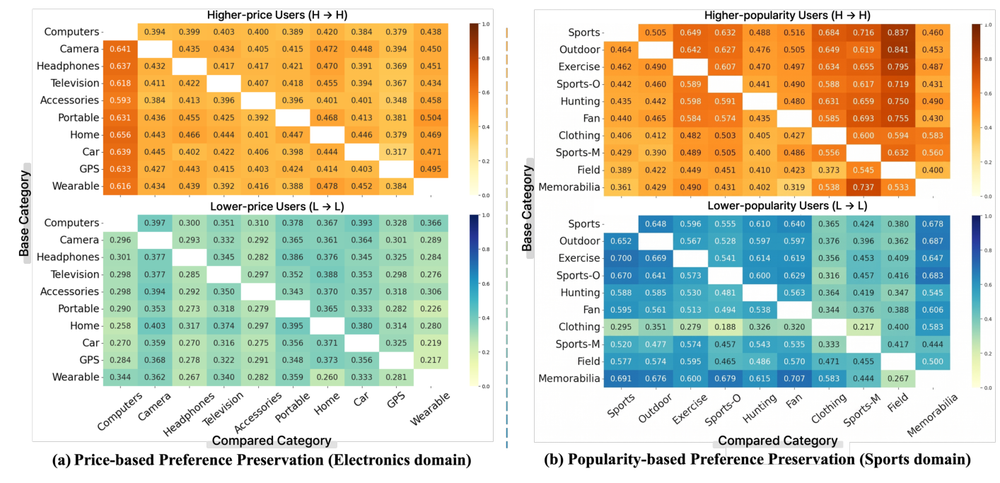
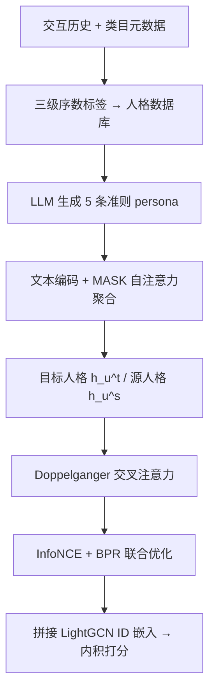
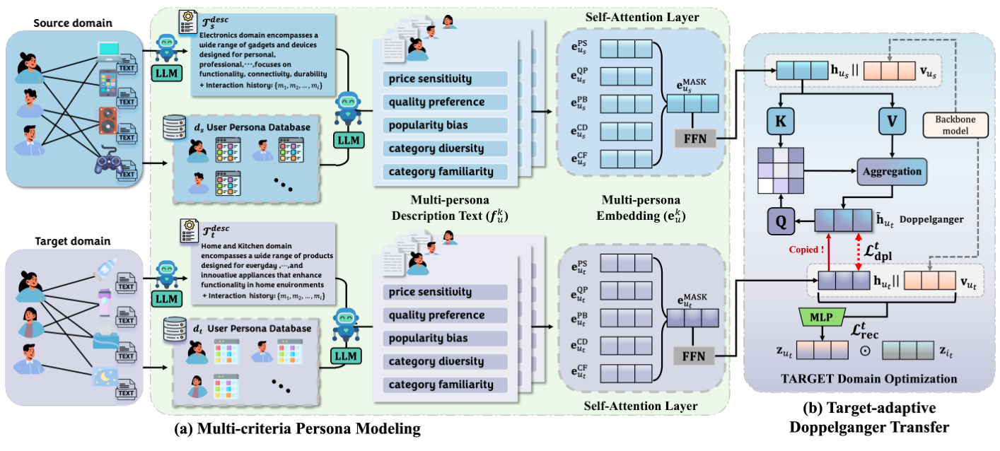

# Multi-TAP: Multi-criteria Target Adaptive Persona Modeling for Cross-Domain Recommendation (多准则目标自适应人格建模的跨域推荐)

- **会议/期刊**: KDD 2026 (32nd ACM SIGKDD)
- **作者与机构**: Daehee Kang, Yeon-Chang Lee（韩国 UNIST 蔚山科学技术院）
- **推荐链路定位**: 精排（跨域用户表征层）
- **研究方向**: 跨域与多场景推荐 / 大语言模型推荐
- **论文原文**: [https://arxiv.org/abs/2603.07086v2](https://arxiv.org/abs/2603.07086v2)
- **开源代码**: [https://github.com/archivehee/Multi-TAP](https://github.com/archivehee/Multi-TAP)

## TL;DR (1分钟核心速览)

现有跨域推荐（CDR）默认"一个域 = 一个用户向量"，忽略了**域内异质性（IDH）**——同一用户在 Electronics 的 Computer 上偏好高价、在 Home Audio 上却转向低价，这种压缩在迁移前就已丢失信息。Multi-TAP 用 LLM 把用户偏好沿价格敏感度、质量偏好、流行度偏置、类目多样性、类目熟悉度五条准则拆成多个语义 persona，再用"目标域人格作 query、源域人格作 K/V"的 doppelganger 交叉注意力做选择性迁移。在 Amazon 五域十组迁移、时间切分 + 全库排序协议下，六组任务中五组最优，Home→Elec 上 HR@5 相对最强基线 PPA 提升 36.3%、NDCG@5 提升 42.6%。

## Background & Motivation (背景与核心矛盾)

- **主流范式**: 早期 EMCDR/SA-VAE/CDIMF 用重叠用户学映射函数对齐表征；近期 UniCDR、EDDA 做共享/私有偏好解耦，CUT、DGCDR 做负迁移过滤。但迁移粒度始终停留在**域级统一向量**。
- **前人局限**: ① 域级聚合会把"按类目条件化的偏好"压平，而 Amazon 单域内含数十个细粒度类目，偏好随类目系统性漂移；② 在此压缩表征之上再做跨域对齐/对比，属于**二次失真**，导致不加区分地盲目迁移（indiscriminate transfer）。
- **核心洞察 (Key Insight)**: 作者提出应以**条件偏好保持率**量化 IDH。对准则 $k$（价格/评分/流行度）按类目三分位离散为$\mathrm{bin}^{(k)}_i\in\{1,2,3\}$，用户在该类目的准则得分为$\mathbf{s}^{(k)}_{u,c}=\frac{1}{|\mathcal{I}_{u,c}|}\sum_{i\in\mathcal{I}_{u,c}}\mathrm{bin}^{(k)}_i$，进而定义从类目$c_b$到$c_t$的保持率$R^{(k)}_g(c_b\!\to\!c_t)=\frac{\sum_{u}\mathbb{I}[\ell^{(k)}_{u,c_b}=g\wedge\ell^{(k)}_{u,c_t}=g]}{\sum_{u}\mathbb{I}[\ell^{(k)}_{u,c_b}=g]}$。实测该比率普遍很低（Car↔GPS 的价格偏好仅约 31% 保持），且低价用户比高价用户更不稳定。
- **本文切入点**: 问题不是"如何迁移"，而是"**迁移哪些偏好**"——先在域内显式解耦多准则人格，再以目标域为锚点选择性吸收源域信号。

<figure class="paper-figure" markdown="span">
  <figcaption>图 2：跨类别的域内偏好异质性。每个热力图可视化条件偏好保持比率，衡量用户从基础类别（𝒚 轴）迁移到比较类别（𝒙 轴）时，其主导偏好标签保持一致的程度。每个单元格表示在基础类别中被分配到特定偏好组（High 或 Low）并在比较类别中仍处于同一组的用户比例。数值越低表示偏好保持越弱、域内异质性越强。</figcaption>
</figure>

## Method (核心方法设计)

### 1. 整体框架 (Overall Architecture)

框架分两阶段。**(P1) 多准则人格建模**在源/目标域各自独立执行：先把交互历史与类目级元数据离散为五条准则的三级序数标签，构成用户人格数据库 $\mathcal{D}_{u,d}$；再以结构化 prompt 驱动 gpt-4o 一次性生成 5 段自然语言 persona（LLM 仅做"显式统计的口语化"，不做偏好推断，规避幻觉）；随后用 text-embedding-3-large 编码为 3072 维向量，经自注意力聚合为域级人格嵌入$\mathbf{h}_{u_s},\mathbf{h}_{u_t}$。**(P2) 目标自适应 Doppelganger 迁移**：为目标域用户实例化一个从$\mathbf{h}_{u_t}$ 初始化的 doppelganger 嵌入，通过交叉注意力选择性吸收源域人格，再用 InfoNCE 使其向目标人格靠拢。最终推荐表征将人格嵌入与预训练 LightGCN 的 ID 行为嵌入拼接，内积打分并用 BPR 优化。源域仅作为"一次性前置训练"，不参与目标域联合优化。

<figure class="paper-figure" markdown="span">
  <figcaption>图 3：Multi-TAP 概览，其包括（P1）多准则用户画像建模和（P2）目标自适应的 Doppelganger 迁移。在（P1）中，Multi-TAP 利用由交互历史和物品元数据构建的用户画像数据库，将用户偏好分解为显式的、准则感知的多用户画像嵌入。在（P2）中，Multi-TAP 通过实例化与目标域用户画像嵌入对齐的 doppelganger 用户画像，选择性纳入源域信息。</figcaption>
</figure>

### 2. 关键设计拆解 (Key Designs)

1. **多准则 Persona 解耦与自注意力聚合**：替代"单条 holistic profile"。五条准则中 PS/QP/PB 复用类目三级序数标签，CD 为用户跨类目数 $\ell^{CD}_{u,d}=\mathrm{Tertile}(|\{\phi(i)\mid i\in\mathcal{I}_{u,d}\}|)$，CF 则按**类目内**交互频次分位$Q_c(q)$归一化（解决类目热度差异）。聚合时不取均值/拼接，而以可学习 MASK token 为 query 做注意力$\alpha^{(k)}_u=\mathrm{softmax}_k\big((\mathbf{e}^{\text{MASK}}_u\cdot\mathbf{e}^{(k)}_u)/\sqrt{n}\big)$，$\mathbf{h}_u=\mathrm{Proj}\big(\mathrm{FFN}(\sum_{k\in\mathcal{K}}\alpha^{(k)}_u\mathbf{e}^{(k)}_u)\big)$。直觉：不同用户应被不同准则主导（价格敏感型 vs 品牌/质量型），注意力权重即为可解释的"准则重要性画像"。
2. **Doppelganger 目标自适应迁移**：直接对齐 $h^s\!\leftrightarrow\!h^t$会迫使域特有偏好坍缩。本文改为**目标中心**的间接迁移：以目标人格为 query、源域人格为 K/V 得到$\alpha^{dpl}_{u,s}=\mathrm{softmax}_{u_s}\big((\tilde{\mathbf{h}}_{u_t}\cdot\mathbf{h}_{u_s})/\sqrt{n}\big)$，$\tilde{\mathbf{h}}_{u_t}=\sum_{u_s}\alpha^{dpl}_{u,s}\mathbf{h}_{u_s}$。源域信息只以"中间人"身份注入，目标表征本身不被强制拉向源域，从而保留域特有结构。
3. **训练目标、负采样与推理效率**：目标域 $-\log\sigma(\hat{y}_{u,i}-\hat{y}_{u,i'})$的 BPR 逐样本采 1 个均匀负例，联合$\mathcal{L}_{total}=\mathcal{L}_{rec}+\lambda\mathcal{L}_{dpl}$，其中$\mathcal{L}_{dpl}=-\sum_{u\in\mathcal{U}_o}\log\frac{\exp(\mathrm{sim}(\mathbf{h}_{u_t},\tilde{\mathbf{h}}_{u_t})/\tau)}{\sum_{u'\in\mathcal{U}_o}\exp(\mathrm{sim}(\mathbf{h}_{u_t},\tilde{\mathbf{h}}_{u'\!_t})/\tau)}$（batch 内重叠用户互为负例，免额外采样）。人格离线生成 ~3 s/用户（$0.022/用户），在线仅需轻量 MLP + 内积，整体训练 9–30 min/域对。

## Experimental Setup & Evaluation Protocol (实验设置与评估协议)

- **数据集与预处理**: Amazon Reviews-2023 五个域，覆盖全部 10 组迁移方向；主表报告重叠用户最多的三对域。

| 数据集 (源→目标) | #重叠用户 | #Items(源/目标) | #Interactions(源/目标) | 稀疏度 | 说明 |
| :--- | :---: | :---: | :---: | :---: | :--- |
| Elec→Home | 7,274 | 58,461 / 59,668 | 180,521 / 171,902 | >99.9% | 含 price/rating/category 元数据 |
| Sports→Cloth | 4,588 | 34,694 / 45,522 | 94,422 / 82,444 | >99.9% | 类目粒度细 |
| Home→Toys | 5,798 | 60,976 / 35,358 | 162,480 / 90,857 | >99.9% | 跨大类语义远 |

- **数据划分与防穿越 (Splitting Strategy)**: 采用**全局时间戳切分**（与 UniCDR 等随机采样划分不同）：2019 年前为训练集，2019 年后划为验证/测试集，仅保留两时段均出现的用户，杜绝未来交互泄漏。
- **排名评测协议 (Ranking Protocol)**: 无偏 **Full-Ranking（全库未交互物品排序）**，指标 HR@5 / NDCG@5，五次随机种子取均值±标准差。
- **对比基线与超参设置**: 单域 BPRMF / NGCF / LightGCN；跨域 UniCDR / CDIMF / CUT-LightGCN / PPA / DGCDR（QRec 复现 + 作者代码）。嵌入维度 $d=128$（人格向量 3072、物品语义 512），batch 1024，Adam，最多 100 epoch 早停，dropout$\{0.1..0.7\}$、负例数$\{1,3,5\}$、正则$\{1\text{e-}4..5\text{e-}3\}$ 均按验证集网格搜索。

## Key Experimental Results (实验关键数据)

### 1. 主实验对比 (Main Results)

| 任务 | 指标@5 | BPRMF | LightGCN | UniCDR | CUT-LGCN | PPA | DGCDR | **Multi-TAP** | Improv. |
| :--- | :---: | :---: | :---: | :---: | :---: | :---: | :---: | :---: | :---: |
| Elec→Home | HR / NDCG | 1.69 / 0.49 | 1.77 / 0.51 | 1.69 / 0.54 | 1.96 / 0.58 | 3.06 / 0.89 | 2.63 / 0.76 | **3.23 / 0.91** | +5.6% / +2.2% |
| Home→Elec | HR / NDCG | 1.66 / 0.47 | 2.21 / 0.63 | 1.55 / 0.47 | 1.57 / 0.46 | 1.79 / 0.54 | 1.57 / 0.47 | **2.44 / 0.77** | **+36.3% / +42.6%** |
| Sports→Cloth | HR / NDCG | 1.56 / 0.42 | 1.66 / 0.46 | 1.71 / 0.47 | 2.96 / 0.92 | 3.36 / 0.98 | 2.25 / 0.63 | **4.09 / 1.11** | **+21.7% / +13.3%** |
| Cloth→Sports | HR / NDCG | 1.59 / 0.50 | 2.20 / 0.72 | 1.37 / 0.42 | 1.67 / 0.51 | **2.25 / 0.71** | 1.85 / 0.58 | 2.08 / 0.68 | −7.6% |
| Home→Toys | HR / NDCG | 0.95 / 0.27 | 0.96 / 0.25 | 0.91 / 0.27 | 1.23 / 0.37 | 1.35 / 0.36 | 1.19 / 0.30 | **1.56 / 0.47** | **+15.6% / +30.6%** |
| Toys→Home | HR / NDCG | 1.44 / 0.40 | 1.75 / 0.47 | 1.85 / 0.51 | 2.13 / 0.58 | 2.98 / 0.80 | 2.73 / 0.73 | **3.11 / 0.88** | +4.4% / +10.0% |

### 2. 消融实验 (Ablation Study)

| 消融维度 | 设置 | Sports→Cloth (HR/NDCG) | Cloth→Sports (HR/NDCG) |
| :--- | :--- | :---: | :---: |
| Persona 解耦 | Single (Raw) → Single (Proc.) → **Multi (Proc.)** | 3.70/1.08 → 3.77/1.09 → **4.09/1.11** | 1.83/0.61 → 1.99/0.64 → **2.08/0.68** |
| 聚合方式 | Mean → Concat → **Self-Attn** | 3.66/1.10 → 3.99/1.04 → **4.09/1.11** | 1.93/0.60 → 2.01/0.65 → **2.08/0.68** |
| 迁移方式 | Direct-ID / Direct-Persona / Direct-Both → **Doppelganger** | 六组任务上均优于三种直接对齐 | 直接对齐跨方向波动大，Doppelganger 更稳 |
| 冷启动 (10% 用户 <5 交互) | PPA → **Multi-TAP** | Home→Toys: 1.24 → **1.42** (NDCG 0.31→0.39) | Home→Elec: 2.31 → **2.42** (NDCG 0.69→0.75) |

### 3. 关键实验发现 (Key Findings)

- **IDH 建模是主要增益源，而非 LLM 本身**：在同一份 processed 元数据下，从单 persona 改为多 persona 使 Sports→Cloth HR@5 由 3.77 升至 4.09（+8.5%），而仅把 raw 元数据换成序数标签只带来 +1.9%，说明增益来自"准则解耦"而非"信息量增加"。
- **聚合方式决定多 persona 是否真有效**：Concat 在 NDCG 上反而劣于 Mean（1.04 vs 1.10），说明固定拼接引入准则噪声；改为 MASK 查询的自适应注意力后 HR/NDCG 同时最优，验证"按用户动态加权准则"是必要设计。
- **目标中心迁移对方向不对称性更鲁棒**：直接对齐（Direct-ID/Persona/Both）在六组任务上随迁移方向剧烈波动，而 doppelganger 迁移全面胜出；冷启动场景下更显著，Home→Elec 的 NDCG@5 相对 PPA 提升 25.81%，说明语义 persona 比 ID 行为在稀疏时更可迁移。超参上 $\lambda>1$明显优于小值，$\tau\in[0.4,0.6]$ 最稳。

## Highlights & Limitations (亮点、对比与审稿批判)

- **与代表作对比 (vs. Prior Work)**: 相对 UniCDR/EDDA 的"域级解耦"，本文把解耦粒度下沉到**准则×类目**；相对 CUT/DGCDR 的"过滤源域噪声"，本文改为"以目标为锚点重参数化源域"；相对 PPA 的隐式原型（数量为超参、不可解释、不做目标自适应），本文 persona 显式、可解释、且由目标域 query 驱动注意力选择。与 LASSO 类 LLM 画像方法相比，本文坚持"LLM 只verbalize 统计而非推断偏好 + 按准则分开生成"，抑制了单条 profile 的可控性缺失与语义漂移。
- **可迁移亮点**: ① 用类目内分位数把异构元数据离散为三级序数标签，是消除域间尺度差异的廉价而通用手段；② "doppelganger 间接对齐"可套用到任何需要选择性迁移的跨域/跨场景对比学习框架（如多业务 STAR 类结构）。
- **审稿级局限批判**: ① 增益高度依赖 LLM 与 3072 维文本编码，离线成本 $0.022/用户、3 s/用户，百万级用户即数万美元量级，且论文未给出开源 LLM 变体的完整主表结论；② 评估仅限 Amazon 五域、指标限于 HR/NDCG@5，缺乏 NDCG@10 与统计显著性检验（仅报告标准差），Cloth→Sports 上还落后 PPA 7.6%，说明"准则解耦"在类目重叠度低时未必优于隐式原型；③ persona 生成使用最近 30 条交互且默认偏好分布缓变，用户兴趣漂移场景下的更新策略未做实验。

## Rating (四维评分)

- **方法创新性 (Novelty)**: ⭐⭐⭐⭐ （把 CDR 的迁移粒度从"域"细化到"准则×类目"，并以目标中心 doppelganger 替代直接对齐，思路清晰且与 IDH 实证自洽，但 LLM+对比学习组合本身不算范式突破）
- **评估协议与实验扎实度 (Protocol & Experiments)**: ⭐⭐⭐⭐ （时间戳切分 + Full-Ranking + 五种子，协议明显严于既往随机划分工作；不足是仅 HR/NDCG@5、缺显著性检验与更多域外数据集）
- **写作与数学规范度 (Clarity & Rigor)**: ⭐⭐⭐⭐ （IDH 的量化定义与保持率指标推导完整、可复现，符号表清晰；doppelganger 交叉注意力公式的 softmax 归一化范围表述略含糊，复杂度分析偏简）
- **工业落地与复现价值 (Industrial & Practical Value)**: ⭐⭐⭐⭐ （代码已开源、训练 9–30 min、在线仅内积，工程友好；但 LLM 离线画像成本与元数据（price/rating/category）可得性构成实际落地门槛）

