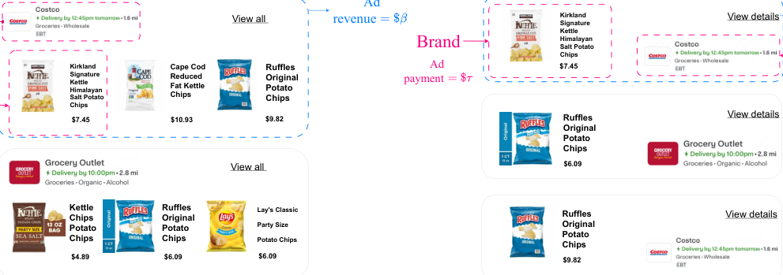
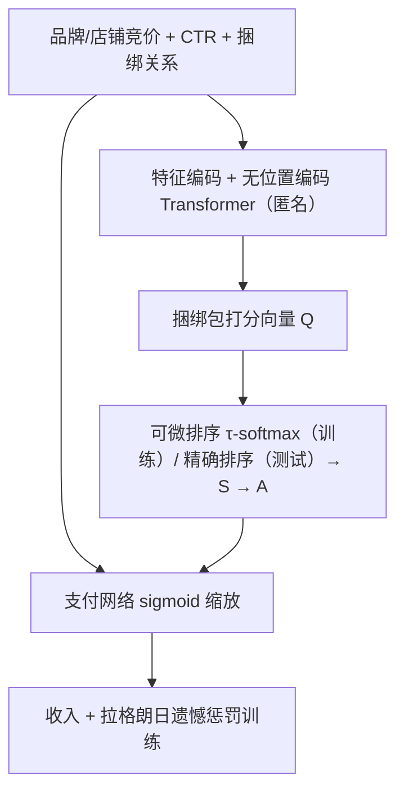
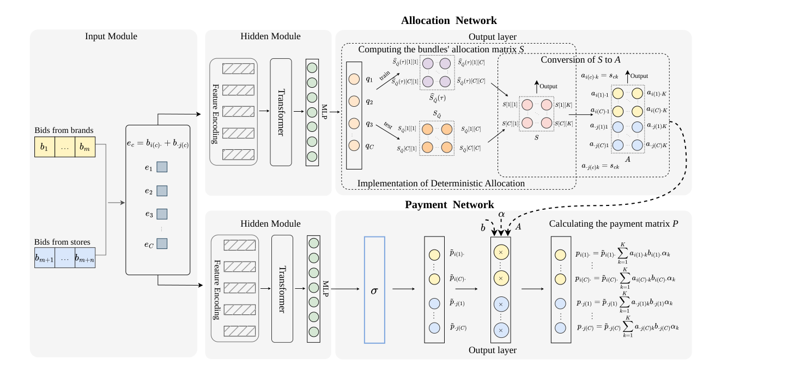

# Deterministic-Allocation and Anonymous Joint Advertising in E-commerce Platforms (电商平台中确定性分配与匿名联合广告拍卖)

- **会议/期刊**: KDD 2026 (arXiv:2506.02435v4)
- **作者与机构**: Zhen Zhang, Qi Qi (中国人民大学高瓴人工智能学院)；Luowen Liu, Wanzhi Zhang, Kun Huang, Qianlong Xie, Xingxing Wang (美团)；Zitian Guo (UCSD)
- **推荐链路定位**: 精排后的广告位分配与计价（拍卖/机制层）
- **研究方向**: CTR/CVR 预估与特征交叉 / 强化学习与动态探索推荐（拍卖机制方向）
- **论文原文**: [https://arxiv.org/abs/2506.02435v4](https://arxiv.org/abs/2506.02435v4)
- **开源代码**: 暂未开源

## TL;DR (1分钟核心速览)

联合广告（店铺+品牌捆绑展示）场景下，既有自动机制设计（AMD）架构只能输出**概率性分配**，本文证明当所有广告位必须售出时这类解在绝大多数情形下不可行，且部分架构（JRegNet）不满足匿名性与 DSIC。作者提出 JTransNet：用**无位置编码 Transformer + 可微排序（$\tau$-softmax）算子**实现确定性 0-1 分配、用 sigmoid 缩放支付保证 IR，以增广拉格朗日训练近似 DSIC。在 4 组合成设置与 3 组真实电商拍卖日志上收入显著超过 VCG/JAMA/RegretNet（真实数据相对 JAMA 提升 1.0%–1.8%，相对 VCG 提升约 80%），线上 40% 流量 A/B 一月收入 +1.87%，TP99 仅 15ms。

## Background & Motivation (背景与核心矛盾)

- **主流范式**: 传统广告仅允许店铺对广告位竞价（GSP/VCG/Myerson）；近年 Zhang et al. 提出**联合广告模型**——广告位展示"店铺+品牌"捆绑包，双方同时竞价，可同时提升店铺曝光、品牌曝光与平台收入。理论机制难以直接适配捆绑定价，学界转向 RegretNet/CITransNet/JRegNet 等 AMD 神经架构学习近似 DSIC 最优机制。
- **前人局限 1（不可部署）**: 所有以 RegretNet 为骨架的 near-DSIC AMD 架构只输出**概率分配**；本文定理 1 证明在"所有广告位必须分配"的在线场景下，概率解在绝大多数情形**无可行整数解**，四舍五入后与最优解存在显著差距。且概率展示令广告主难以理解，工业上从未真正上线过此类架构。
- **前人局限 2（不公平）**: JRegNet 等联合拍卖架构不满足**匿名性**——仅改变竞价顺序就得到不同的分配与计费结果，破坏公平性；而确定性 0-1 分配在数学上不可微，无法直接反向传播训练。
- **核心洞察 (Key Insight)**: 工业机制必须是确定性、可解释、匿名的；既然不可微是训练障碍，就应在**训练期用可微松弛、测试期用精确硬排序**，把"排序"这一离散决策纳入网络。
- **本文切入点**: 以 bundle 得分为排序键，用 $\tau$-softmax 逼近 top-$K$ 指派，配合无位置编码 Transformer 与解耦支付网络，一次性解决确定性、匿名性与 DSIC/IR 三重约束。

<figure class="paper-figure" markdown="span">
  <figcaption>图1：传统广告模型与联合广告模型的比较。</figcaption>
</figure>
图 1：传统广告（仅店铺竞价）与联合广告（店铺+品牌捆绑竞价）的对比。

## Method (核心方法设计)

### 1. 整体框架 (Overall Architecture)

JTransNet 接收 $m$个品牌竞价$b_{i\cdot}$、$n$个店铺竞价$b_{\cdot j}$、位置 CTR$\alpha_k$与捆绑关系矩阵$\mathbb{1}_{ij}$，构造$C$个捆绑包输入得分$e_c=b_{i(c)\cdot}+b_{\cdot j(c)}$；特征编码与无位置编码 Transformer 隐层保证对竞价顺序等变（匿名性）；分配网络输出$C$维打分$Q$，经可微排序算子生成各位置归属的 0-1 分配矩阵$S$，再转换为竞价者层面的分配矩阵$A$；支付网络对$A$ 与各竞价者独立出价做 sigmoid 缩放的乘性计费；最终以增广拉格朗日损失（收入 + 遗憾惩罚）训练，测试时切换为精确排序。

<figure class="paper-figure" markdown="span">
  <figcaption>图2：用于 m 个品牌、n 个商店、K 个广告位和 C 个由品牌与商店组成的捆绑包设置的 JTransNet 架构。</figcaption>
</figure>
图 2：JTransNet 架构——$m$品牌、$n$店铺、$K$广告位、$C$ 捆绑包的分配与支付双分支。

### 2. 关键设计拆解 (Key Designs)

1. **可微确定性分配（Deterministic Allocation）**：痛点是用 $Q$直接取 top-$K$不可导。做法是先用$R_Q[k][c]=|Q_k-Q_c|$构造排序等价的判据，再以 softmax 连续化：$\hat{S}_{\tilde Q[k][:]}(\tau)=\mathrm{softmax}\!\big(((C+1-2k)Q-R_Q\mathbf{1})/\tau\big)$，训练时取$S[c][k]=\hat{S}_{\tilde Q[k][c]}$，测试时$\tau\to0$退化为硬指派$S_{\tilde Q}\in\{0,1\}^{C\times C}$。由于每行每列至多一个 1，天然满足"包占一位、位放一包"两条约束；直觉上温度$\tau$ 控制松弛误差，冷启动阶段梯度平滑、收敛后逼近真实排序。
2. **匿名性与支付解耦（Anonymity & Payment）**：去掉位置编码后，同一竞价无论排在第几个输入，对应神经元输出不变，机制只依赖竞价数值；支付不直接用 bundle 竞价（避免关联竞价污染），而是把 $S$转为竞价者分配$a_{i(c)\cdot k}=s_{ck}$，再按各自出价计费：$p_{i(c)\cdot}=\tilde p_{i(c)\cdot}\sum_{k}a_{i(c)\cdot k}b_{i(c)\cdot}\alpha_k$，$\tilde p_{i(c)\cdot}=\sigma(\cdot)\in[0,1]$由支付网络输出，保证$p\le$估值期望，从而$\mathrm{IR}$ 恒成立。
3. **训练目标、误报枚举与推理开销**：损失为增广拉格朗日 $\mathcal{L}=C_\rho(w;\lambda)=-\frac1L\sum_\ell\big(\sum_i p^w_{i\cdot}+\sum_j p^w_{\cdot j}\big)+\sum_i\lambda_{i\cdot}\widehat{rgt}_{i\cdot}+\frac{\rho}{2}\sum_i\widehat{rgt}_{i\cdot}^2+(\text{store 项})$，遗憾$\widehat{rgt}_{i\cdot}=\frac1L\sum_\ell[\max_{v'}\mu^w_{i\cdot}(\cdot)-u^w_{i\cdot}]$通过对系数集$\Gamma=\{0,0.05,\dots,1.45\}$枚举误报$\min(\mu v_{i\cdot},v^{\max}_{i\cdot})$求得，乘子每$B$步更新。无负采样概念；推理为一次前向 +$O(C\log C)$ 排序，线上均值 <10ms。

## Experimental Setup & Evaluation Protocol (实验设置与评估协议)

- **数据集与预处理**: 合成数据 4 组合（竞价均服从 $U[0,1]$，CTR 递减），真实数据来自某电商平台拍卖日志（含预测 CTR、松弛后的品牌-店铺捆绑关系与真实竞价）。

| 设置 | #Brands | #Stores | #Slots | CTR $\alpha$ | 训练/测试样本 | 说明 |
| :--- | :---: | :---: | :---: | :---: | :---: | :--- |
| A | 4 | 2 | 1 | (0.6) | 100k / 9,984 | 小规模验证可行性 |
| B | 3 | 3 | 2 | (0.6,0.2) | 100k / 9,984 | 对称双方博弈 |
| C | 4 | 4 | 2 | (0.6,0.2) | 100k / 9,984 | 多包竞争 |
| D | 4 | 4 | 3 | (0.6,0.2,0.06) | 100k / 9,984 | 位置衰减 |
| E1–E3 | 10 | 10 | 5 | 平台预测值 | ~230k / 9,984 | 真实召回-粗排-精排后至多 10 包 |

- **数据划分与防穿越 (Splitting Strategy)**: 估值剖面随机划分训练/测试集（测试集固定 9,984 条），无时间穿越问题；真实数据按日志批次切分为 E1/E2/E3 三次独立实验。
- **排名评测协议 (Ranking Protocol)**: 非检索式排序，采用**全量竞价者参与的分配评估**——每条样本对全部品牌/店铺枚举误报网格 $\Gamma$计算最优偏离，报告期望收入 `rev`、平均事后遗憾 `rgt`（衡量 DSIC 违背程度）与社会福利 `sw`；显著性用配对 t 检验（$p<0.05$，标 `†`）。
- **对比基线与超参设置**: RegretNet（仅店铺的传统场景，真实数据因概率分配不可行而剔除）、VCG（联合场景社会福利最优、收入弱）、JAMA（基于 AMA 的精确 IC 联合拍卖）；温度 $\tau=0.001$、惩罚初值$\rho=0.6$，$\Gamma$ 覆盖 0–1.45。

## Key Experimental Results (实验关键数据)

### 1. 主实验对比 (Main Results)

| 设置 | 指标 | RegretNet | VCG | JAMA | **JTransNet** | Improv. vs 最强基线 |
| :--- | :--- | :---: | :---: | :---: | :---: | :---: |
| A (2×4×1) | rev / sw | 0.294 / 0.358 | 0.464 / 0.840 | 0.501 / 0.772 | **0.515**† / 0.840 | +2.8% vs JAMA |
| B (3×3×2) | rev / sw | 0.403 / 0.526 | 0.306 / 1.008 | 0.455 / 0.884 | **0.491**† / 1.008 | +7.9% vs JAMA |
| C (4×4×2) | rev / sw | 0.496 / 0.571 | 0.716 / 1.160 | 0.717 / 1.090 | **0.741**† / 1.157 | +3.3% vs JAMA |
| D (4×4×3) | rev / sw | 0.513 / 0.590 | 0.725 / 1.228 | 0.728 / 1.120 | **0.742**† / 1.226 | +1.9% vs JAMA |
| E1 (真实) | rev / sw / rgt | — | 17.179 / 57.670 / — | 30.863 / 52.204 / — | **31.176**† / 56.989 / <0.130 | +1.0% vs JAMA，+81.5% vs VCG |
| E2 (真实) | rev / sw / rgt | — | 18.019 / 58.279 / — | 31.539 / 52.962 / — | **32.048**† / 57.549 / <0.130 | +1.6% vs JAMA |
| E3 (真实) | rev / sw / rgt | — | 17.475 / 57.873 / — | 30.985 / 52.464 / — | **31.537**† / 57.131 / <0.130 | +1.8% vs JAMA |
| 线上 A/B | 收入 | — | — | — | **+1.87%** | 40% 流量 × 1 个月 |

### 2. 消融/敏感度验证 (原文无标准消融，以下为超参稳健性与替代性验证)

| 变体 | $\tau$|$\rho$ | E1 rev | E2 rev | E3 rev | 说明 |
| :--- | :---: | :---: | :---: | :---: | :---: | :--- |
| **默认** | 0.0010 | 0.60 | **31.176** | 32.048 | **31.537** | 最优配置 |
| 降 $\rho$ | 0.0010 | 0.57 | 31.132 | 32.036 | 31.408 | 收入波动 <0.5% |
| 降 $\tau$ | 0.0009 | 0.60 | 31.063 | **32.167** | 31.187 | 松弛更紧，非单调 |
| 升 $\tau$ | 0.0011 | 0.60 | 31.058 | 31.957 | 31.462 | 波动 <0.4% |
| 概率分配 (RegretNet/JRegNet 类) | — | — | 不可行 | 不可行 | 不可行 | 定理 1：全售出假设下无可行解 |

### 3. 关键实验发现 (Key Findings)

1. **确定性是部署前提而非精度细节**：合成设置 A–D 中 RegretNet 的概率分配在"必须填满所有广告位"下几乎无可行舍入解，收入仅 0.294–0.513，显著低于 JTransNet 的 0.515–0.742；这说明以往的 near-DSIC 增益在工业约束下被舍入误差完全吞噬。
2. **收入-福利近乎无损权衡**：JTransNet 收入全面超过收入最大化的 JAMA（+1.9%–7.9%），同时社会福利仅比福利最优的 VCG 低 0–0.4%（如 E1 的 56.989 vs 57.670），说明确定性指派并未牺牲分配效率。
3. **真实场景与线上双重确认**：三次真实日志实验收入均显著（$p<0.05$）领先，且遗憾 <0.130 近似 DSIC；线上 40% 流量一月 A/B 收入 +1.87%、TP99 = 15ms，验证了毫秒级机制推理的工程可行性。

## Highlights & Limitations (亮点、对比与审稿批判)

- **与代表作对比 (vs. Prior Work)**: 与 RegretNet/JRegNet 的本质区别在于把"概率分配 + 期望计费"换成"硬排序指派 + 独立出价计费"，从而获得工业可用性；与 VCG/JAMA 的区别在于不依赖机制族假设（VCG 收入弱、JAMA 受 AMA 可表示类限制），而是端到端学收入最优；与 CITransNet 的差异在于显式建模捆绑约束与双方联合出价。
- **可迁移亮点**: ① $\tau$-softmax 排序松弛可套用到任何"必须输出硬指派"的 top-$K$ 场景（如流量分配、预算平滑、列表重排的 slab 指派）；② 无位置编码 Transformer 的顺序等变性是实现"竞价顺序无关"这条公平性硬约束的通用手段。
- **审稿级局限批判**: ① 未提供逐组件消融（排序算子、匿名性设计、支付网络各去一次），仅给超参敏感度，因果归因证据偏弱；② 真实数据仅 10×10×5 单场景，且依赖平台内部日志与松弛后的捆绑关系，外部可复现性受限；③ 近似 DSIC 仅在误报网格 $\Gamma$ 离散枚举下验证，连续误报空间的最优偏离未被证明，理论保证弱于精确 IC 的 JAMA；④ 计费仅靠 sigmoid 缩放期望值，长期可能诱发广告主的策略性出价行为，缺少博弈动力学分析。

## Rating (四维评分)

- **方法创新性 (Novelty)**: ⭐⭐⭐⭐ （首次将可微排序嵌入 AMD 实现确定性分配，并用无位置编码 Transformer 解决匿名性，机制层面的组合创新扎实）
- **评估协议与实验扎实度 (Protocol & Experiments)**: ⭐⭐⭐⭐ （合成 4 组 + 真实 3 组 + 线上 A/B 三层次验证且含配对 t 检验，但缺逐组件消融，遗憾评估依赖离散误报网格）
- **写作与数学规范度 (Clarity & Rigor)**: ⭐⭐⭐⭐ （机制、约束、定理与训练算法符号完备、推导清晰；遗憾的连续最优性未展开证明）
- **工业落地与复现价值 (Industrial & Practical Value)**: ⭐⭐⭐⭐⭐ （已全量上线真实电商平台，TP99 15ms，收入 +1.87%，是首个部署的 near-DSIC AMD 架构；但代码未开源，复现需自建仿真环境）

