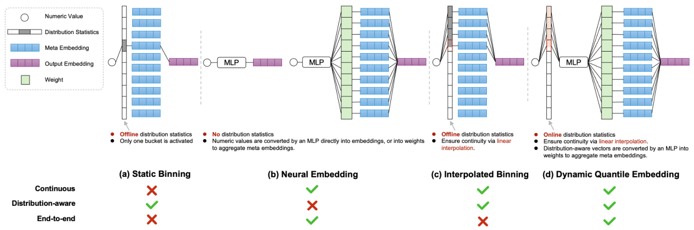
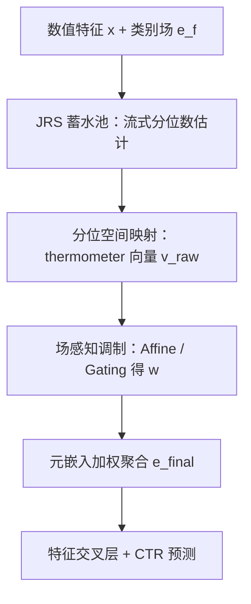

# Distribution-Aware End-to-End Embedding for Streaming Numerical Features in Click-Through Rate Prediction (面向CTR预测流式数值特征的分布感知端到端嵌入)

- **会议/期刊**: KDD 2026 (Under Review)
- **作者与机构**: Jiahao Liu, Hongji Ruan, Weimin Zhang 等；复旦大学、北京交通大学、腾讯
- **推荐链路定位**: 精排
- **研究方向**: CTR/CVR 预估与特征交叉 / 工业架构与流式系统
- **论文原文**: [arXiv:2602.03223v1](https://arxiv.org/abs/2602.03223v1)
- **开源代码**: 暂未开源

## TL;DR (1分钟核心速览)

针对流式CTR中静态分箱语义漂移、神经嵌入丢失分布、DAE依赖i.i.d.分位数且非平稳流下有偏的痛点，DAES用跳采样蓄水池做全局分位估计，在分位空间构造thermometer编码，并以场感知仿射/门控调制元嵌入；在Criteo/AutoML/工业数据按时序单遍训练，AUC较PLE提升0.24%–0.37%，线上ARPU+2.307%。

## Background & Motivation (背景与核心矛盾)

- **主流范式**: 数值特征嵌入分四类：静态分箱、神经嵌入、插值分箱、动态分位嵌入。工业CTR精排仍以EFD/LD等静态分箱为主，学术SOTA为PLE与DAE。
- **前人局限**: 静态分箱依赖离线统计，两阶段更新桶边界会引发**语义漂移**；神经嵌入端到端但丢弃显式分布，易表征坍缩；DAE用批内顺序统计量估分位，依赖i.i.d.，非平稳流下产生系统偏差，且值空间插值忽略局部密度。
- **核心洞察 (Key Insight)**: 流式数据虽非平稳，但维护全流均匀蓄水池可得到CDF的一致估计；在分位空间编码能同时保留序关系与累积密度；场上下文应做**自适应调制**而非逐场建模，避免组合爆炸。
- **本文切入点**: 跳采样蓄水池（JRS）估全局分位 + 分位空间thermometer编码 + 场感知元嵌入调制。

图2直观对比四类数值嵌入范式：静态分箱、神经嵌入、插值分箱与动态分位嵌入。
<figure class="paper-figure" markdown="span">
  <figcaption>图2：不同数值特征嵌入范式的比较。(a) 静态分箱：通过离线统计将值映射到离散桶。(b) 神经嵌入：通过可微神经层变换值。(c) 插值分箱：利用静态桶通过线性插值聚合元嵌入。(d) 动态分位数嵌入：利用在线估计的分位数生成分布感知权重。</figcaption>
</figure>

## Method (核心方法设计)

### 1. 整体框架 (Overall Architecture)

DAES将数值特征嵌入拆为三步：先用JRS维护固定大小蓄水池，按全局流式样本估计$M-1$个分位点；再将$x$映射到分位坐标$\hat{p}$并展开为$M$维thermometer向量$v_{raw}$；最后用类别场$e_f$生成仿射或门控权重$w$，对$M$个元嵌入加权求和得$e_{final}$，送入任意CTR主干。训练用BCE，单遍流式更新；推理仅$O(M)$聚合，蓄水池更新为对数级。

### 2. 关键设计拆解 (Key Designs)

1. **JRS流式分位估计**：DAE用批内顺序统计量，依赖i.i.d.，非平稳流下系统有偏。DAES维护均匀蓄水池$R_t$，任一历史样本保留概率$m/t$，CDF估计$\hat F_t(x)=m^{-1}\sum_{r\in R_t}\mathbb{I}(r\le x)$一致收敛；跳采样按$S(\delta)=(t/(t+\delta))^m$直接采样下次替换间隔$\Delta=\lfloor t(U^{-1/m}-1)\rfloor$，把逐样本随机数调用降到约3%–4%。直觉：全局蓄水池逼近真实流分布，避免局部批偏差。

2. **分位空间thermometer编码**：值空间欧氏距离忽略密度，稀疏区被过度拉伸。DAES先算$\hat p=j/M+\frac{1}{M}\frac{x-q_j}{q_{j+1}-q_j}$，再构造$v_{raw}=[1,\ldots,1,w,0,\ldots,0]^\top$，其中$w=(x-q_j)/(q_{j+1}-q_j)$。它同时保留序关系与累积密度，且对异常值更稳。

3. **场感知分布调制与训练目标**：直接按场建模分布会组合爆炸。门控版$w=\beta(v_{raw}\odot\sigma(W_{gate}e_f))+(1-\beta)v_{raw}$；仿射版用$W_{mod}=\mathrm{Reshape}(W_{tran}e_f)$生成$M\times M$矩阵调制；最终$e_{final}=w^\top E$。$\beta$控制场上下文强度；在嵌入层先校准，减轻后续交叉层负担。训练目标为BCE+L2，CTR全曝光样本训练，无需负采样；推理仅$O(M)$。

## Experimental Setup & Evaluation Protocol (实验设置与评估协议)

- **数据集与预处理**: 原文正文未给出用户/物品/交互统计；三个数据集均按曝光时间排序，数值特征呈非平稳分布。

| 数据集 | #Users | #Items | #Interactions | 稀疏度/密度 | 特征/场景说明 |
| :--- | :---: | :---: | :---: | :---: | :--- |
| Criteo | 未披露 | 未披露 | 未披露 | 未披露 | 26类别+13数值，按时序流式 |
| AutoML | 未披露 | 未披露 | 未披露 | 未披露 | 公开CTR基准，非平稳分布 |
| Industrial | 数亿DAU | 未披露 | 未披露 | 未披露 | 短视频广告生产流 |

- **数据划分与防穿越 (Splitting Strategy)**: 按曝光时间排序并**单遍流式训练**；静态分箱/PLE用离线统计，DAE/DAES用在线估计。原文指出离线统计反而有利于基线。
- **排名评测协议 (Ranking Protocol)**: CTR点式**全曝光评估**，用AUC与LogLoss；非Top-K采样排序，无负采样。
- **对比基线与超参设置**: 四类13个基线（EFD/LD/TD/MultiHot、YouTube/DLRM/FE/AutoDis/NaryDis/Key-Value/DEER、PLE、DAE），六种主干（FNN/W&D/DeepFM/IPNN/DCNv2/xDeepFM）。$d=16$，$M=10$，MLP$(128,32,8)$，batch 8192，蓄水池$10^5$，$\beta=0.5$；5次独立运行，双尾无配对t检验。

## Key Experimental Results (实验关键数据)

### 1. 主实验对比 (Main Results)

以DeepFM为主干的三数据集结果（AUC越高越好，LogLoss越低越好；加粗为列最优）：

| 方法 (DeepFM) | AutoML AUC | AutoML LogLoss | Criteo AUC | Criteo LogLoss | Industrial AUC | Industrial LogLoss |
| :--- | :---: | :---: | :---: | :---: | :---: | :---: |
| EFD | 0.8194 | 0.0698 | 0.7858 | 0.4663 | 0.7559 | 0.2662 |
| MultiHot | 0.8268 | 0.0693 | 0.7861 | 0.4662 | 0.7562 | 0.2663 |
| AutoDis | 0.8247 | 0.0694 | 0.7838 | 0.4682 | 0.7557 | 0.2669 |
| NaryDis | 0.8281 | 0.0692 | 0.7858 | 0.4661 | 0.7557 | 0.2663 |
| PLE | 0.8308 | 0.0689 | 0.7877 | 0.4641 | 0.7576 | 0.2643 |
| DAE | 0.8251 | 0.0696 | 0.7854 | 0.4665 | 0.7547 | 0.2666 |
| DAESgate | **0.8339** | **0.0686** | 0.7894 | 0.4624 | 0.7593 | **0.2623** |
| DAEStran | 0.8324 | 0.0687 | **0.7896** | **0.4622** | **0.7597** | **0.2623** |
| **Improv. vs PLE** | **+0.373%** | **-0.435%** | **+0.241%** | **-0.409%** | **+0.277%** | **-0.757%** |

### 2. 消融实验 (Ablation Study)

Criteo的I3/I5数值特征上，不同分布估计的KL散度与随机数调用：

| 分析项 | I3 KL | I5 KL | 随机数调用 | 结论 |
| :--- | :---: | :---: | :---: | :--- |
| OS (DAE) | $5.97\times10^{0}$|$1.95\times10^{-1}$ | — | 非IID下有偏 |
| RS | $2.46\times10^{-4}$|$4.54\times10^{-4}$|$2.93\times10^7$/$3.62\times10^7$ | 更接近真实分布 |
| JRS | $1.60\times10^{-4}$|$5.91\times10^{-4}$|$1.05\times10^6$/$1.09\times10^6$ | 精度近RS，调用大降 |

其他消融：分位空间插值优于值空间插值；$\beta=0.5$的场感知调制显著优于未调制；用Kruskal-Wallis与Wasserstein筛选的显著特征做调制，优于非显著特征。

### 3. 关键实验发现 (Key Findings)

1. **跨数据集稳定增益**：DeepFM上DAES三数据集AUC均超最强基线PLE，AutoML +0.373%、Criteo +0.241%、Industrial +0.277%，LogLoss同步降0.41%–0.76%，说明显式分布先验+场感知调制并非单数据集偶然。
2. **流式估计更稳**：I3 KL从OS的$5.97$降至JRS的$1.60\times10^{-4}$，I5从$1.95\times10^{-1}$降至$5.91\times10^{-4}$；JRS随机数调用仅为RS的约3%–4%，证明非IID流下全局蓄水池比批内顺序统计更稳且工程可承受。
3. **扩展性与线上价值**：$M$从10增至50时DAES稳定/微升而AutoDis下降；数值特征从13个逐步加入时DAES持续获益；7天线上A/B的ARPU +2.307%，验证工业价值。

## Highlights & Limitations (亮点、对比与审稿批判)

- **与代表作对比 (vs. Prior Work)**: PLE依赖离线分位数，精度高但非端到端且会漂移；DAE虽端到端，却依赖i.i.d.批内顺序统计且值空间插值忽略密度；AutoDis无显式分布先验。DAES把“流式全局分布+分位空间+场感知调制”统一进嵌入层。
- **可迁移亮点**: JRS可直接用于其他流式统计特征（点击率、时长、价格分布）的在线分位估计；thermometer分位编码可迁移到序列推荐与多模态数值特征。
- **审稿级局限批判**: 全局蓄水池对概念漂移存在滞后，论文未给出延迟/内存的线上量化；$m$、$M$、$\beta$及调制特征选择仍需调参，且代码未开源；评测仅AUC/LogLoss，缺少校准与推理延迟对比。

## Rating (四维评分)

- **方法创新性 (Novelty)**: ⭐⭐⭐⭐ （分位空间编码+场感知调制组合新颖，蓄水池一致性为流式非IID提供理论支撑）
- **评估协议与实验扎实度 (Protocol & Experiments)**: ⭐⭐⭐⭐ （三数据集六主干五种子t检验，含线上A/B；但公开数据统计与延迟细节不足）
- **写作与数学规范度 (Clarity & Rigor)**: ⭐⭐⭐⭐ （公式与跳采样推导清晰；部分符号和超参解释放在附录）
- **工业落地与复现价值 (Industrial & Practical Value)**: ⭐⭐⭐⭐⭐ （已部署数亿DAU平台，ARPU+2.307%，即插即用；代码未开源略降复现性）

