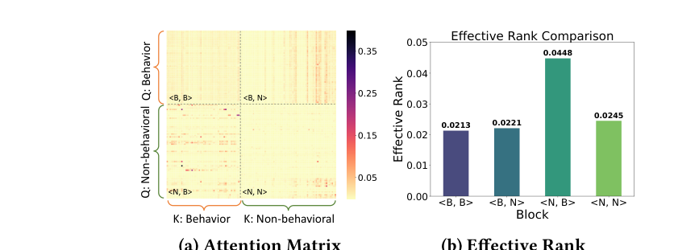
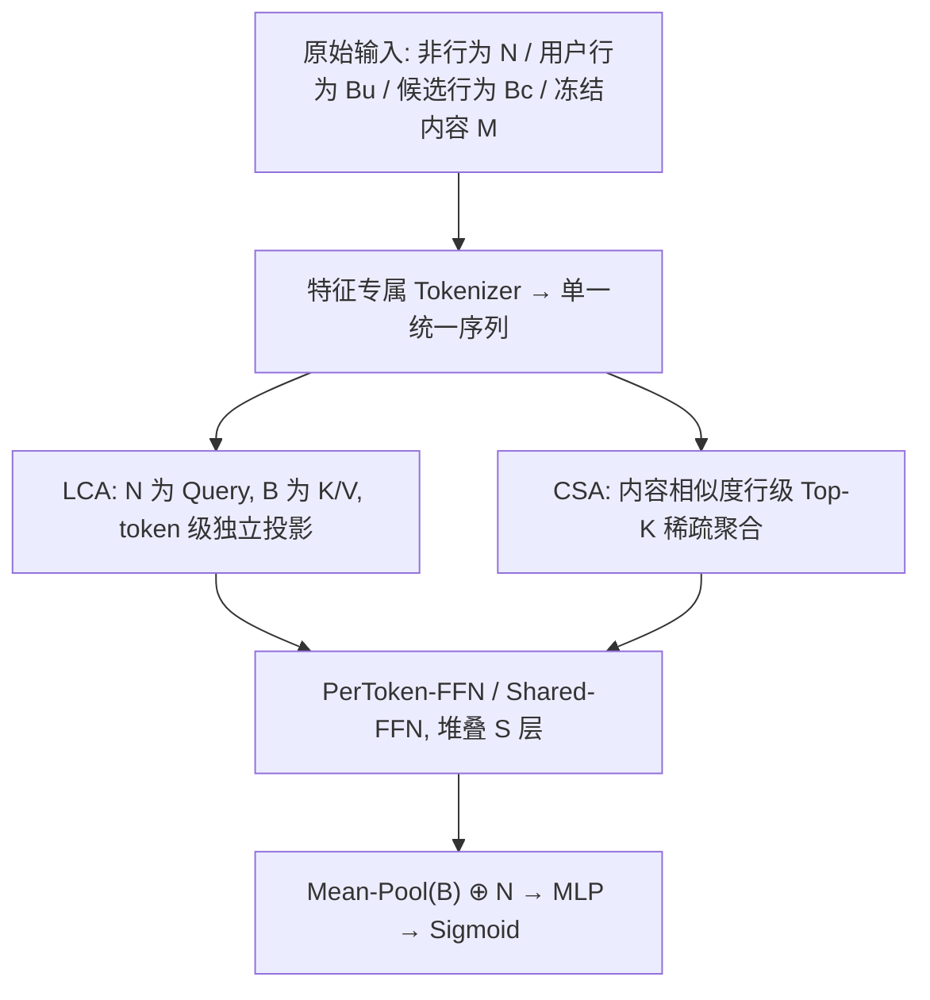
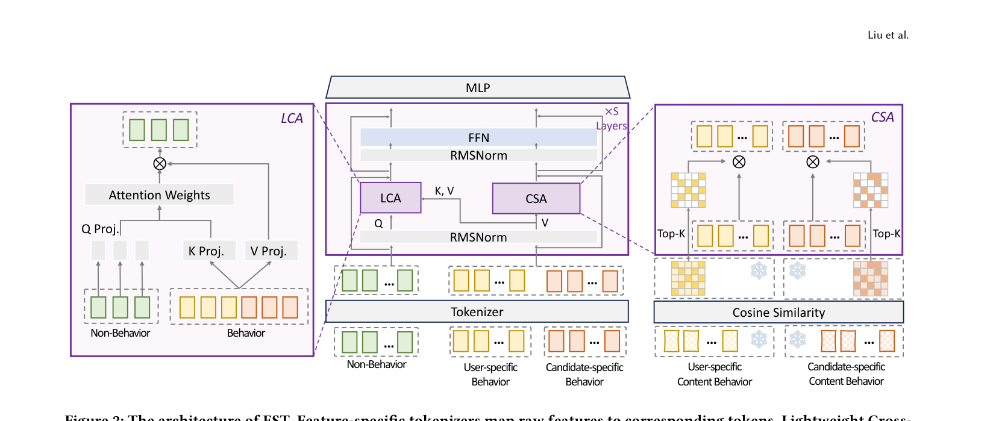

# EST: Towards Efficient Scaling Laws in Click-Through Rate Prediction via Unified Modeling (面向点击率预估高效缩放律的统一建模)

- **会议/期刊**: KDD 2026
- **作者与机构**: Mingyang Liu, Yong Bai, Zhangming Chan 等（阿里巴巴淘天集团）
- **推荐链路定位**: 精排（排序阶段 CTR 预估）
- **研究方向**: CTR/CVR 预估与特征交叉 / 序列推荐
- **论文原文**: [https://arxiv.org/abs/2602.10811v2](https://arxiv.org/abs/2602.10811v2)
- **开源代码**: 暂未开源

## TL;DR (1分钟核心速览)

工业 CTR 模型受毫秒级延迟约束，长期沿用"先聚合行为再建模"的分层范式，导致 token 级细粒度信号被压缩、scaling 收益被封顶。本文提出 EST，把非行为特征、用户行为、候选行为与冻结内容特征放进**同一条序列**做全统一建模，用轻量交叉注意力（LCA）只保留高信息密度的 $\langle N,B\rangle$ 交互、用内容稀疏注意力（CSA）以语义相似度动态筛行为。在淘宝 10 亿曝光日志上，AUC 0.6963（+0.99%）、GAUC 0.6515（+0.87%），算力仅为 OneTrans-F 的 35%，并呈现可预测的幂律缩放；线上 Guess 场景 CTR +1.22%、RPM +3.27%。

## Background & Motivation (背景与核心矛盾)

- **主流范式**: 分层建模（DIN/LONGER/MTGR 等）先将行为序列压缩为定长向量再与特征交叉；统一建模（OneTrans 等）虽把特征与行为拼接为单序列，却仍对候选特定行为做池化。
- **前人局限一**: 早期聚合造成**信息瓶颈**，丢弃对 scaling 至关重要的 token 级细粒度信号，模型加深加宽后收益迅速饱和。
- **前人局限二**: 标准全自注意力在 $10^3$ token 量级的工业输入上呈二次复杂度，且大量行为-行为交互近乎无效，算力被浪费在低回报算子上。
- **核心洞察 (Key Insight)**: 作者将 CTR 输入与 LLM 对齐后发现两点本质差异——(1) **信息密度不对称**：简洁高信号的非行为特征 $N$需与海量低密度行为$B$交互，有效秩 (effective rank) 分析显示$\langle N,B\rangle$ 块 erank 达 0.0448，其余块仅 0.021~0.025，注意力分布塌缩；(2) **模态特异性先验**：内容信号（图/文）直接当 token 注入反而次优，作为**相似度关系**使用收益最大（SimTier +1.18% AUC vs. Side Information +0.44%）。
- **本文切入点**: 以"信息密度即交互优先级"为归纳偏置设计稀疏化骨干，把缩放潜力与序列长度解耦。

<figure class="paper-figure" markdown="span">
  <figcaption>图3：注意力矩阵的可视化与有效秩。为清晰起见，仅展示候选特定行为 token 和非行为 token 的注意力分布，因为用户特定行为呈现与候选特定行为相似的模式。</figcaption>
</figure>

## Method (核心方法设计)

### 1. 整体框架 (Overall Architecture)

EST 摒弃一切前置聚合：每个非行为特征经**特征专属 MLP** 映射为一个 token（支持 warm-start 热插拔扩特征），用户短期行为 $B_u$、GSU 召回的候选行为$B_c$各经序列专属 MLP 映射为行为 token，候选与行为的预训练内容向量经 lookup 得到并**全程冻结**。所有 token 拼成统一序列输入$S$层堆叠的 EST Block：每层内非行为 token 走 LCA（以$N$为 Query、$B$ 为 Key/Value）、行为 token 走 CSA（内容相似度驱动的稀疏聚合），二者并行后分别接 PerToken-FFN 与 Shared-FFN。末层对行为 token 均值池化、与非行为 token 拼接，经 MLP + Sigmoid 输出点击概率，交叉熵训练。

<figure class="paper-figure" markdown="span">
  <figcaption>图2：EST的架构。特征特定 tokenizer 将原始特征映射为相应 token。轻量级交叉注意力（LCA）捕捉非行为 token 与行为 token 之间的交互。内容稀疏注意力（CSA）计算序列内内容相似度，并在行为序列内执行稀疏注意力。</figcaption>
</figure>

### 2. 关键设计拆解 (Key Designs)

1. **Lightweight Cross-Attention (LCA)：砍掉冗余自交互，只留高增益跨特征依赖**
   块级掩码实验证明，屏蔽 $\langle B,B\rangle$、$\langle B,N\rangle$、$\langle N,N\rangle$仅掉 0.00%~0.03% AUC，而屏蔽$\langle N,B\rangle$掉 0.20%。据此 LCA 让非行为 token 独占 Query 位并配 token 级独立参数$W_Q,W_O\in\mathbb{R}^{L_N\times d\times d}$（保留异构特征的个性化表达），行为侧仅用共享$W_K,W_V\in\mathbb{R}^{d\times d}$：
   $\mathrm{LCA}(N,B)=\phi\!\left(\mathrm{Softmax}\!\left(\frac{Q_NK_B^\top}{\sqrt{d}}\right)V_B,\;W_O\right)$注意力复杂度由$O((L_N+L_B)^2 d)$降为双线性$O(L_NL_Bd)$；因$B_u$与候选无关，其$B_uW_K,B_uW_V$ 可在一次请求内跨候选复用，形成 user-candidate 解耦的推理加速。

2. **Content Sparse Attention (CSA)：把内容特征当"关系先验"而非 token**
   用冻结内容向量构造序列内相似度矩阵 $G_\gamma=M_\gamma M_\gamma^\top$，行级取 Top-$K$（全程$K=5$）得索引集$\Omega_\gamma$，直接以相似度作注意力权重聚合 ID token：
   $O_{B_\gamma}[i]=\sum_{j\in\Omega_\gamma} G_\gamma[i,j]\,b_{\gamma,j}$该模块**零可学习参数、免反向传播**，$G_\gamma$与稀疏索引可并行预计算并被所有层复用；复杂度从$O(L_B^2d)$降至$O(L_BKd)$，随序列长度线性增长。直觉是让 ID 共现关系与内容语义关系互补，且稀疏化本身起到去噪正则作用（非稀疏版反而更差）。

3. **训练目标与工业部署策略**
   损失为标准交叉熵 $\mathcal{L}=-\sum_{u,c}[y\log\hat{y}+(1-y)\log(1-\hat{y})]$。部署上，稀疏 embedding 由已训练数万亿样本的线上模型热启，稠密参数从零训练；为突破"one-epoch limitation"采用异步多轮范式：每轮将稀疏参数重置回$\theta_s^{(0)}$，稠密参数$\theta_d^{(e)}$ 从上一轮继承（仅第 1 轮随机初始化），额外带来 0.44% GAUC。

## Experimental Setup & Evaluation Protocol (实验设置与评估协议)

- **数据集与预处理**: 淘宝展示广告生产日志抽样，含数百个异构特征；短期序列截断 300、终生序列 5000，GSU 取 Top-50 候选相关子序列。

| 数据集 | #Users | #Items | #Interactions | 稀疏度/密度 | 特征/场景说明 |
| :--- | :---: | :---: | :---: | :---: | :--- |
| Taobao-Base | 未披露 | 未披露 | >1B 曝光（6 天） | 未披露 | 主离线评测，全量异构特征 |
| Taobao-Large | 未披露 | 未披露 | >3.5B 曝光（同期） | 未披露 | 缩放律实验，特征更丰富 |

- **数据划分与防穿越 (Splitting Strategy)**: 原文未显式声明划分方式，采用六天连续生产日志采样（工业界常用按时间切分，存在轻微穿越风险，复现需谨慎）。
- **排名评测协议 (Ranking Protocol)**: 离线指标为 `AUC` 与 `GAUC`（用户内排序质量，与线上更一致，0.001 GAUC 视为显著提升），效率指标为稠密参数量 Params(M) 与单批 60 样本推理 `GFLOPs`；未使用采样负例，直接在生产曝光分布上评估。
- **对比基线与超参设置**: 对照传统 DNN（AutoInt、DCNv2）、可缩放分层（RankMixer、HiFormer）、可缩放统一（MTGR、OneTrans 及其 DIN 聚合变体 OneTrans-D、全序列变体 OneTrans-F）。所有可缩放基线共享 6 层、$d=128$、约 100M 参数的同等容量，学习率 0.0004，AdamW，32/128 PPU 分布式训练。

## Key Experimental Results (实验关键数据)

### 1. 主实验对比 (Main Results)

| 范式 | 方法 | AUC | ΔAUC | GAUC | ΔGAUC | Params(M) | GFLOPs |
| :--- | :--- | :---: | :---: | :---: | :---: | :---: | :---: |
| Base | MLP | 0.6895 | - | 0.6459 | - | 83.13 | 9.64 |
| 传统 DNN | AutoInt | 0.6907 | +0.18% | 0.6477 | +0.28% | 5.20 | 1.10 |
| 传统 DNN | DCNv2 | 0.6916 | +0.31% | 0.6482 | +0.35% | 15.18 | 1.49 |
| 分层 | RankMixer | 0.6914 | +0.28% | 0.6482 | +0.35% | 136.84 | 15.46 |
| 分层 | HiFormer | 0.6928 | +0.49% | 0.6493 | +0.53% | 113.78 | 14.17 |
| 统一 | MTGR | 0.6917 | +0.32% | 0.6474 | +0.23% | 118.79 | 10.57 |
| 统一 | OneTrans | 0.6921 | +0.38% | 0.6477 | +0.27% | 111.98 | 15.94 |
| 统一 | OneTrans-D | 0.6941 | +0.68% | 0.6500 | +0.64% | 112.06 | 16.19 |
| 统一 | OneTrans-F | 0.6955 | +0.87% | 0.6507 | +0.75% | 110.54 | 52.79 |
| **统一** | **EST** | **0.6963** | **+0.99%** | **0.6515** | **+0.87%** | 103.81 | 18.48 |

### 2. 消融实验 (Ablation Study)

| 配置 | ΔAUC | ΔGAUC | ΔGFLOPs |
| :--- | :---: | :---: | :---: |
| Full-Attention（全自注意力统一建模） | 0.6951 | 0.6506 | 66.27 |
| w/ LCA only（去 CSA） | -0.01% | -0.03% | **-72.23%** |
| EST（LCA + CSA） | **+0.17%** | **+0.14%** | -72.11% |

### 3. 关键实验发现 (Key Findings)

1. **冗余交互的剥离几乎免费**：把全自注意力换成 LCA，算力骤降 72.23%（66.27→18.48 GFLOPs）而 GAUC 仅掉 0.03%，反证 $\langle N,B\rangle$ 之外的行为-行为交互确实近乎白算；再叠加 CSA 反超全注意力 0.14% GAUC，实现"更准且更省"。
2. **候选特定行为必须保真，稀疏化才救得回成本**：OneTrans 因池化候选行为落后 HiFormer（0.6477 vs. 0.6493）；改用 DIN 聚合的 OneTrans-D 升至 0.6500，全序列 OneTrans-F 再升至 0.6507 但算力暴涨至 52.79 GFLOPs；EST 以 18.48 GFLOPs 达 0.6515，用 35% 算力换来 0.12% GAUC 增益。
3. **稀疏即正则，且对低活用户更友好**：非稀疏 CSA（0.6951/0.6511）劣于 Top-5 CSA（0.6963/0.6515），$K\in\{5,20,60,100\}$ 性能稳定；分桶显示行为长度 <500 的低活用户 ΔGAUC 达 +0.1569%，说明内容语义相似度有效补偿了稀疏 ID 表征。

## Highlights & Limitations (亮点、对比与审稿批判)

- **与代表作对比 (vs. Prior Work)**: 相较 HiFormer/RankMixer 的"先聚合后建模"，EST 全程不压缩、保留 token 级信号；相较 OneTrans/MTGR 的"部分统一"（候选行为仍池化），EST 用一个序列 + 两条非对称注意力通路完成全统一，并以 $O(L_NL_Bd)$ 双线性注意力替代二次自注意力，把候选行为保真与低延迟同时满足。
- **可迁移亮点**: (1) "有效秩 + 块级掩码"是低成本定位架构冗余的通用诊断法，可直接用于其他长序列排序模型；(2) 冻结内容特征仅做相似度矩阵 + Top-$K$ 稀疏、免梯度复用，可作为多模态信号注入的轻量替代方案。
- **审稿级局限批判**: (1) 仅报告单一工业数据集（淘宝）与自研 PPU 环境，缺少公开基准（如 Avazu/Criteo）与开源代码，复现与公平性存疑；(2) 数据划分方式未明示，存在时间穿越隐患；Top-$K$ 与层数/维度交互、稀疏 embedding 热启依赖已有生产大模型，冷启动业务难以照搬。

## Rating (四维评分)

- **方法创新性 (Novelty)**: ⭐⭐⭐⭐ （以有效秩刻画"信息密度不对称"并推导出非对称注意力，归纳偏置推导链清晰，但模块本身仍属稀疏/交叉注意力的工程组合）
- **评估协议与实验扎实度 (Protocol & Experiments)**: ⭐⭐⭐ （10 亿级工业数据 + 线上 A/B + 幂律拟合扎实，但仅单平台单数据集、划分协议未披露、无开源与显著性检验）
- **写作与数学规范度 (Clarity & Rigor)**: ⭐⭐⭐⭐ （洞察—设计—复杂度三段论证闭环，公式与复杂度对比简洁；部分符号与 tokenizer 细节需回原文查表）
- **工业落地与复现价值 (Industrial & Practical Value)**: ⭐⭐⭐⭐⭐ （LCA 的 user-candidate 解耦复用、CSA 的免梯度预计算与稀疏热启多轮训练，都是可直接搬进生产链路的高价值工程经验，线上 +3.27% RPM 背书）

