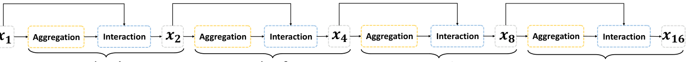
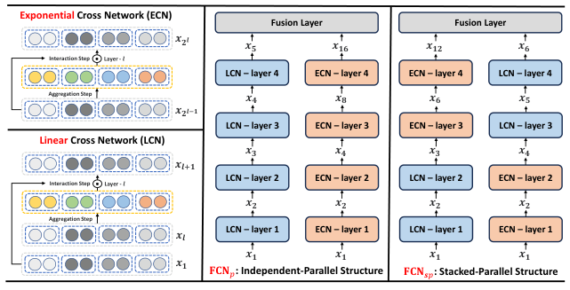
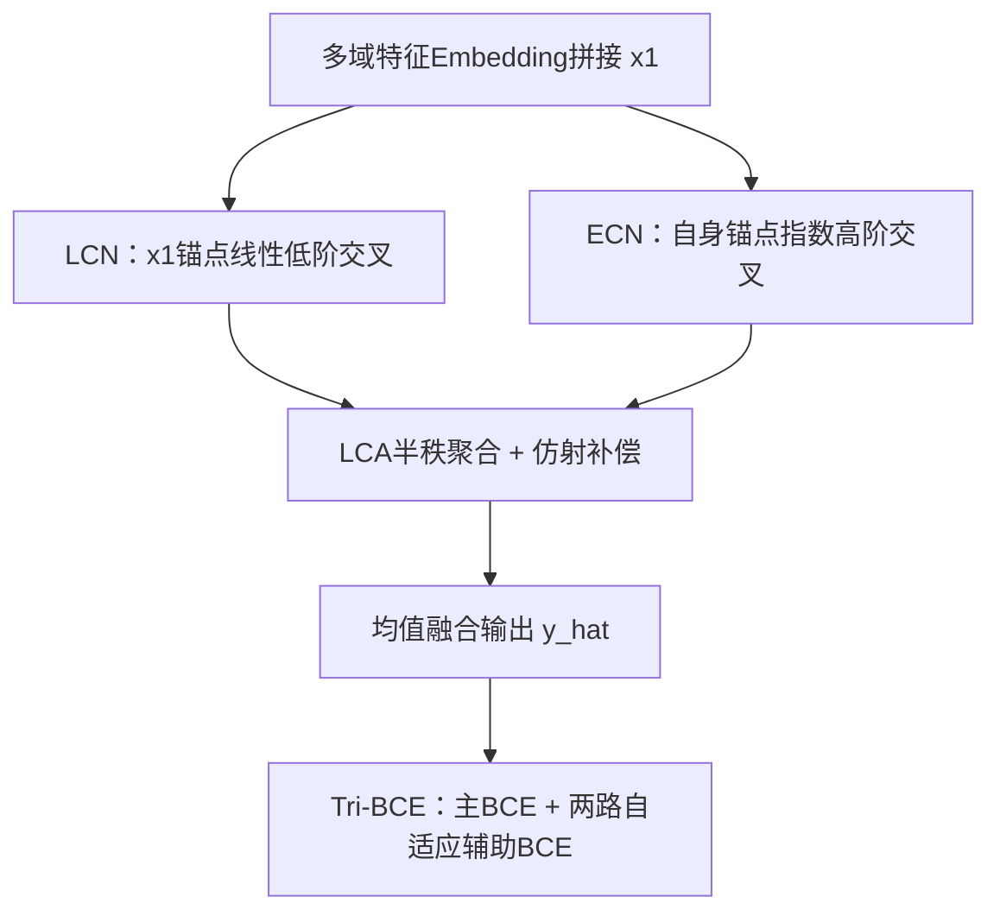

# FCN: Fusing Exponential and Linear Cross Network for Click-Through Rate Prediction (融合指数与线性交叉网络的点击率预测)

- **会议/期刊**: KDD 2026
- **作者与机构**: Honghao Li, Yiwen Zhang, Yi Zhang, Hanwei Li, Lei Sang（安徽大学）；Jieming Zhu（华为诺亚方舟实验室）
- **推荐链路定位**: 精排（CTR 预估）
- **研究方向**: CTR/CVR 预估与特征交叉
- **论文原文**: [https://arxiv.org/abs/2407.13349v8](https://arxiv.org/abs/2407.13349v8)
- **开源代码**: [https://github.com/salmon1802/FCN](https://github.com/salmon1802/FCN)

## TL;DR (1分钟核心速览)

针对 DCN 系列依赖 DNN 隐式高阶、CrossNet 聚合冗余且锚点固定导致阶数线性增长的问题，本文提出 FCN：用 LCN 保留低阶、ECN 将锚点改为 $\mathbf{x}_{2^{l-1}}$实现指数高阶，并以半秩 LCA 降参与 Tri-BCE 分路监督。六数据集样本级 AUC/Logloss 评估中，FCN$_{sp}$ 较最强基线平均 AUC +0.25%、Logloss -0.19%，无需 DNN 即达 SOTA。

## Background & Motivation (背景与核心矛盾)

- **主流范式**: DCN 系列以 CrossNet 显式建模低阶交叉，再用 DNN 隐式学习高阶交叉，兼顾效率与效果。
- **前人局限**: 显式交叉效果常弱于 DNN，整体性能被 DNN 主导；CrossNetv2 的聚合矩阵存在近半低奇异值冗余，且每层固定与一阶 $\mathbf{x}_1$交互，$L$层最多仅$L+1$ 阶；高阶交叉中的噪声与多分支监督缺失亦被忽视。
- **核心洞察 (Key Insight)**: SVD 显示 CrossNetv2 约一半参数子空间利用不足；若把交互锚点从 $\mathbf{x}_1$改为上一层自身$\mathbf{x}_{2^{l-1}}$，阶数可由线性增长变为$2^l$ 指数增长。图2直观对比了线性与指数阶数增长。
- **本文切入点**: 用 LCN 保低阶、ECN 捕极高阶，配合 LCA 半秩聚合与 Tri-BCE 子网监督，构建不依赖 DNN 的“真 deep cross”网络。

<figure class="paper-figure" markdown="span">
  <figcaption>图2：线性增长与指数增长的特征交互方法比较。</figcaption>
</figure>

## Method (核心方法设计)

### 1. 整体框架 (Overall Architecture)

多域 one-hot 特征经 Embedding 拼接为 $\mathbf{x}_1$；LCN 按线性阶数迭代，ECN 按指数阶数迭代，两路经均值融合输出$\hat{y}$。LCA 嵌入每个交叉层，将聚合权重降半并用仿射补偿；Tri-BCE 仅在训练期为两路加自适应辅助 BCE。部署可选 FCN$_p$并行结构（捕获$[1,2,3,4,5,8,16]$阶）或 FCN$_{sp}$堆叠并行结构（捕获$[1,2,3,4,5,6,12]$ 阶），推理仅走主融合头。

<figure class="paper-figure" markdown="span">
  <figcaption>图4：FCN𝑝 和 FCN𝑠𝑝 建模过程的示例。</figcaption>
</figure>

### 2. 关键设计拆解 (Key Designs)

1. **低开销聚合 LCA（半秩掩码/降参）**：痛点源于聚合矩阵近半奇异值偏低；做法是把 $W_{l,i,j}$由$d\times d$降为$d/2\times d$，聚合后做仿射并拼接回$d$维：$c_{l,i}=\sum_j(W_{l,i,j}\mathbf{e}_{l,j}+b_{l,i,j})$，$\mathrm{LCA}(\mathbf{x}_l)=[c_{l,i}\|(\gamma_{l,i}\odot c_{l,i}+\beta_{l,i})]$。直觉是低秩压缩滤除无效子空间，仿射补偿保留表达，参数约降 50%、时延约降 23%。
2. **指数交叉 ECN + 线性交叉 LCN**：DCNv2 每层只与 $\mathbf{x}_1$交互，阶数线性增长；ECN 改为$\mathbf{x}_{2^l}=\mathbf{x}_{2^{l-1}}\odot\mathrm{LCA}(\mathbf{x}_{2^{l-1}})+\mathbf{x}_{2^{l-1}}$，递归乘加使 4 层可达 16 阶；LCN 保持$\mathbf{x}_{l+1}=\mathbf{x}_1\odot\mathrm{LCA}(\mathbf{x}_l)+\mathbf{x}_l$ 捕获低阶。直觉是高低阶显式分工，替代 DNN 的隐式高阶建模。
3. **Tri-BCE 与训练/推理**：若两路只共享主 BCE，梯度项相同，难以 specialization；本文用 $\mathcal{L}_{Tri}=\mathcal{L}+w_{exp}\mathcal{L}_{exp}+w_{lin}\mathcal{L}_{lin}$，$w_{exp}=\max(0,\mathcal{L}_{exp}-\mathcal{L})$，$w_{lin}=\max(0,\mathcal{L}_{lin}-\mathcal{L})$，仅当子网落后融合头时加权。训练为样本级 BCE，负样本即曝光未点击，无额外负采样；推理不计辅助损失，ECN 显式复杂度约$O(D^2L/2)$。

## Experimental Setup & Evaluation Protocol (实验设置与评估协议)

- **数据集与预处理**: CTR 样本级建模，非 user-item 矩阵；类别特征设 OOV 阈值（Criteo/KDD12/KKBox 为 10，Avazu/iPinYou 为 2，ML-1M 为 1），数值特征取 $\lfloor\log_2 x\rfloor$。

| 数据集 | #Instances | #Fields | #Features | 稀疏度/密度 | 场景说明 |
| :--- | :---: | :---: | :---: | :---: | :--- |
| Avazu | 40,428,967 | 24 | 3,750,999 | 高维稀疏，未报告矩阵密度 | 移动广告曝光 |
| Criteo | 45,840,617 | 39 | 910,747 | 高维稀疏 | 展示广告 |
| ML-1M | 739,012 | 7 | 9,751 | 较小规模 | 电影推荐 |
| KDD12 | 141,371,038 | 13 | 4,668,096 | 超大规模稀疏 | 广告点击 |
| iPinYou | 19,495,974 | 16 | 665,765 | 高维稀疏 | 实时竞价 |
| KKBox | 7,377,418 | 13 | 91,756 | 中等稀疏 | 音乐订阅 |
| Industrial | ≈10 Billion | ≈200 | — | 工业超大规模 | 两核心业务域 |

- **数据划分与防穿越 (Splitting Strategy)**: 六个公开集沿用开源 benchmark 的实例级划分；原文未披露具体比例、随机种子与是否全局时间切分，存在复现细节缺口。工业数据前 7 天训练、第 8 天验证，属时间切分。
- **排名评测协议 (Ranking Protocol)**: 非全库未交互排序；在曝光样本上做二分类，报告 Logloss 与 AUC；负样本为曝光未点击，无额外负采样候选集。
- **对比基线与超参设置**: 对比 DNN、PNN、Wide&Deep、DeepFM、DCNv1/v2、xDeepFM、AutoInt*、AFN*、EDCN、MaskNet、EulerNet、FinalMLP、FINAL、RFM、DLF 等 16 个基线；Embedding 维度 KKBox 为 128、其余为 16；Adam，lr=0.001，batch=4096/10000，early stopping patience=2；对最强基线做双尾 T 检验，$p<1e-3$。

## Key Experimental Results (实验关键数据)

### 1. 主实验对比 (Main Results)

AUC(%)↑，最佳值加粗；ΔAUC 为 FCN 相对最强基线的绝对点提升。

| 模型 | Avazu | Criteo | ML-1M | KDD12 | iPinYou | KKBox |
| :--- | :---: | :---: | :---: | :---: | :---: | :---: |
| DNN | 79.27 | 81.40 | 90.30 | 80.52 | 78.06 | 85.01 |
| DeepFM | 79.30 | 81.43 | 90.51 | 80.60 | 77.94 | 85.31 |
| DCNv2 | 79.31 | 81.45 | 90.56 | 80.59 | 78.26 | 85.31 |
| EDCN | 79.35 | 81.44 | 90.48 | 80.62 | 77.93 | 85.27 |
| EulerNet | 79.22 | 81.47 | 90.44 | 80.78 | 78.30 | 84.27 |
| FinalMLP | 79.35 | 81.45 | 90.52 | 80.78 | 78.02 | 85.10 |
| FINAL | 79.41 | 81.49 | 90.53 | 80.74 | 78.13 | 85.14 |
| DLF | 79.31 | 81.40 | 90.52 | 80.81 | 78.09 | 85.07 |
| ECN | 79.68 | 81.56 | 90.67 | 80.88 | 78.50 | 85.59 |
| FCN$_p$ | 79.66 | 81.60 | **90.82** | **80.99** | 78.48 | 85.67 |
| FCN$_{sp}$ | **79.72** | **81.63** | 90.67 | 80.96 | **78.52** | **85.74** |
| ΔAUC(pt) | +0.29 | +0.14 | +0.26 | +0.18 | +0.22 | +0.39 |

FCN 最优 Logloss：Avazu 0.3693、Criteo 0.4357、ML-1M 0.2975、KDD12 0.1494、iPinYou 0.005529、KKBox 0.4754；平均 Logloss 较最强基线下降 0.19%。

### 2. 消融实验 (Ablation Study)

| 变体 | Criteo Logloss↓/AUC↑ | iPinYou Logloss↓/AUC↑ | KKBox Logloss↓/AUC↑ |
| :--- | :---: | :---: | :---: |
| w/o LCN | 0.4362 / 81.58 | 0.005534 / 78.48 | 0.4758 / 85.70 |
| w/o ECN | 0.4367 / 81.53 | 0.005537 / 78.17 | 0.4826 / 85.39 |
| w/o Tri-BCE | 0.4367 / 81.55 | 0.005530 / 78.45 | 0.4777 / 85.56 |
| FCN$_{sp}$ | **0.4357 / 81.63** | **0.005529 / 78.52** | **0.4754 / 85.74** |

### 3. 关键实验发现 (Key Findings)

- FCN$_{sp}$在 6/6 数据集取得最高 AUC（79.72/81.63/90.67/80.96/78.52/85.74），平均 AUC +0.25%、Logloss -0.19%；但 ML-1M 与 KDD12 由 FCN$_p$ 更优（90.82/80.99），说明并行/堆叠结构需按数据所需阶数选择。
- ECN 是主增益来源：去掉 ECN 使 Criteo 81.63→81.53、KKBox 85.74→85.39（-0.35）；去掉 LCN 仅降至 81.58/85.70，说明 LCN 与 ECN 互补而非冗余。去掉 Tri-BCE 也降至 81.55/85.56（KKBox -0.18），验证分路监督有效。
- LCA 的效率收益显著：ECN 参数 1.56M→0.78M、时延 3.62ms→2.85ms；FCN$_p$参数 3.51M→1.76M、时延 6.54ms→5.11ms，AUC 基本不降。Tri-BCE 仅增加训练开销（FCN$_{sp}$ 较 ECN 约 +31s/epoch），不影响推理。

## Highlights & Limitations (亮点、对比与审稿批判)

- **与代表作对比 (vs. Prior Work)**: 相比 DCNv2，ECN 仅改锚点 $\mathbf{x}_1\to\mathbf{x}_{2^{l-1}}$就把阶数从线性提升到指数，并用 LCA 将聚合矩阵半秩化；相比 FinalMLP/FINAL/DLF 等依赖 DNN 或并行 DNN 的模型，FCN 纯显式交叉即达 SOTA；相比 GDCN 等，ECN 显式复杂度约$O(D^2L/2)$，约为其 1/4。
- **可迁移亮点**: 锚点调度（$\mathbf{x}_1$vs$\mathbf{x}_{2^{l-1}}$）可直接插入任意 CrossNet 变体；LCA 的半秩+仿射压缩可迁移到双线性交叉/注意力聚合层；Tri-BCE 的自适应辅助损失适合多分支推荐模型。
- **审稿级局限批判**: 公开集划分比例、随机种子与多轮方差未充分披露，T 检验之外的复现一致性不足；指数高阶在极稀疏特征上可能放大噪声，FCN$_p$/FCN$_{sp}$ 与层深需按数据调参；工业验证仅两域离线日志，缺少在线 A/B 与延迟/内存全链路报告。

## Rating (四维评分)

- **方法创新性 (Novelty)**: ⭐⭐⭐⭐ （锚点改为 $\mathbf{x}_{2^{l-1}}$ 的指数交叉极简但有效，SVD 动机与阶数分析扎实）
- **评估协议与实验扎实度 (Protocol & Experiments)**: ⭐⭐⭐⭐ （六数据集、16 基线、T 检验与工业日志较完整，但划分/种子细节不足）
- **写作与数学规范度 (Clarity & Rigor)**: ⭐⭐⭐⭐ （聚合/交互分解清晰，公式紧凑；$2l$与$2^l$ 的符号表述易误读）
- **工业落地与复现价值 (Industrial & Practical Value)**: ⭐⭐⭐⭐ （开源代码与日志齐全，LCA 半参/低时延，缺在线 A/B 仍限制最终定论）

